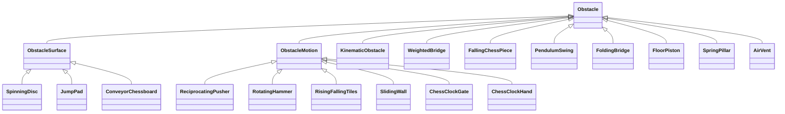

# 장애물 클래스와 Inspector — R70 (2026-10-10)

테스트 씬의 15종은 각각 전용 클래스를 갖고, 모두 `ChessFight.Gameplay.Obstacle`을 공통 조상으로 상속한다. 부모에 모든 물리 수치를 모으지 않는다. 새 클래스의 조절값은 private `[SerializeField]`이며, 이미 전용 클래스였던 7종은 기존 Inspector 필드 이름과 값을 유지한다.

## 이전 구조와 바뀐 역할

이전 `ObstacleSurface`는 `kind`로 원판·점프 패드·컨베이어를 고르는 하나의 클래스였다. 세 종류의 설정과 배열, 원판 운반, 발사 판정, 컨베이어 표시가 섞여 있어 원판에서도 점프 높이가 보였다. `ObstacleMotion`도 이동·회전·문 개폐를 `kind`로 구분했다.

지금은 두 클래스가 **직접 붙일 수 없는 추상 부모**다. `kind`는 없고 실행할 동작은 자식 클래스가 정한다.

- `Obstacle`: 장애물 공통 타입과 공유 시계 접근. Rigidbody나 각 장애물의 수치를 강제하지 않는다.
- `ObstacleSurface`: context 활성 상태와 `IMovingSurface` 계약만 공통 처리. 원판의 `ISurfaceTransport`는 `SpinningDisc`에만 있다.
- `ObstacleMotion`: Rigidbody 설정·시간 함수 실행·탑승 속도 전달을 재사용한다. 축·거리·속도·주기·타격 수치는 자식이 갖는다.
- `KinematicObstacle`: 기존 `Obstacle`의 kinematic 이동 구현을 그대로 옮긴 부모. 기존 Spinner·Oscillator·Pendulum·MovingPlatform·OrbitPlatform·킹러시 이동 장치가 이를 상속한다. 기존 `phase` 데이터와 RequireComponent는 여기서 유지한다.
- `ObstacleImpact`: 충돌을 전달하고 캐릭터별 중복 피격을 막는 보조 컴포넌트. 힘·상승력·재피격 간격은 연결된 장애물에서 읽는다.
- `ChessClockHand`: 09번 체스 시계의 회전 바늘용 보조 자식 클래스. 문은 왕복 개폐, 바늘은 회전이므로 동작을 분리했다.

## 어디에서 조절하나

`ObstacleRagdollTest`를 열고 Hierarchy에서 해당 프리팹을 펼친다. 아래 오브젝트를 선택하면 Inspector에 전용 컴포넌트가 나온다. 여러 판/벽/문은 각각의 값을 편집한다. 영구 저장은 Play를 끈 상태에서 하고 씬을 저장한다.

| # | 장애물 / 클래스 | 선택할 오브젝트 | 주요 조절값 |
|---|---|---|---|
| 01 | 원판 / `SpinningDisc` | `01_SpinningDisc` | Diameter(m), Rotation Direction, Rotation Speed(°/초) |
| 02 | 점프 패드 / `JumpPad` | `02_JumpPad` | Jump Height(m), Air Move Speed(m/s), Air Acceleration(m/s²), Launch Cooldown |
| 03 | 왕복 밀대 / `ReciprocatingPusher` | `03_ReciprocatingPusher` 루트 | Move Speed(m/s, 최고 속도), Push Force, Lift, Hit Cooldown, Axis, Distance, Phase |
| 04 | 회전 해머 / `RotatingHammer` | `04_RotatingHammer` 루트 | Rotation Speed(°/초), Push Force, Lift, Hit Cooldown, Axis, Phase |
| 05 | 승강 타일 / `RisingFallingTiles` | `Lift tile …` 각각 | Axis, Distance, Period, Phase |
| 06 | 슬라이딩 벽 / `SlidingWall` | `Left/Right sliding wall` | Axis, Distance, Period, Phase, Strength, Lift, Hit Cooldown |
| 07 | 하중 다리 / `WeightedBridge` | `07_WeightedBridge` 루트 | Maximum Tilt, Tiles X/Z, Tile Size, Deck Thickness, Deck Mass, Return Spring/Damper, Maximum Angular Speed |
| 08 | 컨베이어 / `ConveyorChessboard` | `08_ConveyorChessboard` | Direction, Conveyor Speed, Belt Length, Belt Markers |
| 09 | 체스 시계 문 / `ChessClockGate` | `Left/Right gate` | Axis, Distance, Period, Phase. `Clock hand`는 별도 회전 속도 |
| 10 | 낙하 기물 / `FallingChessPiece` | `10_FallingChessPiece` | Drop Height, Warning/Fall/Shock/Rest Seconds, Shock Radius, Knockback, Lift |
| 11 | 진자 공 / `PendulumSwing` | `Pivot` | Swing Angle/Duration, Pause At Ends, Knockback/Upward Force, Hit Cooldown |
| 12 | 접이식 다리 / `FoldingBridge` | `12_FoldingBridge` | Open/Warning/Fold/Closed Duration, Fold Angle, Right Delay |
| 13 | 바닥 피스톤 / `FloorPiston` | `13_FloorPiston` | Rise Height/Duration, Launch/Horizontal Force, 주기 |
| 14 | 스프링 기둥 / `SpringPillar` | `14_SpringPillar` | Extend Distance/Duration, Cooldown, Knockback/Upward Force |
| 15 | 바람 / `AirVent` | `15_AirVent` | Wind Strength/Direction, Max Push Speed, 지상·공중 배율, 주기 |

Phase는 이식 장치에서 **주기의 비율**이고, 기존 `KinematicObstacle`의 Phase는 **초**다. 서로 다른 원래 동작을 보존했으므로 혼동하지 않는다. 원판 45°/초·점프 높이 10m·컨베이어 3m/s 등 기존 프리팹 수치는 유지한다. 슬라이딩 벽과 시계 문은 기존 SmoothStep 개폐, 밀대와 승강 타일은 기존 사인 왕복이다.

## 연결과 검사

- 프리팹 9개와 기존 `ImportedChessFightMap`의 직접 부착 장치 29개를 새 스크립트 GUID로 교체했다. 15종 시험 씬은 같은 프리팹을 사용하므로 별도 재생성하지 않는다.
- 기존 오브젝트/컴포넌트 fileID, 배치, 콜라이더, 재질과 유지되는 수치는 보존했다. 피격 힘과 재피격 간격은 같은 fileID의 소유 장애물로 옮겼다. 기록된 이식 검사: 10개 에셋·50개 변경 컴포넌트, 이동 모드 41개 보존.
- 구조/직렬화 회귀 검사 **7개**: `PYTHONDONTWRITEBYTECODE=1 python3 -m unittest discover -s Tests/Gameplay -p 'test_*.py' -v`.
- 기존 Linux Core **83**, 모의 Steam 세션 **39**, 경계·시계·맵 JSON 검사 및 **7개 런타임 어셈블리 컴파일** 통과. Unity Editor 코드와 실제 PhysX 실행은 이 검사에 포함되지 않는다.
- **Unity import/Play·사용자 재확인 대기**: missing script, Inspector 항목, 15종 동작, 09번 문과 바늘, 기존 이식 맵, 기존 Spinner·이동 발판을 확인한다. 온라인 권한·상태형 장애물의 기존 제한은 동일하다.

코드: `Assets/Scripts/Gameplay/ImportedObstacles/`, 공통 부모와 기존 kinematic 계열: `Assets/Scripts/Gameplay/Obstacles/`.

## R71 — 기존 장애물 전체로 확장 (2026-10-10)

R70의 15종뿐 아니라 이식 장애물 18종 전체, 기존 일반 발판/밧줄/점멸 장치, 킹러시 장난감·성벽·하늘 코스 및 상태형 시소/결승판을 공통 `Obstacle` 체계로 정리했다. 이미 독립된 단일 기능 클래스는 기존 설정/API를 유지한다. 캐릭터·체크포인트·게임 규칙·충돌 전달·context 같은 보조 컴포넌트는 장애물 클래스로 바꾸지 않는다.

| 기존 묶음 | 현재 전용 클래스 | 자식에서 조절하는 값 |
|---|---|---|
| 장난감 Orbit | `KingRushOrbitPawn` | Radius |
| 장난감 RollingHead | `KingRushRollingHead` | Travel, Return Depth, Roll Degrees Per Cycle |
| 장난감 ClockButton | `KingRushClockButton` | Amplitude, Vertical Offset |
| 성벽 Ferry | `KingRushFerry` | Distance |
| 성벽 SlidingWall | `KingRushCastleWall` | Distance |
| 성벽 Drawbridge | `KingRushDrawbridge` | Angle |
| 성벽 Portcullis | `KingRushPortcullis` | Height |
| 성벽 Mace | `KingRushMace` | Angle |
| 하늘 코스 낙하 칸 | `KingRushFallingStep` | Fall Distance, Fall Acceleration, Warning Amplitude |
| 하늘 코스 미는 손 | `KingRushSweepingHand` | Half Travel, Withdrawn Height, Shadow |
| 접촉 발사대 | `ContactLaunchPad` | Landing, Clearance, Same Throw(공통 발사 부모의 필드) |
| 주기 발사 스프링 | `SpringLaunchPad` | 발사 설정 + Period, Phase, Wind Key, Wind Turns |

장난감은 `KingRushToyMotion`에서 Period/Offset, 성벽은 `KingRushCastleMotion`에서 Period, 하늘 코스는 `KingRushSkyMotion`에서 Offset과 복귀 충돌 차단·경고 표시를 재사용한다. 세 부모는 이제 추상 클래스이며 종류 enum/bool로 다른 장애물을 고르지 않는다. 모두 `KinematicObstacle → Obstacle`을 상속한다.

`LaunchPad`도 추상 발사 공통 부모다. 궤적 계산·탑승자 감지·중복 발사 방지를 한 번만 구현하고 자식이 접촉/주기 발사를 결정한다. 기존 `ArcVelocity`, `ArcSeconds`, `Configure`, 발사 횟수·이벤트 등 호출 계약은 유지한다. 생성기는 period > 0이면 스프링, 아니면 접촉 패드를 생성한다. 일반 패드 Inspector에는 스프링용 주기·태엽 설정이 없다.

`CrumblingRoyalFloor`, `KnightCavalryCharge`, `CastlingCrossingBridges`, `RopeLine`, `PhaseToggle`, `KingRushSeesawBoard`, `KingRushFinalBoard`도 공통 `Obstacle`을 상속한다. 각각의 기존 상태 전이·권한·주기·규칙 연계는 보존한다. 여기서 상태 enum은 한 장애물의 준비/경고/작동 단계를 나타내므로 종류 분기와 다르며 유지한다. 기존 `MovingPlatform`의 이동+회전은 하나의 탑승 발판 동작이고 설정도 그 발판에만 속하므로 전용 클래스를 유지한다.

### 이전과 확인

- 기존 킹러시 프리팹 **9개·48개 컴포넌트**의 스크립트 연결을 이전했다. fileID·오브젝트·Transform·콜라이더와 유지되는 설정값을 이전 커밋과 비교해 보존 확인. 기존 씬은 재생성하지 않았다.
- 이전 상수였던 이동 거리/각도 등을 자식 필드로 옮기면서 같은 초기값을 직렬화했다. 기존 상태형 코드의 동작은 바꾸지 않았다.
- Unity Editor 생성기 3개, 퀸오브더힐 런타임 생성기/시험대, 기존 성벽 테스트의 발판 타입 조회도 새 클래스를 사용한다.
- 구조/직렬화 회귀 검사 **10개**, Core **83개**, 모의 세션 **39개**, **7개 런타임 어셈블리** 컴파일 통과. 추상 클래스가 에셋에 직접 붙어 있거나 생성기에서 직접 AddComponent되는지 검사한다.
- **Unity import·PhysX·Editor 생성기 실행은 미확인**. 기존 킹러시/퀸오브더힐/래그돌 시험장에서 이동·경고·복귀·일반 발사·스프링 발사를 재확인한다. 기존 래그돌 물리 자동 점검은 이번 클라우드에서 실행하지 않았다.

## R72 — 원판 크기·방향 설정 (2026-10-11)

`SpinningDisc`의 원판 배열을 제거하고 단일 회전 축 `Rotating Surface`에 기존 세 고리를 연결했다. `Disc Geometry` 아래에 바닥·회전부를 함께 두어 Diameter가 메시와 콜라이더를 같은 비율로 조절한다. 두 Transform 참조는 숨겨진 직렬화 필드이며 Inspector에는 개수 조절이 없다. 기존 고리·콜라이더 ID와 배치는 유지한다. 접지 원형 운반·점프 접선 관성은 그대로이며 방향 선택이 표시 회전과 운반에 함께 적용된다.

## R73 — 점프 패드 공중 조작 (2026-10-11)

이식 `JumpPad`는 `IAirSteerableLaunchable` 계약으로 수직 발사와 공중 조작 설정을 캐릭터에 전달한다. `RagdollDriver` → `RagdollPawn.LaunchWithAirControl`에서 몸의 수평 관성을 유지하고 발사 수직 속도만 교체한다. 공중 입력은 carry frame과 별도로 현재 수평 속도 자체를 제동·가속한다. 입력이 없으면 목표 속도를 그대로 유지하고 idle anchor 보정을 생략한다. 착지 시 일반 지상 이동으로 복귀한다. 일반 `Launch`는 전용 조작 상태를 해제하므로 접촉/스프링 발사대와 나이트의 기존 고정 궤적은 유지한다.

Inspector: Jump Height 10 m, Air Move Speed 6 m/s, Air Acceleration 12 m/s², Launch Cooldown 0.7 s. 추가 입력 경로는 없으며 기존 이동 입력을 사용한다. 관성은 충돌·물리 반응으로 달라질 수 있다. 조작 계약을 구현하지 않은 캐릭터는 수평 속도를 유지하는 기존 발사로 대체한다.

구조11·Core83·모의 세션39·7개 런타임 어셈블리 컴파일 통과. Unity용 Launch 자동 점검에 관성/제동 및 기존 발사 궤적 복귀 검사 2개를 추가했으나 Unity/PhysX가 없어 실행하지 않았다.

## R74 — 03·04 속도와 밀치기 설정 (2026-10-11)

R75부터 Hierarchy에서 **03_ReciprocatingPusher**, **04_RotatingHammer**의 최상위 루트를 선택한다. Inspector의 각 전용 컴포넌트에 private SerializeField로 다음 값이 표시된다.

- 03 **Move Speed**: 왕복 중 최고 이동 속도(m/s). 끝에서는 감속하고 중앙에서 가장 빠른 기존 사인 왕복이다. 기본 약 7.07 m/s로 이전 Distance 4.5 m·Period 4초를 유지한다. Distance는 중심에서 끝까지의 거리이며 왕복 시간은 2π × Distance / Move Speed다. 0은 이동 정지(Phase 위치).
- 04 **Rotation Speed**: 회전 속도(°/초), 기본 70. 0 정지, 음수 역회전.
- 두 장애물 **Push Force**: 충돌 시 추가 수평 속도(m/s), 03 기본 9, 04 기본 12. 커질수록 세게 밀며 이동/회전 속도와 독립이다. **Lift**는 위로 튀는 정도, **Hit Cooldown**은 연속 타격 간격이다. Push Force 0에서도 Lift와 콜라이더 물리 반응은 남는다.

기존 프리팹·이식 맵 직렬화 값은 새 이름으로 이전했다. 기존 이름은 FormerlySerializedAs로 보존하며 예전 Period는 숨겨진 legacyPeriod에서 Awake/OnValidate 때 속도로 환산한다. 이동은 ObstacleClock 시간의 순수 함수로 유지한다. 구조12·Core83·세션39·7개 런타임 컴파일 통과. Unity/PhysX 실기는 미확인.

## R75 — 루트에서 03·04 조절 (2026-10-11)

이전에는 SerializeField가 자식 `Moving pusher`/`Hammer pivot` 컴포넌트에 있어 루트를 선택하면 보이지 않았다. 두 전용 컴포넌트를 프리팹 루트로 옮기고 실제 자식 Rigidbody를 숨겨진 `movingBody` 참조로 지정했다. 공통 ObstacleMotion은 지정한 Rigidbody의 시작 위치·회전을 사용하고 해당 물체에 IMovingSurface를 연결한다. 받침대와 루트에는 Rigidbody를 추가하지 않는다. 다른 직접 구동 장치는 자체 RequireComponent를 유지한다. 피격 릴레이는 동일한 컴포넌트 ID를 계속 참조한다.

03 루트 Inspector: Move Speed·Push Force·Lift·Hit Cooldown. 04 루트 Inspector: Rotation Speed·Push Force·Lift·Hit Cooldown. 모두 private SerializeField이며 Play를 끈 상태에서 편집/저장한다. 구조13·Core83·세션39·7개 런타임 컴파일 통과, Unity/PhysX는 미확인.

## R76 — 무게 다리 최대 기울기·타일 수 (2026-10-11)

Hierarchy의 **07_WeightedBridge 루트**를 선택한다. Weighted Bridge의 private SerializeField를 편집한다.

- **Maximum Tilt**: 양쪽 최대 기울기 각도(0~80°), 기본 24°. 0이면 수평 유지. 무게에 따른 목표 각도를 제한하며 값을 줄이면 현재 각도도 제한한다. 실제 가장자리 하강 거리는 폭/2 × sin(각도)로 폭에 따라 달라진다(기본 폭 6 m, 24°에서 약 1.22 m).
- **Tiles X**: 기울어지는 방향의 타일 수, 기본 4. **Tiles Z**: 다리 길이 방향 타일 수, 기본 8. 각 1~64칸.
- **Tile Size**: 한 칸의 변 길이, 기본 1.5 m. X 4→5면 폭 6→7.5 m, Z 8→9면 길이 12→13.5 m. 칸을 추가하며 기존 칸 크기는 늘리지 않는다. 루트 Transform Scale은 추가 배율이다.
- **Deck Thickness**: 판 두께, 기본 0.4 m. **Degrees Per Player**: 무게당 기울기, 기본 12°, 최대 제한과 별개다.

설정 컴포넌트는 루트, 물리는 기존 자식 Tilting deck Rigidbody를 사용한다. 체스 무늬는 두 재질의 격자 메시로 생성하고, 기존 타일 ID는 보존하되 장식 31개는 비활성화했다. 격자와 Solid deck의 단위 BoxCollider 크기·탑승 검사 범위·테두리·진입 경사로를 같은 치수로 갱신한다. 중심 받침대는 고정이다. ExecuteAlways로 편집 상태에서 표시를 갱신하지만 Awake/FixedUpdate의 물리 이동은 Play에서만 수행한다. OnValidate에서는 값 제한과 갱신 예약만 하며 메시 갱신은 Update에서 실행한다. 생성 메시를 해제해 반복 편집 시 누적하지 않는다.

자동 구조14·Core83·모의 세션39·7개 런타임 컴파일 통과. Unity Editor/PhysX는 실행하지 않았으며 편집 미리보기·Undo/재열기·충돌·탑승 실기는 미확인이다.

## R77 — 다리 끝 탑승·운반과 연습맵 수정 (2026-10-12)

코드상 원인: 기존 탑승 판정은 수직 속도 >1.5 m/s 또는 세계 기준 경사 normal.y<0.55이면 끊겼고, 기울어진 다리에서도 세계 수직으로 추정한 발 위치를 엄격하게 검사했다. 실제 판 위에 있어도 RiderCount가 0이 되어 수평 복귀할 수 있었다. 목표 각도는 degreesPerPlayer(12°)로 제한되어 Maximum Tilt를 올려도 한 사람이 최대 각도를 만들지 못했다. 움직이는 판에 IMovingSurface도 연결되어 있지 않았다.

수정: 실제 Solid deck 콜라이더에 대한 지지 캐스트·다리 운동에 대한 상대 이탈 속도로 판정한다. Support Grace 기본 0.12초의 짧은 접촉 여유가 있으며 경계 이탈/위로 이탈 시 해제한다. 하중은 실제 접촉점으로 계산하며, 좌우 바깥 15%에 한 사람이 서면 Maximum Tilt까지 기울어진다. Degrees Per Player는 제거했다. 최대 각도를 낮추면 순간 각도 변경 대신 Tilt Speed로 복귀한다.

WeightedBridgeSurface는 **Tilting deck 자식에만** IMovingSurface를 제공한다. 회전하는 판의 접점 운동을 알려 캐릭터가 판의 상승/하강을 따라간다. 고정 경사로·중앙 받침은 움직이는 표면으로 취급하지 않는다. 이 상태형 판은 DefaultExecutionOrder(-100)로 캐릭터 물리 단계보다 먼저 목표 회전을 계산한다. 공통 래그돌 튜닝은 변경하지 않았다.

`ObstacleRagdollTest`의 07번만 수정: 옆 바닥 시작점을 기존 ±3.1 m에서 기본 ±4 m로, 앞뒤 바닥을 길이 반값 +0.6 m 밖으로 옮겼다. 경사로는 판과 충돌 영역이 겹치지 않도록 간격을 조정했다. `WeightedBridgePracticeArea`가 타일 수/칸 크기/루트 배율에 따라 빈 공간과 바닥·복귀점을 다시 배치한다. 다른 14개 시험대는 유지했다.

구조16·Core83·모의 세션39·7개 런타임 컴파일 통과. 표면 릴레이 위치·설정 이전·연습맵 여유 공간과 참조를 자동 검사했다. Unity/PhysX는 실행하지 않았으므로 실제 속도·끝 탑승·각도 도달·점프/낙하·Undo 실기는 재확인 필요하다.

## R78 — 실제 하중·힌지 물리 방식 (2026-10-13)

R77의 지지 판정 보정 후에도 사용자 실기에서 끝 탑승 판정이 끊겼다. 판정에 따라 각도를 계산하는 경로를 제거하고 실제 물리 접촉 힘으로 움직이는 방식으로 전환했다. Solid deck의 콜라이더가 자식 동적 Rigidbody(중력 사용)에 부착되어 있으며, HingeJoint가 판 중심 위치를 고정하고 로컬 Z축 회전만 허용한다. 캐릭터·물체가 누르는 위치와 힘이 기울기를 결정한다. Grounded/지지 캐스트/탑승 인원/접촉 여유로 목표 각도를 계산하지 않는다.

07 루트 Inspector:

- **Maximum Tilt**: HingeJoint Limits의 최대 ±각도(기본 24°). 실제 각도를 항상 최대치로 만드는 값은 아니다.
- **Deck Mass**: 판 질량(기본 40 kg).
- **Return Spring**: 수평 복귀 스프링 강도(기본 150), 0이면 자동 복귀 힘 없음. 더 쉽게 내려가게 하려면 낮춘다.
- **Return Damper**: 복귀 시 흔들림을 줄이는 감쇠(기본 120).
- **Maximum Angular Speed**: 각속도 상한(기본 30°/초). 기존 Tilt Speed 값 이전.
- 타일 수·칸 크기·두께 설정과 연습맵 회전 공간 자동 배치는 유지한다.

판과 겹치는 중앙 받침대 콜라이더는 판과의 충돌만 제외한다. 플레이어와 받침대의 충돌은 유지한다. Rigidbody 관성과 솔버 설정을 갱신하고 판 자식 표면 컴포넌트가 실제 GetPointVelocity를 전달한다(R79부터 ImportedMovingSurface에 통합). 호스트 각도 캡처/원격 추종 경로는 유지하되 기존 온라인 권한 연결 범위를 확장하지 않았다.

구조16·Core83·모의 세션39·7개 런타임 컴파일 통과. 이는 실제 Unity/PhysX 시험이 아니다. 끝 탑승 유지·양쪽 균형·물체 하중·복귀 및 스프링 강도는 Unity에서 확인하고 조정해야 한다.

## R79 — Unity CS0103 표면 참조 오류 수정 (2026-10-13)

사용자 Unity에서 WeightedBridge.cs의 `WeightedBridgeSurface`를 찾지 못하는 CS0103 컴파일 오류가 발생했다. 저장소에는 타입이 존재했지만 사용자 환경에서 인식되지 않은 구체적인 파일/import 원인은 확인하지 못했다. 전용 스크립트 의존성을 제거하고 기존 ImportedMovingSurface에 동적 표면 바인딩 BindDynamic을 통합했다. 판 Rigidbody에만 속도/회전 콜백을 바인딩하고, 일반 시간 기반 Bind는 기존 계산을 유지한다. 프리팹의 표면 컴포넌트 ID는 보존하면서 기존 스크립트 GUID로 바꾸었다. 불필요해진 전용 스크립트와 meta는 제거했다. 실제 힌지 물리/질량/스프링 설정은 유지한다.

구조16·Core83·모의 세션39·7개 런타임 컴파일 통과. 사용자 최신 main Pull 후 Unity 컴파일 및 하중 실기 확인은 대기 중이다.
