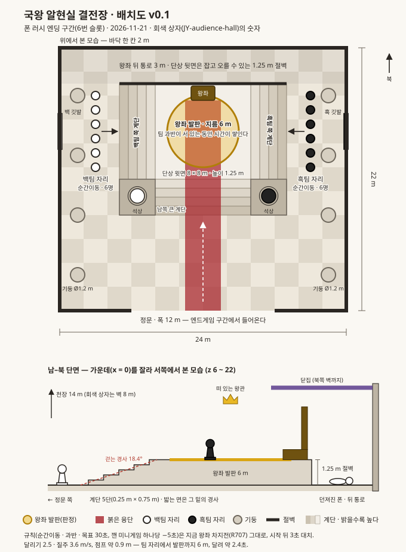

# 폰 러시 엔딩 구간 — 국왕 알현실 결전장 레벨디자인 초안 v0.1

2026-11-21 · 사용자가 이 초안으로 회색 상자를 지으라고 함("회색 상자 지어줘") → **회색 상자 지음(브랜치 `JY-audience-hall`, Unity 확인 전, §9)** · 배치도 [Mockups/AudienceHall_v0.1.svg](Mockups/AudienceHall_v0.1.svg)

숫자는 모두 **시작값**이다. 회색 상자에서 재 보고 맞춘다. 아래 표의 숫자는 회색 상자에 맞춰 고친 것이다(처음 초안과 다른 곳은 §9-2).

## 0. 사용자 구상 (2026-11-21)

> "내가 만들려는 엔딩 구간은 엔드게임 구간 바로 다음에 나오는거야. 알현실을 모티브로 한 공간에, 일정 시간동안 서있는 팀이 이기는 왕좌 발판을 놓고 양 팀 기물들이 서로 밀치고 치고받는."

- **자리:** 6번 슬롯(엔딩)이다. 5번 슬롯 엔드게임 구간(국왕 작전실 · 왕의 서재 · 거인 체스 · 왕실 천문대) 중 무엇이 뽑혀도 바로 뒤에 온다.
- **성격:** 달려서 지나가는 코스가 아니다. 두 팀 전원이 모여 왕좌 발판 하나를 두고 싸우는 결전장이다.
- **규칙:** 지금 코드의 왕좌 차지전(R707, `ThroneContest`)을 그대로 쓴다.
  - 시작: 앞 구간의 큰 문이 열리거나 첫 폰이 엔딩에 들어서는 순간, 전원이 발판 옆으로 순간이동한다(백은 왼쪽, 흑은 오른쪽).
  - 시간: 팀 과반이 발판 위에 있는 동안 그 팀 시간이 쌓인다. 내려와도 줄지 않는다. 두 팀이 동시에 과반이면 둘 다 멈춘다.
  - 목표: 30초. 직접 깬 미니게임 하나당 5초 짧아지고, 10초보다 짧아지지는 않는다.
- **이 초안이 정하는 것:** 공간(알현실 · 단상 · 동선)과 연출이다. 규칙 숫자는 건드리지 않는다.

## 1. 재미가 나오는 구조

시간은 **우리 과반은 위에 있고 상대 과반은 없을 때만** 흐른다. 그래서 결전장에서 하는 일은 둘뿐이다. **상대를 발판에서 떨궈 내기**와 **떨려난 뒤 다시 올라가기**. 공간이 쥐고 있는 손잡이는 셋이다.

| 손잡이 | 뜻 | 지금 임시 바닥 | 이 초안 |
|---|---|---|---|
| 떨려나는 값 | 발판에서 밀려난 사람이 다시 올라오기까지 걸리는 시간 | 거의 0초. 평평해서 한 걸음이면 돌아온다 | 계단 쪽 약 2~3초, 뒤쪽 절벽 약 4~6초 |
| 지키는 힘 | 위에 선 쪽이 유리한 정도 | 없음 | 높이 1.25 m 단상. 올라오는 사람은 계단 위에서 맞고 굴러떨어진다 |
| 끝내는 압력 | 밀어내기만 되풀이하다 끝없이 늘어지는 것을 막는 장치 | 없음 | v0.1은 없이 시험한다. 6대6에서 3분을 넘기면 §6의 둘 중 하나를 넣는다 |

목표(시작값):
- 엔딩 한 번이 6대6에서 **1~2분**. 참고로 11-20 빌드 시험(2대2)의 차지전 두 판은 목표 20초에 66초와 94초 걸렸다([BUILD_TEST_2026-11-21](../Network/BUILD_TEST_2026-11-21.md), main에 있음).
- 떨려난 사람이 **판에서 빠지지 않는다.** 길어야 6초 안에 싸움으로 돌아온다. 그래서 v0.1에는 떨어져 죽는 구멍이 없다.
- 시간을 채우려면 6명 중 4명이 위에 있어야 한다(`MatchResult.MajorityOf`, 3대3이면 2명). 남는 2명은 밖에서 올라오는 적을 막거나 끌어내린다.

## 2. 공간

좌표는 구간 기준이다. 입구 (0, 0, 0)이 남쪽이고 +z가 북쪽(왕좌 쪽)이다.

| 부분 | 크기 · 위치 | 하는 일 |
|---|---|---|
| 홀 | 안쪽 24 m(x −12 ~ 12) × 22 m(z 0 ~ 22), 천장 14 m | 12명이 한 화면에 들어오는 크기. 끝에서 끝까지 달리면 약 10초, 질주하면 약 7초(달리기 2.5 · 질주 3.6 m/s) |
| 정문 | 남쪽 벽 가운데, 폭 12 m | 엔드게임 구간에서 들어오는 문. 시작하면 순간이동이라 싸움 중에는 거의 안 쓴다 |
| 붉은 융단 | 폭 3 m, 정문 → 남쪽 계단 → 왕좌 앞 | 들어오자마자 눈이 왕좌로 가게 하는 선 |
| 단상 | 윗면 8 × 8 m(x −4 ~ 4, z 11 ~ 19), 높이 1.25 m. 남 · 서 · 동 세 면이 계단 5단(한 단 높이 0.25 m, 디딤 0.75 m), 뒷면은 절벽. 밑면 14 × 11 m(x −7 ~ 7, z 8 ~ 19). 앞 두 모서리(3 × 3 m)는 석상을 올린 받침 | 계단은 그림이고, 밟는 면은 그 밑의 18.4° 경사다(대계단 현관홀과 같은 방식: 진짜 턱은 래그돌 발이 걸린다. 코스 경사는 19.5° 이하). 서쪽은 백, 동쪽은 흑의 자기 쪽 계단이고 남쪽은 둘이 같이 쓰는 큰 계단 |
| 왕좌 발판(판정) | 단상 윗면 가운데 금색 원, 지름 6 m, 중심 z 15 | 한 팀 4명과 막으러 온 상대 2~4명이 같이 설 수 있는 크기. 지금 판정의 기본 반지름(3 m)과 같다 |
| 왕좌 | 원의 북쪽 끝에 걸친 의자(폭 2 m, 앉는 판 0.5 m, 등받이 2.6 m). 위에 보라 닫집과 떠 있는 왕관 | 붙잡고 버티는 손잡이. 왕좌 앞쪽을 붙잡고 있으면 원 안이다 |
| 단상 뒤 절벽 · 뒤 통로 | 절벽 1.25 m, 통로 폭 3 m(z 19 ~ 22) | 점프(약 0.9 m)로는 못 오른다. 모서리를 잡고 끌어오르거나 옆 계단으로 돌아가야 한다. 왕좌 뒤로 던지기가 가장 큰 한 방이다 |
| 기둥 | 대리석 기둥 지름 1.2 m, 양쪽에 4개씩(x ±10.5, z 3 · 8 · 13 · 18) | 양옆의 그늘. 가운데 시야는 가리지 않는다. 붙잡고 던지기를 버틸 수 있다 |
| 팀 자리 | 백 x −9, 흑 x +9, z 12 ~ 18에 1.2 m 간격으로 6명 | 순간이동하는 곳. 자기 쪽 계단 아래까지 2 m, 원 가장자리까지 6 m(달려서 약 2.4초) |
| 팀 깃발 | 서쪽 벽에 백, 동쪽 벽에 흑, 높이 8 m | 팀 시간이 쌓이는 만큼 아래에서 위로 차오른다. 화면 막대와 같은 값을 홀 안에서도 볼 수 있다 |

**분위기(3단계 윗궁, [ART_PHASES](PAWN_RUSH_ART_PHASES.md)):** 가장 높은 실내, 굵은 대리석 기둥, 긴 천창, 흑백 대리석 바닥, 보라 벨벳, 금. 바닥 무늬는 2 m 칸 체스판이다.

## 3. 엔딩 한 번의 흐름

| 순간 | 일어나는 일 | 연출(제안, [DESIGN §4.3](Prototype/DESIGN.md) 엔드게임 열) |
|---|---|---|
| 시작 신호 | 앞 구간 큰 문이 열린다(작전실). 또는 첫 폰이 엔딩에 들어선다(서재 · 천문대) | — |
| 0초 순간이동 | 전원이 자기 팀 자리로 간다. 카메라를 끊어 다시 잡는다(R707) | 음악이 꺼지고 바람과 심장 소리만 남는다. 홀이 어두워지고 천창 빛 한 줄기가 왕좌에 떨어진다 |
| 0 ~ 3초 대치(회색 상자에 있음) | 움직일 수는 있지만 발판은 아직 꺼져 있다 | 종이 세 번 울리고, 세 번째에 발판에 불이 들어온다(회색 상자는 화면 글 3 · 2 · 1만) |
| 싸움 | 과반이 위에 있는 팀의 시간이 쌓인다. 둘 다 과반이면 멈춘다 | 발판 테두리가 잡은 팀 색이 된다. 둘 다면 붉게 깜빡인다. 벽 깃발이 차오른다 |
| 한 팀 75% | — | 아나운서가 낮게 "체크." 심장 박동이 빨라진다 |
| 승리 | 먼저 채운 팀이 이긴다(`CrownFinish.Win`) | 0.5초 슬로모션, "체크메이트." 진 팀 기물이 모두 픽 쓰러진다. 체스에서 킹을 눕혀 기권하듯 |

## 4. 이런 장면이 나와야 한다

1. 백 넷이 원 위에 있고 시간은 26 / 30. 흑 한 명이 동쪽 계단에서 다이빙해 백 하나를 원 밖으로 쓸어 낸다. 백이 셋이 되어 시간이 멈춘다. 계단 아래의 백이 그 흑을 붙잡아 끌어내리는 사이, 떨려난 백이 계단을 기어올라 다시 넷이 된다.
2. 흑 한 명이 왕좌 등받이를 붙잡고 버틴다. 백 둘이 그 다리를 잡아당긴다. 손이 풀리는 순간 셋이 엉킨 채 절벽 뒤로 떨어진다.
3. 원 위에 흑 셋, 백 셋. 둘 다 4명이 안 되어 아무도 시간이 안 흐른다. 양쪽 계단 아래에서 한 명씩 뛰어 올라온다. 먼저 올라선 쪽이 시간을 가져간다.

## 5. 기획서와 대조 ([DESIGN §1 ~ §3](Prototype/DESIGN.md))

| 원칙 | 이 초안 |
|---|---|
| 캡슐 시험 | 재미가 계단을 굴러떨어지기, 왕좌에 매달리기, 엉켜서 떨어지기에서 나온다. 캡슐이면 밀어내기만 남는다 → 통과 |
| 몸이 도구다 | 원 위의 몸 넷이 곧 점수이고, 밀어낸 몸이 곧 방해다. 왕좌와 기둥은 붙잡는 손잡이다 |
| 체스는 이미지만 | 왕좌, 왕관, 흑백 대리석 칸, "체크." "체크메이트.", 기권하듯 쓰러지기. 체스 규칙은 없다 |
| 싸움이 끊기지 않는다 | 두 팀 전원이 한 공간에서 발판 하나를 두고 싸운다. 우리 시간을 쌓는 일이 곧 상대를 떨구는 일이다 |
| 체력 · 피해 없음 | 몸을 옮기기만 한다 |
| 앞서도 눈덩이가 안 된다 | 앞선 팀의 이점은 짧은 목표 시간뿐이다(미니게임 하나당 −5초, 최소 10초). 자리 이점은 순간이동이 지운다 |
| 예고가 있다 | 발판이 켜지기 전에 종이 세 번 울린다. v0.1에는 움직이는 장치가 없다 |
| 버린 방향 | 따로 노는 미니게임이 아니다(판의 목적지이고, 미니게임 클리어가 여기까지 이어진다). 옛 카드 '대관식'처럼 미션으로 만들지 않는다. 왕관은 승리 연출일 뿐이다 |

## 6. 손잡이와 시험

회색 상자는 아래 값을 바꿔 가며 해 볼 수 있게 짓는다.

| 손잡이 | 시작값 | 시험 범위 | 볼 것 |
|---|---|---|---|
| 발판 지름 | 6 m | 5 ~ 8 m | 둘 다 과반이라 멈춘 시간. 너무 길면 줄인다 |
| 단상 높이 | 1.25 m(5단 × 0.25 m) | 0.75 ~ 1.5 m | 떨려난 뒤 돌아오는 시간 |
| 디딤판 깊이 | 0.75 m(경사 18.4°) | 0.75 ~ 1.2 m | 계단으로 올라오는 시간. 0.75 m보다 짧으면 경사가 19.5°를 넘는다 |
| 계단 면 | 남 · 서 · 동 | 서 · 동만(남쪽도 절벽) | 정면으로 밀고 올라오기가 너무 쉬운지 |
| 대치 | 3초 | 0 ~ 3초 | 순간이동 뒤가 공정한지 |
| 끝내는 압력 | 없음 | ① 초읽기: 시작 120초 뒤부터 쌓이는 속도 2배 ② 좁아지는 발판: 90초 · 150초에 지름 6 → 4.5 → 3 m | 엔딩 길이 |

순서: 회색 상자 → 혼자 오르내리며 돌아오는 시간 재기 → 3대3 → 6대6. 구간 기록(CSV)에 엔딩 길이, 팀별로 위에 있던 시간, 둘 다 과반이던 시간, 원 밖으로 떨려난 횟수를 남긴다.

## 7. 만들 때 바뀌는 코드 (회색 상자에서 한 것은 §9)

- 새 `AudienceHallSection`(임시 바닥처럼 코드로 짓는 회색 상자)과 `Final_AudienceHall.prefab`을 만든다. `PawnRushSections.asset` 6번 슬롯에서 임시 바닥 자리에 넣는다(임시 바닥 파일은 남긴다). 들어갈 것: 단상 위 원의 `FinishZone`, 체크포인트, `ProgressPath`, 비트, 아래 낙사 판.
- `ThroneContest`: 팀 자리를 구간에서 받게 한다. 지금은 원 가장자리에서 2.2 m 밖에 세우므로 새 단상에서는 계단 위가 된다. 대치 3초를 더한다. 끝내는 압력을 넣으면 동기화 바이트가 1 ~ 2개 는다.
- 구간 검사: 앞 구간 출구에서 원까지 걸어가는 길에 계단이 생기므로 검사를 맞춘다.
- 프로토콜 번호를 올린다. 소리 · 조명 · 슬로모션 · 쓰러짐 연출은 회색 상자를 확인한 뒤 따로 한다.

## 8. 정할 것

회색 상자는 아래 다섯 가지를 추천값으로 지었다. 해 보고 정한다.

1. 발판 지름 6 m, 단상 높이 1.25 m로 시작해도 되는지 — 회색 상자: 이 값(프리팹에서 바꿀 수 있음)
2. 단상 뒤 절벽(왕좌 뒤로 던지기)을 둘지 — 회색 상자: 둠
3. 떨어지면 자기 팀 문에서 다시 나오는 구멍을 넣을지 — 회색 상자: 없음
4. 순간이동 뒤 3초 대치를 넣을지 — 회색 상자: 있음(프리팹에서 0초로 끌 수 있음)
5. 진 팀이 다 같이 쓰러지는 마무리를 넣을지 — 회색 상자: 아직 없음(연출 단계)

## 9. 회색 상자 (2026-11-21, 브랜치 `JY-audience-hall`)

main(R734)에서 딴 브랜치다. 컴파일 · Core 시험 218 · 세션 시험 114는 Unity 밖에서 통과했다. **Unity에서 아무도 아직 안 봤다.**

### 9-1. 만든 것

| 파일 | 내용 |
|---|---|
| `Assets/Scripts/PawnRush/AudienceHallSection.cs` | 알현실을 코드로 짓는다(임시 바닥과 같은 방식: 프리팹은 뿌리만, 깨어날 때 `Content`를 짓는다). 홀 · 단상 · 계단(그림 + 걷는 경사) · 석상 받침 · 왕좌 발판(`FinishZone`, 지름 6 m) · 왕좌 · 닫집 · 왕관 · 기둥 8개 · 팀 깃발(보이기만) · CP0(앞마당 바닥 전체) · 낙사 판 · 비트 3개(1 알현실 앞 · 2 단상 · 왕좌 발판 · 3 왕좌 뒤) |
| `Assets/Prefabs/PawnRushSections/Final_AudienceHall.prefab` | 위 구간의 프리팹. 인스펙터에서 바꿀 수 있는 값: 발판 지름 · 단 수 · 한 단 높이 · 디딤판 깊이 · 남쪽 계단 켜기 · 대치 초 |
| `Assets/Settings/PawnRushSections.asset` | 6번 슬롯(엔딩)의 후보를 임시 바닥에서 알현실로 바꿈. 임시 바닥의 프리팹과 코드는 남김 |
| `Assets/Resources/Loading/PawnRushCourse.txt` | 입장 화면 코스 이름표의 엔딩 줄(Play할 때마다 다시 쓰이는 파일) |
| `Assets/Scripts/PawnRush/ThroneContest.cs` | 엔딩 구간이 `IThroneStage`를 가지면 그 값을 쓴다. 팀을 원 가장자리에서 `StandGap`(알현실은 6 m) 밖에 세우고, 세운 뒤 `StandoffSeconds`(3초) 동안 발판이 어느 팀에도 시간을 주지 않는다(화면: 3 · 2 · 1 → "발판 켜짐!", 가운데 글 "곧 발판이 켜집니다"). `IThroneStage`가 없는 엔딩(임시 바닥)은 예전 그대로(2.2 m, 대치 없음). 통신 바이트는 그대로 7개 |
| `Assets/Scripts/PawnRush/SectionPlaytest.cs` | 구간 시험(오프라인)에서 **F10 = 엔딩 규칙 바꾸기**(왕관 발판 ↔ 왕좌 차지전). 온라인에서는 방장이 방 규칙에서 고른다 |
| `Assets/Scripts/Network/SteamSession.cs` | 프로토콜 `…v61.hall1`: 이 브랜치로 뽑은 빌드끼리만 만난다(main에 합칠 때 main의 번호로 돌린다) |

### 9-2. 처음 초안과 다른 곳

| | 초안 | 회색 상자 | 왜 |
|---|---|---|---|
| 디딤판 | 0.5 m | 0.75 m | 계단을 그림 + 경사로 지어서, 경사가 19.5°를 넘지 않게(0.5 m면 26.6°) |
| 단상 밑면 | 12 × 10 m | 14 × 11 m | 위 때문에 계단이 3 m 나온다 |
| 앞 모서리 | 계단이 돌아감 | 석상 받침(3 × 3 m, 높이 1.25 m) | 두 경사가 모서리에서 만나는 틈을 막고, 체스 석상을 세울 자리 |
| 팀 자리 | x ±8.5 | x ±9 | 계단 아래에서 2 m 띄우게 |
| 기둥 | x ±10 | x ±10.5 | 팀 자리와 1.5 m 띄우게 |

### 9-3. 해 보는 법

1. GitHub Desktop에서 브랜치를 `JY-audience-hall`로 바꾼다. Unity가 다시 불러오면 **ChessFight → Pawn Rush → Open Section Test** → Play.
2. **F10**으로 엔딩 규칙을 '왕좌 차지전'으로 바꾼다(오른쪽 위 글에 지금 규칙이 나온다). 판이 같은 씨앗으로 다시 지어지고 처음부터 시작한다.
3. 첫 구간에서 **[** 한 번(마지막 구간으로 돌아감)이나 **]** 여러 번으로 엔딩(6번 구간)에 가거나, 판을 끝까지 달린다. 엔딩에 들어서면(작전실이 나온 판은 큰 문이 열리면) 팀 자리로 순간이동 → 3 · 2 · 1 → 발판 켜짐.
4. 혼자면 팀 과반이 1명이라, 혼자 원 위에 서 있으면 시간이 쌓인다(30초. F6으로 미니게임을 깨면 하나당 5초 짧아짐).
5. 여럿이 해 보려면 이 브랜치로 뽑은 빌드끼리 방을 만들고, 방장이 방 규칙에서 엔딩을 '왕좌 차지전'으로 고른다.

### 9-4. 볼 것

- 계단을 걸어서 오르내리는지, 계단에서 넘어지면 굴러 내려가는지
- 뒤 절벽(1.25 m)을 점프로는 못 오르고 잡고는 오르는지
- 왕좌 · 기둥을 잡고 버틸 수 있는지, 왕좌 위로 기어오를 수 있는지
- 순간이동 자리(x ±9)가 바닥 위인지, 3 · 2 · 1 글이 보이는지
- 떨려난 뒤 돌아오는 시간 재기: 계단 쪽 2~3초, 절벽 쪽 4~6초가 목표
- 12명이 한 화면에 들어오는지(홀 크기와 카메라)
- 엔딩 한 번의 길이(2대2 · 3대3 · 6대6)

### 9-5. 아직 안 한 것

연출 전부(음악 끄기 · 심장 소리 · 종 · 조명 · 슬로모션 · "체크." · 진 팀 쓰러지기 · 깃발 차오르기), 아트(대리석 · 벨벳 · 천창), 끝내는 압력(§6), 구간 검사 도구(Validate Sections)의 알현실 전용 검사.
