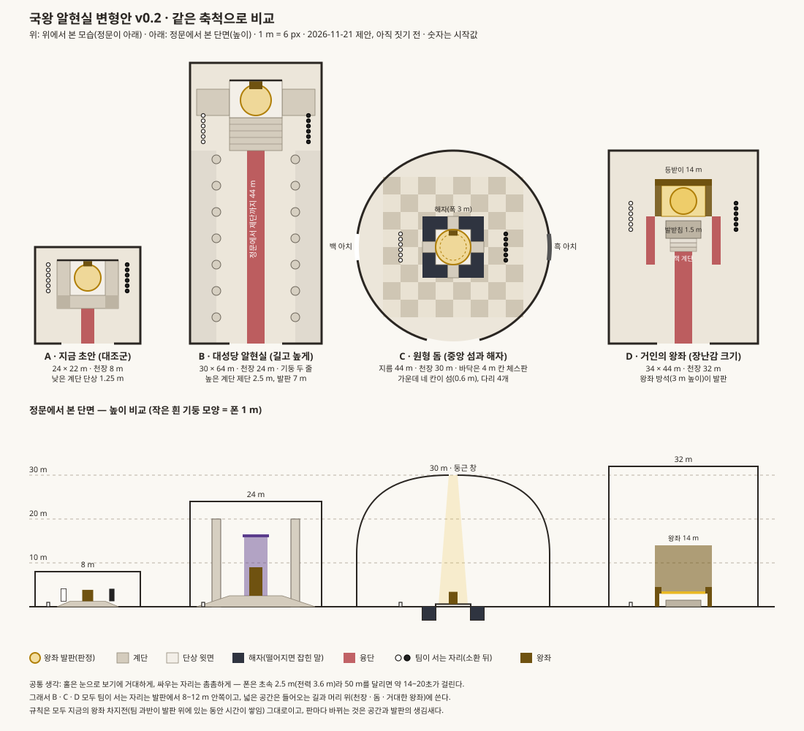

# 폰 러시 엔딩 — 국왕 알현실 변형안 v0.2 (여러 판을 지어 플레이로 비교)

2026-11-21 · 제안 → 사용자 "B·C·D 다 지어줘" → **B · C · D 회색 상자 지음(§7, Unity에서 플레이 전)** · 비교 그림 [Mockups/AudienceHall_variants_v0.2.svg](Mockups/AudienceHall_variants_v0.2.svg) · 앞 문서 [초안 v0.1과 회색 상자](PAWN_RUSH_AUDIENCE_HALL_DESIGN_v0.1.md)

## 0. 사용자 말 (2026-11-21)

> "일단 너가 방금 만들어준거 초안으로는 되게 괜찮거든? 근데 내가 여러가지 방향중에서 고민중이였고 저건 단순하게 만들어본 경우여서 아예 이 구간을 여러개를 만들어보고 직접 플레이하며 비교해보려고 해. 일단 지금 아쉬운건 알현실이 모티브이고 진짜 게임의 끝 부분이라 분위기로 압도하는 그런 느낌이였으면 좋은데 회색 박스 미리보기라지만 방 크기가 좀 작고 그래서 맵이 더 길거나 큰 버전은 느낌이 어떨지 궁금하고, 저 왕좌 발판 부분도 지금처럼 살짝 계단 위에 있는거 말고도 다른식으로도 할 수 있을지 더 생각해보고 싶고, 그리고 아직 확정은 아니지만 지금 저 엔딩구간에는 1등 주자가 엔드게임 코스를 통과하면 30초정도 뒤 텔포로 모든 유저 전원이 이동하게 하는걸 넣자는 안건이 있어서 검토중인데 만약 그렇게 한다면 멋진 연출을 넣고싶어"

## 1. 무엇을 비교하나

세 가지를 따로 본다. 규칙(팀 과반이 발판 위에 있는 동안 그 팀 시간이 쌓이고, 두 팀이 같이 과반이면 멈춤)은 모든 판이 같다.

| 축 | 질문 | 비교 |
|---|---|---|
| 압도감 | 크고 길고 높은 방이 끝판 느낌을 주는가. 넓어서 싸움이 흩어지지는 않는가 | A(지금) ↔ B · C · D |
| 왕좌 발판의 생김새 | 밀려나면 얼마나 손해인가(떨려나는 값), 위에 선 쪽이 얼마나 유리한가(지키는 힘) | 낮은 단상 · 높은 계단 제단 · 해자로 둘러싼 섬 · 거대한 왕좌의 방석 |
| 들어오는 순간 | 전원 소환을 '끝판 입장'으로 만들 수 있는가 | §4 연출안 |

공통 원칙: **보기에는 거대하게, 싸우는 자리는 촘촘하게.** 폰은 초속 2.5 m(전력 3.6 m)라 50 m를 가로지르면 14~20초가 걸린다. 그래서 넓은 공간은 들어오는 길과 머리 위(천장 · 돔 · 거대한 왕좌)에 쓰고, 팀이 서는 자리는 발판에서 8~12 m 안에 둔다.

## 2. 판 네 개

숫자는 모두 시작값이다. 지어 보고 재면서 맞춘다.

### A · 지금 초안 (대조군)

24 × 22 m, 천장 8 m, 1.25 m 단상, 지름 6 m 발판. 회색 상자가 이미 있다(`Final_AudienceHall`). 다른 판과 같은 날, 같은 사람들로 같이 돌려 본다.

### B · 대성당 알현실 — 길고 높게, 높은 계단 제단

| | |
|---|---|
| 공간 | 30 × 64 m, 천장 24 m. 가운데 길(폭 18 m) 양옆에 기둥 두 줄(지름 2 m, 6 m 간격, 높이 20 m), 그 바깥은 어두운 회랑. 높은 창에서 빛이 비스듬히 들어온다 |
| 들어오는 길 | 정문에서 제단 계단까지 44 m 붉은 융단. 30초 소환 안(§3)이 들어가면 먼저 온 주자가 이 길을 혼자 걸어 들어간다 |
| 발판 | 큰 계단 10단(0.25 m × 0.75 m, 폭 12 m)을 올라 2.5 m 단상(12 × 8.5 m), 발판 지름 7 m. 양옆에 팀 계단(폭 6 m). 뒤는 2.5 m 절벽 — 점프로는 못 오르고, 잡고 오르기도 어렵다(손이 닿는 높이 약 2.2 m, 회색 상자에서 확인) |
| 팀 자리 | 백은 서쪽 회랑, 흑은 동쪽 회랑의 계단 아래(발판까지 약 10 m) |
| 나와야 할 장면 | 꼭대기에서 버티는 넷, 큰 계단으로 몰려 올라오는 적, 열 단을 굴러 내려가는 기물 |
| 떨려나는 값 | 계단 쪽 약 3~4초, 절벽 쪽 약 6~8초(옆 계단으로 돌아옴) |
| 걱정 | 꼭대기가 너무 유리해 시간이 금방 찬다 · 길어서 빈 공간이 지루하다 |
| 볼 것 | 팀별 점유 비율, 엔딩 한 번의 길이, 정문에서 걸어 들어올 때의 느낌 |

### C · 원형 돔 — 체스판 한가운데 네 칸이 왕좌 발판

| | |
|---|---|
| 공간 | 지름 44 m 원형 홀, 돔 높이 30 m. 돔 꼭대기의 둥근 창에서 빛 기둥이 발판으로 떨어진다. 바닥은 4 m 칸 8 × 8 체스판 |
| 발판 | 가운데 네 칸(8 × 8 m)이 0.6 m 솟은 섬. 판정은 그 안의 지름 8 m 원. 왕좌는 섬의 북쪽 끝. 섬 둘레는 폭 3 m 해자(깊은 구덩이), 건너는 다리 4개(폭 2.5 m) |
| 해자에 떨어지면 | '잡힌 말'처럼 2초 뒤 자기 팀 아치에서 다시 나온다(약 6~8초 손해). 잡힌 말은 판 밖으로 나간다는 체스 이미지 |
| 체스 이미지 | "엔드게임의 킹은 중앙으로" — 체스를 아는 사람은 가운데 네 칸이 왜 중요한지 바로 안다 |
| 팀 자리 | 백은 서쪽 아치, 흑은 동쪽 아치 안쪽(섬까지 약 8 m) |
| 나와야 할 장면 | 다리 위 밀치기, 해자로 던져 넣기, 해자 모서리에 매달려 버티기, 섬 위 몸싸움 |
| 떨려나는 값 | 다리 쪽으로 밀리면 1~2초, 해자로 떨어지면 6~8초 |
| 걱정 | 다리 막기로 교착 · 해자 손해가 너무 커서 한 번 밀리면 끝 |
| 볼 것 | 해자 낙하 횟수와 팀별 차이, 다리마다 싸운 시간 |

### D · 거인의 왕좌 — 거대한 왕좌의 방석이 발판

| | |
|---|---|
| 공간 | 34 × 44 m, 천장 32 m. 높이 14 m 왕좌 하나가 홀을 채운다. 촛대 · 술잔 같은 소품도 거인 크기 — 기물이 장난감처럼 보인다 |
| 발판 | 3 m 높이 방석(10 × 7 m), 판정은 가운데 지름 6 m 원. 팔걸이는 4.5 m |
| 오르는 길 | 책 계단 → 1.5 m 발받침 → 방석 모서리를 잡고 오르기. 또는 양옆 팔걸이에 늘어진 융단 경사(18°)로 걸어 오르기. 방석 앞에 늘어진 술 장식은 밧줄(이미 있는 `RopeLine`) |
| 팀 자리 | 왕좌 양옆(발판까지 약 9 m) |
| 나와야 할 장면 | 방석 위 몸싸움, 팔걸이에서 다이빙, 방석에서 떨어져 발받침에 튕기기, 술 장식에 매달려 흔들리기 |
| 떨려나는 값 | 약 6~10초(다시 기어올라야 함) |
| 걱정 | 오르기가 길어 늘어짐 · 방석이 넓어 두 팀이 다 올라와 멈춤만 길어짐 |
| 볼 것 | 떨려난 뒤 돌아오는 시간, 둘 다 과반이라 멈춘 시간 |

### 그 밖의 발판 생각 (이번에는 짓지 않음)

- **기울어지는 천칭:** 발판이 가운데 축으로 기울어, 한쪽에 몰리면 미끄러진다.
- **천천히 도는 왕관:** 누워 있는 거대한 왕관 안쪽이 발판. 뾰족한 끝은 잡고 버틸 기둥이자 숨을 곳.
- **좁아지는 발판:** 시간이 지나면 가장자리가 내려앉는다. 어느 판에나 붙일 수 있는 '끝내는 압력'(v0.1 §6).

## 3. 30초 소환 규칙 (검토 중인 안)

| | 지금(R707) | 소환 안 |
|---|---|---|
| 시작 신호 | 앞 구간의 큰 문이 열리거나 첫 폰이 엔딩에 들어섬 | 1등이 엔드게임 코스를 지남 |
| 그다음 | 바로 전원 순간이동 | 30초 뒤, 아직 길 위에 있는 사람을 모두 소환 |
| 먼저 온 이점 | 없음(모두 같은 거리에 세움) | 최대 30초 먼저 들어와 자리 잡기 |

정할 것(추천은 굵게):

1. 30초 동안 발판을 켤까 — **끄고 자리 잡기만 한다.** 켜면 먼저 온 팀이 시간을 쌓아 그대로 끝날 수 있다.
2. 소환할 때 이미 와 있던 사람은 — **그 자리 그대로 둔다**(먼저 온 이점). 또는 모두를 팀 자리로 다시 세운다.
3. 길 위 사람들에게 남은 시간을 보여 준다 — **보여 준다**("왕의 부름까지 30").

이 규칙은 방 규칙의 선택지('엔딩 시작: 즉시 / 30초 뒤 소환')로 넣어 두고 플레이로 비교하는 것을 제안한다(R703~R707의 흐름 규칙과 같은 방식).

## 4. 소환 연출안

### 추천 — "왕의 손이 마지막 수를 둔다" (약 8초)

체스는 손이 말을 옮기는 게임이다. 끝판에 들어서는 순간을 '보이지 않던 손이 마지막 수를 두는' 장면으로 만든다.

| 시각(소환 = 0) | 길 위에 남은 사람 | 이미 알현실에 있는 사람 | 소리 |
|---|---|---|---|
| −30초 | 1등이 엔드게임 코스 출구를 지남. 화면 위에 "왕의 부름까지 30" | 홀의 샹들리에 · 촛대에 불이 하나씩 켜지기 시작 | 종 한 번 |
| −30 ~ −3 | 남은 시간(10초마다 종) | 자리 잡기 | 음악이 점점 낮아짐 |
| −3 | 화면 가장자리가 어두워지고 거대한 손의 그림자가 지나감(예고) | 같은 그림자가 홀 바닥을 지나감 | 바람 |
| 0 | 손이 기물을 집어 들어 올리고, 카메라가 따라 위로 빠짐 | 화면이 위로 빠짐 | 집는 소리 |
| 0.8 ~ 4.5 | 위에서 내려다본 홀(바닥이 체스판처럼): 손이 기물을 한 칸에 하나씩 '탁' 내려놓음, 백 · 흑 번갈아 | 같은 장면 | 말 놓는 소리 |
| 4.5 ~ 5.5 | 카메라가 자기 기물 뒤로 내려앉고, 천장에서 왕관이 발판 위로 내려옴 | 같음 | 음악이 끊기고 심장 소리 |
| 5.5 ~ 8.5 | 3 · 2 · 1(v0.1의 대치) → 발판 켜짐 | 같음 | 종 세 번 |

### 다른 안 1 — "알현 행렬" (B와 잘 맞음)

0초에 암전 → 정문이 열리며 나팔 → 카메라가 정문에서 융단을 따라 왕좌까지 날아감(3초) → 전령의 목소리 "백의 군대, 흑의 군대, 국왕 앞으로!" → 융단 양옆에 두 줄로 선 두 팀 → 왕관 낙하 → 3 · 2 · 1.

### 다른 안 2 — "판이 차려진다" (가장 간단, 손 모델 없이)

위에서 내려다본 홀에 기물이 하나씩 떨어져 '쿵' → 그 사람의 이름과 기물이 잠깐 뜸("백 · OOO — 룩") → 카메라가 자기 기물로 → 3 · 2 · 1. 회색 상자는 이것부터 만들고, 손은 그 위에 얹는 순서가 가장 싸다. 옛 킹 러시 시험장에 거대한 손 조각(`20_GiantHandStair`)이 있어 손 모양의 출발점으로 쓸 수 있다.

### 모든 안에 공통

- 소환 순간은 방장이 정하고, 모든 PC가 같은 시계로 같은 장면을 본다(동기화 바이트 1~2개 추가).
- 장면이 도는 동안은 아무도 움직이지 못한다. 건너뛰기는 없다(공정). 길이는 8초 안.
- 끝 연출은 v0.1 §3 그대로: 이기는 순간 0.5초 슬로모션, "체크메이트.", 진 팀 기물이 모두 픽 쓰러짐, 왕관이 이긴 팀 쪽으로.

## 5. 만드는 순서 (제안)

1. **B · C · D 회색 상자.** 6번 슬롯 후보로 A와 함께 넣고 고르는 법을 둔다: 방 규칙 '엔딩 맵'(무작위 · A · B · C · D), 구간 시험에서 F11로 바꾸기. 판마다 그림 도구로 그림을 찍어 보낸다. 구간 기록에 엔딩 길이 · 팀별 점유 시간 · 둘 다 과반인 시간 · 떨려난 횟수를 남긴다.
2. **30초 소환**을 방 규칙 선택지로 + 연출 회색 상자(어두워짐 · 카메라 · 기물 내려놓기 · 왕관 낙하 · 종). 손은 그다음.
3. 같은 사람들로 판마다 몇 번씩 돌려 보고 고른다 → 고른 판의 아트 · 조명 · 소리.

## 6. 기획서와 대조 (DESIGN §1 ~ §3)

| 원칙 | B 대성당 | C 원형 돔 | D 거인의 왕좌 |
|---|---|---|---|
| 캡슐 시험(래그돌이라 재밌나) | 열 단 계단을 굴러떨어짐 | 해자로 던짐 · 모서리에 매달림 | 기어오름 · 떨어져 튕김 · 술 장식에 매달림 |
| 몸이 도구 | 계단 위 몸이 벽 | 다리 위 몸이 마개 | 방석 위 몸이 점수 |
| 체스는 이미지만 | 왕좌 · 대성당 | 중앙 네 칸 · 잡힌 말 | 기물이 장난감 크기 |
| 싸움이 끊기지 않음 | 계단 하나로 모임 | 섬 하나, 다리 넷 | 방석 하나 |
| 앞서도 눈덩이가 안 됨 | 30초 소환에서 자리 잡기만, 발판은 소환 뒤 켜짐(§3 추천) | 같음 | 같음 |
| 버린 방향 | 독립 미니게임 아님 · 체스 규칙 없음 · '대관식' 미션 아님(왕관은 연출) | 같음 | 같음 |

## 7. 회색 상자 (2026-11-21, 브랜치 `JY-audience-hall`)

사용자 "B·C·D 다 지어줘". 6번 슬롯 후보가 A · B · C · D 넷이 되었다. 컴파일 · Core 시험 219 · 세션 시험 114는 Unity 밖에서 통과했고, 판마다 Unity 배치 모드로 그림을 찍었다(그림 도구 `AudienceHallPictures`). **사람이 플레이해 본 판은 아직 없다.**

### 7-1. 해 보는 법

- **혼자(구간 시험):** **F11**로 엔딩 맵을 무작위 → A → B → C → D 순서로 바꾸고, **F10**으로 엔딩 규칙을 '왕좌 차지전'으로. 첫 구간에서 **[** 한 번이면 엔딩으로 간다.
- **여럿이(온라인 방):** 방장이 방 규칙의 **'엔딩 맵'**(무작위 · A 지금 초안 · B 대성당 · C 원형 돔 · D 거인의 왕좌)과 '엔딩: 왕좌 차지전'을 고른다. 입장 화면의 코스 공개도 고른 판을 보여 준다.
- **비교 기록:** 차지전이 끝날 때마다 판정한 PC의 Player.log에 한 줄이 남는다 — `[PawnRush] 왕좌 차지전 끝: 국왕 알현실 B · 대성당 · 흑팀 승리 · 시작부터 74.2초 (대치 3초) · 점유 백 12.0초 · 흑 20.0초 · 동시 18.3초 · 빈 발판 20.9초 · 목표 백 25 / 흑 20초`(숫자는 예시). 판마다 길이와 '동시 · 빈 발판'의 비율을 비교한다.

### 7-2. 지은 것과 처음 제안에서 바뀐 숫자

| 판 | 코드 · 프리팹 | 제안(§2)과 다른 곳 |
|---|---|---|
| B 대성당 | `CathedralHallSection` · `Final_AudienceHall_B_Cathedral` | 제단 윗면은 z 50.75 ~ 60(큰 계단의 마지막 단이 윗면). 지붕(24 m)과 높은 창(12 ~ 20 m, 6 m마다 2.5 m). 기둥 머리 |
| C 원형 돔 | `RotundaHallSection` · `Final_AudienceHall_C_Rotunda` | **해자 폭 4 m**(체스판 한 칸에 맞춤, 제안은 3 m) — 달려서 뛰어넘기도 어렵다. 아치 폭 6.9 m · 높이 7 m, 그 뒤 닫힌 감실에 팀 체크포인트(잡힌 말이 돌아오는 곳). 돔은 패널, 둥근 창 지름 3 m |
| D 거인의 왕좌 | `GiantThroneHallSection` · `Final_AudienceHall_D_GiantThrone` | 발받침이 방석 앞면에 붙어 있다(z 24.5 ~ 29). 융단 띠는 폭 1.5 m로 팔걸이 남쪽 끝까지(17.8°). 술 장식 밧줄 2개는 천천히 흔들린다(4°, 6초). 지붕은 왕좌 위(x ±7, z 22 ~ 40)가 열려 빛이 든다 |
| 공통 | `HallParts`(계단 · 발판 · 왕좌 · 왕관 · 등불 · 빛 · 벽) | 홀마다 등불과 발판 위 스포트라이트를 넣었다(회색 상자에서도 어둡지 않게) |

### 7-3. 코드에서 바뀐 것

- `IThroneStage.StandRow(team)`: 판이 팀 줄의 가운데를 직접 준다(A는 전과 같은 자리). 왕좌 차지전이 엔딩에 팀 체크포인트가 있으면 그 팀 사람들을 거기로 알린다(C의 감실).
- 방 규칙 `PawnRushRules.EndingMap`(비트 8 ~ 10). 비트 5 ~ 7은 `JY-skill-lab`의 스킬 규칙이 쓰므로 비워 두었다 — 두 브랜치를 합칠 때 겹치지 않는다. `PawnRushSections.PinEnding`이 판 구성(`PawnRushRound`)과 입장 화면 코스 공개(`PawnRushCourseTable`) 둘 다에서 같은 판을 고정한다.
- 프로토콜 `v61.hall2`.

### 7-4. 아직 안 한 것

30초 소환 규칙과 그 연출(§3 · §4), 아트 · 소리, 홀별 구간 검사 도구, C 해자 깊이와 낙하 손해의 실제 시간 재기, D 술 장식 밧줄의 손맛.

