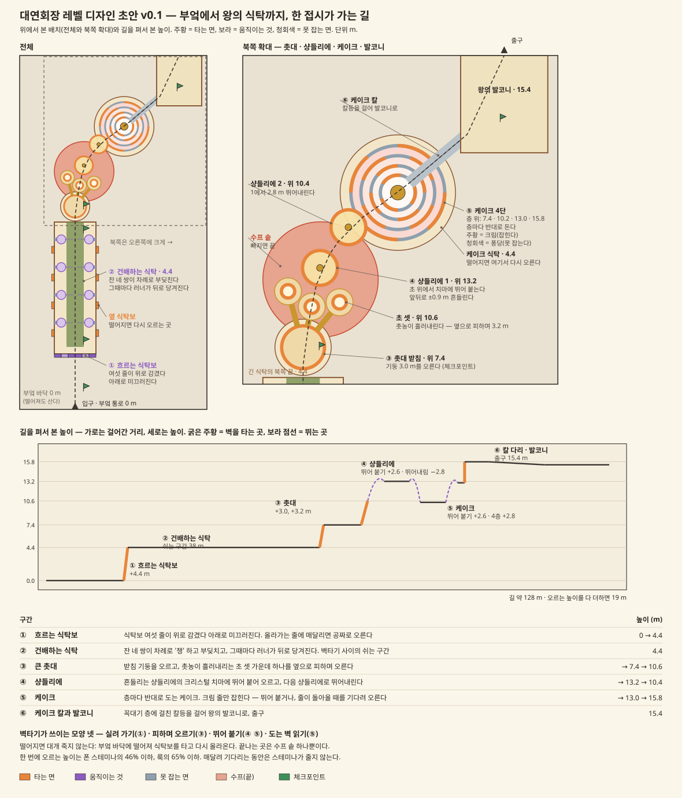

# 대연회장 레벨 디자인 초안 v0.1 — 부엌에서 왕의 식탁까지

2026-11-23 · R787 · 장소 [2-4 대연회장](PAWN_RUSH_PLACES_4MIN.md)(코스 2 · 중반 장애물). 사용자(컨셉 아트 1장): "다음은 연회장에 대한 레벨디자인을 할거야. 천문대와 마찬가지로 연회장만의 분위기와 특성이 잘 반영되어있는 레벨이었으면 좋겠고 … 지금 구현되어있는 모든 장애물 맵은 벽타기를 활용한 맵이 하나도 없어. 벽타기가 적극적으로 활용하는 쪽으로 기획해줘."

> **이 판은 지나갔다.** 사용자 피드백(플레이타임을 대계단만큼, 벽타기를 컨셉에 맞는 상황으로)으로 [v0.2(R788)](PAWN_RUSH_BANQUET_HALL_DESIGN_v0.2.md)를 다시 짰다. 아래는 그 전의 안이고, 이 판의 숫자를 낸 `banquet_layout.py`는 v0.2의 숫자로 바뀌었다(이 판의 것은 git 기록 R787에 있다).

> **초안만 있다.** Unity에는 아무것도 없다. 수치는 폰의 속도와 벽타기 규칙(코드에서 읽은 값)으로 손계산한 것이고, 사람이 달려 본 적이 없다. 사용자 검수 전.

컨셉 아트(사용자 제공): [banquet_concept.webp](ConceptArt/R787_BanquetHall/banquet_concept.webp)

## 한눈에

- **한 줄:** 폰이 요리 한 접시가 가는 길을 따라간다. 아래층 **부엌**에서 식탁보를 타고 **식탁**으로, 식탁 끝의 **촛대**를 올라 **샹들리에**를 건너 **케이크** 꼭대기까지, 거기서 **왕의 발코니**로.
- **구조:** 한 방 안의 세 층(부엌 0 m · 식탁 4.4 m · 발코니 15.4 m). 계단이 하나도 없다 — 층을 잇는 것은 전부 **타고 오르는 것**이다(식탁보, 촛대, 샹들리에의 치마, 케이크).
- **벽타기를 쓰는 모양 넷:** 실려 가기 · 피하며 오르기 · 뛰어 붙기 · 도는 벽 읽기. 구간마다 다르다.
- **떨어져도 대개 죽지 않는다.** 부엌 바닥에 떨어져 식탁보를 타고 다시 올라온다. 끝나는 곳은 수프 솥 하나뿐이다.
- **크기:** 홀 54 × 102 m, 길 약 128 m, 오르는 높이를 다 더하면 19 m. 실수 없이 약 70초(추정).

| # | 구간 | 무엇을 하나 | 벽타기 | 높이 (m) | 난이도 1~5 |
| --- | --- | --- | --- | --- | --- |
| ① | 흐르는 식탁보 | 위로 감기는 줄에 매달려 식탁 위로 | 실려 가기 | 0 → 4.4 | 2 |
| ② | 건배하는 식탁 | 차례로 부딪치는 잔 네 쌍 사이를 달린다 | 없음(쉬는 구간) | 4.4 | 3 |
| ③ | 큰 촛대 | 받침 기둥을 오르고, 촛농을 옆으로 피하며 초를 오른다 | 피하며 오르기 | → 7.4 → 10.6 | 4 |
| ④ | 샹들리에 | 흔들리는 샹들리에에 뛰어 붙고, 다음 것으로 뛰어내린다 | 뛰어 붙기 | → 13.2 → 10.4 | 5 |
| ⑤ | 케이크 | 층마다 반대로 도는 케이크의 크림 줄을 타고 오른다 | 뛰어 붙기 · 도는 벽 읽기 | → 13.0 → 15.8 | 4 |
| ⑥ | 케이크 칼과 발코니 | 칼등을 걸어 왕의 발코니로, 출구 | 없음 | 15.4 | 1 |

## 요청과 답

| 요청 | 답 |
| --- | --- |
| 연회장만의 분위기와 특성 | 길을 연회장에만 있는 것으로 지었다: 식탁보, 건배하는 잔, 촛대와 촛농, 샹들리에, 층층 케이크, 케이크 칼. 순서도 연회의 순서다 — 부엌에서 음식이 올라와, 건배하고, 촛불을 켜고, 케이크를 자른다 |
| 벽타기를 적극적으로 | 여섯 구간 가운데 넷이 벽타기 구간이고, 층을 오르는 길은 벽타기뿐이다(계단 없음). 떨어졌을 때 돌아오는 길도 벽타기다 |
| (천문대에서 배운 것) 구조가 먼저 | 장애물보다 먼저 층과 길의 모양을 정했다. ㄷ자도, 가운데를 감아 오르는 길도 아니다 — 긴 식탁을 곧게 달린 뒤 촛대에서 케이크로 휘어 오른다 |
| (천문대에서 배운 것) 처음부터 촘촘하게 | 서 있을 자리를 좁게 잡았다(초 위 지름 2 m, 샹들리에 지름 5.2 m, 케이크 턱 폭 1.4 m). 주기는 3.6 ~ 8초 |
| (천문대에서 배운 것) 빠른 길이 어려운 길 | 갈림은 케이크 앞 하나다: 3층 벽에 곧장 뛰어 붙으면 빠르고 어렵고, 2층 턱에 내려서서 한 층을 더 오르면 느리고 쉽다 |

## 뼈대 — 한 접시가 가는 길

연회에서 음식은 부엌에서 올라와 식탁을 지나 왕 앞에 놓인다. 코스가 그 길이다.

| 층 | 높이 | 무엇 |
| --- | --- | --- |
| 부엌 | 0 m | 입구. 홀 전체의 바닥이기도 하다 — 위에서 떨어지면 여기다 |
| 식탁 | 4.4 m | 긴 식탁(12 × 38 m)과 케이크 식탁(지름 17 m). 다리가 긴 상이라 밑으로 부엌이 보인다 |
| 식탁 위의 것들 | 7.4 ~ 15.8 m | 촛대 받침(7.4), 초(10.6), 샹들리에 둘(13.2 · 10.4), 케이크 네 층(7.4 · 10.2 · 13.0 · 15.8) |
| 발코니 | 15.4 m | 왕의 발코니와 출구 |

- **위에서 본 모양:** 입구에서 북쪽으로 긴 식탁을 곧게 달리고, 식탁 끝 촛대에서 북동쪽으로 휘어 샹들리에 둘과 케이크를 지나 북동쪽 구석의 발코니에 닿는다. 지팡이 손잡이 모양이다.
- **옆에서 본 모양:** 한 번 오르고(식탁보) 길게 달린 뒤, 오르고 – 오르고 – 뛰어올랐다 – 뛰어내렸다 – 다시 뛰어올라 – 오른다. 뒤로 갈수록 가파르다.
- **계단이 없다.** 한 층을 오르는 길은 매번 다른 물건이고, 매번 다른 방식으로 탄다.
- **지나온 길이 내려다보인다.** 케이크 위에서는 식탁과 부엌, 아직 식탁보에 매달린 뒷사람이 다 보인다.

좌표(구간 로컬: x 동쪽, y 높이, z 북쪽, 원점 = 입구 문턱).

| 것 | 자리 (x, z) | 크기 | 위 높이 |
| --- | --- | --- | --- |
| 부엌 통로 | (0, 0) ~ (0, 16) | 폭 16 | 0 |
| 긴 식탁 | x −6 ~ 6, z 16 ~ 54 | 12 × 38 | 4.4 |
| 촛대 받침 | (0, 58.5) | 지름 6.4 | 7.4 |
| 초 셋 | (−2.2, 66.8) · (1.3, 64.6) · (5.4, 65.2) | 지름 2, 받침 접시 4 | 10.6 |
| 샹들리에 1 | (2.5, 70.3) | 지름 5.2, 치마 3.2 | 13.2 |
| 샹들리에 2 | (6.8, 76.4) | 지름 5.2, 치마 2.4 | 10.4 |
| 케이크 | (14.1, 81.6) | 층 지름 14 · 11 · 8 · 5.2 | 7.4 · 10.2 · 13.0 · 15.8 |
| 케이크 식탁 | (14.1, 81.6) | 지름 17.2 | 4.4 |
| 케이크 칼 | (15.8, 83.0) → (24.5, 90.2) | 폭 2, 길이 11.3 | 15.8 → 15.4 |
| 왕의 발코니 | x 23.5 ~ 36.5, z 87.5 ~ 102 | 13 × 14.5 | 15.4 |
| 수프 솥 | (2.6, 68.6) | 지름 17.2 | 국물 1.2 |
| 출구 | (30, 15.4, 102) | 북쪽을 본다 | — |

숫자는 전부 `ArtSource/PawnRush/BanquetHall/banquet_layout.py`에서 나온다(그림도 이 파일이 그린다).

## 벽타기를 어떻게 쓰나

벽타기 규칙은 [시계탑 설계](PAWN_RUSH_ROYAL_CLOCK_TOWER_DESIGN_v0.1.md)가 코드에서 읽어 둔 값을 쓰고, 이번에 필요한 두 가지를 코드(`RagdollPawn.UpdateClimb`)에서 더 확인했다.

| 규칙 | 값 | 이 설계에서 |
| --- | --- | --- |
| 오르기 / 내려가기 / 옆으로 | 초당 1.2 / 1.6 / 0.9 m | 한 피치는 3.2 m 이하. 옆으로는 피할 때만 쓴다 |
| 스테미나 | 움직이면 8초, **매달려 멈춰 있으면 줄지 않는다** | 기다리는 곳은 전부 '매달려서' 기다릴 수 있게 했다 |
| 움직이는 벽 | 붙은 벽이 움직이면 같이 실려 간다 | ① 식탁보, ④ 샹들리에, ⑤ 케이크 |
| **공중에서 잡기** | 잡기 키를 누른 채 뛰어 벽에 닿으면 그대로 붙는다(땅에 서 있지 않아도 됨) | ④ ⑤ 뛰어 붙기 |
| 꼭대기 | 타던 면이 끝나는 곳에서만 올라선다. 튀어나온 턱은 밑에서 못 오른다 | 올라설 곳은 전부 벽의 끝이다(받침 위, 초 위, 샹들리에 위, 케이크 층 위) |
| 못 잡는 면 | 재질로 가른다 | 케이크의 퐁당 줄, 식탁의 맨 옆면 |
| 떨어짐 | 4.1 m 넘게 떨어지면 1.3초 넘어진다. 죽지는 않는다 | 부엌 바닥으로 떨어지면 넘어졌다 일어나 다시 오른다 |
| 룩 | 등반 0.7배 | 필수 피치는 룩 스테미나의 65% 이하 |

**구간마다 벽을 타는 모양이 다르다.**

| 모양 | 어디 | 무엇이 새로운가 |
| --- | --- | --- |
| **실려 가기** | ① 식탁보 | 벽 자체가 흐른다. 올라가는 줄에 매달리면 힘을 안 쓰고 오르고, 내려가는 줄에서는 밀려 내려간다. 줄을 옆으로 갈아탄다 |
| **피하며 오르기** | ③ 초 | 벽을 타는 동안 위에서 촛농이 흘러내린다. 둥근 초를 옆으로 돌아 피한다 |
| **뛰어 붙기** | ④ 샹들리에, ⑤ 케이크 | 발판에서 뛰어 떨어진 벽에 매달린다. 벽이 흔들리거나 돌고 있어 때를 맞춘다 |
| **도는 벽 읽기** | ⑤ 케이크 | 층마다 반대로 돌고, 잡히는 줄(크림)과 못 잡는 줄(퐁당)이 번갈아 온다. 턱에 서서 다음 줄이 올 때를 읽는다 |

코스 2의 다른 벽타기 초안인 [왕실 시계탑](PAWN_RUSH_ROYAL_CLOCK_TOWER_DESIGN_v0.1.md)과 겹치지 않게 했다. 시계탑은 추 위에 올라타기, 모서리 돌기, 종 줄 그네, 원통에 실려 가며 빗살 피하기, 톱니 블록, 시곗바늘에 매달리기다. 흐르는 벽, 흘러내리는 것 피하기, 뛰어 붙기, 줄무늬 읽기는 거기에 없다.

## 구간별

### ① 흐르는 식탁보 — 실려 가기 (0 → 4.4 m)

부엌 통로 끝에 긴 식탁의 남쪽 면이 벽처럼 서 있다. 식탁보가 4.4 m 드리워져 있고, 시종들이 그것을 감아 올렸다 풀어 내린다.

| 항목 | 값 |
| --- | --- |
| 줄 | 여섯 줄, 한 줄 폭 2 m (식탁 폭 12 m 전체) |
| 한 줄의 주기 | 8초: 위로 흐름 3.2초(초당 0.9 m) → 멈춤 0.8초 → 아래로 흐름 3.2초(초당 1.2 m) → 멈춤 0.8초 |
| 어긋남 | 이웃 줄과 3분의 1 주기. 늘 두 줄은 올라가고 두 줄은 내려간다 |
| 밑단 | 아래 1.6 m는 흐르지 않는다(바닥까지 끌려 내려가지 않게) |
| 보이는 것 | 천의 무늬가 흐르는 쪽으로 움직인다. 올라가는 줄은 화살 무늬가 위로 |

- 올라가는 줄에 매달려만 있어도 3.2초에 2.9 m 오른다. 같이 오르면 초당 2.1 m — 2초 남짓에 식탁 위다.
- 내려가는 줄에서는 올라가는 속도와 같아 제자리다. 옆줄로 갈아타거나(2 m, 2.2초) 밑단까지 밀려 내려가 기다린다.
- 실패해도 다칠 것이 없다. 이 구간이 가르치는 것: **벽은 움직일 수 있고, 매달려 있으면 힘이 안 든다.**

*손잡이:* 흐르는 속도, 주기, 줄 수, 올라가는 줄의 비율.

### ② 건배하는 식탁 — 쉬는 구간 (4.4 m, 38 m)

식탁 위다. 가운데 올리브색 러너(폭 5 m)가 길이고, 양옆은 접시와 병으로 막혀 있다. 러너 양쪽에 큰 잔이 네 쌍 서 있다.

| 항목 | 값 |
| --- | --- |
| 잔 | 네 쌍(z 25 · 33 · 41 · 49), 8 m 간격 |
| 한 쌍의 주기 | 3.6초: 서 있음 1.9초 → 뒤로 젖힘(예고) 0.5초 → 가운데로 기울어 '챙' 0.3초 → 맞댄 채 0.3초 → 돌아감 0.6초 |
| 물결 | 남쪽 쌍부터 0.9초씩 늦게. 건배가 식탁을 따라 올라간다 |
| 맞으면 | 잔 사이에 있던 폰은 앞이나 뒤로 밀려 넘어진다(0.8초) |
| 러너 당김 | 잔이 부딪칠 때마다 그 앞 러너가 0.4초에 1.5 m 뒤로 당겨진다. 러너 위의 폰도 같이 끌려간다 |

- 벽타기 사이에 스테미나를 채우는 구간이다(식탁보에서 쓴 만큼은 달리는 동안 다 찬다).
- 식탁 옆으로 떨어지면 부엌 바닥이다. 식탁 옆면 여덟 곳에 가만히 있는 식탁보가 드리워 있어 4.4 m를 타고 다시 올라온다.

*손잡이:* 잔의 주기와 물결 간격, 러너 당김의 거리(0으로 하면 끔), 잔의 수.

### ③ 큰 촛대 — 피하며 오르기 (4.4 → 7.4 → 10.6 m)

식탁 북쪽 끝에 큰 촛대가 서 있다. 받침 기둥 위에서 팔 셋이 뻗어 초 셋을 받치고, 그 아래는 수프 솥이다.

| 항목 | 값 |
| --- | --- |
| 받침 기둥 | 지름 6.4 m, 식탁에서 3.0 m. 장애물 없는 피치(폰 31%). 위가 체크포인트 |
| 팔 | 폭 1 m, 길이 1.0 ~ 3.4 m. 받침 위에서 초의 받침 접시(지름 4 m)로 |
| 초 | 셋, 지름 2 m, 접시에서 3.2 m. 위는 지름 2 m — 한둘이 선다 |
| 촛농 | 초마다 0.9초에 한 방울. 초의 둘레를 여섯 줄로 나눠 건너편 줄로 번갈아 떨어진다 |
| 예고 | 초 꼭대기 가장자리에 방울이 0.7초 맺혔다가 초당 2.2 m로 흘러내린다(3.2 m를 1.5초에) |
| 맞으면 | 손이 풀려 떨어진다 — 받침 접시(3.2 m 아래)나, 접시를 벗어나면 수프 |

- 초 하나를 오르는 데 2.7초. 그 사이 방울 셋이 떨어지고, 내 줄로 올 확률은 절반쯤이다. 머리 위에 방울이 맺히면 옆으로 0.5 m 비킨다(0.6초).
- 초가 둥글어서 옆으로 가면 화면도 같이 돈다. 초 뒤쪽으로 돌아가 피할 수도 있다.
- 셋 다 샹들리에까지 거리가 같다(2.3 m). 열두 명이 나눠 오른다.

*손잡이:* 방울 간격, 예고 시간, 방울의 폭, 초의 수와 굵기.

### ④ 샹들리에 — 뛰어 붙기 (10.6 → 13.2 → 10.4 m)

초 위에서 케이크까지는 허공이고, 샹들리에 둘이 걸려 있다. 샹들리에는 바퀴 모양 발판이고 둘레에 크리스털 치마(타는 면)가 드리워 있다.

| 항목 | 샹들리에 1 | 샹들리에 2 |
| --- | --- | --- |
| 위 높이 | 13.2 m (초 위보다 2.6 m 높다) | 10.4 m (1보다 2.8 m 낮다) |
| 치마 | 3.2 m | 2.4 m |
| 가는 법 | 초 위에서 2.3 m를 **뛰어 치마에 붙는다** → 1.4 m쯤 올라 위에 선다 | 1에서 2.2 m 틈을 **뛰어내린다** |
| 흔들림 | 길을 따라 앞뒤로 ±0.9 m, 5.2초 | 같고, 1과 반 박자 어긋난다 |

- 뛰어 붙을 곳이 뛰는 곳보다 2.6 m 높은 것은 일부러다. 같은 높이면 그냥 뛰어 건너가고, 벽에 붙을 일이 없다. 높으면 치마의 어디든 가슴 높이에 걸린다.
- 틈은 흔들림에 따라 달라진다: 초 → 1은 1.4 ~ 3.2 m, 1 → 2는 0.4 ~ 4.0 m. 가까워질 때 뛴다. 놓치면 수프다.
- 치마에 매달려 있는 동안은 스테미나가 안 줄고, 샹들리에가 그대로 실어 간다.
- 올라갔다(＋2.6) 내려갔다(−2.8) 한다. 뒤이은 케이크에서 다시 올라간다.

*손잡이:* 흔들림의 폭과 주기, 틈, 샹들리에의 수, 치마의 길이.

### ⑤ 케이크 — 뛰어 붙기 · 도는 벽 읽기 (10.4 → 13.0 → 15.8 m)

네 층 케이크가 회전 받침 위에서 돈다. 컨셉 아트 한가운데의 그것이다.

| 층 | 지름 | 위 높이 | 도는 속도 | 턱의 폭 | 크림 줄 |
| --- | --- | --- | --- | --- | --- |
| 1 | 14 m | 7.4 m | 초당 6° | 1.5 m | 50° 넷 |
| 2 | 11 m | 10.2 m | 초당 10°, 반대로 | 1.5 m | 50° 넷 |
| 3 | 8 m | 13.0 m | 초당 14° | 1.4 m | 50° 넷 |
| 4 | 5.2 m | 15.8 m | 초당 18°, 반대로 | (꼭대기) | 70° 셋 |

- **옆면은 크림 줄만 잡힌다.** 크림 줄 사이는 매끈한 퐁당이라 손이 안 걸린다.
- **샹들리에 2에서 오는 길이 둘이다.** 3층 벽(2.4 m 건너, 2.6 m 위)에 곧장 뛰어 붙으면 1.4 m만 오르면 3층 위다 — 빠르지만 크림 줄이 이쪽을 볼 때(전체의 55%)와 샹들리에가 다가올 때가 겹쳐야 한다. 2층 턱(0.9 m 건너, 0.2 m 아래)에 그냥 내려서면 쉽지만 3층 2.8 m를 처음부터 올라야 한다.
- **턱에 서서 읽는다.** 턱은 아래층과 같이 돌고 위층 벽은 반대로 돈다. 3층 턱에서 보면 4층의 크림 줄이 3.75초마다 오고 2.2초 동안 앞에 있다.
- 매달리면 케이크가 실어 간다. 4층에 매달려 한 바퀴 도는 데 20초.
- **떨어져도 케이크 위다.** 한두 층 아래 턱이나 케이크 식탁(4.4 m)에 떨어져 다시 오른다. 1 · 2층은 그렇게 돌아오는 길이다.
- 4층 위(지름 5.2 m, 가운데 왕관 장식)에서 케이크 칼로 건너간다.

*손잡이:* 층마다의 속도, 크림 줄의 폭과 수, 턱의 폭.

### ⑥ 케이크 칼과 왕의 발코니 (15.8 → 15.4 m)

케이크를 자르려고 꽂아 둔 큰 칼이 4층 위에서 발코니 난간까지 걸쳐 있다. 칼등(폭 2 m, 길이 11.3 m)을 걸어 발코니로 간다. 발코니(13 × 14.5 m)에는 아무것도 없다 — 출구까지 13 m.

- 케이크 4층은 돌고 칼은 서 있다. 칼 끝이 4층 가장자리 위에 5 cm 떠 있어 지나가며 올라선다.
- 칼에서 떨어지면 부엌 바닥이다(죽지 않는다). 케이크 식탁의 식탁보로 올라와 케이크를 1층부터 오른다.

## 떨어지면

| 어디서 | 어디로 | 치르는 값 |
| --- | --- | --- |
| ① 식탁보 | 부엌 바닥(발밑) | 없음 |
| ② 식탁 옆 | 부엌 바닥 | 넘어짐 1.3초 + 옆 식탁보 4.4 m(약 8초) |
| ③ 받침 기둥 | 식탁 | 다시 3.0 m |
| ③ 초 | 받침 접시, 또는 **수프** | 다시 3.2 m, 또는 촛대 받침 위에서 다시 |
| ④ 샹들리에 | **수프** (샹들리에 2의 북쪽 절반은 케이크 식탁) | 촛대 받침 위에서 다시 |
| ⑤ 케이크 | 아래 턱, 케이크 식탁 | 한두 층을 다시 |
| ⑥ 칼 | 부엌 바닥 → 케이크 식탁 | 케이크 네 층(약 25초) |

- **끝나는 곳(낙사)은 수프 솥 하나다.** 초와 샹들리에 밑에만 있다.
- 나머지는 전부 '떨어졌다가 다시 타고 오르기'다. 실패할수록 벽을 더 탄다.

체크포인트 다섯: 입구, 식탁 남쪽 끝, 식탁 북쪽 끝, 촛대 받침 위, 왕의 발코니.

## 피치와 스테미나

한 번에 오르는 높이와 그때 쓰는 스테미나. 폰은 8초, 룩은 같은 8초에 0.7배 속도다.

| 피치 | 높이 | 폰 | 룩 |
| --- | --- | --- | --- |
| 식탁보 — 가만히 있는 줄로 | 4.4 m | 46% | 65% |
| 식탁보 — 올라가는 줄에 매달려 | (실려 감) | 0% | 0% |
| 촛대 받침 | 3.0 m | 31% | 45% |
| 초 (촛농 한 번 피함) | 3.2 m | 41% | 58% |
| 샹들리에 1의 치마 (뛰어 붙어서) | 1.4 m | 15% | 21% |
| 케이크 3층 (뛰어 붙어서) | 1.4 m | 15% | 21% |
| 케이크 3층 (2층 턱에서 처음부터) | 2.8 m | 29% | 42% |
| 케이크 4층 | 2.8 m | 29% | 42% |

- 발을 디디면 0.8초 뒤부터 초당 25%씩 찬다. 초 위, 샹들리에 위, 케이크 턱이 그런 자리다.
- 질주와 스테미나를 같이 쓴다. 식탁을 질주로 건너면 촛대 앞에서 비어 있다.

## 대강의 시간(추정)

| 구간 | 실수 없이 |
| --- | --- |
| 부엌 통로 16 m | 6초 |
| ① 식탁보 | 4초 |
| ② 식탁 38 m | 18초 |
| ③ 촛대 | 9초 |
| ④ 샹들리에 | 10초 |
| ⑤ 케이크 | 11초 |
| ⑥ 칼 · 발코니 | 10초 |
| 합 | 약 70초 |

실패를 넣으면 평균 1분 40초 안팎으로 본다. 실수 없는 70초 가운데 벽에 붙어 있는 시간(오르기 + 매달려 기다리기)은 약 4분의 1이고, 떨어질 때마다 다시 타고 오르므로 실패가 끼면 더 는다. 회색 상자로 달려 보기 전에는 믿을 수 없는 숫자다.

## 새 장치

전부 공유 시계(`ObstacleClock`)의 시간 함수로 움직여 온라인으로 보낼 것이 없다. 맞음 판정은 방장이 한다.

| 장치 | 구간 | 만드는 법 |
| --- | --- | --- |
| 흐르는 식탁보 | ① | 새 코드(작다): 움직이지 않는 벽이 "나는 이 속도로 움직인다"고 알려 주는 것. 바닥 컨베이어(`ConveyorBeltSurface`)가 이미 같은 방식이다 |
| 건배하는 잔 · 당겨지는 러너 | ② | 새 코드: 시간 함수로 기우는 잔(천문대의 조리개 날과 같은 틀), 러너는 위와 같은 '움직인다고 알려 주는 바닥' |
| 촛농 | ③ | 새 코드: 시간표대로 흘러내리는 방울 + 시계탑의 손 떼기 판정(`ClimbPeel`) |
| 샹들리에 | ④ | 기존 왕복 움직임(`ObstacleMotion`) |
| 도는 케이크 | ⑤ | 기존 회전 움직임. 크림 줄 · 퐁당 줄은 재질 |

기존 수입 장애물(벨트 · 추 · 미닫이 벽 등)은 하나도 쓰지 않는다.

## 분위기

- **빛과 색:** 컨셉 아트 그대로 — 크림색 석재와 호두나무, 올리브색 천과 금, 촛불. 홀 전체가 따뜻하고, 아래 부엌은 화덕 불빛으로 더 붉다.
- **채우는 것:** 벽의 왕 문장 현수막과 긴 창, 벽난로, 식탁 위의 접시 · 은 뚜껑 · 꽃, 부엌의 빵 수레와 솥. 폰보다 큰 식기가 폰을 작게 보이게 한다.
- **소리가 박자다:** 건배의 '챙', 식탁보가 감기는 소리, 촛농이 맺히는 소리, 샹들리에의 삐걱임, 케이크 받침의 오르골. 장치의 박자를 귀로도 읽게 한다.
- **가장 높은 곳이 가장 화려하다:** 케이크 꼭대기의 왕관과 촛불, 그 뒤로 왕의 발코니.

## 컨셉 아트와 옛 2-4 기획에서

[장소별 4분 코스 설계의 2-4](PAWN_RUSH_PLACES_4MIN.md)는 기존 수입 장애물 14개를 연회장 모양으로 놓는 안이었다. 장소와 소품은 가져오고 장치는 새로 했다.

| 컨셉 아트 · 옛 기획 | 이번 초안 |
| --- | --- |
| 올리브색 러너(컨베이어 벨트 셋) | 식탁의 길. 계속 흐르지 않고 건배 때마다 당겨진다 |
| 회전 받침 위의 케이크 | 그대로 한가운데. 받침만 도는 것이 아니라 층마다 돌고, 타고 오른다 |
| 샹들리에(진자 철구) | 치는 것이 아니라 뛰어 붙는 발판 |
| 오르내리는 배식 단 | 뺐다. 그 자리를 흐르는 식탁보가 한다 |
| 접이 문 · 들리는 다리 · 미닫이 벽 | 뺐다 |
| 아래층 부엌 | 입구이자, 떨어졌을 때의 바닥 |

## 낙오자 구제의 쉬운 길 (R783 규칙)

뒤 미니게임이 끝나면 걸어서 지나갈 길이 열려야 한다. 이 구간은 계단이 없으므로 그때 계단이 나타나게 한다: 부엌에서 식탁으로 오르는 시종 계단, 식탁 끝에서 케이크 식탁을 지나 발코니로 오르는 배식 계단. 모양과 자리는 회색 상자 때 정한다.

## 넣지 않은 후보

| 후보 | 무엇 | 왜 뺐나 |
| --- | --- | --- |
| 초콜릿 분수 | 흘러내리는 벽을 옆으로 가로지른다 | 옆으로 타기는 초당 0.9 m라 한 피치가 4 m를 못 넘는다. 흐르는 벽은 ①이 이미 쓴다 |
| 흔들리는 현수막 | 천에서 천으로 옆으로 갈아탄다 | 떨어진 두 벽 사이를 옆으로 건너는 동작이 코드에서 확실하지 않다 |
| 벽난로 굴뚝 | 아래에서 불길이 쫓아온다 | 좋은 후보다. 구간을 하나 더 넣는다면 이것 |
| 의자 등받이 | 넣었다 뺐다 하는 의자를 사다리처럼 | ①과 겹친다 |

## 먼저 정할 것

1. **이 뼈대로 갈지.** 부엌 → 식탁 → 촛대 → 샹들리에 → 케이크 → 발코니.
2. **떨어져도 죽지 않는 것.** 다른 맵은 떨어지면 체크포인트다. 여기서는 수프 솥만 그렇고 나머지는 다시 타고 오른다. 벽타기를 더 쓰게 되지만 뒤처진 사람이 더 뒤처진다.
3. **길이.** 128 m · 70초로 천문대(206 m)나 시계탑(213 m)보다 짧다. 구간을 하나 더 넣을지(후보: 굴뚝).
4. **어느 칸에 둘지.** 코스 2(중반 장애물)의 초안 칸에 `Mid_2-4_GrandBanquetHall`로 두는 것을 생각했다. 시계탑 초안과 같은 칸이다.
5. **건배 때 러너가 당겨지는 것.** 넣을지 뺄지.
6. **룩 같은 큰 기물.** 가장 긴 필수 피치가 룩의 65%다. 더 낮출지.

## 다음 단계

뼈대가 정해지면 회색 상자(구간 프리팹, 코스 프리팹 시험에서 달려 보기). 가장 먼저 볼 것은 코드로만 확인한 세 가지다: 흐르는 벽에 실려 가는지, 뛰어서 흔들리는 치마에 붙는지, 도는 케이크의 줄 경계에서 손이 어떻게 되는지.
