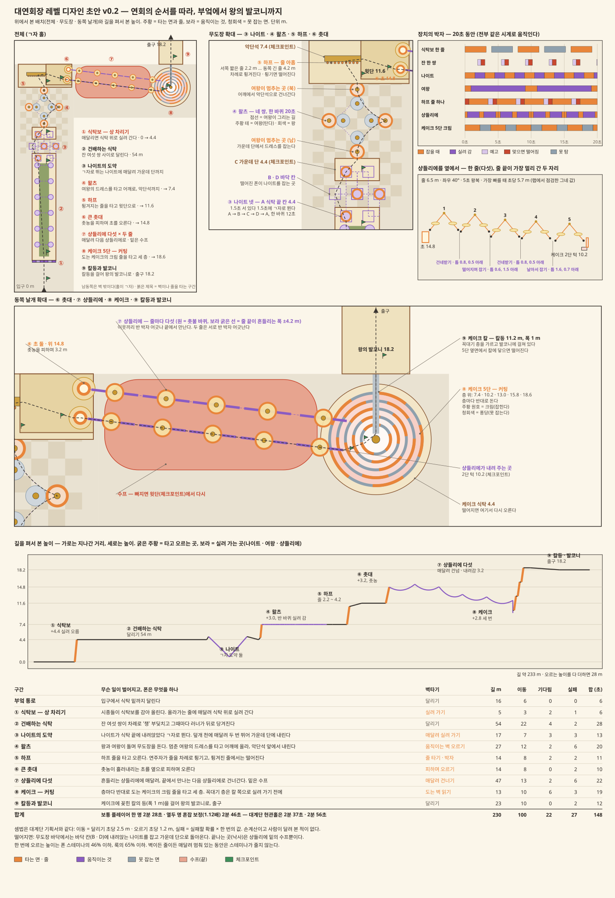

# 대연회장 레벨 디자인 초안 v0.2 — 연회의 순서를 따라, 부엌에서 왕의 발코니까지

2026-11-23 · R788 · 장소 [2-4 대연회장](PAWN_RUSH_PLACES_4MIN.md)(코스 2 · 중반 장애물). [v0.1(R787)](PAWN_RUSH_BANQUET_HALL_DESIGN_v0.1.md)을 본 사용자: "맵의 플레이타임은 대계단정도 나와야 해. 그리고 단순히 벽만 타는게 아니라, 컨셉에 맞게 벽을 타야하는 상황이 연출되어야 해. 예를 들어 흔들리는 샹들리에에 매달려서 다음 샹들리에로 넘어가는 코스라던가, 춤을 추는 체스 기물들이라던가 하는 느낌으로 해줘." 이어서: "그리고 기획이 되면 영상자료로 간단하게 어떤 식으로 진행되는지 자료로 만들어줘."

> **이 판은 지나갔다.** 구간은 그대로 두고 홀의 구성을 다시 짠 [v0.3(R789)](PAWN_RUSH_BANQUET_HALL_DESIGN_v0.3.md)이 있다(한 홀, ㄷ자 식탁과 가운데 무도장, 길이 세 번 오간다). 구간마다의 자세한 설명은 이 문서의 것이 그대로 맞고, 자리 · 좌표 · 홀의 모양은 v0.3이 맞다. 이 판의 숫자를 낸 `banquet_layout.py`는 v0.3의 숫자로 바뀌었다(이 판의 것은 git 기록 R788에 있다).

> **초안만 있다.** Unity에는 아무것도 없다. 수치는 폰의 속도와 벽타기 · 밧줄 규칙(코드에서 읽은 값)으로 손계산한 것이고, 사람이 달려 본 적이 없다. 사용자 검수 전.

- **진행 영상(약 1분 38초):** [banquet_flow_v0.2.mp4](ConceptArt/R788_BanquetHall/banquet_flow_v0.2.mp4) — 노란 표식을 단 폰 하나를 구간마다 따라간다. 장치는 전부 이 문서의 주기대로 움직인다. 폰의 움직임은 기획 수치(달리기 초당 2.5 m, 오르기 초당 1.2 m)로 **그린 것**이다. 게임을 찍은 것이 아니다.
- 컨셉 아트(사용자 제공): [banquet_concept.webp](ConceptArt/R787_BanquetHall/banquet_concept.webp)

## 한눈에

- **한 줄:** 연회가 진행되는 순서가 곧 코스다. 상을 차리고(식탁보) → 건배하고(잔) → 춤을 추고(나이트, 왕과 여왕의 왈츠) → 연주하고(하프) → 촛불을 켜고(촛대, 샹들리에) → 케이크를 자르고(케이크, 칼) → 왕 앞에 선다(발코니).
- **벽은 전부 '지금 벌어지는 일'이다.** 가만히 서 있는 벽을 오르는 곳은 없다. 감아 올리는 식탁보에 실려 가고, 뛰는 나이트에 매달리고, 춤추는 여왕의 드레스를 타고, 튕겨지는 하프 줄을 오르고, 촛농이 흐르는 초를 피해 오르고, 흔들리는 샹들리에에서 샹들리에로 건너가고, 도는 케이크를 칼에 닿기 전에 오른다.
- **플레이타임:** 보통 플레이어 한 명 **2분 28초**, 열두 명 혼잡 보정 **2분 46초**. 대계단 현관홀은 같은 셈법으로 2분 37초 · 2분 56초다(약 94%).
- **구조:** ㄱ자 홀. 남북 날개에 긴 식탁 · 무도장 · 악단석, 동쪽 날개에 샹들리에와 케이크. 높이는 부엌 0 → 식탁 4.4 → 악단석 7.4 → 윗단 11.6 → 초 14.8 → (샹들리에로 내려가며 건넘) → 케이크 10.2 → 18.6 → 발코니 18.2 m. 계단은 없다.
- **크기:** 길 약 233 m(수평 211 m), 타거나 실려 오르는 높이를 다 더하면 28 m.
- **떨어져도 대개 죽지 않는다.** 끝나는 곳(낙사)은 샹들리에 밑의 수프뿐이다.

| # | 구간 | 벌어지는 일 | 폰이 하는 것 | 벽타기 | 높이 (m) | 난이도 1~5 |
| --- | --- | --- | --- | --- | --- | --- |
| ① | 식탁보 — 상 차리기 | 시종들이 식탁보를 감아 올렸다 푼다 | 올라가는 줄에 매달려 식탁 위로 | 실려 가기 | 0 → 4.4 | 2 |
| ② | 건배하는 식탁 | 잔 여섯 쌍이 차례로 부딪친다 | 잔 사이를 달린다 54 m | 없음(달리기) | 4.4 | 3 |
| ③ | 나이트의 도약 | 나이트 넷이 ㄱ자로 뛰며 무도장을 돈다 | 덮개 천에 매달려 두 번 뛰어 가운데 단까지 | 매달려 실려 가기 | 4.4 | 3 |
| ④ | 왈츠 | 왕과 여왕 네 쌍이 돌며 무도장을 돈다 | 멈춘 여왕의 드레스를 타고 어깨로, 악단석 앞에서 내린다 | 움직이는 벽 오르기 | → 7.4 | 4 |
| ⑤ | 하프 | 연주자가 줄을 차례로 튕긴다 | 튕긴 직후의 줄을 타고 윗단으로 | 줄 타기 · 박자 | → 11.6 | 3 |
| ⑥ | 큰 촛대 | 초에서 촛농이 흘러내린다 | 옆으로 피하며 초를 오른다 | 피하며 오르기 | → 14.8 | 4 |
| ⑦ | 샹들리에 다섯 | 샹들리에가 흔들린다 | 매달려, 끝에서 만나는 다음 샹들리에로 건너간다 | 매달려 건너기 | 14.8 → 10.2 | 5 |
| ⑧ | 케이크 — 커팅 | 다섯 단 케이크가 층마다 반대로 돌고, 칼이 꼭대기 층에 꽂혀 있다 | 크림 줄을 타고 세 층을 오른다 | 도는 벽 읽기 | → 18.6 | 4 |
| ⑨ | 칼등과 발코니 | 칼이 발코니에 걸쳐 있다 | 칼등을 걸어 왕의 발코니로, 출구 | 없음 | 18.2 | 2 |

## 요청과 답

| 요청 | 답 |
| --- | --- |
| 플레이타임은 대계단 정도 | v0.1은 실수 없이 70초였다. v0.2는 대계단 기획서와 같은 셈법(이동 + 장치 기다림 + 실패 손실)으로 **2분 28초**, 혼잡 포함 2분 46초다. 대계단은 2분 37초 · 2분 56초. 식탁을 54 m로 늘리고, 무도장(나이트 · 왈츠)과 하프를 새로 넣고, 샹들리에를 둘에서 다섯으로, 케이크를 네 단에서 다섯 단으로 했다 |
| 단순히 벽만 타는 것이 아니라 컨셉에 맞는 상황 | 서 있는 벽을 오르는 곳을 없앴다(v0.1의 촛대 받침 기둥 3 m를 뺐다). 구간마다 연회에서 벌어지는 일 하나가 있고, 그 일 때문에 매달리게 된다 |
| 예: 흔들리는 샹들리에에 매달려 다음 샹들리에로 | ⑦. v0.1은 샹들리에 '위에 올라서서' 다음으로 뛰었다. v0.2는 샹들리에 밑에 **매달려** 흔들리다 끝에서 다음 것으로 옮겨 탄다. 다섯 개가 두 줄로 수프 위 47 m에 걸려 있다. 게임에 이미 있는 밧줄 그네를 쓴다 |
| 예: 춤을 추는 체스 기물들 | ③ ④. 무도장은 체스판이고, 기물이 저마다의 행마로 춤춘다. 나이트는 ㄱ자로 뛰고(매달려 실려 간다), 왕과 여왕은 왈츠를 춘다(여왕의 드레스를 타고 오른다) |
| 진행을 보여 주는 영상 | 구간마다 한 장면씩, 폰 하나를 따라가는 1분 38초 영상을 만들었다. 장치의 박자는 이 문서와 같다 |

## v0.1에서 바뀐 것

| | v0.1 (R787) | v0.2 (R788) |
| --- | --- | --- |
| 시간 | 실수 없이 70초 | 보통 2분 28초 · 혼잡 2분 46초 |
| 길 | 128 m | 233 m |
| 구간 | 여섯 | 아홉 |
| 뼈대 | 한 접시가 가는 길 | 연회의 순서(상 차림 → 건배 → 춤 → 연주 → 촛불 → 케이크 → 왕) |
| 홀 | 54 × 102 m 한 방 | ㄱ자: 남북 날개 30 × 115 m, 동쪽 날개 62 × 27 m |
| 식탁 | 38 m, 잔 네 쌍 | 54 m, 잔 여섯 쌍 |
| 무도장 | 없음 | 새로: 나이트의 도약 + 왈츠 |
| 하프 | 없음 | 새로: 튕겨지는 줄 타기 |
| 촛대 | 받침 기둥 3 m + 초 셋 | 초 둘(받침 기둥 없음). 샹들리에 줄마다 하나 |
| 샹들리에 | 둘, 위에 올라선다 | 다섯 × 두 줄, 밑에 매달린다(밧줄 그네) |
| 케이크 | 네 단, 갈림길 | 다섯 단, 세 층을 오른다. 칼이 꼭대기 층의 위험이 됐다 |
| 낙사 | 초 · 샹들리에 밑 수프 솥 | 샹들리에 밑 수프 |

## 뼈대 — 연회의 순서

| 연회에서 | 코스에서 | 어디 |
| --- | --- | --- |
| 상을 차린다 | ① 식탁보 | 부엌 → 긴 식탁 |
| 건배한다 | ② 건배하는 식탁 | 긴 식탁 위 |
| 춤을 춘다 | ③ 나이트의 도약 · ④ 왈츠 | 무도장(체스판) |
| 연주한다 | ⑤ 하프 | 악단석 |
| 촛불을 켠다 | ⑥ 큰 촛대 · ⑦ 샹들리에 | 윗단 → 수프 위 |
| 케이크를 자른다 | ⑧ 케이크 · ⑨ 칼등 | 케이크 식탁 |
| 왕 앞에 선다 | 출구 | 왕의 발코니 |

- **위에서 본 모양:** 입구에서 북쪽으로 긴 식탁을 달리고, 무도장을 건너 악단석에 오른 뒤, 동쪽으로 꺾어 샹들리에를 타고 케이크로 간다. 꺾이는 곳은 한 번이다.
- **옆에서 본 모양:** 오르고(식탁보) – 길게 달리고 – 내려갔다 올라오고(나이트) – 오르고(여왕) – 오르고(하프) – 오르고(초) – 흔들리며 내려가고(샹들리에) – 세 번 오르고(케이크) – 걷는다.
- **지나온 길이 보인다.** 케이크 위에서는 샹들리에와 무도장, 긴 식탁이 다 내려다보인다. 무도장에서는 북동쪽에 케이크가 보인다.
- **남동쪽은 벽 밖이다.** 홀이 ㄱ자라 길이 없는 넓은 바닥이 생기지 않는다.

좌표(구간 로컬: x 동쪽, y 높이, z 북쪽, 원점 = 입구 문턱). 숫자는 전부 `ArtSource/PawnRush/BanquetHall/banquet_layout.py`에서 나온다(그림과 영상도 이 파일의 숫자로 만든다).

| 것 | 자리 (x, z) | 크기 | 위 높이 |
| --- | --- | --- | --- |
| 부엌 통로 | (0, 0) ~ (0, 16) | 폭 16 | 0 |
| 긴 식탁 | x −6 ~ 6, z 16 ~ 70 | 12 × 54 | 4.4 |
| 나이트의 칸 A | (∓3, 67.6) | 3 × 3, 식탁 끝 위 | 4.4 |
| 나이트의 칸 B · D | (∓6, 73.6) · (0, 73.6) | 3 × 3, 무도장 바닥 | 0.4 |
| 가운데 단 (나이트의 칸 C) | x −6 ~ 6, z 77.2 ~ 83.2 | 12 × 6 | 4.4 |
| 왈츠의 원 | 가운데 (0, 93.4) | 쌍의 가운데가 11.4 × 13 m 타원을 돈다 | 여왕의 어깨 7.4 |
| 악단석 | x −13 ~ 14, z 103.4 ~ 115 | 27 × 11.6 | 7.4 |
| 하프 | z 109, 줄 x −8 ~ 0 | 줄 아홉, 1 m 간격 | 줄 꼭대기 9.6 ~ 11.6 |
| 윗단 | x 1 ~ 14, z 104.6 ~ 115 | 13 × 10.4 | 11.6 |
| 초 둘 | (11.7, 107.2) · (12.3, 112.4) | 지름 2, 받침 접시 4 | 14.8 |
| 샹들리에 | 초에서 동쪽(방위 97°)으로 5.5 · 14.7 · 23.6 · 32.8 · 42.8 m | 줄 6.5 m, 두 줄 | 줄 끝 15.4 → 12.2 |
| 수프 | x 16 ~ 53.7, z 98 ~ 114 | 38 × 16 | 국물 1.2 |
| 케이크 | (64.1, 103.4) | 층 지름 16.4 · 13.6 · 10.8 · 8 · 5.2 | 7.4 · 10.2 · 13.0 · 15.8 · 18.6 |
| 케이크 식탁 | (64.1, 103.4) | 지름 19.6 | 4.4 |
| 케이크 칼 | (64.1, 104.4) → (64.1, 115.6) | 칼등 폭 1, 길이 11.2 | 18.6 → 18.2 |
| 왕의 발코니 | x 58.1 ~ 70.1, z 115 ~ 127 | 12 × 12 | 18.2 |
| 출구 | (64.1, 18.2, 127) | 북쪽을 본다 | — |

## 벽타기와 줄 타기 — 코드에서 읽은 것

[시계탑 설계](PAWN_RUSH_ROYAL_CLOCK_TOWER_DESIGN_v0.1.md)가 정리한 값에, 이번에 코드(`RagdollPawn.UpdateClimb` · `RideWall` · `RagdollPawn.Rope.cs` · `RopeLine` · `RagdollTuning.asset`)에서 확인한 것을 더했다.

| 규칙 | 값 | 이 설계에서 |
| --- | --- | --- |
| 오르기 / 내려가기 / 옆으로 | 초당 1.2 / 1.6 / 0.9 m | 한 번에 오르는 높이는 4.4 m 이하. 옆으로는 피할 때만 |
| 스테미나 | 움직이면 8초. **매달려 멈춰 있으면 줄지 않는다**(벽도 줄도) | 실려 가는 동안과 기다리는 동안은 힘이 안 든다 |
| 움직이는 벽 | 붙은 벽이 움직이거나 돌면 같이 실려 간다. 놓으면 벽의 속도를 지닌 채 떨어진다 | ① 식탁보 ③ 나이트 ④ 여왕 ⑧ 케이크 |
| 공중에서 잡기 | 잡기 키를 누른 채 벽에 닿으면 붙는다(땅에 서 있지 않아도) | ④ 가운데 단에서 여왕에게 뛰어 붙을 때 |
| 꼭대기 | 타던 면이 끝나는 곳에서만 올라선다 | 여왕의 어깨, 초 위, 케이크 층 위 |
| 벽에서 내리기 | 키를 놓으면 그 자리에서 떨어진다. 발밑이 바닥이면 선다 | ③ 가운데 단 위에 선 나이트에서 손을 놓는다 |
| **밧줄(그네)** | 0.7 m 안의 줄을 잡기 키로 잡는다. 줄이 흔들리는 대로 실려 간다. W · S로 오르내린다 | ⑤ 하프 줄 ⑦ 샹들리에 |
| 밧줄에서 뛰기 | 스페이스 = 줄의 속도에 위로 초당 3.5 m를 더해 뛴다. 키를 놓으면 줄의 속도로 떨어진다. 0.5초 뒤부터 다시 잡을 수 있다 | ⑦ 다음 샹들리에로 |
| 밧줄 꼭대기 | 줄 꼭대기에서 W를 누르면 옆의 바닥에 올라선다 | ⑤ 하프의 목 |
| 못 잡는 면 | 재질로 가른다 | 케이크의 퐁당 줄, 왕의 망토, 무대와 윗단의 앞벽 |
| 떨어짐 | 4.1 m 넘게 떨어지면 1.3초 넘어진다. 죽지는 않는다 | 무도장 바닥으로 떨어지면 넘어졌다 일어난다 |
| 룩 | 등반 0.7배 | 필수 피치는 룩 스테미나의 65% 이하 |

밧줄 그네는 랩에서 점검된 값(줄 6.5 m, 좌우 40°, 5초, 8 m 틈)을 그대로 쓴다. 시계탑의 종 줄(⑤)도 같은 부품이다.

## 구간별

### ① 식탁보 — 상 차리기 (0 → 4.4 m)

**벌어지는 일.** 부엌 통로 끝에 긴 식탁의 남쪽 면이 벽처럼 서 있다. 시종들이 식탁보를 줄줄이 감아 올렸다 풀어 내린다.

**폰은.** 올라가는 줄(금색 무늬가 위로 흐른다)에 매달린다. 매달려만 있어도 식탁 위로 실려 가고, 같이 오르면 2초 남짓이다. 내려가는 줄(회색)에서는 올라가는 만큼 밀려 내려간다. 옆줄로 갈아탄다.

| 항목 | 값 |
| --- | --- |
| 줄 | 여섯 줄, 한 줄 폭 2 m (식탁 폭 12 m 전체) |
| 한 줄의 주기 | 8초: 위로 3.2초(초당 0.9 m) → 멈춤 0.8초 → 아래로 3.2초(초당 1.2 m) → 멈춤 0.8초 |
| 어긋남 | 이웃 줄과 3분의 1 주기. 늘 두 줄은 올라간다 |
| 밑단 | 아래 1.6 m는 흐르지 않는다 |

- 실패해도 다칠 것이 없다. 이 구간이 가르치는 것: **벽은 움직이고, 매달려 있으면 힘이 안 든다.** 뒤의 구간이 전부 이것을 쓴다.

*손잡이:* 흐르는 속도, 주기, 올라가는 줄의 비율.

### ② 건배하는 식탁 (4.4 m, 54 m)

**벌어지는 일.** 식탁 위. 올리브색 러너(폭 5 m) 양쪽에 큰 잔 여섯 쌍이 서 있고, 남쪽 쌍부터 차례로 건배한다.

**폰은.** 잔이 뒤로 젖혀지면(예고) 멈추고, 부딪친 뒤에 지나간다. 벽타기 사이에서 스테미나가 차는 구간이다.

| 항목 | 값 |
| --- | --- |
| 잔 | 여섯 쌍 (z 24 ~ 64, 8 m 간격), 높이 3.6 m, 러너 가운데에서 맞부딪친다 |
| 한 쌍의 주기 | 3.6초: 서 있음 1.9초 → 뒤로 젖힘 0.5초 → 가운데로 '챙' 0.3초 → 맞댄 채 0.3초 → 돌아감 0.6초 |
| 물결 | 남쪽 쌍부터 0.9초씩 늦게 |
| 맞으면 | 앞이나 뒤로 밀려 넘어진다(0.8초) |
| 러너 당김 | 잔이 부딪칠 때 그 앞 러너가 0.4초에 1.5 m 뒤로 당겨진다. 위의 폰도 끌려간다 |

- 식탁 옆으로 떨어지면 부엌 바닥이다. 식탁 옆면의 가만히 있는 식탁보로 다시 올라온다.

*손잡이:* 잔의 주기와 물결, 러너 당김(0이면 끔), 잔의 수.

### ③ 나이트의 도약 — 매달려 실려 가기 (4.4 → 0.4 → 4.4 m)

**벌어지는 일.** 식탁이 끝나고 무도장이다. 바닥은 체스판(한 칸 3 m)이고 4.4 m 아래다. 나이트 넷이 자기 행마(ㄱ자: 두 칸 + 한 칸)로 뛰며 마름모를 돈다. 식탁 끝 칸(A)에 내려앉았다, 바닥 칸(B)을 디디고, 가운데 단(C)에 올랐다, 바닥 칸(D)을 디디고 돌아온다.

**폰은.** 식탁 끝 칸에 나이트가 내려앉으면 덮개 천을 잡는다. 나이트 위에는 설 자리가 없다(말 머리다) — **매달려 있어야 한다.** 두 번 뛰는 동안 붙어 있다가, 가운데 단에 올라선 나이트에서 손을 놓는다. 놓치면 나이트가 다시 뛰어 한 바퀴(12초)를 돈다.

| 항목 | 값 |
| --- | --- |
| 나이트 | 넷. 몸통 지름 2.6 m, 덮개 천(잡는 면) 5.2 m, 머리까지 7 m |
| 한 번 | 칸에 1.5초 서 있다(처음 0.7초는 다음 칸 쪽으로 돈다) → 1.5초에 6.7 m를 뛴다(높은 칸보다 1.2 m 위까지) |
| 한 바퀴 | A → B → C → D → A, 12초 |
| 서쪽 둘 · 동쪽 둘 | 한쪽의 둘은 6초 차이, 양쪽은 3초 차이 — 3초마다 어느 한쪽 식탁 끝에 나이트가 온다 |
| 내려앉는 칸 | 보라색으로 칠해져 있다. 내려앉을 때 그 칸에 서 있으면 밀려 넘어진다 |
| D 칸 | 양쪽이 같이 쓴다. 네 나이트가 3초 간격으로 번갈아 디딘다 |

- 매달려 있는 동안은 스테미나가 줄지 않는다. 하는 일은 **잡을 때**와 **놓을 때**를 맞추는 것이다.
- **떨어진 폰의 길이기도 하다.** 무도장 바닥에 떨어지면 바닥 칸(B · D)에 내려앉는 나이트를 잡는다. B에서 잡으면 가운데 단으로, D에서 잡으면 식탁 끝으로 올라간다.
- 바닥에서는 춤추는 기물들에 밀린다.

*손잡이:* 서 있는 시간, 뛰는 시간과 높이, 나이트의 수.

### ④ 왈츠 — 춤추는 여왕의 드레스 (4.4 → 7.4 m)

**벌어지는 일.** 가운데 단과 악단석 사이에서 왕과 여왕 네 쌍이 왈츠를 춘다. 한 쌍은 마주 잡고 돌면서(한 바퀴에 세 번) 무도장을 한 바퀴(20초) 돈다. 이 두 회전이 겹쳐, 여왕은 **네 곳에서 멈췄다가** 사이를 크게 휘돌아 간다. 멈추는 곳이 남쪽(가운데 단 앞) · 동쪽 · 북쪽(악단석 앞) · 서쪽이다.

**폰은.** 여왕이 가운데 단 앞에 멈춘 순간 드레스를 잡는다. 어깨까지 3 m를 타고 오르는 동안 여왕은 다시 돌기 시작한다. 어깨 위(머리 둘레의 폭 0.75 m 턱)에 서서 반 바퀴(10초)를 실려 가, 여왕이 악단석 앞에 멈추면 건너뛴다.

| 항목 | 값 |
| --- | --- |
| 쌍 | 넷. 5초마다 여왕 하나가 가운데 단 앞에 온다 |
| 여왕 | 드레스(잡는 면) 밑 지름 3.6 m → 어깨 2.6 m, 어깨 높이 7.4 m |
| 왕 | 같은 크기, 망토는 못 잡는 면. 늘 여왕의 안쪽(무도장 가운데 쪽)에 있다 |
| 멈춤 | 가운데 단 끝에서 0.3 m, 악단석 끝에서 0.3 m. 손이 닿는 시간은 약 1초 |
| 실려 가는 길 | 반 바퀴 23.7 m, 10초. 가장 빠를 때 초당 약 3.7 m |

- 쌍이 한 덩어리로 도므로, 가운데 단 쪽(바깥)에서 잡은 폰은 내내 바깥쪽에 있다. 왕과 여왕 사이에 끼지 않는다. 악단석 앞에서는 저절로 악단석 쪽을 본다.
- 타고 오르는 동안 화면이 같이 돈다.
- 어깨 위는 좁다. 같이 탄 상대를 밀어 떨어뜨릴 수 있는 자리다. 맞잡은 팔(폭 0.45 m) 위를 건너 왕의 어깨로 피할 수 있다.
- 내릴 때를 놓치면 반 바퀴를 더 돌아 가운데 단 앞으로 돌아온다(10초).
- 떨어지면 무도장 바닥이다(7.4 m, 넘어진다). 나이트로 돌아온다.

*손잡이:* 한 바퀴의 시간, 쌍의 수, 멈추는 곳과의 틈, 어깨 턱의 폭.

### ⑤ 하프 — 튕겨지는 줄 (7.4 → 11.6 m)

**벌어지는 일.** 악단석에 큰 하프가 서 있고, 연주자(비숍)가 줄을 서쪽부터 차례로 튕긴다. 줄은 서쪽이 짧고 동쪽이 길다. 하프의 목은 줄 꼭대기를 잇는 비탈길이고, 윗단으로 이어진다.

**폰은.** 줄 하나를 골라 타고 오른다(줄 타기). 튕겨지는 줄에 매달려 있으면 떨어진다. 튕긴 직후에 잡고, 다음 차례 전에 꼭대기에 닿아 목 위로 올라선다.

| 항목 | 값 |
| --- | --- |
| 줄 | 아홉, 1 m 간격. 오르는 높이 2.2 m(서쪽 끝) ~ 4.2 m(동쪽 끝) |
| 튕김 | 줄마다 4.2초에 한 번. 서쪽 줄부터 0.3초씩 늦게(2.4초에 걸쳐 훑고 1.8초 쉰다) |
| 예고 | 튕기기 0.7초 전부터 줄이 보라색으로 당겨진다 |
| 튕기면 | 그 줄에 매달린 폰은 떨어진다. 0.6초 동안 그 줄은 못 잡는다 |
| 쓸 수 있는 시간 | 한 줄에 3.6초(4.2 − 0.6). 그중 마지막 0.7초는 예고가 떠 있다 |

- **갈림이 여기 하나 있다.** 긴 줄(동쪽)은 꼭대기가 곧 윗단이라 빠르지만 4.2 m를 오르는 데 3.5초가 들어, 다시 잡을 수 있게 된 바로 그때 잡고 예고가 뜬 뒤에도 올라야 한다 — 폰은 빠듯하고 룩(5.0초)은 못 한다. 짧은 줄(서쪽)은 1.8초면 오르지만 목 위를 8 m 걸어야 한다. **빠른 길이 어려운 길이다.**
- 떨어져도 악단석 바닥이다(2 ~ 4 m). 다시 잡는다.
- 줄 타는 법(잡기, W, 꼭대기에서 올라서기)을 낙사가 없는 곳에서 익힌다. 바로 뒤가 샹들리에다.

*손잡이:* 튕김 간격, 훑는 속도, 예고 시간, 줄의 수와 길이.

### ⑥ 큰 촛대 — 피하며 오르기 (11.6 → 14.8 m)

**벌어지는 일.** 윗단 동쪽 끝에 큰 초 둘이 서 있다. 꼭대기에서 촛농이 맺혀 흘러내린다. 초 위가 샹들리에를 잡는 자리다(초 하나에 샹들리에 한 줄).

**폰은.** 초를 타고 3.2 m 오른다. 머리 위에 촛농이 맺히면(보라색) 옆으로 0.5 m 비킨다. 초가 둥글어서 뒤쪽으로 돌아가 피할 수도 있다.

| 항목 | 값 |
| --- | --- |
| 초 | 둘, 지름 2 m, 3.2 m. 위는 지름 2 m — 한둘이 선다 |
| 촛농 | 초마다 0.9초에 한 방울. 둘레를 여섯 줄로 나눠 건너편 줄로 번갈아 |
| 예고 | 꼭대기 가장자리에 0.7초 맺혔다가 초당 2.2 m로 흘러내린다 |
| 맞으면 | 손이 풀려 떨어진다 — 윗단(3 m 아래). 동쪽으로 벗어나면 수프 |

*손잡이:* 방울 간격, 예고 시간, 방울의 폭, 초의 굵기.

### ⑦ 샹들리에 다섯 — 매달려 건너기 (14.8 → 10.2 m, 47 m)

**벌어지는 일.** 윗단과 케이크 사이는 수프 위의 허공이다. 샹들리에 다섯이 한 줄로 걸려 앞뒤로 흔들린다. 줄이 둘이다. 이웃한 샹들리에는 반 박자 어긋나 있어, 한쪽이 앞 끝에 갈 때 다음 것이 뒤 끝으로 와서 **끝에서 만난다.**

**폰은.** 초 위에서 첫 샹들리에의 줄 끝(크리스털 술)을 잡는다. 매달려 반 박자(2.5초)를 실려 가, 다음 샹들리에와 만나는 순간 옮겨 탄다. 네 번 옮겨 타고, 다섯째에서 케이크 2단 턱에 내린다. 흐름을 놓치지 않으면 줄 위에서 12.5초다.

| 항목 | 값 |
| --- | --- |
| 샹들리에 | 한 줄에 다섯, 두 줄(서로 반 박자 차이). 줄 길이 6.5 m, 촛불 바퀴는 줄의 4 m 지점 |
| 흔들림 | 좌우 40°, 5초. 줄 끝이 앞뒤로 ±4.2 m, 가장 빠를 때 초당 5.7 m |
| 줄 끝의 높이 | 15.4 → 14.9 → 13.4 → 12.9 → 12.2 m. 뒤로 갈수록 낮다 |
| 내리는 곳 | 케이크 2단 턱(10.2 m), 줄 끝에서 약 2 m 아래 |
| 밑 | 수프. 빠지면 윗단(체크포인트)에서 다시 — 초를 다시 오른다 |

옮겨 타는 네 번이 다 다르다.

| 어디서 | 이름 | 만날 때의 틈 | 높이 차 | 하는 것 |
| --- | --- | --- | --- | --- |
| 1 → 2 | 건네받기 | 0.8 m | 0.5 m 아래 | 끝에서 뛰어(스페이스) 다음 줄을 잡는다 |
| 2 → 3 | 떨어지며 잡기 | 0.6 m | 1.5 m 아래 | 손을 놓고 떨어지다 잡는다 |
| 3 → 4 | 건네받기 | 0.8 m | 0.5 m 아래 | 한 번 더, 숨 고르기 |
| 4 → 5 | 날아서 잡기 | 1.6 m | 0.7 m 아래 | 끝에 닿기 전, 아직 앞으로 가고 있을 때 뛰어야 닿는다 |

- 매달려 있는 동안은 스테미나가 줄지 않는다. 줄을 놓치지 않는 한 힘은 안 든다 — 어려운 것은 **때**다.
- 만나는 때를 놓치면 그 샹들리에에 매달린 채 한 박자(5초)를 더 돈다. 떨어지지는 않는다.
- 줄 위쪽으로 올라가(W) 덜 흔들리는 데서 기다릴 수 있다. 옮겨 타려면 다시 끝으로 내려와야 한다(끝이 가장 멀리 간다).
- 한 줄에 둘까지 매달린다.
- 시계탑의 종 줄(줄 다섯이 나란히, 한 번 흔들려 건넌다)과 같은 부품이지만, 여기서는 **줄에서 줄로** 이어 건넌다.

*손잡이:* 틈과 높이 차(위 표), 흔들림의 폭과 주기, 샹들리에의 수.

### ⑧ 케이크 — 커팅 (10.2 → 18.6 m)

**벌어지는 일.** 다섯 단 케이크가 층마다 반대 방향으로 돈다. 옆면은 크림 줄(잡힌다)과 퐁당 줄(못 잡는다)이 번갈아 있다. 케이크를 자르던 큰 칼이 꼭대기 층에 꽂힌 채 북쪽 발코니에 걸쳐 있다 — 칼은 돌지 않는다.

**폰은.** 2단 턱에 내려, 3단 · 4단 · 5단을 차례로 오른다. 턱은 아래층과 같이 돌고 위층 벽은 반대로 돌아서, 서 있으면 크림 줄이 앞으로 지나간다. 지나갈 때 잡고 2.8 m를 오른다. 매달린 폰은 케이크가 실어 간다. 꼭대기 층은 칼이 있는 쪽으로 실려 가므로, **칼에 닿기 전에** 올라서야 한다.

| 층 | 지름 | 위 높이 | 도는 속도 | 턱의 폭 | 크림 줄 |
| --- | --- | --- | --- | --- | --- |
| 1 | 16.4 m | 7.4 m | 초당 6° | 1.4 m | 40° 다섯 |
| 2 | 13.6 m | 10.2 m | 초당 8°, 반대로 | 1.4 m | 40° 다섯 |
| 3 | 10.8 m | 13.0 m | 초당 10° | 1.4 m | 50° 넷 |
| 4 | 8 m | 15.8 m | 초당 13°, 반대로 | 1.4 m | 50° 넷 |
| 5 | 5.2 m | 18.6 m | 초당 18° | (꼭대기) | 70° 셋 |

| 어디에 서서 | 위층 크림 줄이 오는 간격 | 앞에 머무는 시간 |
| --- | --- | --- |
| 2단 턱 → 3단 | 5.0초 | 2.8초 |
| 3단 턱 → 4단 | 3.9초 | 2.2초 |
| 4단 턱 → 5단 | 3.9초 | 2.3초 |

- 한 층을 오르는 데 2.3초. 그동안 꼭대기 층은 42° 돈다. 칼 양옆 12° 안에 들어가면 손이 풀린다. 칼에서 60°쯤 떨어진 데서 시작해야 한다.
- 4단 턱에 서 있어도 칼날 밑동이 벽처럼 턱을 가로막고 있어, 실려 가다 밀린다.
- **떨어져도 케이크 위다.** 한두 층 아래 턱이나 케이크 식탁(4.4 m)에 떨어져 다시 오른다. 1단과 2단은 그렇게 돌아오는 길이다.
- 꼭대기(지름 5.2 m, 왕관 장식)에서 칼등으로 올라선다.

*손잡이:* 층마다의 속도, 크림 줄의 폭과 수, 턱의 폭, 칼의 폭.

### ⑨ 칼등과 왕의 발코니 (18.6 → 18.2 m)

칼등(폭 1 m, 길이 11.2 m)을 걸어 발코니로 간다. 발코니(12 × 12 m)에는 아무것도 없다 — 출구까지 12 m.

- 칼은 서 있고 꼭대기 층은 돈다. 지나가며 올라선다.
- 칼등에서 떨어지면 대개 케이크의 아래 턱이나 케이크 식탁이다. 4단 턱의 체크포인트에서 꼭대기 층만 다시 오른다.

## 떨어지면

| 어디서 | 어디로 | 치르는 값 |
| --- | --- | --- |
| ① 식탁보 | 부엌 바닥(발밑) | 없음 |
| ② 식탁 옆 | 부엌 바닥 | 넘어짐 1.3초 + 옆 식탁보 4.4 m |
| ③ 나이트 | 무도장 바닥 | 바닥 칸에서 나이트를 다시 잡는다(약 9초) |
| ④ 여왕 | 무도장 바닥 | 나이트 → 가운데 단 → 다음 여왕(약 23초) |
| ⑤ 하프 줄 | 악단석 | 다음 박자에 다시(약 5초) |
| ⑥ 초 | 윗단, 또는 **수프** | 다시 3.2 m, 또는 윗단에서 다시 |
| ⑦ 샹들리에 | **수프** | 윗단에서 다시: 초 + 샹들리에(약 13초) |
| ⑧ 케이크 | 아래 턱, 케이크 식탁 | 한두 층을 다시(약 8초) |
| ⑨ 칼등 | 케이크 턱, 케이크 식탁 | 꼭대기 층을 다시(약 12초) |

- **끝나는 곳(낙사)은 수프 하나다.** 초의 동쪽과 샹들리에 밑에만 있다.
- 나머지는 전부 '떨어졌다가 다시 타기'다. 실패할수록 더 탄다.

체크포인트 아홉: 입구, 식탁 남쪽 끝, 식탁 북쪽 끝, 가운데 단, 악단석, 윗단, 케이크 2단 턱, 케이크 4단 턱, 왕의 발코니. 케이크의 둘은 도는 턱 위의 고정된 자리다(턱은 고리 모양이라 어디로 내려도 턱 위다).

## 피치와 스테미나

한 번에 오르는 높이와 그때 쓰는 스테미나. 폰은 8초, 룩은 같은 8초에 0.7배 속도다.

| 피치 | 높이 | 폰 | 룩 |
| --- | --- | --- | --- |
| 식탁보 — 가만히 있는 줄로 | 4.4 m | 46% | 65% |
| 식탁보 — 올라가는 줄에 매달려 | (실려 감) | 0% | 0% |
| 나이트 | (실려 감) | 0% | 0% |
| 여왕의 드레스 | 3.0 m | 31% | 45% |
| 하프 — 짧은 줄 / 가운데 줄 / 긴 줄 | 2.2 / 3.2 / 4.2 m | 23 / 33 / 44% | 33 / 48 / 62% |
| 초 (촛농 한 번 피함) | 3.2 m | 41% | 58% |
| 샹들리에 | (실려 감) | 0% | 0% |
| 케이크 한 층 (세 번, 사이에 턱에서 쉼) | 2.8 m | 29% | 42% |

- 발을 디디면 0.8초 뒤부터 초당 25%씩 찬다. 여왕의 어깨, 하프의 목, 초 위, 케이크 턱이 그런 자리다.
- 질주와 스테미나를 같이 쓴다. 식탁을 질주로 건너면 무도장 앞에서 비어 있다 — 나이트는 매달려만 있으면 되니 그사이에 찬다.

## 시간 예산

대계단 현관홀 기획서(v0.3 7절)와 같은 셈법이다. 보통 플레이어 한 명 기준, 이동은 달리기 초당 2.5 m · 오르기 초당 1.2 m, 실패 손실은 '실패할 확률 × 한 번의 값'이다. 단위 초.

| 구간 | 길 (m) | 이동 | 장치 기다림 | 실패 손실 | 합 |
| --- | --- | --- | --- | --- | --- |
| 부엌 통로 | 16 | 6 | 0 | 0 | 6 |
| ① 식탁보 | 5 | 4 | 2 | 1 | 6 |
| ② 건배하는 식탁 | 54 | 22 | 5 | 2 | 29 |
| ③ 나이트의 도약 | 17 | 7 | 3 | 3 | 13 |
| ④ 왈츠 | 27 | 12 | 3 | 6 | 20 |
| ⑤ 하프 | 14 | 8 | 2 | 2 | 11 |
| ⑥ 큰 촛대 | 14 | 8 | 0 | 2 | 10 |
| ⑦ 샹들리에 다섯 | 47 | 13 | 2 | 7 | 22 |
| ⑧ 케이크 | 13 | 10 | 7 | 3 | 19 |
| ⑨ 칼등과 발코니 | 23 | 10 | 0 | 2 | 12 |
| 합계 | 230 | 100 | 22 | 27 | **148 (2분 28초)** |

- 12명 혼잡 보정 1.12배를 하면 **약 2분 46초**. 대계단은 157초(2분 37초) · 혼잡 2분 56초다.
- 148초 가운데 벽이나 줄에 붙어 있는 시간(오르기 + 실려 가기)은 약 50초, 3분의 1이다.
- 회색 상자로 달려 보기 전에는 믿을 수 없는 숫자다. 처음 타 보는 장치(줄에서 줄로)가 많아 실패 손실은 더 클 수 있다.

늘리거나 줄이는 손잡이.

| 손잡이 | 바뀌는 시간 |
| --- | --- |
| 샹들리에 다섯 → 여섯 | +3초 |
| 케이크에 내리는 곳을 2단 턱 → 1단 턱(네 층을 오른다) | +7초 |
| 식탁 54 m → 62 m, 잔 일곱 쌍 | +4초 |
| 왈츠의 쌍 넷 → 셋 (기다림이 는다) | +1초 |
| 하프를 뺀다(악단석에서 윗단으로 계단) | −9초 |
| 나이트를 뺀다(식탁이 가운데 단까지 이어진다) | −10초 |

## 새 장치

전부 공유 시계(`ObstacleClock`)의 시간 함수로 움직여 온라인으로 보낼 것이 없다. 맞음 판정은 방장이 한다.

| 장치 | 구간 | 만드는 법 |
| --- | --- | --- |
| 흐르는 식탁보 | ① | 새 코드(작다): 서 있는 벽이 "이 속도로 움직인다"고 알려 준다. 바닥 컨베이어(`ConveyorBeltSurface`)가 같은 방식이다 |
| 건배하는 잔 · 당겨지는 러너 | ② | 새 코드: 시간 함수로 기우는 잔(천문대의 조리개 날과 같은 틀), 러너는 위와 같은 '움직인다고 알려 주는 바닥' |
| 뛰는 나이트 | ③ | 새 코드: 시간 함수로 칸에서 칸으로 뛰는 움직이는 벽(`Obstacle` + `IMovingSurface`). 내려앉을 때 밀어내는 판정 |
| 왈츠의 쌍 | ④ | 새 코드: 두 회전을 겹친 움직이는 벽. 여왕의 드레스만 잡는 면 |
| 하프 줄 | ⑤ | 기존 밧줄(`RopeLine`, 흔들림 0) + 새 코드(작다): 시간표대로 줄에 매달린 폰을 떨어뜨린다 |
| 촛농 | ⑥ | 새 코드: 시간표대로 흘러내리는 방울 + 시계탑의 손 떼기 판정(`ClimbPeel`) |
| 샹들리에 | ⑦ | **기존 밧줄 그네(`RopeLine`) 그대로.** 촛불 바퀴는 줄을 따라가는 그림만 |
| 도는 케이크 | ⑧ | 기존 회전 움직임(`ObstacleMotion`). 크림 · 퐁당은 재질. 칼 옆의 손 떼기 판정(`ClimbPeel`) |

기존 수입 장애물(벨트 · 추 · 미닫이 벽 등)은 하나도 쓰지 않는다.

## 회색 상자에서 가장 먼저 볼 것

코드를 읽어 '될 것'이라고 본 것들이다. 달려 봐야 안다.

1. **줄에서 줄로 옮겨 타기.** 밧줄 코드에 "뛴 뒤 공중에서 다음 줄을 잡을 수 있다"고 적혀 있지만, 랩이 점검한 것은 줄 하나로 8 m를 건너는 것이다. 틈 0.8 m가 맞는지, '날아서 잡기' 1.6 m가 되는지.
2. **뛰는 나이트에 매달려 있기.** 움직이는 벽은 매달린 폰을 실어 가지만, 이만큼 빠르게 오르내리는 벽은 처음이다(바닥 칸에서 단으로 뛸 때 가장 빠른 순간 초당 11 m). 카메라가 따라가는지도. 너무 거칠면 뛰는 시간을 늘린다.
3. **돌면서 가는 여왕을 타고 오르기.** 멈춘 1초 안에 잡히는지(가운데 단 앞 1.0초, 악단석 앞 1.5초로 셈했다), 어깨 턱 0.75 m에 올라서는지.
4. **흐르는 식탁보.** 서 있는 벽이 속도만 알려 줘도 폰이 실려 가는지.
5. **케이크의 크림 · 퐁당 경계.** 오르는 중에 경계를 넘으면 손이 어떻게 되는지.
6. **난이도.** 천문대는 첫 회색 상자가 너무 쉬웠다. 여기서도 틈 · 주기 · 멈추는 시간을 먼저 조여 볼 것.

## 분위기

- **빛과 색:** 컨셉 아트 그대로 — 크림색 석재와 호두나무, 올리브색 천과 금, 촛불. 무도장은 쪽매 체스판, 동쪽 날개는 샹들리에 불빛과 수프의 붉은빛.
- **기물:** 춤추는 것은 전부 체스 기물이다. 나이트는 상아색과 흑단색이 둘씩, 왕과 여왕은 주황 드레스와 회청색 망토. 연주자는 비숍, 시종은 폰.
- **소리가 박자다:** 건배의 '챙', 나이트가 내려앉는 '쿵', 왈츠(3박자 — 여왕이 멈추는 때가 마디의 첫 박), 하프의 훑는 소리, 샹들리에의 삐걱임, 케이크 받침의 오르골. 장치의 박자를 귀로도 읽게 한다.
- **가장 높은 곳이 가장 화려하다:** 케이크 꼭대기의 왕관과 칼, 그 끝의 왕의 발코니.

## 다른 구간과 겹치지 않게

| 다른 구간 | 거기 있는 것 | 여기서 다른 점 |
| --- | --- | --- |
| [왕실 시계탑](PAWN_RUSH_ROYAL_CLOCK_TOWER_DESIGN_v0.1.md) ② 짝 추 | 오르내리는 추 위에 올라탄다 | 나이트는 옆으로 6.7 m씩 뛰고, 위에 설 수 없다 |
| 시계탑 ⑤ 종 줄 | 줄 다섯이 나란히, 줄 하나로 8 m를 건넌다 | 샹들리에는 다섯이 한 줄로 이어져 줄에서 줄로 옮겨 탄다 |
| 시계탑 ⑥ 편종 원통 | 도는 원통에 붙어 빗살을 피한다 | 케이크는 층마다 반대로 돌고 잡히는 줄이 따로 있다. 위험(칼)은 하나, 서 있다 |
| [왕실 천문대](PAWN_RUSH_ROYAL_OBSERVATORY_STRUCTURE_v0.3.md) 공전 발판 | 도는 발판에서 발판으로 걸어 건넌다 | 여왕은 타고 올라야 하고, 돌면서 간다. 갈아타지 않고 한 여왕이 끝까지 실어 간다 |
| [대계단 현관홀](PAWN_RUSH_GRAND_STAIR_HALL_DESIGN_v0.3.md) 샹들리에 | 떨어지거나 흔들려 치는 것 | 매달려 타는 것 |

## 낙오자 구제의 쉬운 길 (R783 규칙)

뒤 미니게임이 끝나면 걸어서 지나갈 길이 열려야 한다. 계단이 없는 구간이므로 그때 길이 나타나게 한다: 부엌에서 식탁으로 오르는 시종 계단, 식탁 끝에서 가운데 단을 지나 악단석으로 가는 무도장 위 다리, 악단석에서 윗단으로 오르는 계단, 윗단에서 케이크 꼭대기 옆을 지나 발코니로 가는 회랑. 모양과 자리는 회색 상자 때 정한다.

## 먼저 정할 것

1. **이 뼈대로 갈지.** 연회의 순서 아홉 구간, ㄱ자 홀.
2. **나이트와 왈츠를 둘 다 둘지.** 둘 다 '움직이는 기물에 붙어 실려 간다'이다. 나이트는 매달려만 있고(때 맞추기), 여왕은 타고 오른다. 하나만 남긴다면 왈츠다(나이트를 빼면 −10초).
3. **하프.** 줄 타기를 낙사 없는 곳에서 먼저 익히게 하려고 넣었다. 튕김 판정에 작은 새 코드가 든다. 빼면 −9초.
4. **샹들리에 밑이 낙사인 것.** 47 m를 건너다 빠지면 윗단에서 다시다. 중간(셋째 샹들리에 밑)에 쉴 수 있는 큰 샹들리에를 하나 넣을지.
5. **떨어져도 죽지 않는 것.** v0.1과 같다. 무도장에서는 나이트가 돌아오는 길이다.
6. **건배 때 러너가 당겨지는 것.** 넣을지 뺄지.
7. **어느 칸에 둘지.** 코스 2(중반 장애물)의 초안 칸에 `Mid_2-4_GrandBanquetHall`로. 시계탑 초안과 같은 칸이다.

## 다음 단계

뼈대가 정해지면 회색 상자(구간 프리팹, 코스 프리팹 시험에서 달려 보기). 한 번에 다 짓지 않고, 먼저 위의 '가장 먼저 볼 것' 1 ~ 3(샹들리에 줄, 나이트, 여왕)만 작은 시험 방에 놓고 되는지를 본 뒤 전체를 짓는 순서를 권한다.

## 진행 영상에 대해

- 파일: [banquet_flow_v0.2.mp4](ConceptArt/R788_BanquetHall/banquet_flow_v0.2.mp4) (1280 × 720, 약 1분 38초). 만드는 스크립트: `ArtSource/PawnRush/BanquetHall/banquet_flow_video.py`(Blender).
- 장면 열하나: 전체 → ① ~ ⑨ → 맺음. 구간마다 화면이 바뀌고 아래에 구간 이름과 한 줄 설명이 뜬다. 따라가는 폰 위에 노란 표식이 있다.
- 장치(식탁보 · 잔 · 나이트 · 왈츠 · 하프 · 촛농 · 샹들리에 · 케이크)는 이 문서의 주기 그대로다. 숫자를 바꾸고 스크립트를 다시 돌리면 영상도 바뀐다.
- 폰의 움직임은 "이렇게 지나가도록 설계했다"는 그림이다. 물리도 조작도 들어 있지 않다. 되는지는 회색 상자에서 본다.
- 하프 장면에서 파란 폰 하나가 긴 줄을 늦게 타다 튕겨 떨어진다(실패의 예).
- 구간 사이는 잘라 붙였다. 영상의 길이는 플레이타임이 아니다.
