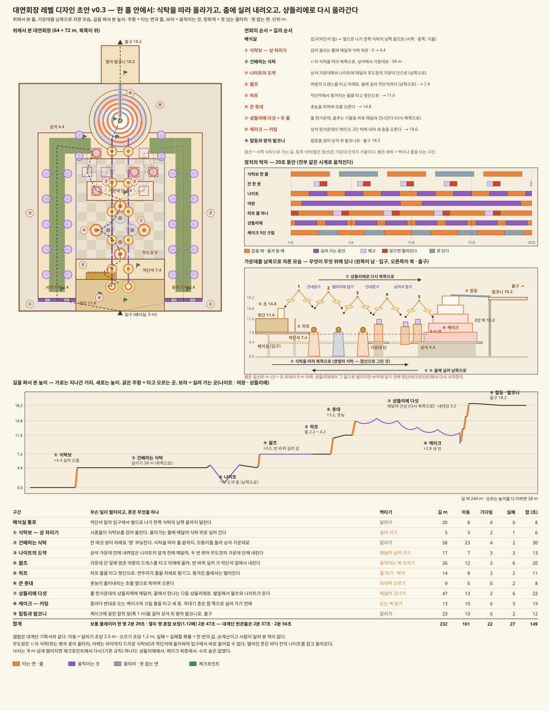

# 대연회장 레벨 디자인 초안 v0.3 — 한 홀 안에서 세 번 오간다

2026-11-23 · R789 · 장소 [2-4 대연회장](PAWN_RUSH_PLACES_4MIN.md)(코스 2 · 중반 장애물). [v0.2(R788)](PAWN_RUSH_BANQUET_HALL_DESIGN_v0.2.md)를 본 사용자: "구간들은 좋은 것 같아. 그런데 지금 맵의 전체적인 구성을 보면 대연회장같지 않고 대연회장 내의 요소들을 구간으로 만들어서 이어붙이기만 한 느낌이라 전체적으로 보면 구성이 어색해. 천문대와 마찬가지로 꼭 1자 코스가 아니여도 좋으니 전체적인 구성도 대연회장에 맞게 구성해줘."

> **초안만 있다.** Unity에는 아무것도 없다. 수치는 폰의 속도와 벽타기 · 밧줄 규칙(코드에서 읽은 값)으로 손계산한 것이고, 사람이 달려 본 적이 없다. 사용자 검수 전.

- **진행 영상(약 1분 47초):** [banquet_flow_v0.3.mp4](ConceptArt/R789_BanquetHall/banquet_flow_v0.3.mp4) — 노란 표식을 단 폰 하나를 구간마다 따라간다. 장치는 전부 이 문서의 주기대로 움직인다. 폰의 움직임은 기획 수치로 **그린 것**이다. 게임을 찍은 것이 아니다.
- 컨셉 아트(사용자 제공): [banquet_concept.webp](ConceptArt/R787_BanquetHall/banquet_concept.webp)

## 한눈에

- **구간은 v0.2 그대로, 놓인 자리를 바꿨다.** v0.2는 폭 30 m 복도에 구간을 한 줄로 늘어놓고 옆 날개를 붙인 ㄱ자였다. v0.3은 **홀 하나**(64 × 72 m)이고, 연회장이 실제로 놓이는 대로 놓았다.
- **홀의 구성:** 입구 위에 **악단석**, 홀을 따라 **ㄷ자 연회 식탁**, 식탁에 둘러싸인 **무도장**(체스판), 무도장 위 한가운데로 **샹들리에 두 줄**, 맨 끝 **상석 한가운데에 케이크**, 그 위 벽에 **왕의 발코니**.
- **길은 홀을 세 번 오간다.** ① 식탁을 따라 홀 끝까지 **올라가고**(양옆), ② 춤에 실려 입구 쪽 악단석까지 **내려오고**(가운데 바닥), ③ 샹들리에를 타고 다시 홀 끝까지 **올라간다**(가운데 공중). 세 길이 서로 다른 높이에 겹쳐 있어, 어디에 있든 다른 구간의 사람들이 보인다.
- **플레이타임:** 보통 플레이어 한 명 **2분 29초**, 열두 명 혼잡 보정 **2분 47초**. 대계단 현관홀은 같은 셈법으로 2분 37초 · 2분 56초다(약 95%).
- **크기:** 홀 64 × 72 m, 길 약 244 m(수평 222 m), 타거나 실려 오르는 높이를 다 더하면 28 m.
- **낙사는 규칙 하나:** 8 m 넘게 떨어지면 체크포인트에서 다시(게임에 이미 있는 규칙). 수프 솥은 없앴다.

| # | 구간 | 홀의 어디 | 어느 쪽으로 | 폰이 하는 것 | 높이 (m) |
| --- | --- | --- | --- | --- | --- |
| – | 배식실 | 악단석 밑 | 옆으로 | 입구에서 한쪽 식탁의 남쪽 끝으로 | 0 |
| ① | 식탁보 — 상 차리기 | 식탁의 남쪽 끝 | 위로 | 감아 올리는 줄에 매달려 식탁 위로 | 0 → 4.4 |
| ② | 건배하는 식탁 | ㄷ자 식탁 위 | **북쪽으로**, 모퉁이를 돌아 가운데로 | 잔 여섯 쌍 사이를 달린다 58 m | 4.4 |
| ③ | 나이트의 도약 | 상석 가운데 → 무도장 | **남쪽으로** | 나이트에 매달려 두 번 뛰어 가운데 단까지 | 4.4 |
| ④ | 왈츠 | 무도장 | **남쪽으로** | 여왕의 드레스를 타고 어깨로, 악단석까지 실려 간다 | → 7.4 |
| ⑤ | 하프 | 악단석 | 위로 | 튕겨지는 줄을 타고 윗단으로 | → 11.6 |
| ⑥ | 큰 촛대 | 윗단 | 위로 | 촛농을 피하며 초를 오른다 | → 14.8 |
| ⑦ | 샹들리에 다섯 | 무도장 위 한가운데 | **다시 북쪽으로** | 매달려 다음 샹들리에로 건너간다 47 m | 14.8 → 10.2 |
| ⑧ | 케이크 — 커팅 | 상석 한가운데 | 위로 | 크림 줄을 타고 세 층 | → 18.6 |
| ⑨ | 칼등과 발코니 | 상석 위 | 북쪽으로 | 칼등을 걸어 왕의 발코니로, 출구 | 18.2 |

## 요청과 답

| 요청 | 답 |
| --- | --- |
| 구간들은 좋다 | 아홉 구간과 그 숫자(주기 · 높이 · 틈)는 v0.2 그대로 두었다. 달라진 것은 놓인 자리와 방향이다 |
| 대연회장 같지 않고 요소를 이어 붙인 느낌 | 구간을 한 줄로 세우는 것을 그만두고 **연회장의 평면을 먼저** 그렸다: 긴 식탁이 홀을 따라 놓이고, 가운데가 무도장이고, 입구 위가 악단석이고, 맨 끝이 상석이다. 그다음에 구간을 그 자리에 넣었다. 건배는 식탁에서, 춤은 무도장에서, 연주는 악단석에서, 샹들리에는 천장 한가운데에서, 케이크는 상석에서 벌어진다 |
| 꼭 1자 코스가 아니어도 좋다 | 길이 홀을 세 번 오간다(올라감 – 내려옴 – 다시 올라감). 가운데에서는 세 길이 층층이 겹친다: 바닥에 왈츠, 그 위 4.4 m에 가운데 단, 그 위 10 ~ 15 m에 샹들리에 |
| (천문대에서 배운 것) 구조가 먼저 | 이번에는 구간보다 홀이 먼저다. 직각으로 꺾이는 곳은 식탁의 모퉁이 하나(양쪽에 하나씩)이고, 나머지 방향 전환은 '실려 가다 내린 곳에서 돌아서는 것'이다 |

## v0.2에서 바뀐 것

| | v0.2 (R788) | v0.3 (R789) |
| --- | --- | --- |
| 홀 | ㄱ자: 남북 날개 30 × 115 m + 동쪽 날개 62 × 27 m | 한 홀 64 × 72 m |
| 길의 모양 | 북쪽으로 한 줄, 끝에서 동쪽으로 한 번 꺾임 | 홀을 세 번 오간다 |
| 식탁 | 가운데 한 줄 54 m | ㄷ자: 양쪽 팔 52 m + 상석. 길이 양쪽으로 갈린다(거울) |
| 무도장 | 식탁 북쪽에 이어 붙음 | 식탁에 둘러싸인 가운데. 나이트와 왈츠가 남쪽으로 실어 간다 |
| 악단석 | 홀 북쪽 끝 | 입구 위(남쪽 끝). 밑이 들어오는 길(배식실) |
| 샹들리에 | 동쪽 날개의 수프 위 | 무도장 위 한가운데. 발밑에서 기물들이 춤춘다 |
| 케이크 | 동쪽 날개 끝, 제 식탁 위 | 상석 한가운데. 맨 아래층은 못 잡는 면이라 샹들리에로만 닿는다 |
| 낙사 | 수프 | 8 m 낙하 규칙 |
| 길 · 시간 | 233 m · 2분 28초 | 244 m · 2분 29초 |

## 홀의 구성

연회장을 위에서 보면 이렇다. 입구가 남쪽, 왕이 앉는 쪽이 북쪽이다.

| 자리 | 무엇 | 높이 | 길에서 |
| --- | --- | --- | --- |
| 남쪽 끝, 입구 위 | **악단석**: 앞단(악단석)과 뒷단(윗단). 밑은 배식실 | 7.4 · 11.6 | 들어오는 곳(밑), ⑤ 하프 ⑥ 촛대(위) |
| 홀을 따라 양쪽 | **ㄷ자 연회 식탁**: 팔 둘과 북쪽 끝의 상석 | 4.4 | ① 식탁보 ② 건배 |
| 가운데 | **무도장**: 체스판 바닥. 한가운데에 낮은 단 | 0 · 4.4 | ③ 나이트 ④ 왈츠 |
| 가운데 천장 | **샹들리에 두 줄**: 악단석에서 상석까지 | 줄 끝 15.4 → 12.2 | ⑦ |
| 북쪽 끝, 상석 한가운데 | **케이크** | 4.4 → 18.6 | ⑧ |
| 북쪽 벽 위 | **왕의 발코니** | 18.2 | ⑨, 출구 |

- **무도장은 닫혀 있다.** 서쪽 · 동쪽 · 북쪽은 ㄷ자 식탁이(위는 병과 꽃의 울타리, 아래는 바닥까지 드리운 식탁보), 남쪽은 악단석의 앞벽이 막는다. 입구에서 바닥으로 걸어 들어갈 수 없고, 식탁 위에서 뛰어내릴 수도 없다. 들어가는 길은 상석 가운데의 나이트뿐이다. 그래서 무도장을 가로지르는 지름길이 없다.
- **케이크는 식탁에서 오를 수 없다.** 맨 아래층은 전부 퐁당(못 잡는 면)이다. 케이크는 샹들리에가 2단 턱에 내려 줄 때만 닿는다.
- **양쪽 식탁은 거울이다.** 입구에서 서쪽 · 동쪽으로 갈려 올라가 상석 가운데에서 다시 만난다. 열두 명이 둘로 나뉘고, 건너편 식탁을 달리는 상대가 무도장 너머로 보인다.
- **세 길이 겹치는 가운데.** 가운데를 남북으로 자르면(그림의 단면), 바닥에 왈츠, 4.4 m에 가운데 단과 상석, 7.4 m에 여왕의 어깨와 악단석, 10 ~ 15 m에 샹들리에, 그 끝에 케이크다. 샹들리에에 매달린 폰은 방금 지나온 왈츠를 내려다본다.

좌표(구간 로컬: x 동쪽, y 높이, z 북쪽, 원점 = 입구 문턱). 숫자는 전부 `ArtSource/PawnRush/BanquetHall/banquet_layout.py`에서 나온다.

| 것 | 자리 (x, z) | 크기 | 위 높이 |
| --- | --- | --- | --- |
| 홀 | x −32 ~ 32, z 0 ~ 72 | 64 × 72 | 천장 26 |
| 윗단 (악단석 뒷단) | x −14 ~ 14, z 0 ~ 10 | 28 × 10 | 11.6 |
| 악단석 (앞단) | x −14 ~ 14, z 10 ~ 16.4 | 28 × 6.4 | 7.4 |
| 배식실 (입구) | 악단석 밑. 무도장 쪽 벽은 악단석 끝보다 0.6 m 안쪽 | 천장 6.9 | 0 |
| 식탁의 팔 (서 · 동) | x ∓14 ~ ∓26, z 4 ~ 56.4 | 12 × 52 | 4.4 |
| 상석 | x −26 ~ 26, z 48.2 ~ 56.4 | 52 × 8.2 | 4.4 |
| 무도장 | x −13.6 ~ 13.6, z 16.4 ~ 48.2 | 27 × 32 | 0 |
| 왈츠의 원 | 가운데 (0, 25.6) | 쌍의 가운데가 지름 11.4 m 원을 돈다 | 여왕의 어깨 7.4 |
| 가운데 단 (나이트의 칸 C) | x −10.5 ~ 10.5, z 35 ~ 41 | 21 × 6 | 4.4 |
| 나이트의 칸 A / B / D | (∓7.5, 50) / (∓10.5, 44) / (∓4.5, 44) | 3 × 3 | 4.4(상석 위) / 0.4 / 0.4 |
| 하프 | 악단석 위, z 12.2, 줄 x −10 ~ −2 | 줄 아홉 | 줄 꼭대기 9.6 ~ 11.6 |
| 초 둘 | (∓2.6, 7.8) | 지름 2 | 14.8 |
| 샹들리에 | x ∓2.6, z 13.3 · 22.5 · 31.4 · 40.6 · 50.6 | 줄 6.5 m, 두 줄 | 줄 끝 15.4 → 12.2 |
| 케이크 | (0, 60.3) | 층 지름 16.4 · 13.6 · 10.8 · 8 · 5.2 | 7.4 · 10.2 · 13.0 · 15.8 · 18.6 |
| 케이크 칼 | (0, 61.3) → (0, 72.6) | 칼등 폭 1, 길이 11.4 | 18.6 → 18.2 |
| 왕의 발코니 | x −6 ~ 6, z 72 ~ 84 | 12 × 12 | 18.2 |
| 출구 | (0, 18.2, 84) | 북쪽을 본다 | — |

## 벽타기와 줄 타기 — 코드에서 읽은 것

v0.2와 같다(`RagdollPawn.UpdateClimb` · `RideWall` · `RagdollPawn.Rope.cs` · `RopeLine` · `RagdollTuning.asset`). 이번에 하나를 더 읽었다: 8 m 낙하 규칙.

| 규칙 | 값 | 이 설계에서 |
| --- | --- | --- |
| 오르기 / 내려가기 / 옆으로 | 초당 1.2 / 1.6 / 0.9 m | 한 번에 오르는 높이는 4.4 m 이하 |
| 스테미나 | 움직이면 8초. 매달려 멈춰 있으면 줄지 않는다(벽도 줄도) | 실려 가는 동안과 기다리는 동안은 힘이 안 든다 |
| 움직이는 벽 | 붙은 벽이 움직이거나 돌면 같이 실려 간다 | ① 식탁보 ③ 나이트 ④ 여왕 ⑧ 케이크 |
| 꼭대기 | 타던 면이 끝나는 곳에서만 올라선다 | 여왕의 어깨, 초 위, 케이크 층 위 |
| 벽에서 내리기 | 키를 놓으면 떨어진다. 발밑이 바닥이면 선다 | ③ 가운데 단 위에 선 나이트에서 손을 놓는다 |
| 밧줄(그네) | 0.7 m 안의 줄을 잡는다. 줄이 흔들리는 대로 실려 간다. W · S로 오르내린다 | ⑤ 하프 줄 ⑦ 샹들리에 |
| 밧줄에서 뛰기 | 스페이스 = 줄의 속도에 위로 초당 3.5 m. 키를 놓으면 줄의 속도로 떨어진다. 0.5초 뒤 다시 잡는다 | ⑦ 다음 샹들리에로 |
| 못 잡는 면 | 재질로 가른다 | 케이크의 퐁당, 왕의 망토, 식탁보 치마, 악단석의 벽, 가운데 단의 옆면 |
| 떨어짐 | 4.1 m 넘게 떨어지면 1.3초 넘어진다 | 무도장 바닥으로 떨어지면 넘어졌다 일어난다 |
| **8 m 낙하** | 마지막으로 디딘 바닥보다 8 m 넘게 내려가면, 닿기 전에 마지막 체크포인트로 돌려보낸다(`FallDistanceRespawn`). 벽이나 줄에 매달린 곳은 '디딘 바닥'이 아니다 | 샹들리에에서 떨어지면(초 위 14.8에서 바닥까지) 윗단에서 다시. **층이 겹친 코스를 위해 만든 규칙이라 그대로 맞는다** |
| 룩 | 등반 0.7배 | 필수 피치는 룩 스테미나의 65% 이하 |

8 m 규칙이 걸리지 않아야 하는 곳도 따져 봤다: 여왕의 어깨에서 바닥까지 7.4 m, 악단석에서 바닥까지 7.4 m, 초 위에서 케이크 2단 턱까지 4.6 m, 샹들리에 가장 낮은 자리의 폰이 초 위보다 4.9 m 아래. 모두 8 m 안이다.

## 구간별

구간의 내용과 숫자는 [v0.2](PAWN_RUSH_BANQUET_HALL_DESIGN_v0.2.md)와 같다. 여기에는 자리와 방향, 그리고 달라진 것을 적는다.

### 배식실 — 들어오는 길 (0 m)

입구는 악단석 밑이다. 기둥 사이에 빵 수레와 화덕이 있는 배식실이고, 북쪽은 벽이라 무도장이 보이지 않는다(음악만 들린다). 옆으로 나가면 홀이 열리고 식탁의 남쪽 끝이 벽처럼 서 있다. 서쪽으로 가든 동쪽으로 가든 20 m.

### ① 식탁보 — 상 차리기 (0 → 4.4 m)

식탁 팔의 남쪽 면(폭 12 m)에 식탁보 여섯 줄이 감겨 올라갔다 풀려 내려온다. 양쪽 팔에 하나씩, 모두 열두 줄이다.

| 항목 | 값 |
| --- | --- |
| 한 줄의 주기 | 8초: 위로 3.2초(초당 0.9 m) → 멈춤 0.8초 → 아래로 3.2초(초당 1.2 m) → 멈춤 0.8초 |
| 어긋남 | 이웃 줄과 3분의 1 주기. 늘 두 줄은 올라간다 |

*손잡이:* 흐르는 속도, 주기, 올라가는 줄의 비율.

### ② 건배하는 식탁 — 홀을 따라 북쪽으로 (4.4 m, 58 m)

식탁 위를 달린다. 팔을 따라 48 m, 상석 모퉁이에서 가운데 쪽으로 꺾어 10 m. 잔은 팔에 다섯 쌍, 상석에 한 쌍이다.

| 항목 | 값 |
| --- | --- |
| 잔 | 여섯 쌍(8 m 간격), 높이 3.6 m. 러너 가운데에서 맞부딪친다 |
| 한 쌍의 주기 | 3.6초: 서 있음 1.9초 → 뒤로 젖힘 0.5초 → '챙' 0.3초 → 맞댄 채 0.3초 → 돌아감 0.6초 |
| 물결 | 남쪽 쌍부터 0.9초씩 늦게 |
| 러너 당김 | 잔이 부딪칠 때 그 앞 러너가 0.4초에 1.5 m 뒤로 |
| 가장자리 | 안쪽(무도장 쪽)은 병과 꽃의 울타리 2 m, 바깥쪽은 접시와 병. 식탁에서 떨어지지 않는다 |

- 달리는 내내 오른쪽(서쪽 식탁이면)으로 무도장이 내려다보이고, 머리 위 저편으로 샹들리에에 매달린 사람들이 지나간다. 정면 끝에 케이크가 있다.
- 건너편 식탁의 상대가 보인다. 누가 앞서는지 안다.

*손잡이:* 잔의 주기와 물결, 러너 당김, 잔의 수.

### ③ 나이트의 도약 — 상석에서 무도장으로 (4.4 → 0.4 → 4.4 m, 남쪽으로)

상석 가운데, 케이크 발치에 나이트가 내려앉는 칸(A)이 양쪽에 하나씩 있다. 나이트는 A → 바닥 칸 B → 가운데 단 C → 바닥 칸 D → A로 ㄱ자로 뛰며 돈다. 덮개 천에 매달려 두 번 뛰면 무도장 한가운데의 단이다.

| 항목 | 값 |
| --- | --- |
| 나이트 | 넷(서쪽 둘 · 동쪽 둘). 몸통 지름 2.6 m, 덮개 천 5.2 m, 머리까지 7 m |
| 한 번 | 칸에 1.5초 서 있다(처음 0.7초는 돈다) → 1.5초에 6.7 m를 뛴다 |
| 한 바퀴 | 12초. 3초마다 어느 한쪽 A 칸에 나이트가 온다 |
| 칸의 자리 | 샹들리에 줄(x ∓2.6)에서 옆으로 비켜 있다 — 뛰는 나이트의 머리와 매달린 폰 사이 1.1 m |

- **무도장으로 들어가는 유일한 길이다.**
- **떨어진 폰이 돌아오는 길이기도 하다.** 무도장 바닥에서는 바닥 칸(B · D)에 내려앉는 나이트를 잡는다. B에서 잡으면 가운데 단으로, D에서 잡으면 상석으로 올라간다.

*손잡이:* 서 있는 시간, 뛰는 시간과 높이, 나이트의 수.

### ④ 왈츠 — 가운데 단에서 악단석으로 (4.4 → 7.4 m, 남쪽으로)

가운데 단과 악단석 사이에서 왕과 여왕 네 쌍이 왈츠를 춘다. 여왕은 한 바퀴(20초)에 네 번 멈춘다: 북쪽(가운데 단 앞), 동쪽, 남쪽(악단석 앞), 서쪽. 가운데 단 앞에 멈춘 여왕의 드레스를 잡고 어깨까지 3 m를 오른다. 반 바퀴(10초) 실려 가, 악단석 앞에 멈추면 건너뛴다.

| 항목 | 값 |
| --- | --- |
| 쌍 | 넷. 5초마다 여왕 하나가 가운데 단 앞에 온다 |
| 여왕 | 드레스(잡는 면) 밑 지름 3.6 m → 어깨 2.6 m, 어깨 높이 7.4 m. 왕의 망토는 못 잡는다 |
| 멈춤 | 가운데 단 끝에서 0.3 m, 악단석 끝에서 0.3 m. 손이 닿는 시간은 약 1초 |
| 실려 가는 길 | 반 바퀴 22.8 m, 10초. 가장 빠를 때 초당 약 3.6 m |

- 어깨 위에서는 머리 위로 샹들리에가 지나간다(가장 낮은 곳이 왕관보다 0.9 m 위).
- 떨어지면 무도장 바닥(7.4 m, 넘어진다). 나이트로 돌아온다. 폰은 악단석 앞에 멈춘 여왕을 바닥에서부터 탈 수도 있다(7.4 m, 스테미나 77%).

*손잡이:* 한 바퀴의 시간, 쌍의 수, 멈추는 곳과의 틈, 어깨 턱의 폭.

### ⑤ 하프 — 악단석에서 윗단으로 (7.4 → 11.6 m)

악단석 서쪽에 하프가 윗단의 벽에 기대 서 있다. 줄은 서쪽이 짧고 동쪽(가운데 쪽)이 길다. 하프의 목은 줄 꼭대기를 잇는 비탈길이고, 끝이 윗단이다. 윗단의 벽 자체는 못 잡는 면이라, 오르는 길은 하프뿐이다.

| 항목 | 값 |
| --- | --- |
| 줄 | 아홉, 1 m 간격. 오르는 높이 2.2 m(서쪽 끝) ~ 4.2 m(동쪽 끝) |
| 튕김 | 줄마다 4.2초에 한 번. 서쪽 줄부터 0.3초씩 늦게 |
| 예고 · 튕김 | 0.7초 전부터 보라색. 튕기면 매달린 폰이 떨어지고 0.6초 동안 못 잡는다 |

- **갈림:** 긴 줄(동쪽)은 꼭대기가 곧 윗단이라 빠르지만 3.5초가 들어 빠듯하다(룩은 못 한다). 짧은 줄은 쉽지만 목 위를 8 m 걷는다. 빠른 길이 어려운 길이다.
- 연주자는 무도장을 내려다보며 연주한다. 하프를 타는 폰의 등 뒤로 왈츠가 돈다.

*손잡이:* 튕김 간격, 훑는 속도, 예고 시간, 줄의 수와 길이.

### ⑥ 큰 촛대 (11.6 → 14.8 m)

윗단 한가운데에 큰 초 둘. 초 하나가 샹들리에 한 줄의 출발점이다.

| 항목 | 값 |
| --- | --- |
| 초 | 둘, 지름 2 m, 3.2 m |
| 촛농 | 초마다 0.9초에 한 방울, 여섯 줄을 번갈아. 0.7초 맺혔다가 초당 2.2 m로 흘러내린다 |
| 맞으면 | 손이 풀려 윗단으로 떨어진다(3 m) |

*손잡이:* 방울 간격, 예고 시간, 초의 굵기.

### ⑦ 샹들리에 다섯 — 무도장 위로 (14.8 → 10.2 m, 47 m, 다시 북쪽으로)

초 위에서 첫 샹들리에의 줄 끝을 잡는다. 이웃한 샹들리에가 끝에서 만날 때 옮겨 탄다. 네 번 옮겨 타고, 다섯째에서 케이크 2단 턱에 내린다. 지나가는 밑이 차례로 악단석, 왈츠, 가운데 단, 나이트, 상석이다.

| 항목 | 값 |
| --- | --- |
| 샹들리에 | 한 줄에 다섯, 두 줄(x ∓2.6, 서로 반 박자). 줄 6.5 m, 좌우 40°, 5초 |
| 줄 끝 | 앞뒤 ±4.2 m, 높이 15.4 → 14.9 → 13.4 → 12.9 → 12.2 m |
| 옮겨 타기 | 건네받기(틈 0.8, 0.5 아래) → 떨어지며 잡기(0.6, 1.5) → 건네받기(0.8, 0.5) → 날아서 잡기(1.6, 0.7) |
| 떨어지면 | 8 m 낙하 규칙 — 바닥에 닿기 전에 윗단(체크포인트)에서 다시. 초를 다시 오른다 |

- 매달려 있는 동안 스테미나는 줄지 않는다. 어려운 것은 때다.
- 발밑에서 나이트가 뛰고 여왕이 돈다. 샹들리에에서 떨어진 폰이 그 사이로 떨어지다 사라진다.

*손잡이:* 틈과 높이 차, 흔들림의 폭과 주기, 샹들리에의 수.

### ⑧ 케이크 — 커팅 (10.2 → 18.6 m)

상석 한가운데의 다섯 단 케이크. 층마다 반대로 돈다. 2단 턱에 내려 3 · 4 · 5단을 차례로 오른다. 꼭대기 층은 꽂힌 칼 쪽으로 실려 가기 전에 올라선다.

| 층 | 지름 | 위 높이 | 도는 속도 | 옆면 |
| --- | --- | --- | --- | --- |
| 1 | 16.4 m | 7.4 m | 초당 6° | **전부 퐁당(못 잡는다).** 턱에 금색 난간 |
| 2 | 13.6 m | 10.2 m | 초당 8°, 반대로 | 크림 40° 다섯 |
| 3 | 10.8 m | 13.0 m | 초당 10° | 크림 50° 넷 |
| 4 | 8 m | 15.8 m | 초당 13°, 반대로 | 크림 50° 넷 |
| 5 | 5.2 m | 18.6 m | 초당 18° | 크림 70° 셋 |

- 2단 턱에서 3단의 크림 줄은 5.0초마다 2.8초, 3단 턱에서 3.9초마다 2.2초, 4단 턱에서 3.9초마다 2.3초 앞에 온다.
- 떨어지면 아래 턱이다. 1단 턱(7.4)이 마지막 그물이고 난간이 있다. 거기서는 2단의 크림 줄로 다시 오른다. 위층에서 턱을 건너뛰어 8 m 넘게 떨어지면 2단 턱(체크포인트)에서 다시.
- 상석을 달리던 폰은 케이크 발치를 지나지만 오를 수 없다. 1분 남짓 뒤에 그 위에 내려온다.

*손잡이:* 층마다의 속도, 크림 줄의 폭과 수, 턱의 폭, 칼의 폭.

### ⑨ 칼등과 왕의 발코니 (18.6 → 18.2 m)

칼등(폭 1 m, 길이 11.4 m)을 걸어 북쪽 벽의 발코니로. 발코니(12 × 12 m)에는 왕과 여왕의 자리가 있고, 그 사이가 출구다. 발코니에서 돌아보면 홀 전체가 보인다 — 지나온 세 길이 다.

## 떨어지면

| 어디서 | 어디로 | 치르는 값 |
| --- | --- | --- |
| ① 식탁보 | 바닥(발밑) | 없음 |
| ② 식탁 | (울타리가 있어 떨어지지 않는다) | 잔에 맞으면 넘어짐 0.8초 |
| ③ 나이트 | 무도장 바닥 | 바닥 칸에서 나이트를 다시 잡는다(약 9초) |
| ④ 여왕 | 무도장 바닥 | 나이트 → 가운데 단 → 다음 여왕(약 23초) |
| ⑤ 하프 줄 | 악단석 | 다음 박자에 다시(약 5초) |
| ⑥ 초 | 윗단 | 다시 3.2 m |
| ⑦ 샹들리에 | **8 m 규칙** → 윗단 | 초 + 샹들리에(약 13초) |
| ⑧ 케이크 | 아래 턱. 8 m 넘으면 2단 턱 | 한두 층을 다시(약 8초) |
| ⑨ 칼등 | 케이크 턱. 8 m 넘으면 4단 턱 | 꼭대기 층을 다시(약 12초) |

- 악단석과 윗단의 옆(식탁 쪽)은 난간으로 막는다. 식탁으로 떨어져 건배 구간으로 되돌아가는 일이 없게.
- 체크포인트 열: 입구, 서쪽 식탁, 동쪽 식탁, 상석, 가운데 단, 악단석, 윗단, 케이크 2단 턱, 케이크 4단 턱, 왕의 발코니.

## 피치와 스테미나

v0.2와 같다.

| 피치 | 높이 | 폰 | 룩 |
| --- | --- | --- | --- |
| 식탁보 — 가만히 있는 줄로 | 4.4 m | 46% | 65% |
| 식탁보 · 나이트 · 샹들리에 — 실려 감 | — | 0% | 0% |
| 여왕의 드레스 | 3.0 m | 31% | 45% |
| 하프 — 짧은 줄 / 가운데 줄 / 긴 줄 | 2.2 / 3.2 / 4.2 m | 23 / 33 / 44% | 33 / 48 / 62% |
| 초 (촛농 한 번 피함) | 3.2 m | 41% | 58% |
| 케이크 한 층 (세 번, 사이에 턱에서 쉼) | 2.8 m | 29% | 42% |

## 시간 예산

대계단 현관홀 기획서(v0.3 7절)와 같은 셈법. 보통 플레이어 한 명, 단위 초.

| 구간 | 길 (m) | 이동 | 장치 기다림 | 실패 손실 | 합 |
| --- | --- | --- | --- | --- | --- |
| 배식실 통로 | 20 | 8 | 0 | 0 | 8 |
| ① 식탁보 | 5 | 4 | 2 | 1 | 6 |
| ② 건배하는 식탁 | 58 | 23 | 5 | 2 | 30 |
| ③ 나이트의 도약 | 17 | 7 | 3 | 3 | 13 |
| ④ 왈츠 | 26 | 12 | 3 | 6 | 20 |
| ⑤ 하프 | 14 | 8 | 2 | 2 | 11 |
| ⑥ 큰 촛대 | 9 | 6 | 0 | 2 | 8 |
| ⑦ 샹들리에 다섯 | 47 | 13 | 2 | 7 | 22 |
| ⑧ 케이크 | 13 | 10 | 7 | 3 | 19 |
| ⑨ 칼등과 발코니 | 23 | 10 | 0 | 2 | 12 |
| 합계 | 232 | 101 | 22 | 27 | **149 (2분 29초)** |

- 12명 혼잡 보정 1.12배를 하면 **약 2분 47초**. 대계단은 2분 37초 · 2분 56초다.
- 양쪽 식탁으로 갈리므로 ① ②의 혼잡은 v0.2의 절반이다. 병목은 가운데 단(나이트가 3초에 하나, 여왕이 5초에 하나)이다.
- 회색 상자로 달려 보기 전에는 믿을 수 없는 숫자다.

늘리거나 줄이는 손잡이.

| 손잡이 | 바뀌는 시간 | 홀이 어떻게 되나 |
| --- | --- | --- |
| 홀을 9 m 늘리고 샹들리에를 여섯으로 | +7초 | 식탁과 무도장도 같이 9 m 길어진다(왈츠와 가운데 단 사이에 나이트 한 번 더) |
| 케이크에 내리는 곳을 1단 턱으로(네 층을 오른다) | +7초 | 그대로 |
| 하프를 뺀다(악단석에서 윗단으로 계단) | −9초 | 그대로 |
| 나이트를 뺀다(상석에서 가운데 단으로 다리) | −10초 | 무도장이 닫히지 않는다 — 권하지 않는다 |

## 새 장치

v0.2와 같다. 전부 공유 시계의 시간 함수.

| 장치 | 구간 | 만드는 법 |
| --- | --- | --- |
| 흐르는 식탁보 | ① | 새 코드(작다): 서 있는 벽이 속도를 알려 준다(`ConveyorBeltSurface`와 같은 방식) |
| 건배하는 잔 · 당겨지는 러너 | ② | 새 코드: 시간 함수로 기우는 잔, 속도를 알려 주는 바닥 |
| 뛰는 나이트 | ③ | 새 코드: 칸에서 칸으로 뛰는 움직이는 벽(`Obstacle` + `IMovingSurface`) |
| 왈츠의 쌍 | ④ | 새 코드: 두 회전을 겹친 움직이는 벽 |
| 하프 줄 | ⑤ | 기존 밧줄(`RopeLine`, 흔들림 0) + 새 코드(작다): 시간표대로 줄에서 떨어뜨린다 |
| 촛농 | ⑥ | 새 코드: 시간표대로 흘러내리는 방울 + `ClimbPeel` |
| 샹들리에 | ⑦ | 기존 밧줄 그네(`RopeLine`) 그대로 |
| 도는 케이크 | ⑧ | 기존 회전(`ObstacleMotion`), 재질, 칼 옆의 `ClimbPeel` |
| 8 m 낙하 | ⑦ ⑧ ⑨ | 기존 `FallDistanceRespawn` |

## 회색 상자에서 가장 먼저 볼 것

1. **줄에서 줄로 옮겨 타기.** 랩이 점검한 것은 줄 하나로 8 m다. 틈 0.8 m, '날아서 잡기' 1.6 m가 되는지.
2. **뛰는 나이트에 매달려 있기.** 가장 빠른 순간 초당 11 m로 솟는다. 카메라가 따라가는지.
3. **돌면서 가는 여왕을 타고 오르기.** 멈춘 1초 안에 잡히는지(가운데 단 앞 1.0초, 악단석 앞 1.5초).
4. **8 m 낙하 규칙이 구간 라운드에서 도는지.** 코드에 있고 작전실 주석이 이 규칙을 말하지만, 줄에 매달렸다 떨어질 때 '마지막으로 디딘 바닥'이 초 위로 남는지는 봐야 한다.
5. **겹친 층의 화면.** 샹들리에 밑으로 왈츠가 도는 것이 방해가 아니라 구경거리가 되는지. 식탁을 달릴 때 무도장과 샹들리에가 한 화면에 들어오는지.
6. **닫힌 무도장.** 울타리 2 m를 폰이 정말 못 넘는지, 식탁보 치마가 못 잡는 면으로 읽히는지.
7. **난이도.** 천문대는 첫 회색 상자가 너무 쉬웠다. 틈 · 주기 · 멈추는 시간을 먼저 조여 볼 것.

## 분위기

- **한눈에 연회장이다.** 들어서면(식탁 위에 올라서면) 홀 전체가 보인다: 양쪽으로 뻗은 긴 식탁, 가운데서 도는 왕과 여왕, 머리 위로 줄지어 흔들리는 샹들리에, 정면 끝의 케이크와 그 위 발코니. 목표가 처음부터 보이고 끝까지 정면에 있다.
- **빛과 색:** 컨셉 아트 그대로 — 크림색 석재와 호두나무, 올리브색 천과 금, 촛불. 무도장은 쪽매 체스판.
- **기물:** 춤추는 것은 전부 체스 기물이다. 나이트는 상아색과 흑단색, 왕과 여왕은 회청색 망토와 주황 드레스. 연주자는 비숍, 시종은 폰.
- **소리가 박자다:** 건배의 '챙', 나이트의 '쿵', 왈츠의 3박자(여왕이 멈추는 때가 첫 박), 하프의 훑는 소리, 샹들리에의 삐걱임. 음악이 악단석에서 나오므로, 악단석에 가까워질수록 커진다.

## 다른 구간과 겹치지 않게

| 다른 구간 | 거기 있는 것 | 여기서 다른 점 |
| --- | --- | --- |
| [왕실 시계탑](PAWN_RUSH_ROYAL_CLOCK_TOWER_DESIGN_v0.1.md) | 탑을 위로 오른다. 종 줄 다섯이 나란히 | 한 홀을 세 번 오간다. 샹들리에는 줄에서 줄로 이어 건넌다 |
| [왕실 천문대](PAWN_RUSH_ROYAL_OBSERVATORY_STRUCTURE_v0.3.md) | 가운데 큰 지구의를 감아 오른다 | 가운데가 비어 있고(무도장) 길이 그 위에 층층이 겹친다 |
| [대계단 현관홀](PAWN_RUSH_GRAND_STAIR_HALL_DESIGN_v0.3.md) | 가운데 계단에서 좌우로 갈렸다 다시 만난다 | 처음에 좌우로 갈려(식탁) 가운데에서 만난다. 계단이 없다 |

## 낙오자 구제의 쉬운 길 (R783 규칙)

뒤 미니게임이 끝나면 걸어서 지나갈 길이 열려야 한다. 이때는: 식탁 끝에 시종 계단, 상석 가운데에서 무도장을 건너 악단석으로 가는 다리, 악단석에서 윗단으로 계단, 윗단에서 홀의 옆벽을 따라 발코니로 가는 회랑. 모양과 자리는 회색 상자 때 정한다.

## 먼저 정할 것

1. **이 구성으로 갈지.** 한 홀, ㄷ자 식탁, 가운데 무도장, 입구 위 악단석, 상석의 케이크 — 길이 세 번 오간다.
2. **양쪽 식탁으로 갈리는 것.** 서쪽과 동쪽이 거울이다. 한쪽을 더 짧고 어렵게 만들 수도 있다(지금은 같다).
3. **낙사를 8 m 낙하 규칙으로.** 수프 솥을 없앴다. 샹들리에에서 떨어지면 무도장에 닿기 전에 윗단으로 돌아간다.
4. **식탁에서 못 떨어지게 한 것.** 무도장으로 뛰어내리는 지름길을 막으려고 양쪽에 울타리를 쳤다. 건배 구간의 실패는 '넘어짐'뿐이 된다.
5. **나이트와 왈츠를 둘 다 둘지 · 하프 · 러너 당김.** v0.2 때와 같은 질문이다.
6. **어느 칸에 둘지.** 코스 2(중반 장애물)의 초안 칸에 `Mid_2-4_GrandBanquetHall`로.

## 다음 단계

구성이 정해지면 회색 상자. 한 번에 다 짓지 않고, 먼저 '가장 먼저 볼 것' 1 ~ 4(샹들리에 줄, 나이트, 여왕, 8 m 규칙)를 작은 시험 방에서 본 뒤 홀을 짓는 순서를 권한다.

## 진행 영상에 대해

- 파일: [banquet_flow_v0.3.mp4](ConceptArt/R789_BanquetHall/banquet_flow_v0.3.mp4) (1280 × 720, 약 1분 47초). 만드는 스크립트: `ArtSource/PawnRush/BanquetHall/banquet_flow_video.py`(Blender).
- 장면 열하나: 홀 전체 → 배식실 · ① ~ ⑨ → 맺음. 따라가는 폰 위에 노란 표식이 있다. 폰은 서쪽 식탁으로 올라가고 동쪽 줄의 샹들리에를 탄다.
- 장치는 이 문서의 주기 그대로다. 폰의 움직임은 "이렇게 지나가도록 설계했다"는 그림이고, 물리도 조작도 들어 있지 않다.
- 하프 장면에서 파란 폰 하나가 긴 줄을 늦게 타다 튕겨 떨어진다(실패의 예).
- 구간 사이는 잘라 붙였다. 영상의 길이는 플레이타임이 아니다.
- 그림에는 식탁 안쪽 울타리만 그렸다(바깥쪽 것과 악단석 옆 난간은 안 그렸다).
