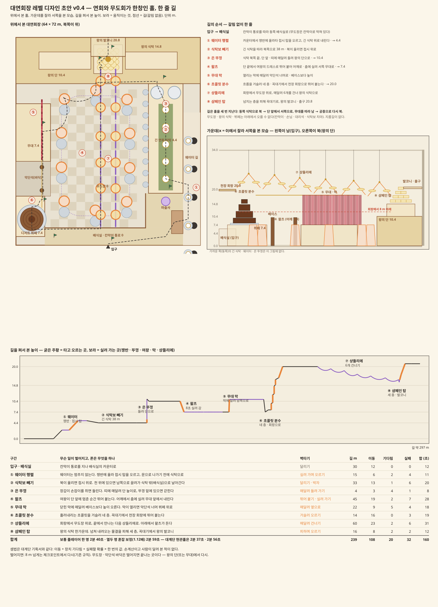

# 대연회장 레벨 디자인 초안 v0.4 — 연회와 무도회가 한창인 홀, 한 줄 길

2026-11-24 · R815 · 장소 [2-4 대연회장](PAWN_RUSH_PLACES_4MIN.md)(코스 2 · 중반 장애물). [장애물 아이디어 여덟(R814)](PAWN_RUSH_BANQUET_HALL_OBSTACLE_IDEAS.md)을 본 사용자: "1~6까지 아이디어 좋아. 이것들이랑 샹들리에 타기, 왈츠까지 너무 좋은 것 같아. 이것들로 구성해서 아까처럼 전체적인 구조가 대연회장처럼 보일 수 있게 재구성 및 배치 기획해줘."

> **회색 상자가 있다(R816, 2026-11-24).** 코스 프리팹 시험 장면의 숫자 **5**로 달려 볼 수 있고, 판에는 아직 나오지 않는다. 지으며 설계에서 바꾼 곳이 있고(아래 '회색 상자' 절), 사용자가 달려 보고 · 보고 세 번 고쳤다(R817, R825, R828). **R905 절(샹들리에) → R828 절 → R825 절 → R818 → R817 → R816 → 본문 순으로 앞의 것이 맞다**(그림 · 입체 미리보기 · 영상은 R815 설계 그대로, R818 컨셉 아트는 R818 때의 배치 — 샴페인 탑이 있고 웨이터 · 은 뚜껑 · 분수가 R825 전 모양이다. **지금(R828) 배치의 컨셉 아트는 아래 R833 절**).
> **사람이 달려 본 적이 없다.** 수치는 폰의 속도와 벽타기 · 밧줄 규칙(코드에서 읽은 값)으로 손계산한 것이고, 자동 점검은 지어짐 · 장치의 움직임 · 면만 봤다. 사용자 Unity 확인 전.

- **진행 영상(약 1분 48초):** [banquet_flow_v0.4.mp4](ConceptArt/R815_BanquetHall/banquet_flow_v0.4.mp4) — 노란 표식의 폰 하나를 구간마다 따라간다. 장치는 전부 이 문서의 주기대로 움직이고, 폰의 움직임은 기획 수치로 **그린 것**이다(게임을 찍은 것이 아니다).
- 지나간 판: [v0.3](PAWN_RUSH_BANQUET_HALL_DESIGN_v0.3.md) · [v0.3 검수 뒤 제안(R805)](PAWN_RUSH_BANQUET_HALL_V04_PROPOSAL.md) · [아이디어 여덟(R814)](PAWN_RUSH_BANQUET_HALL_OBSTACLE_IDEAS.md)

## 샹들리에를 '눈치' 구간으로 (R905) — 아래 절들과 본문보다 이것이 맞다

사용자: "디자인 자체는 전체적으로 괜찮게 뽑혔는데, 문제가 대계단의 '오징어 게임 다리'처럼 앞서나간 사람이 계속 달리며 앞서 가는게 아니라, 시행착오를 거치게 되면서 뒷 사람들과 자연스럽게 거리가 좁혀지는 요소가 있어야 해. 지금 연회장의 경우 본인이 컨트롤만 잘하면 계속 앞서나가게 되잖아? 나는 샹들리에 쪽이 대계단의 '오징어 게임 다리'처럼 뒷사람과 거리가 좁혀지는 구간으로서 작용됐으면 좋겠어. 이 부분 명심해서 레벨디자인을 수정해줘."

대계단의 유리 징검다리(`GuessBridge`)는 "옳은 길은 정해져 있고 직접 밟아 봐야 안다" — 앞사람이 틀리며 길을 찾고, 뒷사람은 그것을 보고 따라온다. 대연회장에는 그런 곳이 없었다(웨이터부터 샹들리에까지 전부 박자와 손놀림). 샹들리에 구간을 그런 곳으로 바꿨다.

| 무엇 | 전(R828) | 지금 |
| --- | --- | --- |
| 샹들리에 열 개 | 두 줄이 나란한 같은 길(한 줄에 다섯) | 자리 · 길이 · 박자 · 모델은 그대로. **같은 순서의 두 개(서쪽 줄 · 동쪽 줄)가 한 쌍**이고, 쌍마다 **하나는 줄이 풀려 있다**(권양기의 걸쇠가 안 걸려 있다). 어느 쪽인지는 그 판의 씨앗이 정한다(판 내내, 모든 PC에서 같다). 겉모습과 흔들림은 똑같다 |
| 풀린 샹들리에를 타면 | — | 매달린 채 **흔들림의 한가운데(무도장 위)를 지날 때** 줄이 풀린다: 흔들림이 멎고 0.9초에 5 m(마지막 쌍은 2.2 m) 내려앉는다. 줄이 다 풀려 덜컹 멎을 때 폰은 손을 놓쳐 떨어지고(8 m 낙하 규칙, 마지막 쌍은 단 위의 얇은 낙사 영역) **방금 줄을 고른 자리**에서 다시 한다. 잡았다 바로 놓아 보는 것으로는 알 수 없다 — 한가운데까지 타야 풀린다 |
| 내려앉은 샹들리에 | — | **그 판 내내** 불 꺼진 채 낮게 가만히 매달려 있다(위로 풀린 사슬이 보이고, 다시 잡을 수 없다). 뒤에 오는 사람은 보고 반대쪽을 탄다 — 앞사람만 값을 치른다 |
| 버틴 샹들리에 | — | 누군가 타고 **한가운데를 지나간 쪽은 촛불이 켜진 채 남는다**(입힌 홀, `ChandelierRideLights.Proven` — PC마다 본 대로 켠다, 보내는 것 없음). 뒷사람은 내려앉은 쪽(타면 안 되는 줄)과 불 켜진 쪽(누가 건넌 줄)을 둘 다 본다 |
| 줄을 고르는 자리 | 회랑과 큰 샹들리에뿐(그 사이는 줄에서 줄로 넘겨 잡음) | 넘겨 잡던 세 곳(1 → 2, 2 → 3, 4 → 5번째 줄) 밑에 **촛대 들보**: 두 줄을 가로지르는 판(9.2 × 2.4 m, 양 끝에 초 셋과 수정 방울, 천장에서 사슬 넷). 회랑 → 들보 → 들보 → 큰 샹들리에 → 들보 → 발코니 — **쌍마다 그 앞에 서서 고르고, 앞사람이 고르는 것을 지켜볼 자리**가 있다. 들보 위에서 줄 → 줄로 바로 넘겨 잡는 것도 전처럼 된다(발이 판 위 0.36 m를 지난다) |
| 체크포인트 | 8 | **12** — 회랑 끝(줄 앞)과 촛대 들보 셋이 더해졌다. 떨어지면 방금 고른 자리에서 반대쪽을 탄다(전에는 회랑의 사다리 옆 · 큰 샹들리에에서 다시) |
| 표지 7 | 넘겨 잡기 안내 | "두 개 중 하나는 줄이 풀려 있다 — 타고 한가운데를 지날 때 내려앉는다 · 내려앉은 샹들리에는 이 판 내내 그대로" · "끝이 가까이 오면 우클릭 · 촛대 들보에서 줄을 고른다 · 촛불이 켜진 샹들리에는 누가 타고 건넌 것" |
| 낙오자 구제 | — | 구제(`SectionRelief`)가 주어지면 모든 샹들리에가 버틴다: 내려앉은 것은 2.5초에 다시 감겨 올라가고, 입힌 홀에서는 전부 녹색등 · 촛불이 켜진다 |

**왜 이 모양인가.**

- **고르려면 설 자리가 있어야 한다.** 줄에서 줄로 넘겨 잡는 사슬에서는 옆줄로 갈 수 없어서(두 줄이 5.2 m 떨어져 있다) 쌍마다 고를 수가 없다. 넘겨 잡는 자리 바로 밑에 들보를 달아, 내려서서 고르거나 그대로 넘겨 잡게 했다. 샹들리에 열 개의 자리 · 길이 · 모델 · 천장 봉은 하나도 옮기지 않았다.
- **한가운데에서 풀린다.** 잡자마자 풀리면 들보 끝에서 발만 헛디디고, 잡았다 놓는 값싼 시험이 된다. 한가운데는 줄이 곧게 선 순간이라 샹들리에가 곧장 아래로 내려앉는다.
- **그 판 내내 내려가 있다.** 유리 징검다리는 15초 뒤 다시 붙어 똑같아 보인다. 줄 타기는 한 쌍에 5 ~ 8초가 걸려서, 금방 되돌아가면 조금만 뒤처진 사람도 다시 찍어야 한다. 내려앉은 채 두면 뒤처진 사람일수록 덕을 본다(풀린 쪽 다섯이 다 드러난 뒤에는 그 판의 누구도 값을 치르지 않는다). 유리처럼 되돌리고 싶으면 `LooseChandeliers`에 되감는 시간을 넣으면 된다.
- **누가 하는가.** 샹들리에는 불을 붙이려고 내리고 올리는 물건이다(천장 회랑은 샹들리에지기들의 길). 걸쇠가 안 걸린 권양기는 무게가 실리면 줄을 풀어 준다.

**숫자** (`GrandBanquetHallBuilder`의 `BeamAfter` · `BeamY` · `BeamZ` · `ChandelierSink`, `LooseChandeliers`)

| 것 | 값 |
| --- | --- |
| 쌍 | 다섯: 회랑 → ① → 들보 → ② → 들보 → ③ → 큰 샹들리에 → ④ → 들보 → ⑤ → 발코니 |
| 촛대 들보 | 위 높이 19.5 · 19.0 · 17.3 m, 가운데 z 15.1 · 24.2 · 50.7, x ±4.6, 폭 2.4 m, 두께 0.3 m. 다음 줄의 고리가 판 위 0.55 m로 온다(회랑 · 큰 샹들리에와 같은 관계), 앞 줄의 고리는 1.05 m 위 |
| 내려앉기 | 0.9초에 5 m(① ~ ④ — 내려앉은 고리 11.5 ~ 14.0 m, 춤추는 왕의 왕관은 9.7 m), ⑤는 2.2 m(단의 회랑 위 3.4 m — 걷는 폰의 머리 위) |
| 한 번 틀리면 | 약 8초: 한가운데까지 1.25 + 내려앉기 0.9 + 떨어져 다시 태어나기 + 반대쪽 고리 기다리기(평균 2.5) |
| 선두 혼자 다섯 쌍 | 평균 2.5번 틀려 **약 20초**(한 번도 안 틀릴 확률 3 %, 네 번 넘게 19 %). 다 드러난 뒤에 오는 사람은 0초 |
| 깨끗이 지날 때 | 전과 같은 약 30초(한 쌍에 고리 기다리기 평균 2.5 + 흔들림 2.5 + 들보 1초) |

**코드.** 새 `BanquetLooseChandeliers.cs`(`LooseChandeliers` — 씨앗은 `ISectionPart`, 온라인은 `ISectionNetPart` 쌍마다 1바이트, 판정은 캐릭터를 계산하는 PC만 `ObstacleClock.Authority`; 타는지는 고리 둘레의 캐릭터 몸으로 봄, 놓게 하기는 `IHitReceiver.ApplyHit(…, drop)`), `GrandBanquetHallBuilder`(`CandleBeams`, `.Course`의 체크포인트 12 · 진행 경로 · 표지), `ChandelierRideLights.Out` · `Proven` · `Safe`(입힌 홀: 내려앉으면 등 · 촛불 꺼짐, 건넌 쪽은 촛불이 남음, 구제 때 전부 켜짐), `GrandBanquetHallSound.ChandelierFell`, `GrandBanquetHallDressing.Chandeliers`의 `CandleBeams`, `SectionRelief`.

**알려 둘 것.**

- 촛대 들보와 풀린 사슬은 **모델이 없다** — 회색 상자 모양에 홀의 재질(호두나무 · 금 · 밀랍 · 수정)만 입혔다. 회색 상자만 볼 때 들보 위는 초록(서는 곳)이다.
- 내려앉는 **소리도 제 것이 없다** — 승강기 줄 · 샹들리에 딸랑 · 은 뚜껑 소리를 높낮이만 바꿔 빌렸다.
- 들보는 줄 끝이 만나는 자리 바로 밑이라, 들보에 서 있으면 흔들려 오는 샹들리에의 고리(지름 2.4 m)가 몸을 스쳐 지나간다(충돌은 없다, 그림만). 큰 샹들리에 가장자리와 발코니 앞에서도 전부터 그랬다.
- 풀린 쪽을 미리 알아볼 표시는 없다(유리 징검다리와 같다). 앞사람이 맞힌 쌍은 건넌 쪽에 촛불이 켜져 남는다 — 입히기를 끈 회색 상자 화면에는 이 불이 없다(내려앉은 것만 보인다).
- 기획 숫자 파일(`banquet_layout.py`) · 배치도 · 입체 미리보기 · 진행 영상 · 컨셉 아트에는 들보가 없다.

**자동 점검**(`GrandBanquetHallValidation`, 프로젝트 사본의 Unity 배치): 편집 + Play 31개 통과(실패 0 · 못 돌린 것 0) — 구간 검사 오류 0(경로 310.4 m, 체크포인트 12 · 부활 자리 72), 면 광선 29곳, 촛대 들보 셋이 두 줄의 넘겨 잡는 자리 밑에 있음(E8: 앞 줄에서 오는 폰의 발이 판 위 0.36 m, 다음 줄의 고리는 0.55 m 위), 풀린 쪽은 씨앗만으로 정해짐(E9: 씨앗 816이면 서 · 동 · 서 · 서 · 서, 다시 해도 같음), Play에서 둘째 쌍의 두 샹들리에에 대역(몸이 있고 '놓기' 신호를 받는 물체)을 매달자 풀린 쪽만 한가운데에서 줄이 풀려 5 m 내려앉아 멎고 대역은 '놓기'를 한 번 받았으며 고리는 다시 잡을 수 없게 됨, 버티는 쪽은 그대로 흔들리며 '건넌 줄'로 표시됨(P20), 구제를 주면 2.5초에 다시 올라가고(P21) 대역을 매달아도 한 바퀴 내내 버팀(P22). 샹들리에 열 개의 흔들림과 다른 장치 · 연출 검사는 전과 같이 통과, 오류 0. 그림 다섯 장과 결과 글은 `Docs/PawnRush/Checks/R905_BanquetChandelierGuess/`. **아무도 달려 보지 않았다** — [확인표](../Network/VALIDATION.md) 맨 위 R905.

## 컨셉 아트 다시 (R833) — R828 배치

사용자(R828을 보고): "좋아 훨씬 좋아졌어. 이대로 컨셉아트 뽑아줘." R818과 같은 방식(회색 상자의 숫자를 옮겨 적은 Blender 장면에 컨셉 아트의 재질 · 조명)으로 지금의 배치를 네 장으로 뽑았다. 스크립트 `ArtSource/PawnRush/BanquetHall/banquet_graybox_concept.py`(R818 판은 git 기록에), 그림 `ConceptArt/R833_BanquetHallConcept/`. 그림일 뿐 Unity에 들어가지 않는다. 장치는 공유 시계 1.5초의 모습이다: 서쪽 승강기는 식탁에서, 동쪽 승강기는 단 높이에서 열려 있고, 막은 닫혀 있다.

| 그림 | R818 컨셉 아트와 다른 곳 |
| --- | --- |
| 홀 전체(R818과 같은 자리) | 샴페인 탑이 없고 단 위 가운데에 **왕의 발코니**(16 m, 대리석 앞면에 금 테와 왕의 깃발 · 양옆 금 난간 · 왕좌 둘 · 차양, 뒤가 출구)와 그 양옆에 왕의 식탁 두 날개. 웨이터는 넷, 식료품실 문은 식탁 남쪽 끝에서 8 m. 은 뚜껑 승강기의 틀 |
| 샹들리에(R818과 같은 자리) | 줄 끝에 왕의 발코니, 오른쪽에 은 뚜껑 승강기의 틀 |
| 은 뚜껑 승강기(새로) | **배식 승강기 틀**: 호두나무 기둥 셋(금 받침 · 머리 · 꼭지, 동쪽 기둥은 식료품실 벽 위), 금 테의 가로대, 금 도르래 여섯. 접시는 테 밖 금 고리에서 **쇠줄 두 가닥**에, 뚜껑은 꼭지의 **금 사슬**에 매달린다 — 손(장갑)은 없다. 서쪽 승강기는 식탁에서 열려 폰이 올라타고, 동쪽은 단 높이에서 열려 폰이 단으로 걸어 나간다. 회색 상자의 기둥은 '못 탐' 청회색이고 여기서는 호두나무다 |
| 초콜릿 분수와 회랑의 사다리(새로) | 사다리 없이 **세 층 전체에 초콜릿이 흘러내린다**: 테를 넘는 입술, 물결(게임의 물결 고리), 윤기 나는 줄기와 끝의 방울. 폰 하나는 둘째 층을 거슬러 오르고, 하나는 첫 층 고리에서 쉬고, 하나는 그릇에서 첫 층 앞. 회랑 끝에서 **금 사다리**가 고리 둘로 걸려 내려오고(발치가 분수 꼭대기보다 1 m 아래) 폰 하나가 오른다. **이 한 장만 막 위 가리개(레일)를 뺐다** — 가리개는 막이 열린 끝에서 3.5 m 더 나와 분수 북동쪽 위를 지나므로, 넣으면 분수 꼭대기와 사다리를 가린다(단면처럼 뺀 것, 홀 전체 · 샹들리에 그림에는 있다) |

## 세 번째 고침 (R828) — 아래 절들과 본문보다 이것이 맞다

사용자: "1. 은뚜껑을 들어올렸는데 전체가 올라오는건 이상하잖아. 그리고 사다리를 초코분수에 넣으면 어떡해. 위 피드백 내용 다시 읽고 진행해줘." 다시 읽은 R825 피드백: 은 뚜껑은 사용자 안 그대로 승강기("엘리베이터처럼 닫히고 접시 째 올리고 뚜껑이 열리고"), 분수는 "한 단에서 반은 초코가 흐르고 반은 안흐른다는게 상식선에서 이해가 안 가. 버그를 고쳐도 이해가 되게 납득 가능한 방식으로 고쳐야지", 그리고 "초코분수 꼭대기에서도 길이 어딘지 한참 해맸어 … 사다리처럼 하든 뭘 하든 인식 가능하게" — 사다리는 분수가 아니라 **꼭대기에서 회랑으로 붙는 벽** 얘기였다.

| 피드백 | 바꾼 것 |
| --- | --- |
| "은뚜껑을 들어올렸는데 전체가 올라오는건 이상하잖아" | R825는 뚜껑 손잡이를 장갑(손)과 소매가 늘 쥐고 있어서, 손이 뚜껑을 들면 접시와 폰까지 통째로 딸려 올라가는 것처럼 보였다. 승강기(사용자 안)는 그대로 두고 **무엇이 올리는지 보이게** 했다. 식탁 북쪽 끝에 **배식 승강기 틀**: 청회색 기둥 셋(식탁 서쪽 끝 · 두 승강기 사이 · 식료품실 벽 위 — 잡을 수 없음, 접시에서 0.5 m 떨어져 타고 내리는 길을 막지 않음)과 16.6 m 높이의 가로대(위에서 열린 뚜껑 손잡이 15.35 m보다 높다), 그 밑에 금 도르래 여섯. **접시는 쇠줄 두 가닥**(접시 테 밖의 금 고리에서)에 매달려 오르내리고, **뚜껑은 손잡이에 걸린 제 사슬**로만 들린다 — 식탁에서 사슬이 뚜껑만 들어 열고, 덮인 채 접시와 같이 오르고, 위에서 다시 뚜껑만 든다(`HoistLine`: 줄을 매 프레임 고리에서 도르래까지 늘이는 그림). 장갑과 소매는 없앴다. 움직임 · 12.4초 주기 · 두 승강기가 반 바퀴 어긋나는 것은 R825 그대로 |
| "사다리를 초코분수에 넣으면 어떡해" | 분수의 금 사다리 여섯을 없앴다. 초콜릿은 처음 설계대로 **층 전체(테에서 발치까지)가 흐르고, 그것을 거슬러 오른다**: 초당 0.3 m로 끌어내리고 폰은 1.2 m로 오른다 — 한 층(2.83 m)에 폰 3.0초 · 기력 38 %, 룩(오르는 빠르기 0.7배) 5.0초 · 62 %로, R817 때 사용자가 오른 것(3.0초 · 36 % · 65 %)과 거의 같다. 멈추면 초당 0.3 m로 미끄러져 내려간다. **흐르는 게 보이도록** 층마다 밝은 갈색 물결 넷이 테 밑에서 솟아 발치까지 흘러내려 아래 층(첫 층은 그릇)으로 잠긴다(초당 0.3 m, 0.71 m 간격, `ChocolateRipples`, 그림만) — 층 전체가 같은 초콜릿이고 반만 다른 띠는 없다 |
| R817의 "단에 안올라가지고 계속 미끄러짐"이 다시 생기지 않게 | 원인은 흐르는 벽이 테를 넘어가는 동작의 경로까지 끌어내린 것이었다. 넘어가는 동작은 몸의 기준점이 테에서 0.25 m 안에 왔을 때 시작하므로(`RagdollPawn.TryStartTopOut`), **테 밑 0.45 m만 당기지 않는다** — 손이 테를 잡고 넘어가는 자리이고 겉모습은 다르지 않다(R817의 1.3 m 밝은 띠 대신). 층 위(고리)도 흐르지 않는다 |
| 회랑의 사다리(R825) | 그대로 — 이제 홀의 사다리는 이것 하나. 꼭대기 남쪽 끝에서 1.6 m 뛰어 붙는다 |

길: 분수는 다시 **북쪽에서 곧게** 오른다(뷔페 북쪽 → 그릇 → 세 층 → 꼭대기에서 왕관을 돌아 남쪽 끝 → 회랑의 사다리). 표지 6: "초콜릿 분수: 흘러내리는 초콜릿을 거슬러 한 층씩 오른다 · 꼭대기 남쪽에서 회랑의 사다리로 뛰어 붙기".

자동 점검(`Tools/Run-GrandBanquetHall.ps1`과 같은 점검, 사본) PASS: 구간 검사 오류 0(경로 310.0 m, 체크포인트 8 · 부활 자리 48), 면 광선 29곳 전부 맞음(승강 틀의 기둥 · 은 뚜껑 띠 · 회랑 앞면은 못 잡음, 초콜릿 세 층의 북쪽 · 회랑 사다리는 잡음), 사다리는 회랑의 것 하나, Play 14초에 쇠줄 넷 · 사슬 둘이 접시 · 뚜껑을 식탁에서 단까지 따라감(줄 끝이 고리 · 도르래에서 벗어난 최대 0 m), 세 층의 물결이 테 밑에서 발치까지(−0.08 .. 2.75 m), 오류 0. 사진은 `Checks/R816_BanquetHallGraybox/`(R828로 다시 찍음, 새로 `hall_16_cloche_lifts`). **고친 뒤 아무도 달려 보지 않았다.**

## 두 번째 플레이 뒤 (R825) — 아래 절들과 본문보다 이것이 맞다(분수의 사다리 · 초당 1.4 m 흐름과 은 뚜껑의 장갑은 위 R828 절이 대신한다)

사용자가 최신 회색 상자를 달려 보고: "별로인 곳, 우회로도 너무 많고 버그도 너무 많아." 적어 준 다섯 가지를 고쳤다. (말한 영상 `녹음 2026-11-24 220632`는 이 PC의 바탕화면 · 비디오 · 사진 · 문서 · 다운로드 · OneDrive 어디에도 없어 보지 못했다 — 영상에만 있는 우회로 · 버그는 아직 모른다.)

| 피드백 | 바꾼 것 |
| --- | --- |
| "웨이터 파트에서 무조건 최대한 오래 타있는게 이득 … 식탁보 빼기 코스의 이동 경로가 웨이터의 이동 방향과 동일해서 굳이 위험하게 일찍 내릴 이유가 없어" | 식료품실 문을 식탁의 북쪽 끝 옆(z 43)에서 **식탁 남쪽 끝 8 m 지점(z 26)**으로 옮겼다. 쟁반이 식탁 옆을 지나는 8 m(약 3.6초) 안에 서쪽 식탁으로 뛰어내려야 하고, 늦으면 식료품실로 실려 들어가 입구부터. 식료품실은 식탁의 나머지 옆을 따라 이어지고, 그 벽이 식탁 동쪽 끝을 막는다(동쪽으로 떨어지는 일도 없다). 웨이터 넷(7.25 m 간격, 3.3초마다 쟁반) |
| "은뚜껑 부분은 … 슈퍼점프가 가능해. 이걸 악용하면 코스 밖 공간으로 넘어갈 수도 … 엘리베이터처럼 닫히고 접시 째 올리고 뚜껑이 열리고, 뚜껑이 닫히고 내려와서 열리면 다시 플레이어들이 탑승" | 말한 그대로 **은 뚜껑 승강기**(`ClocheLift`): 식탁에서 뚜껑이 열려 있는 동안(3초) 접시(지름 4.4 m)에 올라탄다 → 뚜껑이 덮인다 → 접시째 단 높이까지 오른다(2.2초) → 뚜껑이 열리면 단으로 걸어 나간다(2.6초) → 뚜껑이 덮이고 내려간다 → 식탁에서 다시 열린다. 한 바퀴 12.4초, 두 승강기는 반 바퀴 어긋나 하나가 탈 때 하나는 위에 있다. 뚜껑은 속이 빈 돔(띠가 접시까지 내려와 안을 막는다)이고 어디도 잡을 수 없으며, 올라가는 동안 폰은 덮인 뚜껑 안에 있어 튕겨 나갈 데가 없다. 접시는 위에서 단과 같은 높이, 단 끝까지 0.1 m |
| "초코 분수 … 한 단에서 반은 초코가 흐르고 반은 안흐른다는게 상식선에서 이해가 안 가 … 벽을 탈 수 있구나라는게 바로 생각이 안나 … 사다리처럼 하든 뭘 하든 인식 가능하게" | 초콜릿은 **층의 위부터 아래까지 다 흐르고**, 오르는 것보다 빠르다(초당 1.4 m) — 초콜릿은 길이 아니다. 대신 층마다 **금 사다리 둘**(주황 판에 금 난간 · 가로대, 너비 1.2 m): 첫 층은 북쪽(뷔페 쪽) 둘, 둘째 층은 동 · 서, 꼭대기 층은 남쪽 둘 — 고리(턱)를 따라 4분의 1 바퀴씩 돌아 다음 사다리로. 천장 회랑의 앞면은 잡을 수 없는 벽이 되고, 분수 앞에 **회랑에서 내려온 사다리**(너비 1.6 m, 발치가 꼭대기보다 1 m 아래)가 걸린다: 꼭대기 남쪽 끝에서 1.6 m 뛰어 붙는다 |
| "초코분수 체크포인트가 분수 안에 있는지 태어나면 분수 속에 박히는 버그" | 원인: 혼자 하는 시험에서 다시 태어나는 자리는 체크포인트 판정 상자 바닥의 한가운데인데, 판정 상자를 뷔페 전체로 넓혀(R733 방식) 그 한가운데가 분수였다. 큰 샹들리에(가운데 기둥)와 무대(막 뒤)도 같은 문제. → 대연회장의 체크포인트 여덟은 **태어날 자리를 한가운데로 둔 상자**로(지나가는 곳은 다 덮도록 크기를 맞춤): 뷔페는 그릇 북쪽, 큰 샹들리에는 기둥 남쪽, 무대는 막 앞. 공용 코드(다른 구간)는 건드리지 않았다 |
| "샹들리에 쪽은 완전 좋아" | 그대로 |
| "마지막 샴페인 구간은 빼자. 샹들리에를 넘어가면 끝" | 샴페인 탑을 없앴다. 마지막 줄 끝이 **왕의 발코니**(16 m, 단 위 가운데에서 북쪽 벽까지, 앞면은 잡을 수 없음) 앞쪽 0.8 m 위로 와서, 놓으면 0.95 m 아래 발코니에 선다. 출구는 발코니 뒤(0, 16, 72). 왕의 식탁 두 날개가 발코니 양옆 |

체크포인트는 여덟(입구 · 긴 식탁 · 단의 회랑 · 무대 · 뷔페 · 천장 회랑 · 큰 샹들리에 · 왕의 발코니).

자동 점검(`Tools/Run-GrandBanquetHall.ps1`) PASS: 구간 검사 오류 0(경로 314.5 m, 체크포인트 8 · 부활 자리 48), 면 광선 26곳 전부 맞음(은 뚜껑 띠 · 식료품실 벽 · 회랑 앞면은 못 잡음, 분수 · 회랑 사다리는 잡음), 난간의 두 틈, Play 14초에 웨이터 넷이 식료품실에서 부엌으로 넷 다 돌아감, 은 뚜껑 승강기 둘(접시 4.52 → 10.4 m, 뚜껑은 아래에서 덮이고 위에서 열림), 오류 0. 사진은 `Checks/R816_BanquetHallGraybox/`(R825로 다시 찍음). **고친 뒤 아무도 달려 보지 않았다.**

## 샹들리에의 모양과 컨셉 아트 (R818)

사용자: "샹들리에가 샹들리에처럼 안생겼어. 그레이박스라도 모델링과 텍스쳐를 입히는데 기본이 되는 모양이기 때문에 확실하게 생겨야 해. 디자인적으로 신경써서 만들어줘." · "블렌더를 이용해서 천문대 레벨디자인 때처럼 컨셉아트를 뽑아줘."

**샹들리에.** 대연회장 컨셉 아트(R787)의 금빛 왕관 샹들리에를 본떴다. 원기둥 · 공을 쌓은 것 대신 깎은 모양(옆모습을 돌린 것) · 고리 · 휜 관으로 메시를 코드가 만든다(`BanquetChandelierShape`, 한 번 만들어 같이 씀, 충돌 없음).

| 무엇 | 모양 |
| --- | --- |
| 매달린 샹들리에(줄 열) | 위에서부터: 축의 고리 · 사슬(고리 하나 0.17 m, 번갈아 돌림) · 왕관 뚜껑 · 주 고리로 퍼지는 사슬 여섯 · 깎은 기둥(마디 · 항아리 · 구슬) · 위 고리(지름 1.24 m)와 초 여섯 · 주 고리(지름 2.4 m, 굵은 고리 + 아래 띠, 기둥으로 살 넷)와 초 열 · 초 사이마다 왕관 뾰족 장식과 그 아래 수정 방울 · 꼭지 · **맨 끝(줄의 끝)에 폰이 매달리는 금 고리**. 샹들리에는 줄의 아래 2.5 m, 그 위는 사슬. 축 위는 천장까지 가만히 있는 금 막대와 천장 장미 장식, 축에 돌쇠 |
| 큰 샹들리에(쉼터) | 지름 8.4 m의 금 접시(윗면이 바닥, 초록 카펫) · 가장자리 턱에 초 스물넷과 그 아래 수정 방울 · 깎은 기둥에 S자 팔 여덟(끝마다 초)과 수정 · 꼭대기 왕관(뾰족 장식 여덟) · 왕관에서 접시 끝으로 사슬 넷(줄 길을 피해 홀의 축 방향) · 접시 아래 큰 수정 방울 · 천장까지 사슬. 바닥 · 기둥의 충돌은 전처럼 단순한 원기둥 |
| 색 | 금(몸) · 크림(초) · 불꽃(빛남) · 옅은 수정색 |

**컨셉 아트**(천문대 R723 · R724와 같은 방식): 지금의 회색 상자 배치(R817 + R818 샹들리에)를 Blender에서 컨셉 아트의 재질 · 조명으로 입혀 두 장 — 홀 전체, 샹들리에와 무도장을 가까이. 스크립트 `ArtSource/PawnRush/BanquetHall/banquet_graybox_concept.py`(회색 상자의 숫자를 옮겨 적었다; 샹들리에도 같은 방식으로 만든다), 그림 `ConceptArt/R818_BanquetHallConcept/`. 그림일 뿐 Unity에 들어가지 않는다.

## 사용자 첫 플레이 뒤 (R817) — 아래 R816 절과 본문보다 이것이 맞다

사용자가 회색 상자를 달려 보고(스크린샷 4장 · 영상 2개) 다섯 가지를 말했다. 고친 것:

| 피드백 | 원인 | 바꾼 것 |
| --- | --- | --- |
| "초코분수에서 칸을 올라갈 때마다 단에 안올라가지고 계속 미끄러짐" | 흐르는 벽은 매달린 폰을 통째로 실어 내리는데, 가장자리를 넘어가는 동작의 경로까지 같이 내려가 넘어가다 미끄러졌다. 넘어간 폰도 층 위의 바깥으로 미는 흐름(초당 0.8 m)이 0.8 m 턱에서 밀어 떨어뜨렸다(영상 1) | 층마다 **가장자리 아래 1.3 m는 흐르지 않는다**(밝은 갈색 띠; 흐르는 아래쪽은 어두운 갈색). **층 위는 흐르지 않는다.** 네 층 → **세 층**(턱 0.9 · 1.0 · 1.0 m, 층 2.83 m), 그릇 반지름 4.2 m, 중심 (−27.7, 9.2). 한 층에 약 3초(폰 36% · 룩 65%). 꼭대기에서 회랑까지 1.9 m 그대로, 회랑 앞면은 16 ~ 20 m |
| "샹들리에 코스가 너무 김(스테미너도 있고 난이도도 있음)" | 여섯 줄을 쉬지 않고 이어 타야 했고, 한 번 떨어지면 회랑부터 다시. 줄마다 높이가 달라 줄을 오르내리느라 숨을 썼고, 1.6 m '날아서 잡기'가 있었다 | 여섯 줄 → **세 줄 + 큰 샹들리에 + 두 줄**. 홀 한가운데(z 36.4)에 **큰 샹들리에**(멈춰 있는 고리, 지름 8.4 m, 17.8 m, 초록)가 있어 거기 내려 숨을 고르고, **체크포인트**도 있다. 뒤 두 줄은 8 m(끝이 5.1 m씩). 옮겨 잡기는 모두 건네받기(0.6 ~ 0.8 m, 0.5 m 낮게). 줄의 촛대 바퀴는 지름 2 m로 줄 위쪽에 — 3.2 m 바퀴가 손 높이에서 다음 줄을 가렸다(스크린샷 1) |
| "길을 모르겠음 (쓸데없는 길도 너무 많음)" — 가장 큰 문제 | 길이 지나는 바닥에 표시가 없었고, 쓸 일 없는 넓은 곳(입구 통로의 서쪽, 단 전체, 홀 너비의 천장 회랑)이 열려 있었다 | 길이 지나는 바닥마다 **빨간 카펫 + 금색 화살표**(입구 통로 → 카운터, 단의 회랑, 무대, 뷔페 → 분수, 분수 꼭대기, 천장 회랑, 큰 샹들리에, 발코니). 막은 곳: 입구 통로의 서쪽(문 옆에 벽), 단은 **뚜껑에서 탑승 자리까지의 회랑만**(양 끝과 식탁 사이 틈을 막음), 천장 회랑은 둘째 줄 자리까지(동쪽 27 m를 뗌). 표지는 다음에 할 일부터 말하고 다가오는 쪽을 본다 |
| "왈츠를 타기까지 유도가 잘 안됨" | 단 끝 어디서나 떨어질 수 있었고, 여왕이 어디서 언제 멈추는지 표시가 없었다 | 단 끝에 **난간**, 틈은 둘(뚜껑이 내려 주는 곳, 여왕이 멈추는 곳). 여왕이 멈추는 틈 양쪽에 **초록 등**: 여왕이 멈추기 1.2초 전부터 0.4초 뒤까지 켜진다(4.8초마다). 카펫이 그 틈까지 와서 꺾인다. 무대 앞 내리는 곳에도 같은 등 |
| "마지막 샴페인 구간은 아무 일도 일어나지 않음" | 넘침이 층 둘레의 손 떼기 영역(`ClimbPeel`)을 켜고 끄는 방식이었는데, 달려 보니 매달린 폰에 아무 일도 없었다(영상 2). 첫 층 위에 내려 세 층만 올랐다 | 넘치는 층은 **네 옆면에 샴페인이 흘러내리고**(밝은 판), 그 옆면이 **매달린 폰을 초당 2.5 m로 씻어 내린다**(초콜릿과 같은 방식: 벽이 흐른다고 말한다, 위에 선 폰은 그대로). 4초마다 붓고 층마다 1.6초 넘침(전 5초 · 1.4초). 마지막 줄 끝이 탑 앞 **받침대**(14.8 m) 위로 와서 **네 층을 모두 오른다**. 탑은 z 65.8 |
| (지으며 본 것) 콘트라베이스 | 폰은 손 아래로 0.9 m쯤 매달린다: 손이 10.9 m(막을 3.5 m 오름)면 발이 10.0 m라 머리 10.0 m인 베이스에 걸렸다 | 베이스 머리 9.6 m |
| (지으며 본 것) 둘째 줄에서 떨어지면 | 단의 회랑(7.4 m 아래)에 떨어져 8 m 규칙에 걸리지 않고, 왈츠부터 다시 해야 했다 | 줄 아래 회랑 위 2.6 ~ 3.2 m에 얇은 낙사 영역(걷는 폰의 머리 위, 매달린 폰의 발 아래) → 큰 샹들리에에서 다시 |

자동 점검(`Tools/Run-GrandBanquetHall.ps1`) PASS: 구간 검사 오류 0(경로 319.9 m, 가장 넓은 틈 0.90 m, 체크포인트 9 · 부활 자리 54, 못 타는 면 100), 면 광선 26곳 전부 맞음, 난간의 두 틈이 열려 있음, 왈츠 계산 그대로, Play 14초에 줄 열 · 큰 샹들리에 · 분수 세 층 · 넘침(4초마다, 층마다) · 등 넷(멈춤마다 켜짐, 3분의 1쯤)이 설계대로, 오류 0. 결과와 사진은 `Checks/R816_BanquetHallGraybox/`(R817로 다시 찍음). **고친 뒤 아무도 달려 보지 않았다** — [확인표](../Network/VALIDATION.md) 맨 위 R817.

사용자: "이 구성으로 진행" → 이 설계를 그대로 Unity 회색 상자로 지었다.

**여는 법.** Unity 메뉴 **ChessFight → Pawn Rush → Open Course Prefab Test** → Play → 숫자 **5**(코스 2의 셋째: 3 대계단 · 4 시계탑 · 5 대연회장). 뒤 번호가 하나씩 밀렸다: 6 작전 회의실 · 7 왕의 서재 · 8 천문대 · 9 금고실. F8 새 씨앗, R 체크포인트로. 프리팹 `Assets/Prefabs/PawnRushSections/Mid_2-4_GrandBanquetHall.prefab`은 뿌리만 있고 Play 때 코드가 짓는다(시계탑 방식). 구간 목록 셋째 칸의 `drafts`라 판은 뽑지 않는다.

**색**(시계탑과 같다). 주황 = 타는 면(접시 탑은 보라, 회랑 앞면 · 샴페인 탑은 주황), 청회색 = 못 타는 면, 보라 = 움직이며 실어 가는 것(쟁반 · 접시 탑 · 은 뚜껑 띠 · 여왕 · 막), 초록 = 안전한 접시, 빨강 = 신호(북이 울릴 때의 식탁보 · 막 위 가리개), 갈색 = 초콜릿(흐르는 벽), 밝은 노랑 = 넘치는 샴페인 층, 짙은 보라 바닥 = 떨어지면 끝나는 곳(무도장 · 악단석). 사람 · 소품은 베이지 그림(충돌 없음)이다.

**지으며 바꾼 것.**

| 무엇 | 설계(R815) | 회색 상자 | 왜 |
| --- | --- | --- | --- |
| 부엌 · 식료품실 | 남쪽 벽 밖 부엌 문, 동쪽 벽의 식료품실 문 | 홀 안 남동쪽 구석의 부엌(x 26 ~ 32, z 0 ~ 4)과 식탁 북쪽 옆의 식료품실(z 43 ~ 56). 웨이터는 부엌에서 나와 49 m를 걷고 식료품실 안에서 부엌으로 돌아간다(간격 9.8 m · 4.5초마다 그대로) | 구간은 입구 평면 뒤에 아무것도 두지 않는다(복도가 붙는다) |
| 카운터로 오르는 길 | 0.8 m 계단 둘 | 7 m 경사로(19°) | 폰은 0.8 m 턱을 걸어 오르지 못한다 |
| 식탁보 | 식탁 끝까지 | z 18 ~ 50. 은 뚜껑이 있는 북쪽 끝 6 m는 은쟁반 자리(식탁보 밖) | 뚜껑을 기다리는 폰이 10초마다 배식실로 날아가지 않게 |
| 식탁보에서 떨어지는 것 | 천과 함께 끌려가 날아간다 | 천 위에 선 폰(접시 위가 아닌)을 발사대의 포물선으로 배식실 바닥(z 9)에 던진다. 마술사는 그림이라 날아가는 폰이 걸리지 않는다 | 0.3초에 30 m를 끄는 바닥에 실리면 초속 100 m로 튕긴다 |
| 은 뚜껑 | 띠(1.4 m)에 매달려 들린다 | 띠 위에 0.8 m 너비 가장자리(돔은 지름 2.8 m): **올라서서** 들려도 되고 매달려 들려도 된다. 들리면 가장자리가 단보다 1 m 높고 단 끝까지 0.9 m — 건너 내린다 | 매달린 채로는 등 뒤의 단으로 갈 수 없다(벽에서 뒤로 뛰는 동작이 없다) |
| 은 뚜껑의 박자 | 예고 0.8 · 오름 0.8 · 들림 2.6 · 내림 0.6 · 덮임 2.4 (7.2초) | 오름 **1.2초**(코사인으로 부드럽게) · 들림 **2.4초** (7.4초) | 0.8초에 5.6 m를 들면 멈출 때 중력보다 세게 서서, 가장자리에 선 폰이 위로 튕겨 나간다 |
| 은 뚜껑 밑 | 덮이면 갇힌다 | 뚜껑이 속이 찬 원기둥이라 갇히지 않고 옆으로 밀려난다 | 회색 상자의 모양 |
| 여왕 · 왕 | 위가 좁은 드레스 | 원기둥(지름 2.6 m, 어깨 7.4 m), 머리는 못 잡는 공 | 회색 상자의 모양. 단에서 드레스까지 1.0 m · 무대까지 0.6 m 그대로 |
| 무대 막 · 뷔페 | 막의 선 x −23, 뷔페 동쪽 끝 x −22, 끝에 케이크 받침 울타리 | 막 x **−24.5**, 뷔페 동쪽 끝 x **−23.5**, 울타리 없음. 무대 앞 폭 3 → 4.5 m | 여왕이 뷔페 옆(z 16.2)에 멈출 때 어깨에서 뷔페까지 2.6 m였다 — 질주 점프(약 3 m)로 닿는다. 4.1 m로 벌렸다. 울타리는 막에 실려 오는 폰과 겹쳤다 |
| 막 자락 | 앞뒤로 엇갈린 두 줄 | 한 평면 | 옆으로 타며 넘어갈 때 0.24 m 턱이 모서리로 읽히지 않게 |
| 초콜릿 분수 | 중심 (−26.5, 9), 그릇 반지름 5, 층 4 · 3 · 2 · 1.1 m, 층 위는 돔 | 중심 (−27.7, 8.8), 그릇 반지름 4(턱 0.5 m), 층 **3.2 · 2.4 · 1.6 · 0.9 m**, 층 위는 평평(흐름이 바깥으로 민다) | 좁아진 뷔페에 맞춤. 꼭대기에서 회랑 앞면까지 1.9 m 그대로 |
| 손님 | 앉은 손님 아홉 | 의자 줄(높이 2.2 m)이 식탁 서쪽 끝 밑을 막는다 | 배식실에서 식탁 밑 좁은 틈으로 무도장에 들어갈 수 없게 |

**자동으로 본 것**(`Tools/Run-GrandBanquetHall.ps1` — 프로젝트 사본에서 Unity 배치, 결과 `Checks/R816_BanquetHallGraybox/hall.txt`).

- Edit: 구간 검사 오류 0(경로 316.7 m, 가장 넓은 틈 0.90 m, 뜻한 틈 다섯, 체크포인트 8 · 부활 자리 48, 못 타는 면 85). 움직이는 것: 웨이터 5 · 은 뚜껑 2 · 춤추는 쌍 10 · 막 자락 20 · 샹들리에 12, 식탁보 1, 초콜릿 층 4, 샴페인 탑 1(넘침 4). 타야 할 면과 못 타야 할 면 22곳에 광선을 쏘아 전부 맞음. 왈츠 계산: 0번 쌍의 여왕이 0초에 단 앞(어깨가 단에서 1 m)에, 8.36초에 무대 앞(0.6 m)에 멈춤, 서로 다른 쌍끼리 가장 가까울 때 7.0 m.
- Play 14초: 웨이터 다섯이 길을 걷고 식료품실에서 부엌으로 세 번 돌아감, 은 뚜껑 둘이 식탁에서 5.6 m 위까지, 샹들리에 열둘의 끝이 4.18 m씩 흔들림, 막의 남쪽 맨 앞 자락이 39.5 → 16 m(뷔페 위)까지 · 북쪽이 무대 끝까지, 춤추는 쌍들이 무도장을 한 바퀴(가운데가 x −16.2 ~ 7.5 · z 10.2 ~ 51.8), 식탁보를 뺌(위에 아무도 없어 던진 것 0) · 샴페인이 층마다 넘침, 오류 0.
- Unity 밖 전체 컴파일 PASS, Core + 모의 세션 115 통과.

**못 본 것 — 달려서 볼 것.** [확인표](../Network/VALIDATION.md) 맨 위. 무엇보다 ① 움직이는 쟁반에 올라타 실려 가며 접시 탑을 오를 수 있는지 ② 단에서 뛰어 여왕의 드레스를 공중에서 잡고 어깨로 올라서는지, 도는 어깨 위에 서 있을 수 있는지 ③ 막에 매달려 옆으로 실려 가는 동안 카메라 ④ 흐르는 벽(초콜릿)이 매달린 폰을 끌어내리는지 ⑤ 줄에서 줄로 옮겨 타기 ⑥ 넘치는 층 아래 턱에 선 폰도 비틀거리는지(넘침의 손 떼기 영역이 아래 턱에 선 폰의 몸에도 닿는다).

**코드.** `Assets/Scripts/PawnRush/`의 `GrandBanquetHallSection`(뿌리) · `GrandBanquetHallBuilder`(배치 · 좌표 · 주기 전부, `.Course`는 체크포인트 · 떨어지면 끝나는 바닥 · 진행 경로 · 뜻한 틈 · 비트 · 표지) · `BanquetMovers`(웨이터 · 은 뚜껑 · 왈츠 · 막 자락 — `Obstacle`) · `BanquetDevices`(식탁보 · 초콜릿 흐름 · 샴페인 넘침 · 샹들리에 그림), 색은 시계탑의 `RoyalClockTowerLook`. 점검은 `PawnRushEditor/GrandBanquetHallValidation`(메뉴 **Validate → Grand Banquet Hall (Edit + Play)**). 숫자를 고칠 때는 `GrandBanquetHallBuilder.cs` 맨 위의 상수들.

## 한눈에

- **고른 여덟 가지:** 웨이터 행렬 · 마술사의 식탁보 빼기 · 은 뚜껑 · 왈츠 · 무대 막 · 초콜릿 분수 · 샹들리에 · 샴페인 탑. 나이트 · 하프 · 피아노 · 케이크 · 촛대는 뺐다.
- **홀이 먼저다.** 왕궁의 연회 겸 무도회 홀을 실제로 놓이는 대로 놓고, 장치를 저마다 제자리에 넣었다:
  - 입구 쪽(남): **칸막이 통로와 배식실**, 그 위에 **천장 회랑**(샹들리에지기들이 다니는 높은 회랑)
  - 동쪽: **긴 연회 식탁**(손님이 앉아 있다)과 식탁 뒤 **웨이터 길**
  - 서쪽: **악단의 무대**와 붉은 **막**, 그 남쪽에 **악단석**과 **디저트 뷔페**(초콜릿 분수)
  - 가운데: **무도장**(체스판) — 열 쌍의 왕과 여왕이 홀을 돌며 춤춘다. 그 위로 **샹들리에 두 줄**
  - 북쪽 끝: **왕의 단**과 **왕의 식탁**(가운데에 샴페인 탑), 그 위 북쪽 벽에 **왕의 발코니**(출구)
- **길은 하나다. 갈리지 않는다.** 홀을 세 번 지난다: ① 동쪽 식탁을 따라 북쪽으로(높이 4.4) → ② 단 앞에서 춤에 실려 서쪽으로, 무대를 따라 남쪽으로(7.4) → ③ 천장 회랑에서 샹들리에를 타고 공중으로 다시 북쪽으로(17 ~ 20). 세 번이 서로 다른 높이에 겹쳐, 샹들리에에 매달린 폰 밑에서 왈츠가 돌고 그 옆에서 건배가 벌어진다.
- **샹들리에가 높아졌다:** 줄 끝 20.6 → 17.6 m(v0.3은 15.4 → 12.2), 천장 34 m. 춤추는 왕의 왕관(9.7 m)과 8 m 떨어진다.
- **플레이타임:** 보통 플레이어 한 명 **2분 40초**, 열두 명 혼잡 보정 **2분 59초**. 대계단 현관홀은 같은 셈법으로 2분 37초 · 2분 56초다.
- **크기:** 홀 64 × 72 m(발코니까지), 천장 34 m. 길 약 297 m.

| # | 구간 | 홀의 어디 | 폰이 하는 것 | 벽타기 | 높이 (m) |
| --- | --- | --- | --- | --- | --- |
| – | 입구 · 배식실 | 남쪽 칸막이 통로 → 동쪽 배식실 | 칸막이를 따라 달려 카운터로 | 없음 | 0 |
| ① | 웨이터 행렬 | 동쪽 웨이터 길 | 지나가는 쟁반에 올라타 접시 탑을 오르고, 긴 식탁으로 내린다 | 실려 가며 오르기 | 0 → 2.4 → 5.0 → 4.4 |
| ② | 식탁보 빼기 | 긴 식탁 위, 북쪽으로 | 북이 울리면 접시 위로. 천 위에 있으면 배식실로 날아간다 | 없음(박자) | 4.4 |
| ③ | 은 뚜껑 | 식탁 북쪽 끝, 왕의 단 앞 | 뚜껑 띠에 매달려 들려 왕의 단으로 | 매달려 들려 가기 | → 10.4 |
| ④ | 왈츠 | 무도장 | 단 앞에 멈춘 여왕의 드레스로 뛰어 붙어 어깨로, 춤에 실려 무대 앞까지 | 뛰어 붙기 · 실려 가기 | → 7.4 |
| ⑤ | 무대 막 | 서쪽 무대 → 악단석 위 | 막을 베이스보다 높이 오르고, 열리는 막에 실려 뷔페 위로 | 매달려 옆으로 | 7.4 → 11 → 7.4 |
| ⑥ | 초콜릿 분수 | 남서쪽 디저트 뷔페 | 흐르는 초콜릿을 거슬러 네 층, 꼭대기에서 천장 회랑에 뛰어 붙는다 | 거슬러 오르기 · 뛰어 붙기 | → 17 → 20.0 |
| ⑦ | 샹들리에 | 무도장 위, 남 → 북 | 매달려 여섯 개를 건너 왕의 식탁으로 | 매달려 건너기 | 20.6 → 17.6 |
| ⑧ | 샴페인 탑 | 왕의 식탁 한가운데 | 넘치는 층을 피해 세 층, 꼭대기에서 왕의 발코니 | 피하며 오르기 | 16.3 → 20.8 |

## 요청과 답

| 요청 | 답 |
| --- | --- |
| 1 ~ 6 + 샹들리에 타기 + 왈츠로 | 여덟 가지 모두 썼다. 하나씩의 숫자는 [R814 아이디어](PAWN_RUSH_BANQUET_HALL_OBSTACLE_IDEAS.md)를 이 홀에 맞춰 고쳤다(아래 '구간별') |
| 전체 구조가 대연회장처럼 | 장치를 줄 세우지 않고 홀의 자리부터 정했다. 웨이터는 식탁 뒤 웨이터 길을 걷고, 마술사는 식탁 끝에, 뚜껑 덮인 요리는 왕의 단 앞에, 춤은 가운데 무도장에서, 막은 악단의 무대에, 초콜릿 분수는 디저트 뷔페에, 샹들리에는 천장 한가운데에, 샴페인 탑은 왕의 식탁 한가운데에 있다. 입체 그림 한 장이 그대로 '연회가 한창인 홀'로 보이게 했다 |
| (R805) 양쪽 식탁으로 갈리면 안 된다 | 긴 식탁은 하나(동쪽)이고 길은 하나다. 샹들리에 두 줄은 5 m 떨어져 나란히 가므로 갈림이 아니다(한 줄에 둘씩, 열두 명이 다 탈 수 있게) |
| (R805) 샹들리에를 더 높이 | 줄 끝 20.6 → 17.6 m. 타는 곳(천장 회랑 20.0)과 내리는 곳(샴페인 탑 16.3)을 같이 올렸다 |
| (R805) 현실성 · 한눈에 읽히는 장치 | 여덟 모두 그 물건이 실제로 하는 움직임이고, 누가 하는지(웨이터 · 마술사 · 장갑 · 춤추는 쌍 · 악단 · 소믈리에)가 보인다 |
| (천문대 · v0.3에서 배운 것) 1자 코스가 아니어도 된다 | 길이 홀을 세 번 지나며 높이가 층층이 겹친다 |

## 홀의 구성

| 자리 | 무엇 | 높이 | 길에서 |
| --- | --- | --- | --- |
| 남쪽 벽, 입구 | 칸막이 통로(목재 칸막이 6 m)와 동쪽 배식실 | 0 | 시작 |
| 그 위 | 천장 회랑 — 샹들리에에 불을 켜는 이들이 다니는 높은 회랑 | 20.0 | ⑥에서 올라와 ⑦을 타는 곳 |
| 동쪽 | 긴 연회 식탁(12 × 38 m), 안쪽(무도장 쪽)에 손님이 앉아 있다 | 4.4 | ② |
| 그 뒤 | 웨이터 길 — 부엌 문(남)에서 식료품실 문(동쪽 벽)까지 | 0 | ① |
| 북쪽 끝 | 왕의 단(대리석, 앞면은 깎아지른 벽)과 왕의 식탁 | 10.4 · 14.8 | ③ ⑧ |
| 그 위 | 왕의 발코니(왕좌 둘, 출구) | 20.8 | 끝 |
| 서쪽 | 악단의 무대(12 × 20 m)와 붉은 막, 무대 위의 악단 | 7.4 | ⑤ |
| 그 남쪽 | 악단석(바닥, 콘트라베이스) · 디저트 뷔페와 초콜릿 분수 | 0 · 7.4 | ⑤ ⑥ |
| 가운데 | 무도장(체스판, 약 34 × 50 m) — 열 쌍이 홀을 돌며 춤춘다 | 0 | ④ |
| 가운데 천장 | 샹들리에 두 줄(여섯 개씩), 천장 회랑에서 왕의 식탁까지 | 줄 끝 17.6 ~ 20.6 | ⑦ |

**지름길이 없다.**

- **무도장은 닫혀 있다.** 남쪽은 칸막이, 동쪽은 앉은 손님들의 등(과 식탁보 치마), 북쪽은 왕의 단의 대리석 면, 서쪽은 무대의 앞면과 뷔페의 치마. 입구에서 무도장으로 들어갈 수 없다.
- **무도장 · 악단석 바닥은 떨어지면 끝나는 곳이다.** 바닥에 닿으면 왕의 단(악단석이면 무대)에서 다시 — 바닥에서 여왕을 타고 오르는 우회가 없다(룩은 7.4 m를 한 번에 못 오른다).
- **왕의 단에는 앞 계단이 없다.** 은 뚜껑으로만 오른다(계단은 왕의 문 쪽, 뒤에만).
- **샴페인 탑은 단에서 오를 수 없다.** 왕의 식탁 한가운데(받침, 14.8 m)에 서 있고, 식탁보 치마는 못 잡는 면이다. 샹들리에로만 닿는다.
- **뷔페는 여왕의 어깨에서 건너뛸 수 없다.** 동쪽 가장자리에 높은 케이크 받침(3 m)이 늘어서 있다. 막을 타고만 온다.
- **배식실은 무도장과 칸막이로 나뉜다**(칸막이가 배식실을 ㄱ자로 감싸 손님들의 줄에 닿는다).

좌표(구간 로컬: x 동쪽, y 높이, z 북쪽, 원점 = 입구 문턱). 숫자는 전부 `ArtSource/PawnRush/BanquetHall/banquet_layout.py`에서 나온다.

| 것 | 자리 (x, z) | 크기 | 위 높이 |
| --- | --- | --- | --- |
| 홀 | x −32 ~ 32, z 0 ~ 72 | 64 × 72 | 천장 34 |
| 칸막이 통로 · 천장 회랑 | z 0 ~ 6 | 회랑은 x −31 ~ 31 | 0 · 20.0 |
| 배식 카운터 | x 22 ~ 26, z 4 ~ 12 | 서쪽에 계단 | 2.4 |
| 웨이터 길 | x 26 ~ 32, z −3 ~ 46 | 쟁반 x 27.8, 몸 x 29.8 | 0 |
| 긴 식탁 | x 14 ~ 26, z 18 ~ 56 | 12 × 38, 접시 z 23 · 29 · 35 · 41 · 47 | 4.4 |
| 마술사 | (20, 15.2) | 식탁 남쪽 끝 | — |
| 은 뚜껑 둘 | (17, 52.9) · (23, 52.9) | 지름 4.4, 띠 1.4 | 들림 5.6 |
| 왕의 단 | x −32 ~ 32, z 56 ~ 72 | 앞면 대리석 | 10.4 |
| 왕의 식탁 · 받침 | 양쪽 x ±(6 ~ 24) · 가운데 x −5 ~ 5 | 받침 z 59.5 ~ 69.5 | 14.8 |
| 샴페인 탑 | (0, 64.5) | 4층(16 · 9 · 4 · 1잔) | 20.8 |
| 왕의 발코니 | x −6 ~ 6, z 65.4 ~ 72 | 출구 (0, 20.8, 72) | 20.8 |
| 왈츠의 길 | x −16.2 ~ 7.5, z 10.2 ~ 51.8 | 모서리 반지름 6.5, 한 바퀴 119.4 m | 여왕의 어깨 7.4 |
| 무대 | x −32 ~ −20, z 29.1 ~ 49.1 | 막 x −23, z 40.1에서 만난다 | 7.4 |
| 악단석 | x −32 ~ −20, z 17 ~ 29.1 | 콘트라베이스 둘(머리 10.0) | 0 |
| 디저트 뷔페 | x −32 ~ −22, z 3 ~ 17 | 동쪽 가장자리에 케이크 받침 | 7.4 |
| 초콜릿 분수 | (−26.5, 9.0) | 그릇 지름 10, 층 9.8 · 12.2 · 14.6 · 16.4 | 17.0 |
| 샹들리에 | x ∓2.6, z 10.5 · 19.7 · 28.6 · 37.8 · 47.8 · 56.9 | 줄 6.5 m | 줄 끝 20.6 → 17.6 |

## 벽타기와 줄 타기 — 코드에서 읽은 것

v0.3과 같다(`RagdollPawn.UpdateClimb` · `RideWall` · `RagdollPawn.Rope.cs` · `RopeLine` · `FallDistanceRespawn` · `RagdollTuning.asset`): 오르기 초당 1.2 m, 움직이면 스테미나 8초(매달려 멈추면 줄지 않는다), 움직이는 벽에 실려 간다, 공중에서 잡기, 밧줄은 잡기 키 · 0.7 m · 스페이스로 뛰기, 8 m 넘게 떨어지면 체크포인트로, 룩은 0.7배.

## 구간별

### 입구 · 배식실

입구(남쪽 벽 가운데)로 들어오면 목재 칸막이가 무도장을 가린다. 음악과 사람들 소리만 들린다. 칸막이를 따라 동쪽으로 20 m 가면 배식실이다. 카운터(2.4 m) 옆의 계단으로 카운터에 올라선다.

### ① 웨이터 행렬 (0 → 4.4)

| 항목 | 값 |
| --- | --- |
| 웨이터 | 다섯, 9.8 m 간격, 초당 2.2 m. 부엌 문(남쪽 벽)에서 나와 웨이터 길을 따라 북쪽으로, 식료품실 문(동쪽 벽, z 46)으로 들어간다 |
| 쟁반 | 지름 3 m, 높이 2.4 m(카운터와 같다). 접시 탑 2.6 m(꼭대기 5.0) |
| 타는 때 | 카운터 옆을 쟁반이 4.5초마다 지난다 |
| 내리는 곳 | 접시 탑 꼭대기에서 서쪽 긴 식탁(4.4)으로. 식료품실 문까지 약 15초 |
| 늦으면 | 식료품실 문으로 실려 들어가 배식실로 돌아온다 |

- 접시 탑을 오르는 데 2.2초(폰 27% · 룩 39%). 꼭대기는 지름 1.6 m — 둘까지.

### ② 마술사의 식탁보 빼기 (4.4, 북쪽으로 33 m)

| 항목 | 값 |
| --- | --- |
| 마술사 | 식탁 남쪽 끝 바닥에 서서 식탁보 끝을 쥐고 있다 |
| 주기 | 10초: 놓여 있음 3.5 · 북 2.0 · 빼기 0.3 · 비어 있음 2.2 · 다시 깔기 2.0 |
| 안전한 자리 | 러너 위 접시 다섯(z 23 ~ 47, 6 m 간격, 지름 2.4) |
| 천 위에 있으면 | 식탁보와 함께 남쪽으로 끌려가 식탁 끝 밖 — 배식실 바닥으로 날아간다. 웨이터부터 다시 |
| 가장자리 | 서쪽은 앉은 손님들의 등, 동쪽은 웨이터 길(떨어지면 배식실로 돌아가는 길) |

- 북소리 2초 안에 접시에 닿아야 한다(접시 6 m 간격 — 달리면 2.4초. 질주하거나 미리 가까이 있어야 한다).
- 열두 명이 같은 박자를 같이 맞는다. 접시 하나에 둘쯤.

### ③ 은 뚜껑 (4.4 → 10.4)

| 항목 | 값 |
| --- | --- |
| 뚜껑 | 둘, 식탁 북쪽 끝에서 왕의 단 앞면에 붙어 있다. 지름 4.4, 아래 곧은 띠 1.4 m(잡는 면) |
| 주기 | 7.2초: 예고(장갑이 쥐고 흔들림) 0.8 · 오름 0.8 · 들려 있음 2.6 · 내려옴 0.6 · 덮여 있음 2.4 |
| 들리는 높이 | 5.6 m — 띠에 매달린 폰이 단 높이(10.4)를 넘는다. 뒤로 뛰어 단에 올라선다 |
| 뚜껑 밑에 있으면 | 덮일 때 갇힌다 — 다음 차례(약 7초)까지 |

- 뚜껑과 단 앞면 사이 0.9 m에 매달린다(단의 북쪽 면을 등진다).

### ④ 왈츠 (10.4 → 7.4, 춤에 실려 무대까지)

**벌어지는 일.** 열 쌍의 왕과 여왕이 무도장을 반시계 방향으로 돌며(실제 왈츠의 '춤의 길') 저마다 시계 방향으로 돈다. 그래서 **여왕은 바깥쪽에 올 때마다 잠깐 멈춘다** — 단 앞, 무대 앞, 칸막이 앞, 손님들 앞.

| 항목 | 값 |
| --- | --- |
| 쌍 | 열. 11.9 m 간격으로 무도장을 돈다(초당 2.5 m, 한 바퀴 48초) |
| 여왕이 멈추는 때 | 4.8초마다 한 번 — 다음 여왕이 같은 자리에 온다 |
| 타는 곳 | 단 앞(x −4.25): 여왕이 단 앞면에서 1.0 m, 어깨가 단보다 3 m 아래. 단 끝에서 뛰어 드레스에 붙고(공중에서 잡기) 1.2 m 올라 어깨로 |
| 실려 가는 길 | 8.4초 — 북서쪽 모서리를 돌아(여기서 한 번 멈추지만 아무 데도 닿지 않는다) 무대 앞에서 멈춘다 |
| 내리는 곳 | 무대 앞(z 40): 어깨와 무대 앞면 사이 0.6 m, 높이 같음 — 건너간다 |
| 놓치면 | 다음 멈춤(4.8초 뒤, 무대 남쪽 끝 z 28)은 악단석 앞이다 — 뛰어내리면 바닥(끝나는 곳) |

- 어깨 위는 머리 둘레 폭 0.75 m의 고리. 여왕이 돌면 화면도 돈다.
- 같은 여왕에 둘까지. 서로 밀어 떨어뜨릴 수 있다.
- 열 쌍이 도는 사이 다른 쌍과의 거리는 3.4 m 이상(드레스끼리 닿지 않는다).

### ⑤ 무대 막 (7.4 → 11 → 7.4)

| 항목 | 값 |
| --- | --- |
| 막 | 무대 앞에서 1 m 안쪽(x −23)에 높이 10.6 m. 두 쪽이 z 40에서 만난다 |
| 주기 | 15초: 닫혀 있음 6 · 열림 5 · 열려 있음 2 · 닫힘 2 |
| 남쪽 쪽 | 열리면 23.5 m를 5초에 남쪽으로 — 무대 끝을 지나 악단석 위, 디저트 뷔페 위까지 |
| 베이스 | 악단석의 콘트라베이스 머리가 10.0 m. 10.6 m보다 낮게 매달려 있으면 걸려 악단석으로 떨어진다 |
| 오르기 | 3.6 m(폰 36% · 룩 52%) — 닫혀 있는 6초 안에 |
| 내리는 곳 | 막이 멈추면 놓는다 — 뷔페(7.4)로 3.6 m |

### ⑥ 초콜릿 분수 (7.4 → 17 → 20.0)

| 항목 | 값 |
| --- | --- |
| 분수 | 디저트 뷔페(7.4) 위, 그릇 지름 10 m, 네 층(9.8 · 12.2 · 14.6 · 16.4) |
| 흐름 | 층마다 가장자리에서 초당 0.4 m로 흘러내린다. 층 위(돔)에서는 바깥으로 초당 0.8 m |
| 오르기 | 실제로 오르는 속도 초당 0.8 m — 한 층 2.3 ~ 2.8초(폰 37% · 룩 52%). 매달려 쉬면 밀려 내려간다 |
| 쉬는 곳 | 층 위에서 안쪽으로 걸으면 제자리 — 걷는 동안 스테미나가 찬다 |
| 회랑으로 | 꼭대기 층의 남쪽 끝에서 1.9 m 건너, 3 m 위의 천장 회랑 앞면(돌)에 뛰어 붙어 오른다 |
| 떨어지면 | 아래 층이나 그릇(초콜릿 웅덩이). 회랑으로 뛰다 떨어지면 8 m 넘는다 — 뷔페에서 다시 |

### ⑦ 샹들리에 (20.6 → 17.6, 남 → 북 51 m)

| 항목 | 값 |
| --- | --- |
| 샹들리에 | 두 줄(x ∓2.6), 여섯 개씩. 줄 6.5 m, 좌우 40°, 5초. 이웃끼리 반 박자 어긋나 끝에서 만난다 |
| 줄 끝 | 20.6 · 20.1 · 19.1 · 18.6 · 18.1 · 17.6 m |
| 옮겨 타기 | 건네받기(틈 0.8, 0.5 아래) · 떨어지며 잡기(0.6, 1.0) · 건네받기 · 날아서 잡기(1.6, 0.5) · 건네받기 |
| 내리는 곳 | 마지막 샹들리에 끝에서 왕의 식탁 위 샴페인 탑의 첫 층(16.3) |
| 떨어지면 | 8 m 넘는다 — 천장 회랑에서 다시 |

- 매달려 있는 동안 스테미나가 줄지 않는다. 어려운 것은 때다.
- 아래로 왈츠가 돌고, 동쪽으로 긴 식탁의 건배와 마술이 보인다.

### ⑧ 샴페인 탑 (16.3 → 20.8)

| 항목 | 값 |
| --- | --- |
| 탑 | 왕의 식탁 한가운데 받침(14.8) 위, 4층(1.5 m씩), 꼭대기 20.8 |
| 붓기 | 소믈리에가 5초마다 꼭대기 잔에 붓는다. 넘친 샴페인이 위에서 아래로 0.45초씩 한 층씩 내려온다(빛나는 층, 1.4초) |
| 오르기 | 한 층 1.25초(폰 16% · 룩 22%). 넘치는 층의 잔에 매달려 있으면 씻겨 내려간다 — 아래 잔 위의 턱에서 기다린다 |
| 끝 | 꼭대기 잔에서 북쪽으로 왕의 발코니(20.8), 왕좌 사이의 출구 |

## 떨어지면

| 어디서 | 어디로 | 치르는 값 |
| --- | --- | --- |
| ① 쟁반 · 접시 탑 | 웨이터 길 바닥 | 카운터로 돌아가 다시(약 8초) |
| ② 식탁보 | 배식실 바닥 | 웨이터부터 다시(약 16초) |
| ③ 뚜껑 | 식탁(4.4) 또는 뚜껑 밑에 갇힘 | 다음 차례(약 7초) |
| ④ 여왕 | 무도장 바닥 — **끝나는 곳** | 왕의 단에서 다시 · 다음 여왕(약 10초) |
| ⑤ 막 | 악단석 바닥 — **끝나는 곳** | 무대에서 다시 · 다음 막(약 15초) |
| ⑥ 분수 | 아래 층, 그릇 / 회랑으로 뛰다가 — 8 m | 한두 층 / 뷔페에서 다시 |
| ⑦ 샹들리에 | 8 m 넘게 | 천장 회랑에서 다시(약 14초) |
| ⑧ 탑 | 받침 위(14.8) | 첫 층부터 다시 |

체크포인트 여덟: 입구, 긴 식탁, 왕의 단, 무대, 뷔페, 천장 회랑, 왕의 식탁, 왕의 발코니.

## 피치와 스테미나

| 피치 | 높이 | 폰 | 룩 |
| --- | --- | --- | --- |
| 웨이터 — 접시 탑 | 2.6 m | 27% | 39% |
| 은 뚜껑 — 띠 | 1.0 m | 10% | 14% |
| 여왕 — 뛰어 붙어서 어깨까지 | 1.2 m | 12% | 18% |
| 무대 막 — 베이스 위로 | 3.6 m | 36% | 52% |
| 초콜릿 분수 — 한 층(흐름을 거슬러) | 2.2 m | 37% | 52% |
| 분수 꼭대기 → 회랑(뛰어 붙어서) | 3.0 m | 31% | 45% |
| 샴페인 탑 — 한 층 | 1.5 m | 16% | 22% |

## 시간 예산

대계단 현관홀 기획서(v0.3 7절)와 같은 셈법. 보통 플레이어 한 명, 단위 초.

| 구간 | 길 (m) | 이동 | 장치 기다림 | 실패 손실 | 합 |
| --- | --- | --- | --- | --- | --- |
| 입구 · 배식실 | 30 | 12 | 0 | 0 | 12 |
| ① 웨이터 행렬 | 15 | 6 | 2 | 4 | 12 |
| ② 식탁보 빼기 | 33 | 13 | 1 | 6 | 20 |
| ③ 은 뚜껑 | 4 | 3 | 4 | 1 | 8 |
| ④ 왈츠 | 45 | 20 | 2 | 7 | 28 |
| ⑤ 무대 막 | 22 | 9 | 5 | 4 | 18 |
| ⑥ 초콜릿 분수 | 14 | 16 | 0 | 3 | 19 |
| ⑦ 샹들리에 | 60 | 23 | 3 | 6 | 31 |
| ⑧ 샴페인 탑 · 발코니 | 16 | 8 | 3 | 2 | 12 |
| 합계 | 239 | 110 | 20 | 30 | **160 (2분 40초)** |

- 12명 혼잡 보정 1.12배를 하면 **약 2분 59초**. 대계단은 157초(2분 37초) · 혼잡 2분 56초.
- 회색 상자로 달려 보기 전에는 믿을 수 없는 숫자다.

## 만드는 법

전부 공유 시계(`ObstacleClock`)의 시간 함수로 움직여 온라인으로 보낼 것이 없다. 맞음 판정은 방장이 한다.

| 장치 | 만드는 법 |
| --- | --- |
| 웨이터 행렬 | 새 코드: 시간 함수로 걷는 움직이는 쟁반(바닥)과 접시 탑(벽), `Obstacle` + `IMovingSurface` |
| 식탁보 빼기 | 새 코드(작다): 순간적으로 빠르게 움직이는 바닥(`ConveyorBeltSurface`와 같은 방식), 접시는 서 있는 발판 |
| 은 뚜껑 | 새 코드(작다): 시간 함수로 오르내리는 움직이는 벽. 갇힘은 닫힌 공간 그대로 |
| 왈츠 | 새 코드: 두 회전(무도장을 도는 것 + 쌍이 도는 것)을 겹친 움직이는 벽. 여왕의 드레스만 잡는 면 |
| 무대 막 | 새 코드(작다): 자락마다 옆으로 움직이는 벽. 콘트라베이스는 서 있는 것(넘어뜨림) |
| 초콜릿 분수 | 새 코드(작다): 서 있는 벽이 '아래로 흐른다'는 속도를 알려 준다(`ConveyorBeltSurface`를 벽에) |
| 샹들리에 | 기존 밧줄 그네 `RopeLine` 그대로 |
| 샴페인 탑 | 새 코드: 시간표대로 넘치는 층의 손 떼기(`ClimbPeel`) |
| 떨어짐 | 기존 `FallDistanceRespawn`(8 m), 무도장 · 악단석 바닥은 `KillVolume` |

## 회색 상자에서 가장 먼저 볼 것

1. **도는 여왕에 뛰어 붙기.** 단에서 3 m 아래 · 1 m 건너의 드레스를 공중에서 잡는 것이 되는지, 멈춘 1초 남짓 안에.
2. **움직이는 쟁반에 올라타고 실려 가며 오르기.** 바닥과 벽이 같이 움직이는 것은 처음이다.
3. **줄에서 줄로 옮겨 타기**(v0.3부터 같은 질문).
4. **흐르는 벽.** 서 있는 벽이 속도만 알려 줘도 오르는 폰이 밀려 내려가는지.
5. **열린 막에 실려 가는 동안 카메라.** 옆으로 5초 동안 23 m.
6. **한눈에 보이는가.** 식탁 위에서 무도장 · 샹들리에 · 무대 · 왕의 단이 한 화면에 들어오는지.
7. **난이도.** 첫 회색 상자는 늘 쉬웠다(천문대). 주기와 틈을 먼저 조여 볼 것.

## 분위기

- **한눈에 연회장이다.** 동쪽 식탁에서 보면: 앉은 손님들의 등 너머로 춤추는 쌍들, 그 위 줄지어 흔들리는 샹들리에, 서쪽 무대의 붉은 막과 악단, 북쪽 끝에 빛나는 샴페인 탑과 왕의 발코니.
- **빛과 색:** 컨셉 아트 그대로 — 크림색 석재와 호두나무, 올리브색 천과 금, 촛불, 무대의 붉은 막, 초콜릿의 갈색.
- **소리가 박자다:** 마술사의 북, 뚜껑의 '짜잔', 왈츠의 3박자(여왕이 멈추는 때가 첫 박), 막이 열리기 전 팡파르, 샹들리에의 삐걱임, 샴페인을 붓는 소리.
- **모두 체스 기물이다:** 손님 · 웨이터(비숍) · 왕과 여왕 · 마술사 · 악단.

## 낙오자 구제의 쉬운 길 (R783 규칙)

뒤 미니게임이 끝나면 걸어서 지나갈 길이 열려야 한다: 배식실에서 식탁으로 오르는 시종 계단, 식탁 끝에서 왕의 단으로 오르는 계단, 왕의 단에서 무도장 위를 건너 무대로 가는 다리, 무대에서 천장 회랑으로 오르는 나선 계단, 회랑에서 왕의 식탁 위로 가는 높은 다리. 모양과 자리는 회색 상자 때 정한다.

## 먼저 정할 것

> **R816 — 정해짐:** 사용자 "이 구성으로 진행". 아래 넷 모두 이 문서대로 지었다(무도장 · 악단석 바닥은 떨어지면 끝나는 곳, 왈츠 초당 2.5 m, 코스 2의 초안 칸 `Mid_2-4_GrandBanquetHall`). 작은 시험 방 대신 홀 전체를 바로 지었다(시계탑과 같이) — '가장 먼저 볼 것'은 회색 상자에서 본다.

1. **이 구성으로 갈지.** 동쪽 식탁 → 왕의 단 → 무도장 → 서쪽 무대 → 뷔페 → 천장 회랑 → 샹들리에 → 왕의 식탁.
2. **무도장 · 악단석 바닥을 떨어지면 끝나는 곳으로 둘지.** 그렇지 않으면 바닥에서 여왕을 타고 오르는 우회가 생기고, 룩은 못 오른다.
3. **왈츠의 속도.** 초당 2.5 m(한 바퀴 48초, 여왕이 4.8초마다 멈춤). 느리면 우아하지만 실려 가는 시간이 길어진다.
4. **어느 칸에 둘지.** 코스 2(중반 장애물)의 초안 칸에 `Mid_2-4_GrandBanquetHall`로.

정해지면 회색 상자. 먼저 '가장 먼저 볼 것' 1 ~ 4를 작은 시험 방에서 본 뒤 홀을 짓는 순서를 권한다.

## 진행 영상에 대해

- 파일: [banquet_flow_v0.4.mp4](ConceptArt/R815_BanquetHall/banquet_flow_v0.4.mp4) (1280 × 720, 약 1분 48초). 만드는 스크립트: `ArtSource/PawnRush/BanquetHall/banquet_flow_video.py`(Blender, EEVEE).
- 장면 열: 홀 전체 → ① ~ ⑧ → 맺음. 장면마다 실패하는 폰도 있다: 늦어 식료품실 문으로 실려 가는 폰, 천 위에서 날아가는 폰, 뚜껑 밑에 갇히는 폰, 낮게 매달려 베이스에 걸리는 폰, 쉬다 밀려 떨어지는 폰, 넘친 샴페인에 씻기는 폰.
- 장치는 이 문서의 주기 그대로다. 폰의 움직임은 "이렇게 지나가도록 설계했다"는 그림이고, 물리도 조작도 들어 있지 않다.
- 구간 사이는 잘라 붙였다. 영상의 길이는 플레이타임이 아니다.
