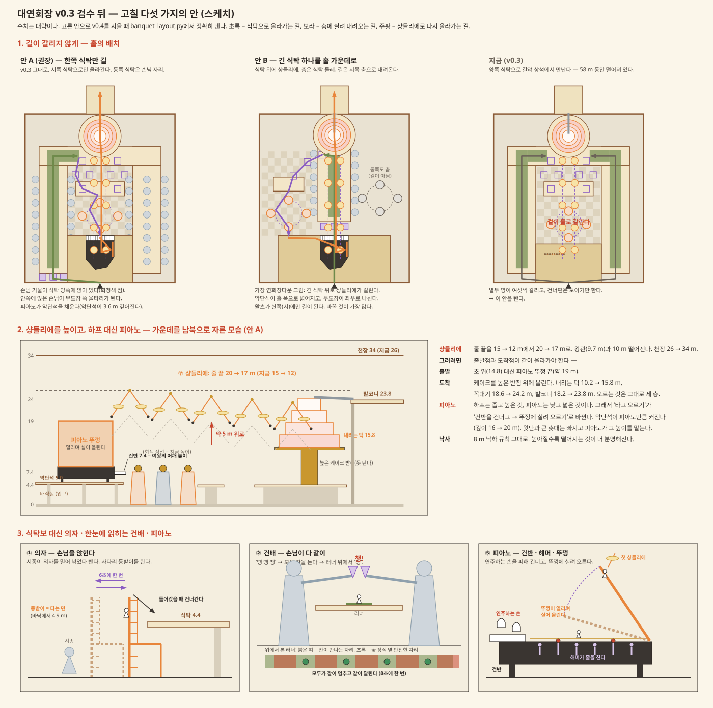

# 대연회장 v0.3 검수 뒤 — 고칠 다섯 가지의 안과 아이디어 목록 (v0.4 제안)

2026-11-23 · R805 · [v0.3(R789)](PAWN_RUSH_BANQUET_HALL_DESIGN_v0.3.md)을 본 사용자:

> "1. 샹들리에가 더 높은 곳에 있어야 할 것 같아. 그리고 식탁보 부분에선 지금 방식은 다소 심심하고 현실성이 없는 것 같아. 다른 방식을 기획해줘. 그리고 와인잔을 부딪히는 부분은 어떤 장애물인지 그냥 봐선 잘 모르겠어. 하프도 외관상 하프같지가 않아. 차라리 피아노가 있으면 좋겠어. 사이즈가 다르니 구조적으로 조정해야겠지?
> 2. 양쪽 식탁이 갈리면 안 돼. 특히 길이가 짧지 않아서 플레이어들끼리 분리될 확률이 높아. 다른 방식을 고안해줘.
> 그리고 지금 아이디어가 막 떠오를지 않아서 대연회장하면 떠오르는 이미지, 컨셉, 키워드 등을 제시해줘."

> **제안 단계다.** v0.3의 문서 · 배치도 · 영상은 그대로 두었다. 아래에서 고른 것으로 v0.4(수치 · 배치도 · 입체 그림 · 영상)를 다시 짓는다. 여기의 숫자는 대략이고, Unity에는 아무것도 없다.

## 한눈에

| # | 지적 | 권하는 안 | 다른 안 |
| --- | --- | --- | --- |
| 1 | 샹들리에가 더 높아야 | 줄 끝을 15 → 12 m에서 **20 → 17 m**로(약 5 m). 천장 26 → 34 m. 출발점은 피아노 뚜껑 끝, 도착점은 높은 받침 위에 올린 케이크 | 마지막 샹들리에가 도르래로 내려와 케이크에 내려 준다 |
| 2 | 식탁보가 심심하고 현실성이 없다 | **의자** — 시종이 손님을 앉히려고 의자를 밀어 넣었다 뺀다. 사다리 등받이를 타고, 밀려 들어갔을 때 식탁으로 건너간다 | 식탁보 당기기(시종이 당길 때 딸려 올라간다) · 배식 수레(3단, 부엌에서 식탁까지 타고 간다) |
| 3 | 잔 부딪치기가 무슨 장애물인지 모르겠다 | **손님이 앉아서, 다 같이 건배한다** — '땡 땡 땡' 소리 → 모든 손님이 잔을 든다 → 러너 위에서 '챙'. 잔이 혼자 기우는 것이 아니라 손님이 든다 | 포크와 나이프(손님이 접시를 찍는다) · 샴페인 코르크(날아온다) |
| 4 | 하프가 하프 같지 않다, 피아노로 | **그랜드 피아노**가 악단석을 채운다. 연주하는 손을 피해 건반을 건너고 → (해머가 줄을 치는 피아노 속) → **열리는 뚜껑에 실려** 샹들리에 높이로 | 뚜껑은 열어 둔 채 받침대를 탄다 |
| 5 | 양쪽 식탁으로 갈리면 안 된다 | **안 A: 한쪽(서쪽) 식탁만 길.** 동쪽 식탁은 손님이 앉은 자리 | 안 B: 긴 식탁 하나를 홀 가운데로, 춤이 식탁 둘레로 |

구간의 순서는 그대로다: 배식실 → ① 의자 → ② 건배하는 식탁 → ③ 나이트 → ④ 왈츠 → ⑤ 피아노(건반 · 뚜껑) → ⑦ 샹들리에 → ⑧ 케이크 → ⑨ 칼등 · 발코니. ⑥ 큰 촛대는 빠진다(피아노가 그 높이를 맡는다).

## 1. 샹들리에를 높인다

- **지금:** 줄 끝이 15.4 → 12.2 m, 촛불 바퀴가 16 m 안팎, 천장 26 m. 춤추는 왕의 왕관(9.7 m) 바로 위에 걸려 있어 샹들리에라기보다 낮게 매단 그네처럼 보인다.
- **안:** 줄 끝 **20 → 17 m**, 촛불 바퀴 22 m 안팎, 천장 **34 m**. 춤추는 기물과 10 m 떨어진다. 줄 길이 · 흔들림 · 옮겨 타는 방식은 그대로다.
- **같이 올라가야 하는 것.** 샹들리에만 올리면 탈 수도 내릴 수도 없다.

| | 지금 | 안 |
| --- | --- | --- |
| 출발점 | 초 위 14.8 m | 피아노 뚜껑 끝 약 19 m |
| 내리는 곳 | 케이크 2단 턱 10.2 m | 케이크 내리는 턱 15.8 m |
| 케이크 | 식탁 위 5단, 꼭대기 18.6 m | **높은 받침(스탠드) 위의 4단**, 받침 접시 13.0 m, 꼭대기 24.2 m. 오르는 것은 그대로 세 층 |
| 발코니 · 출구 | 18.2 m | 23.8 m |
| 천장 | 26 m | 34 m |

- 케이크를 받침 위에 올리면 좋은 점이 하나 더 있다: 맨 아래를 '못 잡는 퐁당'으로 칠하지 않아도 받침 기둥이 저절로 못 오르는 것이 된다. 상석을 달리는 폰은 머리 위 13 m에 뜬 케이크를 올려다본다.
- 낙사는 8 m 낙하 규칙 그대로다. 높아질수록 '떨어졌다'가 더 분명해진다.
- *다른 안 — 도르래:* 옛 샹들리에는 촛불을 켜려고 도르래로 내렸다. 마지막 샹들리에만 줄이 길게 풀렸다 감기게 해서, 높은 데서 케이크 높이까지 태워 내린다. 케이크를 높이지 않아도 된다. 다만 '매달려 내려가기'가 하나 더 생겨 샹들리에 구간이 길어진다.

## 2. 식탁보 대신 — ① 의자

지금 것(식탁 끝면의 식탁보 여섯 줄이 위아래로 흐른다)은 실제 식탁보가 하지 않는 움직임이다.

**벌어지는 일.** 시종들이 손님을 앉히려고 의자를 식탁 쪽으로 밀어 넣었다 뺀다. 의자는 등받이가 사다리처럼 가로대로 된 것이다.

**폰은.** 바닥에서 의자 등받이 뒷면을 탄다. 식탁보다 높이 올라가 매달려 있다가, 의자가 밀려 들어가 등받이 끝이 식탁에 닿을 때 건너간다. 작은 것이 식탁에 오르는 가장 자연스러운 길이다.

| 항목 | 값(대략) |
| --- | --- |
| 의자 | 다섯, 식탁 남쪽 끝에 나란히. 앉는 판 2.6 m, 등받이 꼭대기 6.6 m(식탁보다 2.2 m 높다) |
| 타는 면 | 등받이 뒷면(다리 + 가로대). 바닥에서 4.9 m — 폰 스테미나 51%, 룩 73% |
| 주기 | 6초: 빠져 있음 2.2초(식탁과 2.6 m) → 밀려 들어감 0.8초 → 들어가 있음 2.2초(식탁과 0.4 m) → 빠짐 0.8초. 이웃 의자와 어긋난다 |
| 실려 가기 | 타는 동안 의자가 움직이면 같이 실려 간다. 매달려 기다리는 동안 힘은 안 든다 |
| 실패 | 빠져 있을 때 뛰면 바닥으로 떨어진다(다시 탄다) |

- 읽히는 이유: 의자는 누구나 안다. 등받이의 가로대는 사다리로 보인다. 밀어 넣는 시종이 옆에 서 있다.
- *다른 안 — 식탁보 당기기:* 식탁보는 드리워 있고(타고 오를 수 있다), 시종이 식탁 위에서 식탁보를 확 당기면 매달린 폰이 딸려 올라가 식탁 위로 넘어온다. 식탁보가 실제로 하는 움직임이지만, 식탁 위의 접시가 같이 끌려와야 말이 된다.
- *다른 안 — 배식 수레:* 3단 수레가 배식실에서 식탁까지 오간다. 수레의 단을 타고 오르며 실려 가, 식탁에 닿으면 건너간다. '음식과 함께 들어온다'는 맛이 있지만 기다리는 시간이 길다.

## 3. 한눈에 읽히는 건배 — ②

지금 것이 안 읽히는 까닭: 잔이 아무도 없이 혼자 기운다. 건배로 보이지 않고, 언제 닫히는지도 잔마다 다르다.

**벌어지는 일.** 식탁 양쪽에 손님 기물이 앉아 있다. 누군가 숟가락으로 잔을 두드린다 — '땡 땡 땡'. 모든 손님이 잔을 높이 들고, 마주 앉은 손님끼리 러너 위에서 '챙' 하고 부딪친다. 식탁 전체가 한 번에 한다.

**폰은.** 소리가 나면 잔이 만나지 않는 자리(꽃 장식 옆)로 들어가 멈춘다. 지나가면 다시 달린다.

| 항목 | 값(대략) |
| --- | --- |
| 손님 | 식탁 양쪽에 4 m 간격으로 마주 앉는다. 안쪽에 앉은 손님이 무도장 쪽 울타리 노릇을 한다(v0.3의 꽃 울타리 대신) |
| 주기 | 8초: 달리는 시간 6.1초 → '땡 땡 땡' 1.5초(잔을 든다) → '챙' 0.4초 |
| 잔이 만나는 자리 | 손님 쌍마다 러너 위 폭 2.4 m. 그 사이 1.6 m가 안전하다(꽃 장식 · 촛대가 놓인 자리) |
| 맞으면 | 넘어져 뒤로 밀린다 |

- 읽히는 이유: 손님이 잔을 든다(건배로 보인다), 모두가 같이 한다(한 번 보면 안다), 소리가 먼저 난다.
- 열두 명이 같이 멈추고 같이 달린다. 좁은 안전 자리를 두고 밀치게 된다.
- *다른 안 — 포크와 나이프:* 러너 대신 접시 위를 달린다. 손님이 접시의 음식을 포크로 찍는다(그림자가 먼저 진다). 가장 빨리 읽히지만 '찍는 것 피하기'는 흔한 장애물이다.
- *다른 안 — 샴페인 코르크:* 병이 '쉬익' 하다 코르크가 식탁을 가로질러 날아간다.

## 4. 하프 대신 피아노 — ⑤

**구조를 고쳐야 한다.** 하프는 좁고 높은 것이라 '줄을 타고 오르기'였다. 피아노는 낮고 넓은 것이라 같은 자리에 같은 방식으로는 못 쓴다. 대신 피아노에는 하프에 없는 것이 있다: 건반, 속의 해머와 줄, 그리고 **열리는 뚜껑**이다. 뚜껑이 샹들리에 높이까지 가는 길이 된다.

| | v0.3 (하프) | 안 (피아노) |
| --- | --- | --- |
| 악단석 | 앞단 7.4 m + 윗단 11.6 m, 깊이 16.4 m | 한 단 5.0 m, 깊이 20 m. 피아노가 채운다 |
| 악기 | 하프: 폭 9 m, 줄 높이 2.2 ~ 4.2 m | 그랜드 피아노: 길이 약 14 m, 폭 약 12 m, 건반 높이 7.4 m, 열린 뚜껑 끝 약 19 m |
| 닿는 법 | 여왕의 어깨 → 악단석 바닥 → 하프 줄 | 여왕의 어깨 → **건반 위로 바로**(건반이 악단석 앞 가장자리에 있고 높이가 어깨와 같다) |
| 하는 것 | 튕겨지는 줄을 타고 오른다 | 건반을 건넌다 → 뚜껑에 실려 오른다 |
| 그다음 | 윗단 → 초(3.2 m) → 샹들리에 | 뚜껑 끝 → 샹들리에 |

**벌어지는 일.** 흰 장갑 한 쌍이 피아노를 친다(연주자는 장갑뿐이다 — 의자도 몸도 없어 길을 막지 않는다). 곡이 고조되면 뚜껑이 활짝 열린다.

**폰은.**

1. **건반** — 연주하는 손을 피해 건반 위를 달린다(약 8 m). 손은 치기 전에 들린다. 건반을 밟으면 소리가 난다.
2. **피아노 속** — 건반 뒤는 줄과 해머다. 건반이 눌리면 그 줄의 해머가 0.7초 뒤에 올라와 줄을 친다. 줄 밭을 건너는 동안 해머가 치는 줄 위에 있으면 튕겨 나간다(약 8 m). 넣을지 뺄지는 고른다 — 빼면 건반에서 바로 뚜껑이다.
3. **뚜껑** — 낮게 열려 있던 뚜껑이 10초에 한 번 활짝 열린다. 뚜껑 가장자리에 매달려 있으면 약 19 m까지 실려 올라간다. 다 열렸을 때 가장자리의 금테(폭 1.2 m)에 올라서서 첫 샹들리에의 줄을 잡는다.

- 읽히는 이유: 건반과 열린 뚜껑은 멀리서도 피아노다. 무도장에서 보면 장갑이 건반을 치고 뚜껑이 뒤에서 솟는다.
- 따라 바뀌는 것: 윗단과 ⑥ 큰 촛대가 빠진다. 촛대는 피아노 위의 장식으로 남길 수 있다.
- 회색 상자에서 볼 것: 움직이는 뚜껑에 매달려 실려 가는지(움직이는 벽은 되지만 이렇게 크게 도는 것은 처음이다), 뚜껑 끝에서 줄로 옮겨 잡히는지.
- *다른 안:* 뚜껑은 열어 둔 채 받침대(뚜껑을 괴는 막대)를 타고 오른다. 만들기는 쉽지만 '서 있는 것을 오르기'가 된다.

## 5. 길이 갈리지 않게 — 홀의 배치

지금은 서쪽 · 동쪽 식탁으로 갈려 58 m를 따로 달린 뒤 상석에서 만난다. 열두 명이 여섯씩 갈린다.

### 안 A (권장) — 한쪽 식탁만 길

- v0.3의 홀 그대로(ㄷ자 식탁이 무도장을 둘러싼다). **서쪽 식탁으로만 올라간다.** 의자는 서쪽 식탁 끝에만 있다.
- 동쪽 식탁은 손님이 가득 앉은 자리다. 길은 아니지만 홀의 좌우가 같아 보이고, 건너편에서도 같은 건배가 벌어진다.
- 식탁 위의 길: 서쪽 팔 52 m + 상석 13 m = 65 m(지금 58 m).
- 바뀌는 것이 가장 적다. 나이트 · 왈츠 · 샹들리에 · 케이크의 자리는 그대로다.
- 약한 점: 홀의 절반(동쪽 식탁)이 구경거리다.

### 안 B — 긴 식탁 하나를 홀 가운데로

- 긴 식탁이 홀 한가운데에 남북으로 놓인다. **샹들리에가 식탁 위에** 걸린다(실제 연회장이 그렇다). 춤은 식탁 둘레에서 벌어진다.
- 길: 식탁을 달려 북쪽 끝 케이크 발치까지 → 나이트로 식탁 서쪽 무도장에 내려 → 왈츠에 실려 남쪽 악단석으로 → 피아노 → 식탁 위 샹들리에로 다시 북쪽.
- 식탁을 달리는 폰의 머리 바로 위로 샹들리에에 매달린 폰이 지나간다. 세 길이 가장 가깝게 겹친다.
- 약한 점: 무도장이 식탁 좌우로 나뉘어 좁아진다(한쪽 폭 약 22 m). 동쪽 춤은 길이 아니다. 악단석을 홀 폭으로 넓혀야 한다. 바꿀 것이 가장 많다.

### 버린 것

- ㄷ자를 한 방향으로 다 돈다(서쪽 팔 → 상석 → 동쪽 팔): 식탁 위만 150 m가 된다.
- 갈림을 짧게 한다: 짧아도 갈리는 것은 같다.

## 다 고치면 (안 A 기준, 대략)

| 구간 | 지금(v0.3) | 고친 뒤 | 시간(초, 대략) |
| --- | --- | --- | --- |
| 배식실 | 입구 → 양쪽 식탁 끝 | 입구 → 서쪽 식탁 끝 | 8 |
| ① | 식탁보 | **의자** | 8 |
| ② | 잔 여섯 쌍이 차례로 | **손님이 다 같이 건배**, 65 m | 34 |
| ③ 나이트 · ④ 왈츠 | 그대로 | 그대로 | 13 + 20 |
| ⑤ ⑥ | 하프 + 큰 촛대 | **피아노**(건반 · 속 · 뚜껑) | 20 |
| ⑦ 샹들리에 | 줄 끝 15 → 12 m | **20 → 17 m** | 22 |
| ⑧ 케이크 · ⑨ 칼등 | 식탁 위 5단 | **높은 받침 위 4단**, 발코니 23.8 m | 19 + 12 |
| 합 | 2분 29초 | 약 2분 36초 | 156 |

대계단 현관홀은 2분 37초다. 손계산이다.

## 대연회장 하면 떠오르는 것 — 아이디어 목록

**★ = 폰이 매달리거나 타고 오를 거리가 되는 것.** 굵은 것은 지금 기획에 이미 들어 있는 것.

### 공간 · 건축

- 높은 아치 천장과 목조 들보 ★ · 긴 창과 스테인드글라스(빛줄기) · 벽을 두른 2층 회랑 ★ · **악단석** · 상석이 놓이는 단 · 큰 벽난로와 굴뚝 ★ · 줄지어 선 기둥 ★
- 문장 깃발(현수막) ★ · 태피스트리(벽걸이 그림) ★ · 무대 막과 커튼 줄 ★ · 대리석 체스판 바닥 · 붉은 카펫 · 두 짝 대문 · 거울의 방 · **왕의 발코니**(박스석)
- 벽에 걸린 것: 사슴 머리 박제 ★ · 방패와 교차한 검 ★ · 갑옷 입상 ★ · 벽 촛대

### 식탁 위

- **긴 식탁 · 러너** · 식탁보와 냅킨(백조 모양으로 접은 냅킨) · 접시 탑 ★ · 은 뚜껑(클로슈, 일제히 열린다) · 촛대(가지 달린) ★ · **와인잔** · 샴페인 잔 탑 ★ · 디캔터와 와인병 ★
- 포크 · 나이프 · 스푼 · 소금통과 후추통(그라인더) · 꽃 장식(센터피스) ★ · 과일 탑과 포도송이 ★ · 3단 디저트 스탠드 ★ · 수프 그릇과 국자 · 얼음 조각 ★ · 초콜릿 분수 ★ · 돌아가는 회전판 · 자리 이름표

### 음식

- **층층 케이크** ★ · 슈 탑(크로캉부슈) ★ · 통구이(꼬치에 꿰어 도는) ★ · 젤리와 푸딩(출렁인다 — 튀어 오른다) · 새가 날아오르는 파이 · 구멍 난 치즈(굴) · 빵 바구니와 바게트
- 마카롱 탑 ★ · 사탕 공예 · 아이스크림(녹는다 — 미끄러진다) · 버터 조각(미끄럽다) · 꿀과 시럽(끈적인다) · 포도주 통(구른다) · 샴페인 코르크(날아간다) · 끓는 수프

### 사람 · 역할

- 왕과 여왕(상석) · 앉은 손님들 · 시종과 웨이터(쟁반을 든 행렬 ★ — 접시 탑을 들고 걷는다) · 집사(종을 친다) · 요리사 · 술 따르는 사람
- 악단: 지휘자(지휘봉) · **피아노** ★ · 바이올린과 첼로(활) · 하프 ★ · 팀파니(튀어 오르는 북) · 트럼펫 팡파르 · 파이프 오르간 ★
- **춤추는 기물(왈츠 · 나이트)** ★ · 광대와 저글러 · 마술사(식탁보 빼기) · 불 뿜는 곡예사 · 의장병(칼로 만든 아치) · 가면 쓴 손님 · 긴 드레스 자락과 망토 ★

### 벌어지는 일

- 손님 입장과 팡파르 · **자리에 앉히기(의자)** ★ · **건배**(잔 두드리기 '땡 땡 땡') · 음식이 나온다(행렬, 뚜껑 열기) · **첫 춤** · **케이크 커팅** · 샴페인 터뜨리기
- 촛불 켜기와 끄기(어두워진다) · **샹들리에를 도르래로 내려 불 붙이기** ★ · 폭죽과 색종이 · 가면 무도회 · 왕의 입장(모두 일어선다) · 여흥(곡예 · 저글링 · 불쇼)
- 자정의 종(열두 번 — 시간이 다 됐다) · 의자 뺏기 놀이(음악이 멈추면 앉는다) · 잔 던지기 · 선물 쌓기 ★

### 움직임 — 장치의 씨앗

| 움직임 | 연회장에서 |
| --- | --- |
| 흔들린다 | **샹들리에** ★ · 커튼 줄 ★ · 그네 타는 곡예사 ★ · 깃발 ★ |
| 돈다 | **케이크 받침** ★ · **왈츠** ★ · 회전판 · 꼬치구이 ★ · 후추 그라인더 |
| 밀리고 당겨진다 | **의자** ★ · 식탁보 ★ · 쟁반 · 접시 · 배식 수레 ★ |
| 오르내린다 | **피아노 뚜껑** ★ · 은 뚜껑 · 음식 승강기 ★ · 도르래 샹들리에 ★ · 젤리 |
| 흘러내린다 | 촛농 ★ · 와인 · 샴페인 탑 ★ · 초콜릿 분수 ★ · 시럽 |
| 내리친다 | 포크 · 나이프 · **피아노 해머** · 팀파니 채 · 지휘봉 |
| 날아온다 | 코르크 · 폭죽 · 접시(저글러) · 새(파이에서) |
| 쫓아온다 | 굴뚝의 불길 ★ · 넘치는 수프 · 구르는 포도주 통 |
| 균형을 잡는다 | 웨이터의 쟁반 위 ★ · 접시 탑 ★ · 칼등 · 현수막 봉 ★ |

### 떠오르는 장면(참고)

식기들이 춤추는 만찬 · 자정에 끝나는 무도회 · 촛불이 떠 있는 긴 식탁의 대연회장 · 피아노 속에서 해머를 피하는 생쥐 · 떨어지는 샹들리에 · 끝없는 다과회 · 부엌의 작은 요리사. 참고 삼아 떠올리는 것이고, 그대로 옮기지는 않는다.

### 아이디어를 고를 때 보는 것

1. **연회에서 실제로 벌어지는 일인가.** (의자를 밀어 넣는다 ○ / 식탁보가 위아래로 흐른다 ×)
2. **한눈에 읽히는가.** 누가, 무엇으로, 언제 하는지 보이는가. (손님이 잔을 든다 ○ / 잔이 혼자 기운다 ×)
3. **폰이 매달릴 이유가 되는가.** 서 있는 벽이 아니라 움직이는 것에.
4. **열두 명이 같이 겪는가.** 갈리지 않고, 같은 박자를 같이 맞는가.
5. **다른 구간에 없는가.** (시계탑: 추 · 종 줄 · 원통 / 천문대: 공전 발판 · 구르는 공 / 대계단: 굴러오는 것 · 떨어지는 샹들리에 · 바람)

### 아직 안 쓴 것 가운데 눈에 띄는 것

| 아이디어 | 어떻게 쓰나 | 어디에 |
| --- | --- | --- |
| 쟁반을 든 웨이터 행렬 ★ | 접시 탑을 든 웨이터들이 줄지어 걷는다. 접시 탑을 타고 올라 쟁반 위에 실려 간다 | 배식실 → 식탁 (의자 대신) |
| 샴페인 잔 탑 ★ | 잔을 쌓은 탑 꼭대기에서 샴페인을 붓는다. 흘러넘치는 줄기를 피해 오른다 | 상석 위, 케이크 옆 |
| 은 뚜껑 열기 | 웨이터들이 뚜껑을 일제히 든다. 뚜껑 손잡이에 매달려 있으면 들려 올라간다 | 식탁 위 건배 사이 |
| 커튼 줄 ★ | 무대 막의 줄을 잡으면 막이 걷히며 옆으로 실어 간다 | 악단석 옆 |
| 의자 뺏기 | 음악이 멈추면 의자(안전한 자리)에 올라가 있어야 한다 | 무도장 |
| 자정의 종 | 종이 열두 번 치면 촛불이 꺼져 어두워진다 | 구간 전체의 박자 |
| 굴뚝의 불길 ★ | 벽난로 굴뚝을 오르는데 아래에서 불길이 솟는다. 빵 굽는 구멍에 숨는다 | 서쪽 벽 (떨어진 폰이 돌아오는 길로도) |

## 먼저 정할 것

1. **배치:** 안 A(한쪽 식탁만 길)인가, 안 B(긴 식탁을 가운데로)인가.
2. **식탁에 오르는 법:** 의자 · 식탁보 당기기 · 배식 수레 가운데.
3. **건배:** 손님이 다 같이 하는 건배로 갈지, 포크 · 코르크로 바꿀지.
4. **피아노:** 건반 + 뚜껑만 할지, 피아노 속(해머)도 넣을지.
5. **샹들리에 높이:** 줄 끝 20 → 17 m와 높은 받침 위의 케이크로 갈지, 도르래로 내려올지.
6. **목록에서 더 넣고 싶은 것.**

정해지면 v0.4를 짓는다: 수치 스크립트 → 배치도와 단면 → 입체 그림 → 진행 영상.
