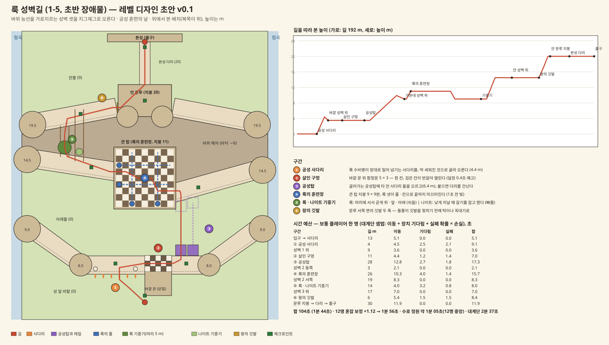

# 룩 성벽길 레벨 디자인 초안 v0.1 — 성벽 셋을 지그재그로 오르는 공성 훈련의 날

2026-11-26 · R843 · 장소 [1-5 룩 성벽길](PAWN_RUSH_PLACES_4MIN.md#1-5-룩-성벽길)(코스 1 · 초반 장애물). 사용자가 컨셉 그림(아래)을 붙이고: "다음으론 바깥뜰(초반구간)의 룩 성벽길 장애물 프리팹을 만드려고 해. 천문대와 연회장을 만든 것 처럼 '성벽길' 만의 구성과 장애물을 기획해서 레벨디자인 초안 만들어줘."

> **사람이 달려 본 적이 없다.** 수치는 폰의 속도와 벽타기 규칙(코드에서 읽은 값)으로 손계산한 것이고, 그림은 설계를 그린 것이다(게임을 찍은 것이 아니다). 회색 상자 전.
> 숫자는 전부 `ArtSource/PawnRush/RookRampart/rampart_layout.py` 한 곳에서 나온다(배치도도 이 파일이 그린다). 입체 그림은 `rampart_blockout.py`(Blender)가 같은 숫자로 만든다.
> **구간별 2D 설명(움직이는 그림, R859):** [PAWN_RUSH_ROOK_RAMPART_2D_v0.1.html](PAWN_RUSH_ROOK_RAMPART_2D_v0.1.html) — 구간마다 설계의 시간 함수로 움직이는 단면 · 평면과 주기 띠. 그리며 ⑤ · ⑥을 고쳤다(아래 [2D로 그려 보며 고친 것](#2d로-그려-보며-고친-것-r859)).

## 한눈에

- **성이 먼저다.** 왕성의 바깥 방어를 실제 성의 모양으로 놓았다: 두 협곡 사이로 뻗은 **바위 능선** 위에 **성벽 셋**이 능선을 가로질러 겹겹이 서 있고(바깥 성벽 → 가운데 성벽과 그 가운데의 **큰 탑** → 안 성벽과 **안 문루**), 바깥 성벽과 가운데 성벽 사이는 **아래뜰**, 가운데와 안 성벽 사이는 **바위 해자**다. 뒤로 갈수록 높아진다(성벽 위 3.5 → 9 → 14.5 m) — 안쪽 성벽이 바깥 성벽 너머를 내려다보는 실제 성의 짜임 그대로.
- **오늘은 공성 훈련의 날이다.** 성벽은 룩(살아 움직이는 탑, 성의 수비병)이 지키고, 폰들이 공격조다. 기술자들은 기중기로 새 기물(거대한 룩과 나이트)을 성벽 위로 올리는 중이다. 그래서 장치마다 그 일을 하는 이가 보인다: 사다리를 미는 룩 수비병, 사다리를 다시 세우는 공격조, 공성탑을 미는 조, 기중기 바퀴를 걷는 일꾼, 훈련장의 룩, 바람.
- **길은 하나, 성벽을 지그재그로 오른다.** 바깥 성벽을 사다리로 올라 **동쪽으로** → 공성탑을 타고 **북쪽으로** 아래뜰을 건너 → 가운데 성벽을 **서쪽으로**(큰 탑 지붕의 훈련장을 대각선으로) → 기중기의 룩이나 나이트로 **북쪽으로** 해자를 건너 → 안 성벽을 **동쪽으로** → 문루의 왕의 깃발을 타고 지붕으로 → **북쪽으로** 본성 다리, 출구. 세 다리가 높이를 달리해 겹치므로, 가운데 성벽 위에서 아래로 사다리에 매달린 폰들이 보이고 안 성벽 위에서 훈련장이 내려다보인다.
- **플레이타임:** 보통 플레이어 한 명 **1분 44초**, 열두 명 혼잡 보정 **1분 56초**. 같은 셈법으로 대계단 현관홀은 2분 37초, 수로 정원은 12명 중앙값 약 1분 5초다 — 초반 구간이라 그 사이로 잡았다('먼저 정할 것' 3).
- **크기:** 능선 92 m(절벽 포함) × 98 m, 높이 0 → 20 m(출구). 길 192 m.

| # | 구간 | 성의 어디 | 폰이 하는 것 | 벽타기 / 종류 | 높이 (m) |
| --- | --- | --- | --- | --- | --- |
| – | 성 앞 비탈 | 바깥 성벽 앞 | 입구에서 사다리 밑으로 | 없음 | 0 |
| ① | 공성 사다리 | 바깥 성벽 바깥면 | 룩 수비병이 장대로 밀어 넘기는 사다리 여섯 중 **막 세워진 것**을 골라 총안까지 오른다 | 밀려 넘어지는 사다리 오르기 | 0 → 3.5 |
| ② | 살인 구멍 | 바깥 문 위의 성벽 길 | 함정문 5 × 3이 **흰 칸, 검은 칸 번갈아** 열린다 — 닫힌 색을 골라 밟는다 | 박자 · 발 디딤 | 3.5 |
| ③ | 공성탑 | 아래뜰 | 바깥 성벽에 붙은 공성탑에 타고, **구르는 동안** 안 사다리 둘을 올라, 가운데 성벽에 붙으면 내린 다리를 건넌다 | 움직이며 오르기 | 3.5 → 9.9 → 9 |
| ④ | 룩의 훈련장 | 가운데 성벽의 큰 탑 지붕 | 9 × 9 판을 대각선으로. 룩 넷이 **줄(세로)과 칸(가로)을 끝까지 미끄러진다**, 1초 전에 그 줄이 빛난다 | 피하기(체스 규칙) | 9 → 11 → 9 |
| ⑤ | 룩 · 나이트 기중기 | 바위 해자 위 | **룩**: 머리(지름 5 m) 위에 서서 곧게 위로, 곧게 건너(쉬움 · 기다림) / **나이트**: 낮게 지날 때 갈기에 뛰어 붙어 성벽 너머로(어려움 · 빠름) | 타기 / 뛰어 붙기 | 9 → 14.5 |
| ⑥ | 왕의 깃발 | 안 문루 서쪽 면 | 깃발 두 폭을 오른다. 돌풍이 깃발을 젖히기 전에(지붕의 작은 깃발이 먼저 펄럭인다) 가운데 턱이나 꼭대기에 있어야 한다 | 바람 속 오르기 | 14.5 → 20 |
| – | 본성 다리 | 문루 지붕 → 본성 | 다리를 건너 출구 | 없음 | 20 |

## 요청과 답

| 요청 · 지켜야 할 것 | 답 |
| --- | --- |
| '성벽길'만의 구성 (천문대 · 연회장처럼) | 장치를 줄 세우지 않고 **성의 생김새부터** 정했다: 능선을 가로지르는 성벽 셋, 그 사이의 아래뜰과 바위 해자, 성벽 끝의 원탑들, 가운데 성벽의 큰 탑, 안 성벽의 문루, 본성. 길은 그 성벽들을 차례로 '공략'한다. 길의 모양이 구간마다 다르다(성벽 바깥면, 성벽 위, 굴러가는 탑, 정사각 판, 해자 위 공중, 문루 면, 다리) |
| 컨셉 그림의 ㄷ자(협곡을 도는 성벽) | 그대로 쓰지 않았다: 구간의 출구는 다음 구간으로 이어지게 **북쪽(+z)** 을 봐야 하는데, 협곡을 한 바퀴 돌면 출구가 남쪽을 향한다. 대신 **성벽이 협곡 위 절벽 가에 서고, 양옆이 협곡(강 · 폭포)** 인 능선으로 했다 — 그림의 절벽 · 강 · 다리가 그대로 보인다 |
| 그림의 장치들 | 하나씩 그 자리의 실제 일로 바꿨다(아래 표) |
| (천문대 · 연회장에서 배운 것) 구조 먼저, 그 장소만의 장치 | 장치마다 그 성벽에서 실제로 하는 일이다: 공성 사다리 밀어내기, 살인 구멍, 공성탑, 기중기, 깃발과 바람. 체스는 룩 · 나이트가 자기 행마대로 움직이는 데서(훈련장의 줄 · 칸, 기중기의 곧은 이동 · 나이트의 도약) |
| 빠른 길은 어려운 길 | 길이 갈리는 곳은 ⑤ 하나, 5.5 m 떨어진 두 기중기다(긴 갈림 없음): 룩(기다림 · 쉬움)과 나이트(기다림 없음 · 뛰어 붙기). 조심스러운 사람은 룩을 탄다 |
| 벽타기는 연출된 상황으로 | 서 있는 벽만 타는 곳은 없다: ① 밀려 넘어지는 사다리, ③ 굴러가는 공성탑 안, ⑤ 해자를 뛰는 나이트, ⑥ 돌풍에 젖혀지는 깃발 |
| 한 판 안에서 겹치지 않게 | 대계단의 바람 구멍(길 가로 밀기)과 떨어지는 기물(예고 원), 마차뜰의 크레인 짐 낙하, 뒤에 오는 미니게임 C(도개교 당기기) · D(쇠살문 권양기)와 같은 장치를 쓰지 않았다. 바깥 문 · 안 문 · 도개교는 닫힌 채 서 있기만 한다(미니게임에서 열 것) |

| 컨셉 그림의 것 | 이 설계에서 |
| --- | --- |
| 계단처럼 쌓인 성벽을 오르는 폰들 | ① 바깥 성벽의 **공성 사다리** — 룩 수비병이 밀어 넘긴다 |
| 성벽 길의 흰 바람 | ⑥ **왕의 깃발**을 젖히는 돌풍(지붕의 작은 깃발이 예고) — 길을 미는 바람은 대계단에 있어서 쓰지 않았다 |
| 쇠살문이 있는 문루 둘 | **바깥 문**(그 위가 ② 살인 구멍)과 **안 문루**(⑥의 깃발이 걸린 곳). 문은 닫혀 있다 |
| 틀에 매달린 룩과 나이트, 바닥의 빨간 원 | ⑤ **기중기의 룩과 나이트** — 룩은 타고, 나이트는 뛰어 붙는다. 빨간 원은 그것들이 내려앉는 자리('비켜 서라') |
| 화살표를 따라 움직이는 둥근 룩 | ④ **룩의 훈련장** — 룩이 줄 · 칸을 따라 미끄러진다 |
| 금빛 틀의 나무 승강대 | ③ **공성탑**(움직이며 높이를 올려 주는 나무 탑) |
| 왕관 아치와 계단의 출구 | 본성 다리 끝의 본성 문(출구) |
| 협곡 · 강 · 아치 다리 · 폭포 | 능선 양옆의 협곡, 그 아래 강과 아치 다리, 건너편 절벽의 폭포 · 숲 |

## 성의 구성

좌표(구간 로컬: x 동쪽, y 높이, z 북쪽, 원점 = 입구 문턱).

| 자리 | 무엇 | 높이 (m) | 길에서 |
| --- | --- | --- | --- |
| 성 앞 비탈 (z −12 ~ 11) | 입구, 바깥 성벽 앞의 풀밭 | 0 | 시작, ① 밑 |
| 바깥 성벽 | 가운데가 곧은(z 11, x −24 ~ 24) 꺾인 성벽, 양 끝이 절벽의 원탑. 성벽 위 6 m, 흉벽 1 m(총안 턱 0.9 · 성가퀴 1.8) | 위 3.5 | ① ② |
| 바깥 문 (x 0 ~ 10) | 앞으로 나온 문루, 쇠살문이 내려져 있다. 그 위 성벽 길이 ②의 함정문 | 3.5 | ② |
| 아래뜰 | 바깥 성벽과 가운데 성벽 사이 풀밭(폭 약 17 ~ 18 m) | 0 | ③ |
| 가운데 성벽 | 큰 탑 동쪽(곧게 z 38 → 47)과 서쪽(z 46 → 51, 북쪽으로 물러남) | 위 9 | ③ ④ ⑤ |
| 큰 탑 (x −11.6 ~ 11.6, z 35.4 ~ 58.6) | 가운데 성벽 한가운데의 네모난 큰 탑(그 자체가 룩). 지붕이 9 × 9 판 | 지붕 11 | ④ |
| 바위 해자 | 가운데와 안 성벽 사이를 깎아 낸 도랑(기중기에서 폭 10.4 m) | 바닥 −6 | ⑤ |
| 안 성벽 | 문루 서쪽(z 64 → 70)과 동쪽. 서쪽 기중기 자리의 흉벽에 12 m 승강 문 | 위 14.5 | ⑤ ⑥ |
| 안 문루 (x −10 ~ 10, z 70 ~ 82) | 남쪽에 룩 머리의 원탑 둘, 도개교는 올려져 있다. 서쪽 면에 왕의 깃발 | 지붕 20 | ⑥ |
| 안뜰 | 안 성벽 뒤 | 9 | (떨어지면) |
| 본성 다리 (x −2 ~ 2, z 82 ~ 98) | 문루 지붕에서 본성 문까지 | 20 | 끝 |
| 협곡 (\|x\| > 46) | 절벽 아래 강(−32), 건너편 절벽 · 숲 · 폭포, 낮은 아치 다리 | — | 배경 |

**지름길이 없다.**

- **바깥 문은 닫혀 있다**(쇠살문). 비탈에서 아래뜰로 들어갈 수 없다. 성벽의 바깥면은 사다리 말고는 잡을 수 없다.
- **아래뜰에서 가운데 성벽으로는 공성탑뿐이다.** 가운데 성벽 · 큰 탑의 면은 잡을 수 없다. 아래뜰의 수비병 계단은 바깥 성벽 위의 사다리 끝으로만 돌아간다.
- **큰 탑이 가운데 성벽 길을 막는다.** 동쪽 길에서 서쪽 길로는 탑 지붕(훈련장)을 건너야 한다.
- **해자는 기중기로만.** 폭 10 ~ 13 m에 안 성벽이 5.5 m 높다. 큰 탑 북쪽 면과 문루 원탑 사이는 7.4 m에 높이차 9 m 이상.
- **안 성벽 동쪽은 막다른 곳**이고, 안뜰(9)의 계단은 안 성벽 서쪽 끝으로 돌아간다. 출구는 20 m 높이의 본성 다리에만 있다.

## 벽타기 · 움직임 — 코드에서 읽은 것

연회장과 같다(`RagdollPawn.UpdateClimb` · `RideWall` · `TryStartTopOut` · `FallDistanceRespawn` · `RagdollTuning.asset`): 달리기 2.5 m/s, 점프로 넘는 턱 0.6 m까지(그보다 높으면 오르기), 오르기 초당 1.2 m(55°보다 가파른 면), 움직이며 오르면 스테미나가 초당 1(최대 8), 매달려 멈추면 줄지 않음, 움직이는 면에 실려 간다, 공중에서 잡기(우클릭), 8 m 넘게 떨어지면 마지막 체크포인트, 룩은 오르기 0.7배.

## 구간별

### 입구 → ① 공성 사다리 (비탈 0 → 바깥 성벽 위 3.5)

| | |
| --- | --- |
| 자리 | 바깥 성벽 가운데의 서쪽 절반, 총안 여섯(x −18.5 ~ −3.5, 3 m마다) |
| 사다리 | 길이 5.2 m, 75°로 총안에 걸침. 오르는 높이 4.4 m(총안 턱까지) — 폰 3.7초, 룩 5.2초 |
| 누가 | **룩 수비병 둘**이 성벽 위에서 갈래 장대로 민다(각자 사다리 셋을 차례로, 3초마다 한 번). 사다리 발치의 **공격조**가 밧줄로 다시 세운다 |
| 시간 | 사다리마다 9초에 한 번: 장대를 내림(예고 0.6초) → 밀려 **수직을 지나** 비탈 위로 넘어짐(0.9초) → 누워 있음(0.6초) → 다시 세움(1.4초) → 기대어 있음 5.5초. 여섯이 1.5초씩 어긋난다 |
| 규칙 | 사다리가 수직을 지나는 순간 매달린 폰은 놓친다(떨어짐 최대 약 4 m). 넘어지는 사다리가 덮치는 비탈 위(발치 남쪽 5 m)에 서 있으면 넘어진다 |
| 어떻게 | 수비병이 **방금 밀고 지나간 사다리**를 고른다 — 다시 설 때 붙어 바로 오르면 다음 장대 전에 넉넉히 넘는다(폰은 다시 선 뒤 2.6초 안에 시작). 룩은 빠듯하다(1초). 기다리는 자리는 **발치 안쪽(성벽 쪽)** — 사다리는 바깥으로 넘어진다 |
| 그 다음 | 총안 턱(0.9 m)을 넘어 성벽 위. 수비병 둘이 사다리 사이를 오가므로 피해서 동쪽으로 |

### ② 살인 구멍 (바깥 문 위, 3.5)

| | |
| --- | --- |
| 자리 | 성벽 길이 바깥 문의 지붕을 지나는 10 × 6 m(x 0 ~ 10) |
| 장치 | 2 m 함정문 5 × 3 = 15장, 흰 칸 · 검은 칸이 체스판처럼 놓였다. 밑은 문 통로(3.5 m 아래) |
| 누가 | 수비병들이 공격조 머리 위로 모래 자루를 떨어뜨리는 훈련 — 문 안쪽 방에서 뚜껑을 연다 |
| 시간 | 4.4초 주기: 흰 칸 덜컹(0.4초 예고) → 흰 칸 열림 1.2초 → 모두 닫힘 0.6초 → 검은 칸 덜컹 0.4 → 열림 1.2 → 모두 닫힘 0.6 |
| 어떻게 | 닫힌 색의 칸으로, 대각선으로(비숍처럼) 한 칸씩. 10 m를 4초에 건너니 색이 한 번은 바뀐다 |
| 떨어지면 | 문 통로로(3.5 m) — 통로 끝 계단으로 성벽 위, 약 7초 |

### ③ 공성탑 (아래뜰, 3.5 → 9.9 → 가운데 성벽 위 9)

| | |
| --- | --- |
| 자리 | 바깥 문 동쪽(x 13.5 · 18) — 아래뜰을 가로지르는 바퀴 자국 둘 |
| 탑 | 4 × 4 m 나무 탑, 앞과 옆은 젖은 가죽, 뒤(남쪽)는 열려 있다. 층 셋: 3.5(바깥 성벽 위와 같은 높이) · 6.7 · 9.9(가운데 성벽의 총안 턱 높이). 안 사다리 둘(3.2 m씩), 꼭대기 앞에 내리는 다리 |
| 누가 | 뒤에서 미는 **공격조**(폰 셋) |
| 시간 | 24초 주기, 둘이 반 주기 어긋남: 바깥 성벽에 붙어 타는 4초 → 굴러감 8초(16.5 / 17.8 m) → 다리 내림 0.6 → 다리 내려 있음 3.4 → 올림 0.6 → 돌아옴 7.4 |
| 어떻게 | 뒤로 타서(성벽 위에서 걸어 들어감) 구르는 동안 사다리 둘을 오른다: 폰 5.3초, 룩 7.6초 — 붙을 때까지 8.6초. 다리가 내려가면 건너 가운데 성벽 위로 |
| 늦으면 | 다리가 올라가면 탑과 같이 돌아가 다시(떨어지지 않음). 평균 기다림 2.7초 |
| 떨어지면 | 아래뜰로 — 꼭대기에서면 8 m 넘어 체크포인트 2(바깥 성벽 위, 공성탑 앞) |

### ④ 룩의 훈련장 (큰 탑 지붕 11)

| | |
| --- | --- |
| 자리 | 가운데 성벽 한가운데의 큰 탑. 동쪽 길에서 계단 넷(0.5 m씩)으로 지붕에 올라 **2번째 줄 동쪽 끝**에서 들어가고, **5번째 줄 서쪽 끝**으로 나가 서쪽 길로 내려간다 — 대각선으로 건넌다 |
| 판 | 9 × 9 칸, 한 칸 2.4 m(21.6 m). 둘레는 흉벽(들어가고 나가는 곳만 열림) |
| 누가 | **룩 넷**(높이 3 m)이 행마 훈련: 세로줄 2 · 6(x −4.8 · 4.8)과 가로줄 3 · 6(z 44.6 · 51.8) |
| 움직임 | 룩답게 자기 줄을 **끝에서 끝까지 한 번에**: 쉼 2초 → 그 줄이 빛남 1초 → 미끄러짐 19.2 m(초당 8 m, 2.4초) → 쉼 → 빛남 → 되돌아감. 한 바퀴 10.8초, 넷이 2.7초씩 어긋남 |
| 맞으면 | 흉벽까지 밀려 넘어진다(약 4초 손해) — 떨어지지는 않는다('먼저 정할 것' 5) |
| 어떻게 | 빛나는 줄에서 비켜 선다. 가로줄 룩은 걸어가는 방향으로 오기도 한다 — 다른 줄로 한 칸 비켜 지나보낸다 |

### ⑤ 룩 · 나이트 기중기 (바위 해자 위, 9 → 14.5)

가운데 성벽 서쪽 끝에서 두 나무 기중기(들보가 해자를 가로지름)가 안 성벽 흉벽의 **승강 문**(성가퀴가 없는 12 m)으로 짐을 나른다. 안 성벽 위의 **밟는 바퀴**를 일꾼 폰들이 걸어 돌린다.

| | 룩 (쉬운 길) | 나이트 (빠른 길) |
| --- | --- | --- |
| 자리 | x −30 | x −24.5 (5.5 m 옆) |
| 짐 | 거대한 룩, 머리(성가퀴 여섯 두른 바닥)가 지름 5 m — 폰 4 ~ 6 | 거대한 나이트(높이 4.6 m), 갈기 · 목을 잡는다 |
| 움직임 | 룩답게 **곧게**: 가운데 성벽 높이(9)에서 머리가 성벽 가에 붙어 3.5초 멈춤 → 곧게 위로 5.5 m(1.8초) → 곧게 북쪽으로 5.1 m(1.2초) → 승강 문 앞에서 3초 멈춤 → 되돌아옴. 12.5초 주기 | 나이트답게 **뛴다**: 가운데 성벽 가에서 1.8 m 떨어져 목이 손 높이로 지나가고, 13 m를 3초에 날아 안 성벽 위 승강 문 안에 내려앉아 **0.6초 돌아서고**, 3초에 되돌아와 또 0.6초 돌아선다(7.2초 주기, R859). **기다리지 않는다**(돌아설 뿐), 가장 높을 때 귀 20 m |
| 하는 것 | 멈췄을 때 머리 위로 걸어 올라 서 있다가, 승강 문 앞에서 걸어 내린다 | 가운데 성벽 가에서 돌아서는 끝에 뛰어 갈기를 잡고(우클릭), 안 성벽 위에서 나이트가 돌아설 때 같이 앞쪽(북쪽)으로 돌아가 놓는다(약 1.2 m 아래 성벽 위). 뒤(승강 문)에 놓으면 되뛰는 나이트의 받침에 치인다 |
| 기다림 | 평균 3.2초 | 없음(7.2초마다 돌아섬) |
| 실패 | 거의 없음(늦으면 다음 차례) | 못 잡거나 놓치면 해자 바닥(−6) — 체크포인트 4(가운데 성벽 서쪽) |
| 빨간 원 | 룩 머리가 붙는 가운데 성벽 가 | 나이트가 내려앉는 안 성벽 위 — 비켜 서라 |

### ⑥ 왕의 깃발 (안 문루 서쪽 면, 14.5 → 20)

| | |
| --- | --- |
| 자리 | 안 성벽 위를 동쪽으로 18 m, 문루의 서쪽 면 |
| 깃발 | 흰 바탕에 금 왕관, 두 폭(각 2.75 m · 폭 3.6 m), 사이에 돌 턱(17.25, 깊이 0.6 m, 문루 면 전체 너비). 두 폭 다 벽에 붙어 윗변에 걸린다. 위 폭 꼭대기에서 지붕으로 넘어간다 |
| 누가 | 협곡에서 부는 바람 — 지붕의 작은 깃발 셋이 먼저 펄럭인다 |
| 시간 | 7초마다 돌풍: 작은 깃발이 펄럭임(예고 1초) → 깃발이 벽에서 40° 젖혀짐(0.6초) → 1초 → 돌아옴(0.8초). 잠잠한 동안 4.6초(예고 포함) |
| 규칙 | 젖혀진 깃발은 바닥에서 50°라 잡을 수 없다(55°보다 눕는다) — 매달려 있던 폰은 놓친다. 그 전에 턱이나 꼭대기에 있어야 한다 |
| 어떻게 | 펄럭임이 멎으면 한 폭을 단숨에: 폰 2.3초, 룩 3.3초 — 둘 다 한 번의 잠잠함에 들어간다. 턱에서 다음 돌풍을 기다릴 때는 **깃발 옆으로 비켜 선다** — 위 폭 앞에 서 있으면 젖혀지는 깃발에 밀려 떨어진다(R859) |
| 떨어지면 | 안 성벽 위로(2.75 ~ 5.5 m) — 바로 다시 |

### 본성 다리 → 출구 (20)

문루 지붕을 가로질러 북쪽 성가퀴 틈으로 본성 다리(폭 4 m, 16 m)에 나서 본성 문으로. 출구 (0, 20, 98), 북쪽을 본다.

## 떨어지면

| 어디서 | 어디로 | 치르는 값 |
| --- | --- | --- |
| ① 사다리(넘어질 때) | 비탈 | 다른 사다리로 다시(약 7초) |
| 바깥 성벽 위 → 안쪽 | 아래뜰(3.5 m) | 수비병 계단으로 사다리 끝까지(약 10초) |
| ② 함정문 | 바깥 문 통로(3.5 m) | 통로 끝 계단으로(약 7초) |
| ③ 공성탑 | 아래뜰 — 8 m 넘으면 체크포인트 2 | 약 12초 |
| 가운데 성벽 · 큰 탑 | 아래뜰(9 m 이상) · 해자 | 체크포인트 3 · 4 |
| ⑤ 나이트 | 해자 바닥 | 체크포인트 4(약 10초) |
| ⑥ 깃발 | 안 성벽 위 | 다시(약 6초) |
| 안 성벽 → 안쪽 | 안뜰(5.5 m) | 안뜰 계단으로 안 성벽 서쪽 끝(약 12초) |

체크포인트 여덟(슬롯 1 → 번호 0 ~ 7): 입구 · 바깥 성벽 위(사다리 끝) · 바깥 성벽 위(공성탑 앞) · 가운데 성벽 동쪽 · 가운데 성벽 서쪽 · 안 성벽 서쪽(기중기 끝) · 안 문루 지붕 · 본성 다리 끝.

## 스테미나

| 피치 | 높이 | 폰 | 룩 |
| --- | --- | --- | --- |
| ① 공성 사다리 — 총안 턱까지 | 4.4 m | 46% | 65% |
| ③ 공성탑 — 안 사다리 한 칸(둘, 사이에 층) | 3.2 m | 33% | 48% |
| ⑤ 나이트 — 갈기에서 귀까지(빠른 길에서 필요하면) | 1.6 m | 17% | 24% |
| ⑥ 왕의 깃발 — 한 폭(둘, 사이에 턱) | 2.75 m | 29% | 41% |

초반 구간이라 한 피치가 연회장(무대 막 36% · 52%)과 비슷하거나 낮다. 가장 무거운 것은 첫 사다리다.

## 시간 예산

대계단 현관홀 기획서(v0.3 7절)와 같은 셈법. 보통 플레이어 한 명, 단위 초.

| 구간 | 길 (m) | 이동 | 장치 기다림 | 실패 손실 | 합 |
| --- | --- | --- | --- | --- | --- |
| 입구 → 사다리 | 13 | 5.1 | 0 | 0 | 5.1 |
| ① 공성 사다리 | 4 | 4.5 | 2.5 | 2.1 | 9.1 |
| 바깥 성벽 위 | 9 | 3.6 | 0 | 0 | 3.6 |
| ② 살인 구멍 | 11 | 4.4 | 1.2 | 1.4 | 7.0 |
| ③ 공성탑 | 28 | 12.8 | 2.7 | 1.8 | 17.3 |
| 가운데 성벽 동쪽 | 3 | 2.1 | 0 | 0 | 2.1 |
| ④ 룩의 훈련장 | 26 | 10.3 | 4.0 | 1.4 | 15.7 |
| 가운데 성벽 서쪽 | 19 | 8.3 | 0 | 0 | 8.3 |
| ⑤ 룩 · 나이트 기중기 | 14 | 4.0 | 3.2 | 0.8 | 8.0 |
| 안 성벽 위 | 18 | 7.0 | 0 | 0 | 7.0 |
| ⑥ 왕의 깃발 | 6 | 5.4 | 1.5 | 1.5 | 8.4 |
| 문루 지붕 → 다리 → 출구 | 30 | 11.9 | 0 | 0 | 11.9 |
| 합계 | 180 | 79 | 15 | 9 | **104 (1분 44초)** |

- 12명 혼잡 보정 1.12배를 하면 **약 1분 56초**. 대계단은 2분 37초 · 혼잡 2분 56초, 수로 정원은 12명 중앙 약 1분 5초.
- 회색 상자로 달려 보기 전에는 믿을 수 없는 숫자다. 늘리려면 성벽 길(가운데 · 안 성벽)을 길게, 또는 ⑥ 뒤에 한 구간을 더한다.

## 만드는 법

전부 공유 시계(`ObstacleClock`)의 시간 함수로 움직여 온라인으로 보낼 것이 없다. 맞음 판정은 방장이 한다.

| 장치 | 만드는 법 |
| --- | --- |
| 공성 사다리 | 새 코드: 발치를 축으로 도는 타는 면(시간표), 수직을 지나면 매달린 폰을 놓게 한다 — **R817에서 `ClimbPeel`이 매달린 폰에 듣지 않았다**, 먼저 확인. 수비병 룩(그림 + 밀치는 몸), 넘어지는 사다리의 몸 |
| 살인 구멍 | 새 코드(작다): 시간표대로 콜라이더를 껐다 켜는 바닥 판 + 뚜껑 그림 |
| 공성탑 | 새 코드: 시간 함수로 구르는 탑(`Obstacle` + `IMovingSurface`) — 층(바닥) · 안 사다리(타는 면) · 내리는 다리(도는 바닥). 대연회장 웨이터 쟁반과 같은 방식 |
| 룩의 훈련장 | 새 코드: 줄 · 칸을 미끄러지는 룩(`Obstacle`, 미는 몸) + 1초 전에 빛나는 줄(그림) |
| 룩 기중기 | 새 코드(작다): 곧게 오르고 곧게 건너는 바닥(대연회장 `ClocheLift`와 같은 방식) |
| 나이트 기중기 | 새 코드: 시간 함수로 뛰는 나이트(타는 면, `Obstacle`). 잡기 · 놓기는 지금 그대로 |
| 왕의 깃발 | 새 코드(작다): 윗변을 축으로 젖혀지는 타는 면(바람) + 지붕 작은 깃발(그림). 55°를 넘으면 놓게 하는 것은 사다리와 같은 문제 |
| 떨어짐 | 기존 `FallDistanceRespawn`(8 m), 해자 바닥은 `KillVolume` |
| 성 | 기존 방식(원탑 · 성벽 · 성가퀴를 코드가 짓는 회색 상자, 대연회장과 같은 뿌리 프리팹 + `Awake`) |

## 회색 상자에서 가장 먼저 볼 것

1. **매달린 폰을 놓게 하기.** 사다리가 수직을 지날 때, 깃발이 40° 젖혀질 때 매달린 폰이 정말 떨어지는가(R817의 `ClimbPeel`은 듣지 않았다). 넘어지는 사다리가 밑의 폰을 넘어뜨리는가.
2. **구르는 공성탑 안에서 오르기.** 움직이는 탑의 사다리를 오르고, 움직이는 층에 서고, 다리를 건너는 것이 되는가.
3. **나이트에 뛰어 붙기.** 돌아서는 끝에서 1.8 m 떨어진 목을 공중에서 잡는 것이 되는가, 매달린 채 같이 돌아 앞쪽(성벽 위)에 놓기(R859).
4. **룩이 미는 힘.** 초당 8 m로 미끄러지는 룩이 폰을 넘어뜨리고 흉벽까지 미는 데서 그치는가(흉벽 너머로 튕기지 않는가).
5. **빨리 오르는 바닥에 서 있기.** 룩 머리가 1.8초에 5.5 m 오를 때.
6. **한눈에 보이는가.** 바깥 성벽 위에서 공성탑 · 큰 탑의 훈련장 · 기중기 · 문루가 보이는지.
7. **난이도.** 첫 회색 상자는 늘 쉬웠다(천문대 · 연회장). 주기와 틈을 먼저 조여 볼 것.

## 분위기

- **한눈에 공성 훈련 중인 성이다.** 사다리를 오르다 보면 위에서 룩이 장대를 내리고, 아래뜰에서 공성탑이 삐걱이며 굴러가고, 큰 탑 지붕에서는 룩들이 줄을 따라 쓸고 지나가고, 해자 위로 나이트가 뛰어오르고, 문루에서 왕의 깃발이 펄럭인다.
- **빛과 색:** 컨셉 그림 그대로 — 맑은 낮, 크림색 돌과 금 테, 흰 바탕 금 왕관 깃발, 파란 뾰족 지붕, 푸른 절벽과 폭포.
- **소리가 박자다:** 훈련 나팔(사다리를 밀 때마다), 함정문의 덜컹, 공성탑 바퀴의 삐걱임과 조의 구령, 룩이 미끄러질 때 돌 긁히는 소리와 줄이 빛날 때의 종소리, 밟는 바퀴와 사슬, 바람 소리와 작은 깃발의 펄럭임.
- **모두 체스 기물이다:** 룩(수비병 · 훈련장), 나이트 · 룩(기중기의 짐), 폰(공격조 · 일꾼), 왕의 깃발과 본성.

## 낙오자 구제의 쉬운 길 (R783 규칙)

뒤 미니게임이 끝나면 걸어서 지나갈 길이 열려야 한다: **훈련이 끝나 성문이 열린다** — 바깥 문의 쇠살문이 올라가고(비탈 → 아래뜰), 공성탑은 가운데 성벽에 붙은 채 계단이 되고, 큰 탑 지붕의 룩들은 멈추고, 안 문루의 도개교가 해자 위로 내려오고, 문루 안 계단으로 지붕까지. 모양과 자리는 회색 상자 때 정한다.

## 2D로 그려 보며 고친 것 (R859)

[구간별 2D 설명](PAWN_RUSH_ROOK_RAMPART_2D_v0.1.html)에서 장치와 폰을 설계 숫자 그대로 움직여 보니:

- **⑤ 나이트에서 내린 폰이 다시 치였다.** v0.1대로면 안 성벽에서 놓은 폰은 나이트 뒤(승강 문)에 떨어지는데, 나이트는 쉬지 않고 바로 그 문으로 되뛰어 받침이 폰을 친다. → 끝마다 **0.6초 돌아선다**('끝에서 돌아설 뿐'을 시간에 넣음). 매달린 폰은 나이트와 같이 앞쪽(북쪽)으로 돌아가 성벽 위에 놓고, 나이트는 반대로 뛰어 간다. 가운데 성벽 가에서도 돌아서는 끝에 잡는다. 주기 6 → 7.2초, 기다림은 여전히 없다. `rampart_layout.py`의 `KNIGHT_TURN` · `knight_phase` · `KNIGHT_HANG`, 위상 `KNIGHT_DELAY` 4.2(입체 미리보기의 13.75초 모습은 그대로).
- **⑥ 턱 위에서도 밀려 떨어진다.** 턱은 문루 면 전체 너비(깊이 0.6 m — 입체 미리보기와 같음, `LEDGE_DEPTH` · `LEDGE_Z`)이고 깃발은 그 가운데 3.6 m다. 위 폭은 벽에 붙어 걸려 있어서 턱 위라도 그 앞에 서 있으면 젖혀지는 깃발에 밀린다. → **턱에서는 깃발 옆으로 비켜 기다린다**(규칙).
- **① 기다리는 자리.** 사다리는 바깥(남쪽)으로 넘어지므로 발치 안쪽(성벽 쪽)이 안전하다. 발치 남쪽 5.2 m가 덮치는 자리.
- **숫자 확인.** ① 폰은 사다리가 다시 선 뒤(주기 3.2초)부터 5.8초까지 오르기 시작하면 다음 장대 전에 넘는다(룩은 4.2초까지), 사다리는 9.9초에 수직을 지난다. ② 살인 구멍을 시간 · 칸 탐색으로 건너면 5.6초, ④ 훈련장은 13.4초 — 세로줄 둘, 가로줄 둘이 각각 같이 쉬고 둘을 한 번에 건너는 때는 없다. 시간 예산의 ② 5.6초 · ④ 14.3초와 맞다.

## 먼저 정할 것

1. **이 구조로 갈지.** 능선을 가로지르는 성벽 셋을 지그재그로(바깥 성벽 → 아래뜰 → 가운데 성벽과 큰 탑 → 바위 해자 → 안 성벽과 문루 → 본성 다리). 장애물보다 이것을 먼저 정한다.
2. **'공성 훈련의 날'이라는 이야기.** 폰이 공격조, 룩이 수비병.
3. **길이.** 1분 44초(12명 1분 56초) — 초반 구간으로 이 정도인지, 대계단만큼(2분 37초) 늘릴지.
4. **⑤의 갈림.** 룩(쉬움 · 기다림) / 나이트(어려움 · 빠름).
5. **훈련장의 룩에 맞으면.** 넘어지고 흉벽까지 밀림(지금, 초반이라 순하게) / 큰 탑 밖으로 밀려 떨어짐(더 어렵게).
6. **출구 높이 20 m.** 다음 미니게임이 그 높이에서 시작한다.
7. **어느 칸에 둘지.** 코스 1(초반 장애물)의 초안 칸에 `Early_1-5_RookRampart`로.

정해지면 회색 상자. 먼저 '가장 먼저 볼 것' 1 ~ 3을 작은 시험 방에서 본 뒤 성을 짓는 순서를 권한다.

## 그림

- 배치도 · 높이 · 시간 예산: [R843_RookRampart.svg](Mockups/R843_RookRampart.svg) — `rampart_layout.py <svg>`가 그린다.
- **구간별 2D 설명**(R859): [PAWN_RUSH_ROOK_RAMPART_2D_v0.1.html](PAWN_RUSH_ROOK_RAMPART_2D_v0.1.html) — 구간마다 설계의 시간 함수로 움직이는 단면 · 평면, 주기 띠, 설명. `rampart_2d.py <html>`가 쓴다(틀은 `rampart_2d_page.html`). 브라우저로 연다.
- 입체 미리보기 세 장(Blender Cycles, 시계 13.75초의 모습 — 사다리 둘은 넘어지는 중 · 흰 함정문이 열림 · 공성탑 하나는 가운데 성벽에 다리를 내림 · 줄 둘이 빛남 · 나이트는 도약 중): `ArtSource/PawnRush/RookRampart/rampart_blockout.py`. 룩 · 나이트는 게임의 기물 모델(`PR_Piece_Rook` · `PR_Piece_Knight`)을 키운 것이다. 그림일 뿐 Unity에 들어가지 않는다.

