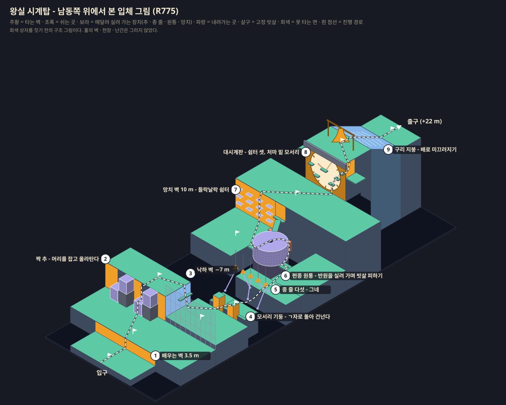
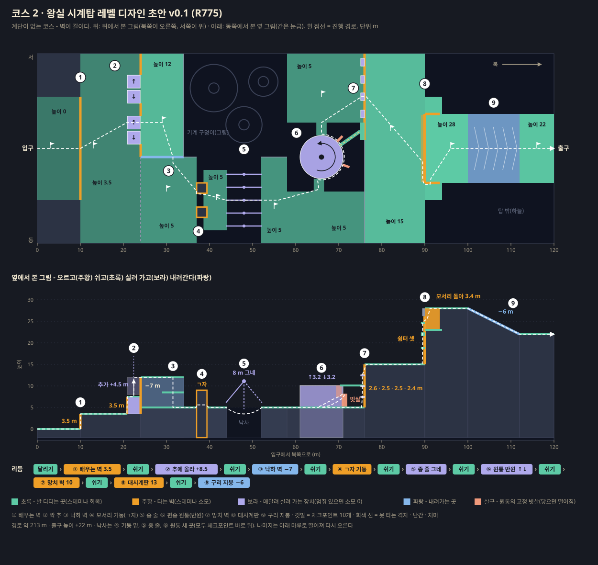
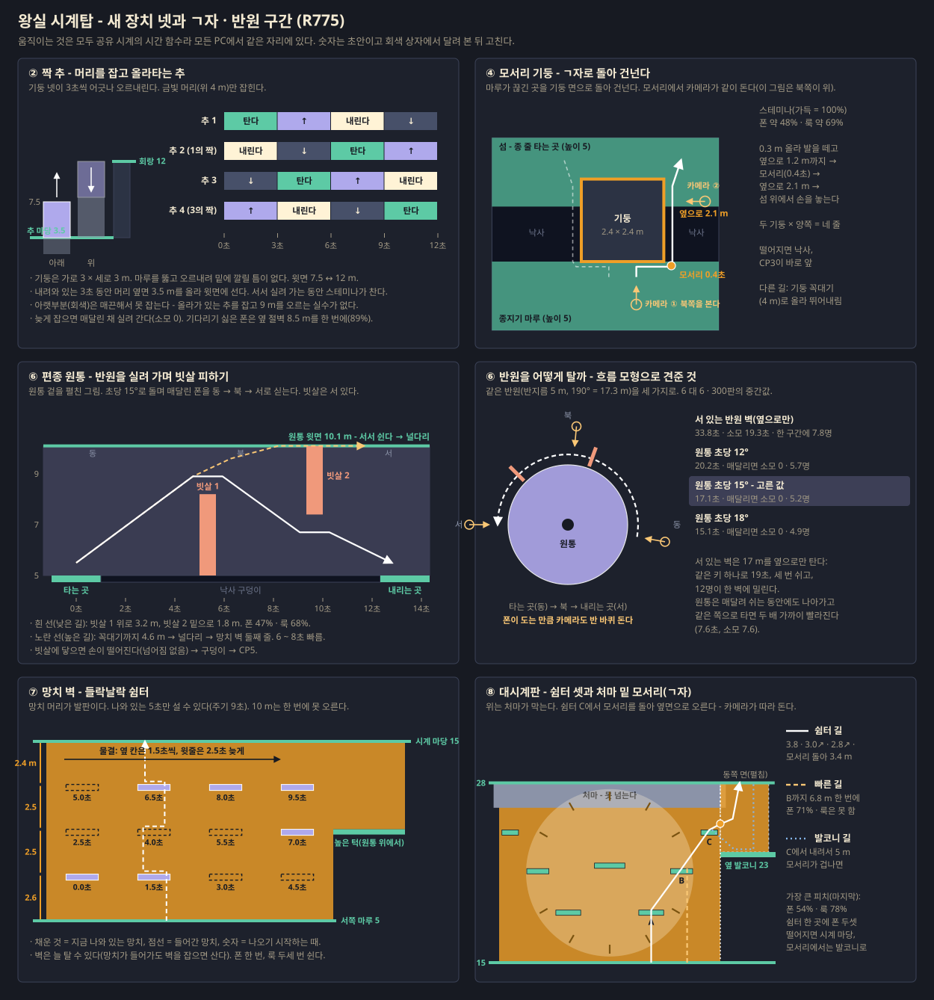

# 폰 러시 중반 장애물(코스 2) · 왕실 시계탑 레벨 디자인 v0.1 (초안)

2026-11-22 · R775 · 승규의 지시로 Claude가 쓴 초안. 지시: "벽 타기를 활용한 코스 … 벽타기 쉬기 벽타기 쉬기", "재미를 받을 수 있는 구간이랑 창의적인 경험", "기존에 쓰던 장애물은 사용 하지마", "길이 일직선으로만 쭉 가는 길이 아닌 위로 갔다 아래로 갔다 옆으로 갔다", "대계단이 있지만 참고 하지는 마", 이어서 "ㄱ 자로 된 벽도 카메라가 움직이면서 되니까 그것도 활용", "반원형으로 된 구간을 벽타기를 통해서 하는 것을 생각해봐 재미 검증 해주고".

> **회색 상자가 있다(R780, 2026-11-22).** 코스 프리팹 시험 장면의 숫자 4로 달려 볼 수 있고, 판에는 아직 나오지 않는다. 지으며 설계에서 바꾼 곳이 있다 — 바로 아래 '회색 상자' 절. **그 절과 아래 본문이 다르면 그 절이 맞다**(그림 셋과 흐름 모형은 R775 설계 그대로다).
> **사람도 봇도 달려 본 적이 없다.** 이동 수치는 코드에서 읽었고(아래 '벽타기 규칙'), 시간 · 기다림 · 길 견주기는 흐름 모형의 계산이다('재미 검증'). 실패 확률은 추정값이라 달려 본 뒤 바꿔야 한다. 사용자 Unity 확인 전.

## 사용자 첫 플레이 뒤 (R781) — 아래 R780 절과 본문보다 이것이 맞다

| 피드백 | 바꾼 것 |
| --- | --- |
| "보라빛 꼭대기에 올라가기만 해서 밋밋함" | **추 사슬.** 네 줄 모두 낮은 추(윗면 5 ↔ 7.5 m) 뒤에 높은 추(9 ↔ 11.5 m)가 붙어 있고 둘은 반 주기 어긋난다(9.8초 주기, 양 끝 2.5초). 1.5 m 올라 낮은 추 → 실려 감 → 낮은 추가 위에 있을 때 내려와 있는 높은 추를 1.5 m 올라 → 실려 감 → 회랑(0.5 m). 오르고-실리고-오르고-실리고. 박자를 놓치면 추 머리에 매달려 실려 가거나 더 오른다 |
| "모서리 기둥 … ㄱ자만 가능하게" | 기둥 높이 9 m(마루 위), 아래 3.4 m만 주황이고 위는 못 잡는 면(잡고 오르면 손이 풀린다) — 넘어가는 길이 없다. 섬은 마루 끝에서 2.6 m(점프로 못 감) · 1.4 m 위, 옆면은 못 잡음. 기둥은 2.4 × 3 m라 모서리를 돌아 옆면 2.6 m를 가야 섬 위다(폰 약 55% · 룩 약 78%) |
| "원통 위에는 아예 올라가지 못하고 옆면에 판자" | 원통 위에 같이 돌지 않는 못 잡는 뚜껑(10.1 → 13.5 m). 높은 길 · 널다리 · 망치 벽의 높은 턱은 없앴다. 원통 옆에 같이 도는 초록 판자 여섯(1.6 × 0.9 m, 60°마다, 높이 8.6 · 5.8 번갈아). 높은 판자에 선 폰은 빗살 1(5 ~ 8.2 m) 위로 지나가고 빗살 2(7.4 m ~)에 걸린다 — 그 전에 벽을 잡고 내려가 낮은 판자로 옮겨 서야 한다 |
| "망치벽을 좀 더 재밌게" | **톱니 블록 벽**(시계의 탈진기). 새 장치 `RatchetStep`: 블록(1.8 × 0.5 m)이 0.3초에 0.9 m 나와 1.5초 기다리고, 2초 동안 한 줄(2.5 m) 올라가 1.2초 멈췄다 들어가서 벽 속으로 내려온다(8초 주기). 위 줄 블록은 1.5 m 위 · 반 칸 옆에서 3.5초 늦게 나온다 = 아래 블록이 꼭대기에 닿을 때. 서서 실려 가고(쉼), 벽을 대각선으로 약 2.7초 타서(34%) 위 줄로 옮겨 타기를 세 번. 한 줄 네 칸이 2초씩 어긋나 다음 블록이 늘 온다 |
| "기둥보다는 실제 대시계 시침과 분침이 가고 그거대로 올라탄다" | 벽기둥 · 옆면 띠 · 발코니를 없애고 시계판은 못 잡는 면. **분침**(5.5 m, 시계 방향 15°/초 = 24초에 한 바퀴)과 **시침**(3.4 m, 4°/초)이 돈다. 6시 아래 받침대(0.8 m)에 올라 분침 앞면을 잡고 매달리면(소모 0) 9시를 지나 12시까지 약 12초 실려 간다. 12시에 분침 끝이 정오 턱(27 m)과 같은 높이 — 위로 올라서 턱으로, 주황 처마 1 m를 올라 종루. 바늘이 수평일 때는 위에 설 수도 있다(기울면 미끄러짐) |

자동 점검(`Tools/Run-RoyalClockTower.ps1`) PASS: 구간 검사 오류 0(경로 212.3 m, 가장 넓은 틈 0.85 m), 면 광선 19곳, Play에서 추 8 · 톱니 블록 11 · 줄 5 · 원통 · 바늘 둘이 설계대로 움직이고 오류 0. 흐름 모형과 그림 셋(R775)은 아직 R775 설계 그대로다.

## 회색 상자 (R780)

**여는 법.** Unity 메뉴 **ChessFight → Pawn Rush → Open Course Prefab Test** → Play → 숫자 **4**(코스 2의 둘째. 뒤 번호가 하나씩 밀렸다: 5 작전실 · 6 서재 · 7 천문대 · 8 금고실). F8 새 씨앗, R 체크포인트로. 프리팹 `Assets/Prefabs/PawnRushSections/Mid_2-2_RoyalClockTower.prefab`은 뿌리만 있고 Play 때 코드가 짓는다(금고실 방식). 구간 목록 셋째 칸의 `drafts`라 판은 뽑지 않는다.

**색.** 주황 = 타는 면, 청회색 = 못 타는 면, 보라 = 움직이는 것(추 · 블록 · 원통 · 줄), 초록 = 쉬는 곳, 파랑 = 내려가는 곳, 빨강 = 빗살, 회색 = 바닥.

**지으며 바꾼 것.**

| 무엇 | 설계(R775) | 회색 상자 | 왜 |
| --- | --- | --- | --- |
| 종 줄 섬 | 마루와 같은 높이(5 m), 1.6 m 건너 | **1.4 m 높다(6.4 m), 옆면은 못 잡는 면** | 1.6 m 틈은 벽을 탈 필요 없이 그냥 뛰어 건넌다(질주 점프 약 2.8 m). 옆으로 타는 거리는 스테미나 때문에 점프 거리보다 길게 못 만들므로 높이로 막았다. 기둥 옆면을 타며 1.4 m 올라야 해서 폰 약 55% · 룩 약 76% |
| 종 줄 착지 | 같은 높이 | 섬(6.4)에서 원통 마루(5)로 1.4 m 내려서며 내린다 | 위 때문. 줄의 축 높이 12.48 m |
| 낙하 벽의 턱 | 깊이 0.8 m | 깊이 2.5 m | 걸어 나가면 0.8 m 턱은 지나쳐서 7 m를 다 떨어진다 |
| 망치 벽의 쉼터 | 벽에서 나오는 얇은 망치 머리, 네 칸 × 세 줄 | **벽에서 0.9 m 밀려 나오는 블록**(폭 1.8 m, 높이 한 줄 2.5 m), 줄마다 반 칸 어긋나게 4 · 3 · 4개 | 튀어나온 얇은 턱은 밑에서 올라설 수 없다 — 등반은 타던 면이 끝나는 곳에서만 올라선다. 블록의 앞면을 타면 윗면에 올라서고, 그 위에서 옆 블록의 옆면(0.2 m 옆)을 타면 다음 줄이다 |
| 시계판의 쉼터 | 튀어나온 턱 A · B · C와 가운데 | **마당에서 올라오는 벽기둥 셋**(높이 3.8 · 6.8 · 9.6 m, 0.9 m 돌출, 좌우 대칭). 가운데 쉼터 없음 | 같은 이유. 첫 기둥의 앞면 3.8 m → 둘째 기둥의 옆면 3.0 m → 셋째 기둥의 옆면 2.8 m. 빠른 길은 둘째 기둥의 앞면 6.8 m. 대각선 피치가 없어졌다 |
| 추의 주기 | 12초(3초씩) | 13초(오르내림 3.5초), 짝은 6.5초 · 다른 짝은 3.25초 어긋남 | `MovingPlatform`의 가속 · 감속 0.5초 |
| 블록의 박자 | 나와 있음 5초 / 들어감 4초 | 9초: 다 나와 3.7초 · 오가는 0.8초씩 · 들어가 3.7초 | `MovingPlatform`은 양 끝에서 쉬는 시간이 같다 |
| 원통 | 15° 이하 조각 | Unity 원기둥(20면, 18°) | 먼저 달려 보고, 타는 동안 덜컥거리면 면을 늘린다 |
| 색 | — | 위 '색' | 벽이 길인 구간이라 색이 길을 알려야 한다 |

**자동으로 본 것**(`Tools/Run-RoyalClockTower.ps1` — 프로젝트 사본에서 Unity 배치, 결과 `Checks/R775_RoyalClockTowerGraybox/tower.txt`).

- Edit: 구간 검사 오류 0(경로 214.0 m, 가장 넓은 틈 1.35 m, 뜻한 틈 셋, 체크포인트 10 · 부활 자리 60, 못 타는 면 48). 움직이는 것 16(추 4 + 블록 11 + 원통) · 줄 5 · 빗살 2 · 낙사 영역 3. 타야 할 면 14곳과 못 타야 할 면 7곳에 광선을 쏘아 전부 맞음.
- Play 14.5초: 추 넷의 윗면이 7.5 ↔ 12 m, 블록 열하나가 0.9 m씩, 줄 다섯의 끝이 섬 ~ 원통 마루, 원통이 초당 −15°(동 → 북 → 서), 추 하나는 늘 아래에 서 있음, 오류 0.
- Unity 밖 전체 컴파일 PASS, Core + 모의 세션 115 통과.

**못 본 것 — 달려서 볼 것.** [확인표](../Network/VALIDATION.md) 맨 위 열다섯 줄. 무엇보다 ① 돌아가는 원통에 매달려 실려 가는지 ② 기둥과 탑의 모서리를 돌 수 있는지 ③ 블록 · 벽기둥의 앞면을 타고 윗면에 올라서는지 ④ 빗살이 손을 떼는지. 그리고 원통 위로 가는 널다리 밑을 지나는 폰이 널다리에 걸리는지, 블록이 나올 때 그 자리 벽에 붙어 있던 폰이 어떻게 되는지, 27° 구리 지붕을 걸어 내려갈 때 넘어지는지.

**코드.** `Assets/Scripts/PawnRush/`의 `RoyalClockTowerSection`(뿌리) · `RoyalClockTowerBuilder`(배치 · 좌표 · 주기 전부, `.Course`는 체크포인트 · 낙사 · 진행 경로 · 표지) · `RoyalClockTowerLook`(색) · `ClimbPeel`(빗살), 점검은 `PawnRushEditor/RoyalClockTowerValidation`(메뉴 **Validate → Royal Clock Tower (Edit + Play)**). 숫자를 고칠 때는 `RoyalClockTowerBuilder.cs` 맨 위의 상수들.

## 개요

**계단이 하나도 없는 코스다. 벽이 길이다.** 대계단 현관홀이 윗궁으로 가는 정문 길이라면, 시계탑은 뒷길이다. 시계탑 기계실의 추에 매달려 오르고, 기계 뭉치에서 뛰어내리고, 기둥을 ㄱ자로 돌아 종 줄 그네를 타고, 돌아가는 편종 원통에 붙어 반원을 실려 간 뒤, 망치 벽과 대시계판을 올라 구리 지붕을 배로 미끄러져 윗궁 문 앞에 닿는다. 기계실 북쪽 큰 아치 너머로 대시계판이 입구에서부터 보인다.

지금의 폰 러시 구간은 벽을 못 타는 면으로 막아 두었다(정원과 대계단은 단단한 것 전부, 구간 사이 복도의 벽). 이 구간이 **벽타기가 길이 되는 첫 구간**이다.

| 항목 | 값 |
| --- | --- |
| 자리 | 한 판의 셋째 칸(중반 장애물, 아랫궁). 대계단 현관홀과 같은 칸의 둘째 후보 |
| 크기 | 가로 44 m × 세로 120 m(기계실 76 m + 시계 마당 14 m + 탑 · 지붕 · 출구 30 m), 길 위 높이 0 ~ 28 m |
| 경로 | 약 213 m, 한 줄. 중간에 고르는 길 넷(절벽 직등, 원통 높은 길, 시계판 빠른 길, 발코니 길) |
| 높이 | 0 → 3.5 → 12 → 5 → (원통 위 10.1) → 15 → 28 → 22 m. 오르기와 내려가기가 번갈아 온다 |
| 비트 | 아홉: 배우는 벽 / 짝 추 / 낙하 벽 / 모서리 기둥(ㄱ자) / 종 줄 / 편종 원통(반원) / 망치 벽 / 대시계판 / 구리 지붕 |
| 새 장치 | 넷: 짝 추, 종 줄 그네, 편종 원통과 빗살, 망치 발판. 기존 장애물은 하나도 쓰지 않는다 |
| 낙사 | 세 곳(모서리 기둥 밑, 종 줄, 원통). 모두 체크포인트 바로 뒤. 나머지는 아래 마루로 떨어져 다시 오른다 |
| 모형의 시간(6 대 6) | 1등 약 1분 31초, 중간 1분 53초, 꼴찌 2분 27초. 폰 보통 1분 48초 · 처음 하는 사람 2분 21초 · 숙련 1분 37초 · 룩 2분 9초 |
| 온라인 | 움직이는 것이 모두 공유 시계의 시간 함수라 구간 상태로 보낼 것이 없다(0바이트) |

### 요청과 답

| 요청 | 이 초안의 답 |
| --- | --- |
| 벽타기, 쉬기, 벽타기, 쉬기 | 벽타기 피치가 끝나는 곳마다 발 디딜 곳(마루 · 턱 · 추 윗면 · 망치 머리 · 쉼터)이 있다. 모형에서 시간의 33%가 벽타기, 27%가 쉬기(매달려 실려 감 13% + 추 위 2% + 쉼터 9% + 기다림 3%)다. 쉬기에도 네 가지가 있다: 넓은 마루, 좁은 턱, 움직이는 쉼(추 위 · 원통), 시간이 정해진 쉼(망치) |
| 재미를 받을 구간 | ② 추 하나에 여럿이 붙어 올라간다 · ⑤ 종 줄 그네(줄마다 종이 울린다) · ⑥ 원통에 붙어 반 바퀴 실려 가며 빗살을 피한다 · ⑧ 처마 밑 모서리를 돌면 화면이 돈다 · ⑨ 지붕을 배로 미끄러진다 |
| 창의적인 경험 | 같은 곳을 지나는 법이 여럿이다. 낙하 벽은 턱 · 뛰어내림 · 다이빙, 기둥은 모서리 돌기 · 꼭대기 넘기, 원통은 매달려 쉬기 · 같이 타서 빨리 가기 · 꼭대기로 넘기, 시계판은 쉼터 길 · 빠른 길 · 발코니 길. "멈춰 매달리면 스테미나가 안 닳는다"를 알면 움직이는 벽이 쉼터가 된다 |
| 기존 장애물 금지 | 회전 막대 · 진자 · 밀대 · 컨베이어 · 바람 · 떨어지는 것 · 점프대 · 프레스 · 시간 문 · 굴러오는 것 · 유리 징검다리를 쓰지 않는다. 폰을 치는 장치가 하나도 없다(원통의 빗살은 서 있고, 닿으면 손이 떨어질 뿐 넘어뜨리지 않는다) |
| 일직선 말고 위 · 아래 · 옆 | 옆에서 보면 톱니 모양(오름 넷, 내림 셋), 위에서 보면 S자(서쪽 추 → 동쪽 종 줄 → 원통을 돌아 서쪽 → 가운데 시계탑). 옆 이동은 ㄱ자 기둥, 원통 반 바퀴, 시계판 대각선 |
| 대계단 참고 금지 | 계단 없음, 나선 없음, 둥근 홀 아님, 대계단의 장치 없음 |
| ㄱ자 벽(카메라가 따라 도는 것) | ④ 모서리 기둥에서 배우고(마루 높이, 짧게), ⑧ 대시계판의 처마 밑 모서리에서 다시 쓴다(높은 곳, 스테미나가 줄어든 채) |
| 반원형 구간을 벽타기로 | ⑥ 편종 원통. 위에서 볼 때 반원(벽이 휘고, 타는 동안 카메라가 반 바퀴 도는 구간)으로 읽었다. 서 있는 반원 벽과 돌아가는 원통을 모형으로 견줘 원통을 골랐다('재미 검증'의 1번). 옆에서 볼 때의 반원(아치를 타 넘기)을 뜻했다면 알려 주면 된다 |
| 재미 검증 | 실제 이동 수치로 만든 흐름 모형(6명 · 12명, 300판)과 거기서 나온 재미 위험 아홉 가지. 여섯은 설계를 고쳤다 |

### 먼저 정할 것

1. **장소.** 왕실 시계탑으로 갈지. 구조물(추 · 종 줄 · 편종 원통 · 망치 · 시계판)이 시계탑에만 있는 것들이라, 다른 장소로 바꾸면 이름과 생김새를 다시 잡아야 한다(뼈대와 숫자는 그대로 쓸 수 있다).
2. **반원 구간.** 돌아가는 원통(실려 가며 탄다)으로 갈지, 서 있는 반원 벽을 직접 옆으로 탈지. 모형은 원통 쪽이다. 직접 타는 맛을 원하면 반지름 2.5 m 둥근 탑을 쉼터 하나로 도는 작은 반원(약 13초)이 대안이다.
3. **빗살.** 닿으면 벽에서 떨어지는 고정 빗살이 "기존 장애물을 쓰지 않는다"는 기준에 맞는지. 빼면 원통은 타고 가기만 하는 구간이 된다.
4. **낙사 수위.** 세 곳이다. ④ 기둥 밑은 낙사 없는 2 m 도랑으로 바꿀 수 있지만, 모형에서는 처음 하는 사람이 5초 더 느려졌다(부활이 스테미나를 채워 주기 때문).
5. **길이.** 모형의 중간값 1분 53초. 대계단 모형(2분 6초)과 비슷하다. 늘리려면 망치 벽 줄 수, 시계판 높이가 손잡이다.
6. **룩.** 등반이 0.7배라 한 번에 6.7 m가 한계다. 필수 피치를 모두 룩의 80% 이하로 잡았고, 절벽 직등과 시계판 빠른 길은 룩이 못 한다. 이 차이를 둘지.
7. **출구 높이 +22 m, 홀 44 × 120 m.** 대계단(+15 m)보다 높다.
8. **소리 연출.** 종 줄 다섯에 음 다섯, 망치 물결에 음계, 꼭대기 큰 종. 넣을지는 소리 단계에서.

## 벽타기 규칙 — 코드에서 읽은 숫자

설계의 숫자는 전부 여기서 나왔다. 저장된 값은 `Assets/Settings/RagdollTuning.asset`, 동작은 `RagdollPawn.cs`의 `UpdateClimb`.

| 무엇 | 값 | 설계에 주는 뜻 |
| --- | --- | --- |
| 오르기 / 내려가기 / 옆으로 | 초당 1.2 / 1.6 / 0.9 m | 옆으로 타기가 가장 느리다. 긴 옆 이동은 지루해진다 |
| 두 방향 키를 같이 | 각 방향이 0.707배로 동시에 | 대각선 피치가 '위로 간 뒤 옆으로'보다 빠르다. 시계판 쉼터를 대각선으로 놓았다 |
| 스테미나 | 8초(등반 · 질주 · 다이빙 공용). 움직이면 초당 1, **멈춰 매달리면 0** | 한 번에 오르는 한계 9.6 m. 움직이는 벽에 매달리면 공짜로 간다 |
| 회복 | 발을 디디고 0.8초 뒤부터 초당 2(벽 · 밧줄에서는 회복 없음) | 바닥나면 다 차는 데 4.8초. 쉼터에서 2 ~ 3초 쉬면 다음 피치가 된다 |
| 벽 점프(Space) | 1 m를 0.3초에, 스테미나 1.2 | 빠르지만 비싸다. 급할 때의 선택 |
| 모서리 | 바깥 · 안쪽 모서리를 A / D로 0.4초에 돈다(`TryOutsideCorner` · `TryInsideCorner`). 랩 자동 점검 "옆으로 가도 … 모서리를 돌아감" | ㄱ자 벽 |
| 카메라 | 벽에 붙어 있는 동안 폰이 도는 만큼 카메라도 돈다(`LabCamera`의 `climbTurn`) | 모서리와 곡면에서 화면이 따라 돈다 |
| 움직이는 벽 | 붙은 벽이 움직이거나 돌면 몸 · 손 · 모서리 경로가 같이 간다(`RideWall`, 벽의 속도와 회전을 그대로 따름) | 짝 추, 편종 원통 |
| 꼭대기 | 벽 끝에서 0.45초에 올라선다 | |
| 탈 수 있는 면 | `NoClimbSurface` · `GrabOnlySurface`가 아니고 55°보다 가파른 단단한 면 | 탈 면과 못 탈 면을 재질로 가른다 |
| 떨어짐 | 4.1 m 넘게 떨어지면 넘어진다(약 1.3초). 다이빙으로 떨어지면 넘어지지 않는다 | 내려가는 곳의 선택지 |
| 밧줄 | 0.7 m 안의 줄을 우클릭으로 잡는다. 놓으면 줄의 속도 + 위로 3.5 m/s. 랩 [7i]에 8 m 틈 · 좌우 40° · 5초 그네 | 종 줄은 랩에서 점검한 값 그대로 |
| 룩 | 등반 속도 0.7배(`ChessPieces`). 소모는 같다 | 룩은 한 번에 6.7 m, 옆으로 5 m가 한계 |
| 달리기 / 질주 | 초당 2.5 / 3.6 m, 질주는 스테미나 초당 1 | 질주로 스테미나를 비우고 벽에 붙으면 못 오른다 |

**없는 동작 하나.** 꼭대기에 서서 발밑의 벽을 잡고 내려가기 시작하는 동작은 없다(벽이 앞에 있어야 잡는다). 그래서 내려가는 곳은 턱을 밟고 내려서거나 뛰어내리게 만들었고, 벽을 타고 내려가는 것은 이미 벽에 붙어 있을 때만 나온다(원통).

**피치의 한계.** 필수 길의 피치는 폰의 55% · 룩의 80% 이하다.

| 피치 | 폰 | 룩 |
| --- | --- | --- |
| 배우는 벽 3.5 m · 추 머리 3.5 m | 36% | 52% |
| 모서리 기둥(0.3 m 위로, 옆 0.8 m, 모서리, 옆 2.1 m) | 48% | 69% |
| 원통 낮은 길(3.2 m 오르고 1.8 m 내림) | 47% | 68% |
| 망치 한 칸 2.6 m | 27% | 39% |
| 시계판 A 3.8 m / A → B / B → C | 40 / 44 / 41% | 57 / 63 / 58% |
| C → 처마 밑 모서리 → 꼭대기 | 54% | 78% |
| (고르는 길) 절벽 직등 8.5 m | 89% | 못 함 |
| (고르는 길) 원통 꼭대기 4.6 m + 높은 턱에서 4.9 m | 48% + 51% | 68% + 73% |
| (고르는 길) 시계판 빠른 길 6.8 m | 71% | 못 함 |
| 망치 벽 10 m를 한 번에 | 못 함(104%) | 못 함 |

## 공간과 뼈대

**장소.** 아랫궁 뒤편의 시계탑. 남쪽이 기계실(추와 기계 뭉치, 종 줄, 편종 원통이 선 큰 홀), 북쪽이 하늘이 열린 시계 마당과 탑이다. 기계실의 북쪽 벽은 큰 아치로 뚫려 있어 입구에서 대시계판의 윗부분이 보인다. 목표가 처음부터 보이고, 가는 동안 계속 정면에 있다.

**타는 면과 못 타는 면.** 징 박힌 떡갈나무와 거친 돌은 탄다. 매끈한 황동 · 유리 · 쇠 격자는 못 탄다. 못 타는 면은 길을 건너뛰는 것을 막는 곳에만 쓴다(추의 아랫부분, 추 마당과 종지기 마루 사이의 격자, 시계 마당의 남쪽 난간, 시계판 위의 처마).

**좌표.** 구간 로컬(x 동쪽, y 높이, z 북쪽, 원점 = 입구 문턱 가운데). 방위는 동쪽에서 반시계로 잰 각(90° = 북)이다.

| 구조물 | 자리 | 높이 |
| --- | --- | --- |
| 입구 마당 | x ±12, z 0 ~ 10. 입구 문 폭 12 m | 0 |
| ① 배우는 벽 | z 10, x ±12 | 0 → 3.5 |
| 추 마당 | x ±22, z 10 ~ 24 | 3.5 |
| ② 기계 뭉치(윗면이 회랑) | x −22 ~ 2, z 24 ~ 34 | 12 |
| ② 추 넷 | x −15.5 · −12 · −6 · −2.5, z 20.9 ~ 23.9, 가로세로 3 m | 윗면 7.5 ↔ 12 |
| ② 절벽 직등 줄 셋 | 기계 뭉치의 남쪽 면 x −22 ~ −17 · −10.5 ~ −7.5 · −1 ~ 2 | 3.5 → 12 |
| ③ 낙하 벽 | 기계 뭉치의 동쪽 면 x 2, z 24 ~ 34. 중간 턱 z 29 ~ 34 | 12 → 5, 턱 8.5 |
| 종지기 마루 | x 2 ~ 22, z 24 ~ 37 | 5 |
| ④ 모서리 기둥 둘 | x 8 ~ 10.4 / 13.6 ~ 16, z 37 ~ 39.4 | 9(마루 위 4 m) |
| 섬(종 줄 타는 곳) | x 5 ~ 19, z 38.6 ~ 44 | 5 |
| ⑤ 종 줄 다섯 | x 6 · 9 · 12 · 15 · 18, 구덩이 z 44 ~ 52 | 축 11.1, 줄 6.5 m |
| 원통 마루 | x 2 ~ 22, z 52 ~ 58 + x 10 ~ 22, z 58 ~ 76 | 5 |
| ⑥ 편종 원통 | 중심 (2, 66), 반지름 5 | 5 → 10.1 |
| ⑥ 빗살 둘 | 방위 70°(높이 5 ~ 8.2를 막음) / 135°(7.4 ~ 10.1을 막음) | |
| ⑥ 널다리와 높은 턱 | 원통 윗면(방위 122°) → 망치 벽 동쪽 끝의 턱 x −6 ~ −2, z 75 ~ 76 | 10.1 |
| 서쪽 마루 | x −22 ~ −6, z 58 ~ 76 | 5 |
| ⑦ 망치 벽 | z 76, x −22 ~ −6. 망치 칸 x −20 · −16 · −12 · −8 | 5 → 15, 줄 7.6 · 10.1 · 12.6 |
| 시계 마당 | x ±22, z 76 ~ 90 | 15 |
| ⑧ 시계탑 | x ±8, z 90 ~ 100. 시계판 중심 (0, 21.5), 반지름 6 | 15 → 28 |
| ⑧ 쉼터 | A (±3.0, 18.8) · B (±5.2, 21.8) · C (±7.2, 24.6) · 가운데 (0, 22.2) — (x, 높이) | |
| ⑧ 처마 · 옆면 · 발코니 | 처마 26.2 ~ 28(남쪽 면 전체, 못 탐) · 옆면 타는 띠 x ±8, z 90 ~ 93.5 · 발코니 x 8 ~ 12 / −12 ~ −8, z 90 ~ 94 | 옆면 23 → 28, 발코니 23 |
| 종루 | 탑 윗면 | 28 |
| ⑨ 구리 지붕 | x ±8, z 100 ~ 112(27° 내리막) | 28 → 22 |
| 출구 테라스 | x ±8, z 112 ~ 120. 출구 (0, 22, 120), 북쪽 | 22 |

## 비트별 상세

### ① 배우는 벽 (오르기, 낙사 없음)

입구 마당 끝을 가로막은 3.5 m 벽, 폭 24 m. 열두 명이 나란히 붙는다. 표지 하나: "우클릭을 누른 채 W — 벽을 탄다. 멈추면 숨이 안 닳는다." 떨어져도 마당이다. 이 구간이 벽타기를 꼭 해야 하는 첫 곳이라 실패가 없는 벽으로 시작한다.

### ② 짝 추 — 머리를 잡고 올라탄다 (매달려 타기, 낙사 없음)

기계 뭉치(8.5 m 절벽) 앞에 놋쇠 추 기둥 넷이 마루를 뚫고 오르내린다. 둘씩 짝이라 한쪽이 오르면 짝이 내려간다(체스 시계처럼 번갈아). 12초 주기(아래 3초, 오름 3초, 위 3초, 내림 3초), 넷이 3초씩 어긋나 **언제 와도 하나는 아래에 서 있다.**

- 금빛 머리(위 4 m)만 잡힌다. 아랫부분은 매끈해서 못 잡는다 — 올라가 있는 추를 잡고 9 m를 오르는 실수가 없다.
- 내려와 있는 3초 동안 머리 옆면 3.5 m를 올라 윗면에 선다. 추가 4.5 m를 올려 주는 동안 서서 쉰다(스테미나가 찬다). 위에서 3초 서 있는 동안 회랑으로 걸어 나간다.
- 늦게 잡으면 매달린 채 실려 간다(소모 0). 위에서 마저 오르지 못하면 도로 내려갔다 다시 올라온다 — 낙사는 없고 시간만 잃는다.
- 기둥이 마루를 뚫고 다녀서 밑에 깔릴 틈이 없다. 한 기둥의 머리 세 면에 폰 아홉쯤이 붙는다.
- **다른 길 — 절벽 직등.** 추 사이의 절벽 8.5 m를 쉼터 없이 한 번에(폰 89%, 룩은 못 함). 기다리기 싫은 숙련자의 길이다. 떨어지면 추 마당이다.

### ③ 낙하 벽 — 뛰어내린다 (내려가기 −7 m, 낙사 없음)

회랑(높이 12)은 기계 뭉치의 윗면이다. 북쪽은 큰 톱니가 도는 기계 구덩이(난간), 동쪽 끝이 종지기 마루(높이 5)로 떨어지는 7 m 벽이다.

- **턱:** 중간 턱(높이 8.5)을 밟고 3.5 m씩 두 번 내려선다. 안 넘어진다.
- **뛰어내림:** 7 m를 한 번에. 넘어진다(약 1.3초).
- **다이빙:** 좌클릭으로 몸을 던지면 배로 떨어져 미끄러진다. 안 넘어지고 가장 빠르다. 마루가 동쪽으로 20 m라 미끄러질 자리가 넉넉하다.

모형에서는 턱 37% · 뛰어내림 15% · 다이빙 48%로 골랐다(추정). 세 길의 차이는 1초 안팎이라 벌이 아니라 취향이다.

### ④ 모서리 기둥 — ㄱ자로 돌아 건넌다 (옆으로 + 모서리, 낙사)

종지기 마루가 끊기고 1.6 m 건너에 섬(종 줄 타는 곳)이 있다. 끊긴 곳에 2.4 m 각기둥 둘이 서 있다. 기둥의 남쪽 면을 잡고, 발을 떼고, 옆으로 가서 **모서리를 돌아** 옆면을 2.1 m 타면 발밑에 섬이 온다. 모서리에서 카메라가 90° 따라 돈다.

- 폰 약 4초(스테미나 48%), 룩 약 6초(69%). 두 기둥의 양쪽으로 네 줄이다.
- 첫 다리(남쪽 면)는 마루 위라 떨어져도 마루다. 옆면에서 떨어지면 낙사, 체크포인트(CP3)가 바로 앞이다.
- **다른 길 — 넘어가기.** 기둥 꼭대기(4 m)로 올라 섬으로 뛰어내린다(약 6초). 모서리가 붐빌 때.
- 여기서 ㄱ자를 싸게 배우고 ⑧에서 비싸게 쓴다.

### ⑤ 종 줄 — 그네 (매달려 건너기, 낙사)

섬과 원통 마루 사이 8 m 구덩이 위로 종 줄 다섯이 남북으로 흔들린다(좌우 40°, 5초, 1초씩 어긋남 — 랩의 그네 점검과 같은 값). 줄 끝이 이쪽에 올 때 우클릭으로 잡고, 저쪽 끝에서 놓는다. 줄마다 달린 종이 탈 때마다 울린다(음 다섯). 한 줄에 둘까지. 떨어지면 CP4(섬).

### ⑥ 편종 원통 — 반원을 실려 가며 빗살을 피한다 (옆으로 반 바퀴, 낙사)

구덩이 한가운데 선 지름 10 m 원통(편종을 치는 핀 박힌 통)이 초당 15°로 돈다. 동쪽 혀에서 원통 겉을 잡으면 원통이 폰을 북쪽을 지나 서쪽 혀까지 반 바퀴 실어 간다. **폰이 도는 만큼 카메라도 반 바퀴 돈다** — 기계실 전체가 화면을 지나간다.

- **가만히 매달리면** 12.7초, 스테미나 0. 쉬면서 간다.
- **같은 쪽으로 옆으로 타면** 거의 두 배로 빨라진다(내내 타면 7.6초, 스테미나 7.6). 타다가 쉬다가를 섞는다.
- **빗살 둘**은 벽에서 뻗어 나온 고정 살이다. 원통이 폰을 그쪽으로 실어 가므로 미리 높이를 맞춰야 한다. 첫 빗살은 아래를 막아 3.2 m 올라가 넘고, 둘째는 위를 막아 1.8 m 내려가 밑으로 지난다. 반원 안에서 위로 갔다 아래로 갔다 한다.
- 빗살에 닿으면 손이 떨어진다(넘어짐 없음) → 구덩이 → CP5. 가장 늦게 탄 룩도 첫 빗살까지 4.3초(3.6 m 오를 시간)가 있다.
- **다른 길 — 높은 길.** 꼭대기까지 4.6 m를 올라 원통 위에 선다(서서 쉰다). 널다리를 건너면 망치 벽의 둘째 줄 높이 턱이다. 망치 벽의 아래 절반을 건너뛴다(약 6 ~ 8초 이득).
- 원통의 핀이 지렛대를 건드릴 때마다 음이 난다(오르골). 그림 단계의 일이다.

### ⑦ 망치 벽 — 들락날락 쉼터 (오르기 10 m, 낙사 없음)

시계 마당을 받치는 10 m 벽. **한 번에는 누구도 못 오른다**(폰도 104%). 종을 치러 벽에서 나오는 망치 머리(1.8 × 0.9 m) 열둘이 쉼터다. 망치는 9초 주기로 5초 동안 나와 있고, 윗줄은 2.5초 · 옆 칸은 1.5초 늦게 나와 물결이 서쪽 아래에서 동쪽 위로 지나간다. 물결을 타면 올라간 곳에 망치가 막 나와 있다.

- 피치 2.6 · 2.5 · 2.5 · 2.4 m. 폰은 한 번, 룩은 두세 번 쉬어야 꼭대기에 닿는다.
- 벽은 늘 탈 수 있다. 망치가 들어가도 벽을 잡으면 떨어지지 않는다(매달려 다음 망치를 기다린다 — 그동안 회복은 없다).
- 떨어지면 서쪽 마루다. 망치가 나올 때마다 음계가 한 음씩 오른다.

### ⑧ 대시계판 — 쉼터 셋과 처마 밑 모서리 (자유 등반 13 m, 낙사 없음)

시계 마당 북쪽에 선 탑의 남쪽 면이 지름 12 m 시계판이다. 13 m는 누구도 한 번에 못 오른다. 바늘은 유리 뒤의 그림자다(판정 없음).

- **쉼터 길:** 마당 → A(3.8 m) → B(대각선) → C(대각선) → 모서리. 좌우 대칭이라 두 줄이다.
- **처마 밑 모서리(ㄱ자):** 시계판 위는 처마가 막는다. 모서리 쉼터 C에서 벽을 잡고 **모서리를 돌아** 탑의 옆면으로 넘어가 3.4 m를 오르면 종루다. 모서리를 도는 순간 카메라가 돌아 구리 지붕과 출구가 보인다. 스테미나가 가장 적게 남은 곳의 마지막 한 수다(폰 54%, 룩 78%).
- **빠른 길:** 마당에서 B까지 6.8 m를 한 번에(폰 71%, 룩은 못 함).
- **발코니 길:** C에서 옆 발코니(높이 23)로 내려서서 옆면 5 m를 오른다. 모서리가 겁나는 사람의 길이고, 모서리에서 떨어진 사람을 받아 주는 곳이기도 하다.
- 쉼터 한 곳에 폰 두셋. 붐비면 밀려난다. 떨어지면 시계 마당이다.

### ⑨ 구리 지붕 — 배로 미끄러진다 (내려가기 −6 m)

종루(높이 28)에서 북쪽으로 27° 구리 지붕. 다이빙으로 배를 대고 미끄러지면 달리는 것보다 빠르다. 끝이 출구 테라스(높이 22)다. 오르기만 한 구간의 마지막을 내리막으로 끝낸다.

## 새 장치 넷

| 장치 | 움직임 | 지을 때 쓰는 부품 | 새 코드 |
| --- | --- | --- | --- |
| 짝 추 | 위아래 4.5 m, 초당 1.5 m, 양 끝 3초, 12초 주기, 위상 0 · 6 · 3 · 9초 | `MovingPlatform`(오가는 거리 · 멈춤 · 위상). 머리만 타는 면, 아래는 `NoClimbSurface` | 없음 |
| 종 줄 | 길이 6.5 m, 좌우 40°, 5초, 위상 0 ~ 4초 | `RopeLine`(랩 [7i] 그네와 같은 값) | 없음(종 소리만) |
| 편종 원통 | 세로축으로 초당 15° | `MovingPlatform`의 회전. 원통 면은 15° 이하 조각으로 | 없음 |
| 원통의 빗살 | 움직이지 않는다 | 고정 상자 + 닿은 폰의 손을 떼는 판정 | **하나** — 닿으면 `IHitReceiver.ApplyHit(밀기 약 2 m/s, 넘어짐 0, 스테미나 0, 떨어뜨림)`. 방장만 판정 |
| 망치 발판 | 벽에서 0.9 m 나왔다 들어감, 9초 주기(나와 있음 5초), 줄 +2.5초 · 칸 +1.5초 | `MovingPlatform` | 없음(종 소리만) |

기존 '장애물'은 쓰지 않고, 랩에 있던 '부품'(왕복 발판 · 밧줄 · 회전)의 설정만으로 짓는다.

## 체크포인트

| | 자리 | 떨어지면 여기로 |
| --- | --- | --- |
| CP0 | 입구 마당 (0, 0, 3) | |
| CP1 | 추 마당 (0, 3.5, 13) | |
| CP2 | 회랑 (−6, 12, 29) | 기계 구덩이(회랑 북쪽 난간 너머) |
| CP3 | 종지기 마루 (10, 5, 30) | ④ 기둥 밑 |
| CP4 | 섬 (12, 5, 41.6) | ⑤ 종 줄 |
| CP5 | 원통 마루 (14, 5, 55) | ⑥ 원통 |
| CP6 | 서쪽 마루 (−12, 5, 66) | |
| CP7 | 시계 마당 (−4, 15, 82) | |
| CP8 | 종루 (0, 28, 96) | |
| CP9 | 출구 테라스 (0, 22, 116) | |

판에서는 200 ~ 209번이다. 낙사는 구덩이 세 곳뿐이고, 나머지 벽에서는 아래 마루로 떨어져 다시 오른다.

## 재미 검증 (흐름 모형 — 사람 · 봇 시험 전)

**방법.** `Tools/RoyalClockTower/clocktower_flow.py`. 폰을 점으로 놓고 실제 수치(달리기 · 질주 · 등반 속도, 스테미나 8초와 회복, 모서리 0.4초, 낙하 4.1 m)와 장치의 실제 주기 · 위상으로 구간을 지나가게 한다. 물리는 없다. 플레이어는 세 부류다 — **처음**(스테미나를 안 보고 질주하고, 벽 앞에서 쉬지 않는다), **보통**(다음 피치의 1.15배가 찰 때까지 쉰다), **숙련**(딱 맞게 쉬고 빠른 길을 고른다). 6 대 6은 처음 3 · 보통 폰 4 · 보통 룩 2 · 숙련 3, 15초에 걸쳐 들어온다. 300판의 중간값이다. **실패 확률은 추정값이다**(기둥 12 / 4 / 1%, 종 줄 28 / 10 / 3%, 첫 빗살 22 / 6 / 1%, 마지막 모서리 8 / 2 / 0.5% — 처음 / 보통 / 숙련). 그래서 이 숫자는 **속도 · 기다림 · 어느 길이 이득인지**를 보는 데 쓰고, 재미 자체는 회색 상자에서 사람이 달려 판단한다. 대계단의 R301 검토와 같은 방식이다.

**결과 (6 대 6, 초).**

| 비트 | 전체 | 폰 보통 | 처음 | 숙련 | 룩 | 같은 비트에 같이 있는 사람 | 낙하 / 낙사(사람당) |
| --- | --- | --- | --- | --- | --- | --- | --- |
| ① 배우는 벽 | 6.5 | 6.9 | 6.1 | 6.1 | 8.1 | 4.2명 | 0 / 0 |
| ② 짝 추 | 11.7 | 10.9 | 17.8 | 10.6 | 11.6 | 6.4명 | 0.11 / 0 |
| ③ 낙하 벽 | 6.1 | 6.3 | 5.4 | 4.9 | 6.6 | 3.5명 | 0 / 0 |
| ④ 모서리 기둥 | 8.5 | 7.8 | 13.2 | 7.9 | 9.6 | 4.4명 | 0 / 0.25 |
| ⑤ 종 줄 | 6.0 | 6.3 | 6.1 | 5.7 | 6.0 | 2.7명 | 0 / 0.17 |
| ⑥ 편종 원통 | 17.1 | 16.9 | 26.1 | 12.2 | 17.2 | 5.2명 | 0 / 0.28 |
| ⑦ 망치 벽 | 18.2 | 14.0 | 20.9 | 7.1 | 23.1 | 3.6명 | 0.25 / 0 |
| ⑧ 대시계판 | 28.0 | 27.3 | 32.2 | 27.9 | 36.8 | 4.7명 | 0.26 / 0 |
| ⑨ 구리 지붕 | 9.2 | 9.2 | 11.8 | 9.2 | 9.2 | 1.5명 | 0 / 0 |
| **구간 전체** | **112.6** | 107.5 | 140.5 | 96.8 | 129.3 | | |

- 구간에 머문 시간: 6 대 6에서 1등 91초 · 중간 113초 · 꼴찌 147초, 3 대 3에서 100 · 120 · 144초. 숙련의 ⑥ · ⑦이 짧은 것은 절반이 원통 높은 길로 가서 원통에서 일찍 내리고 망치 벽 아래를 건너뛰어서다.
- 시간 나눔(전체): 벽타기 32.7% · 매달려 실려 감 13.3% · 추 위 2.4% · 쉼터에서 쉬기 8.6% · 기다림 2.5% · 달리기 25.3% · 질주 10.1% · 내려가기 3.5% · 낙하와 부활 1.8%. **벽타기 33 : 쉬기 27** — 요청한 리듬이 숫자로 나온다.
- 기다림(평균 / 가장 긴 것): 추 1.7 / 9.8초 · 기둥 0.3 / 6.5초 · 종 줄 0.7 / 8.4초 · 망치 1.7 / 4.6초 · 시계판 쉼터 0 / 4.6초. 줄 서는 곳이 없다.
- 고른 길(사람당): 절벽 직등 0.04 · 원통 높은 길 0.13 · 시계판 빠른 길 0.35 · 발코니 길 0.12 · 지붕 미끄럼 0.82.
- 벌어짐: 1등과 꼴찌의 차이가 입장 13초 → 추 13 → 기둥 19 → 종 줄 24 → 원통 28 → 망치 벽 38 → 시계판 50 → 출구 57초.

**모형이 가리킨 재미 위험과 한 일.**

1. **서 있는 반원 벽은 가장 지루한 구간이 된다 → 돌아가는 원통으로.** 같은 반원(반지름 5 m, 190° = 17.3 m)을 서 있는 벽으로 두고 옆으로만 타면 19.3초 내내 같은 키 하나를 누르고, 스테미나가 19.3초 들어 세 번 쉬어야 한다. 모형에서 그 비트가 33.8초(룩 44.9초), 한 벽에 7.8명이 밀렸고, 구간 중간값이 113 → 129초로 늘었다. 원통이면 17.1초 · 5.2명이고, 매달려 쉬는 동안에도 나아가며, 같이 타면 더 빨라지는 선택이 생긴다. 옆으로 타기가 초당 0.9 m로 가장 느린 동작이라서 그렇다.
2. **원통의 빠르기는 초당 15°.** 12°면 비트 20.2초(처음 하는 사람 30.6초)로 처진다. 18°면 15.1초지만 가장 늦게 탄 룩이 첫 빗살 전에 오를 시간이 모자라진다. 15°에 맞춰 빗살을 방위 70° · 135°에 놓았다.
3. **추 옆의 절벽에 쉼터가 있으면 추를 안 탄다 → 쉼터를 뺐다.** 손계산으로 쉼터 있는 절벽이 폰에게 7.5초, 추는 7초 + 기다림이었다. 숙련자가 전부 절벽으로 가면 이 구간의 얼굴인 추가 빈다. 쉼터를 빼 8.5 m 직등(폰 89%)으로 두니 모형에서 4%만 골랐다. 그리고 올라가 있는 추를 잡으면 9 m를 올라야 해서, 머리(위 4 m)만 잡히게 했다.
4. **망치 벽이 7 m면 폰이 한 번에 오른다(73%) → 10 m로.** 쉼터가 들락날락하는 장치인데 쉴 필요가 없으면 장치가 그림이 된다. 10 m는 폰도 못 오른다(104%). 모두가 한 번은 망치를 밟는다.
5. **원통 높은 길의 이득이 너무 컸다(약 12초) → 6 ~ 8초로.** 처음에는 원통 꼭대기가 망치 벽 꼭대기 3 m 아래까지 이어져 숙련자가 망치 벽을 통째로 건너뛰었다. 원통을 5.1 m로 낮추고 널다리를 둘째 줄 높이에 댔다.
6. **처음 하는 사람은 질주로 스테미나를 비운 채 기둥에 붙어 떨어진다.** ④에서 사람당 0.25번 낙사, 처음 하는 사람은 13.2초(보통 7.8초)였다. 낙사 대신 2 m 도랑(기어 나오기)으로 바꾸면 18.2초로 오히려 느려졌다 — 부활은 스테미나를 가득 채워 주는데 도랑에서는 차기를 기다려야 한다. 그래서 낙사를 두고 체크포인트를 바로 앞에 두었으며, 첫 다리는 마루 위에 있게 했다. ②에서 먼저 한 번 떨어져 보는 것(사람당 0.11번, 낙사 아님)이 예습이 된다.
7. **마지막 모서리에서 떨어지면 시계판 전체를 다시 올랐다 → 옆 발코니.** 모서리에서 떨어지면 5 m 아래 발코니가 받고, 거기서 옆면 5 m만 오르면 된다. 겁나는 사람이 일부러 고르는 길도 된다(모형 12%).
8. **벌어짐은 대계단과 비슷하다.** 입장 13초가 출구 57초로 벌어진다(대계단 R301 모형은 1등 1:39 · 꼴찌 2:47로 68초). 처음 하는 사람 2분 21초, 숙련 1분 37초. 다시 모이는 곳은 추(같이 있는 사람 6.4명)와 시계판(4.7명)이다. 더 모으려면 추의 주기를 늘리는 것이 손잡이다. 고치지 않았다.
9. **대시계판이 가장 길다(28초, 룩 37초).** 마지막 구조물이라 그대로 두었다. 길면 쉼터 A를 0.5 m 올리고 마당을 4 m 줄이는 것이 손잡이다. 고치지 않았다.

**모형이 못 보는 것 — 회색 상자에서 사람이 볼 것.**

- 돌아가는 원통에 매달려 실려 가는 느낌, 그리고 곡면에서 옆으로 타기. 코드는 벽의 회전을 따라가게 돼 있지만(`RideWall`) 랩이 점검한 것은 옆으로 미끄러지는 평평한 벽뿐이다. **가장 먼저 확인할 것.**
- 모서리를 돌 때와 원통에서 카메라가 도는 동안의 방향 감각(키는 카메라 기준으로 읽힌다).
- 올라가기 시작한 추의 머리를 잡는 감각, 망치가 들어갈 때 그 위에 서 있던 폰이 어떻게 되는지.
- 빗살에 닿아 떨어지는 것이 억울하지 않은지, 미리 읽히는지.
- 실제 실패 확률 전부(특히 종 줄을 놓는 때).
- 몸싸움. 모형은 밀치기 · 잡기를 하지 않는다. 쉼터 · 망치 머리 · 추 윗면에서 밀려나는 것이 재미인지 짜증인지.
- 룩의 사슬(사거리 12 m)로 팀원을 추 마당에서 회랑으로, 망치 벽 아래에서 위로 끌어올릴 수 있는지. 되면 "느리게 오르는 룩이 팀을 끌어올린다"가 된다.

**몰리는 곳.** 추 머리(한 기둥에 아홉쯤), 기둥의 모서리(한 줄에 한 명씩 돈다), 시계판 쉼터(두셋), 망치 머리(둘).

**다시 재는 법.** `python Tools/RoyalClockTower/clocktower_flow.py 300 775 report.txt` (Python 3이면 된다. 이 PC는 Blender에 든 python). 숫자는 스크립트 위쪽 표에 있다. 그림은 `python Tools/RoyalClockTower/clocktower_mockup.py Docs/PawnRush/Mockups R775`.

## 공정성 점검

- **룩.** 필수 피치의 최대가 78%(마지막 모서리). 망치 벽에서 두세 번 쉰다. 구간 전체는 폰보다 약 22초 느리다(등반 0.7배가 설계된 약점).
- **팀 인원.** 길이 하나이고 인원에 따라 바뀌는 것이 없다. 3 대 3과 6 대 6의 비트 시간이 거의 같다.
- **막히는 곳.** 추는 넷이 3초 간격, 줄은 다섯, 기둥은 네 줄, 원통은 이어진 면, 망치는 네 칸, 시계판은 두 줄. 한 사람이 막아서 못 지나가는 곳이 없다.
- **경고.** 치는 장치가 없어서 경고가 필요한 것은 빗살뿐이고, 빗살은 서 있다. 추의 머리는 금색, 망치는 나오기 전에 구멍이 빛난다.
- **카메라.** 길 위는 대부분 트인 홀과 하늘이다. 원통과 홀 벽 사이는 5 m 이상이다.

## 온라인 · 구현 메모

- 움직이는 것은 모두 `ObstacleClock` 시간의 순수 함수다(절대 규칙 7). 구간 상태 0바이트, 프로토콜 그대로.
- 빗살의 판정은 방장만(`ObstacleClock.Authority`).
- 프리팹 이름 제안 `Mid_2-2_RoyalClockTower`. 구간 목록의 셋째 칸 `drafts`에 넣으면 코스 프리팹 시험과 구간 검사에만 나오고 판은 뽑지 않는다(천문대 · 금고실과 같은 방식). 빌더는 Play 때 코드가 짓는 방식.
- 구간 검사의 '필수 틈 1.5 m'에 걸리는 곳(종 줄, 원통, 기둥)은 `IntendedGap`으로 표시한다. 비트 상자는 벽면을 포함해 폰이 지나가는 곳을 덮게 둔다(로딩 뒤 미리 그리기).
- 아트 단계에서 이 구간용 복도 키트가 하나 필요하다(복도는 들어가는 구역의 모습을 따른다).

## 튜닝 손잡이

| 손잡이 | 지금 | 올리면 |
| --- | --- | --- |
| 추의 주기 | 12초(3초씩) | 기다림과 다시 모이는 정도가 는다 |
| 절벽 직등 높이 | 8.5 m | 9 m를 넘기면 폰도 못 한다 |
| 낙하 벽 높이 | 7 m(턱 3.5 m씩) | 4.1 m를 넘는 턱은 넘어진다 |
| 기둥 옆면 길이 | 2.1 m | 룩의 여유(지금 69%)가 준다 |
| 종 줄 주기 / 구덩이 | 5초 / 8 m | 랩에서 점검한 값이라 먼저 그대로 |
| 원통 빠르기 | 초당 15° | 비트가 짧아지고 빗살 전의 여유가 준다 |
| 빗살 자리 / 높이 | 70° · 135° / 3.2 m 위로 · 1.8 m 아래로 | 어려워진다. 룩의 오를 시간(지금 4.3초)을 넘기지 말 것 |
| 망치 주기 / 나와 있는 시간 | 9초 / 5초 | 나와 있는 시간을 줄이면 룩이 쉬다 밀려난다 |
| 망치 벽 높이 | 10 m | 줄을 더하면 길어진다(줄마다 약 4초) |
| 시계판 쉼터 간격 | 3.8 · 3.0 · 2.8 m | 룩의 마지막 피치(78%)가 먼저 한계에 닿는다 |
| 지붕 기울기 | 27° | 미끄럼이 빨라진다 |

## 다음 단계

1. 위 '먼저 정할 것' 여덟 가지를 정한다(특히 장소, 반원, 빗살).
2. 맞으면 회색 상자를 짓는다 — 코스 프리팹 시험에서 달려 볼 수 있게. 가장 먼저 원통에 매달려 실려 가는 동작과 곡면 옆 타기를 확인한다.
3. 달려 본 뒤 숫자를 고치고, 모형의 실패 확률을 실제 기록으로 바꿔 다시 잰다.
