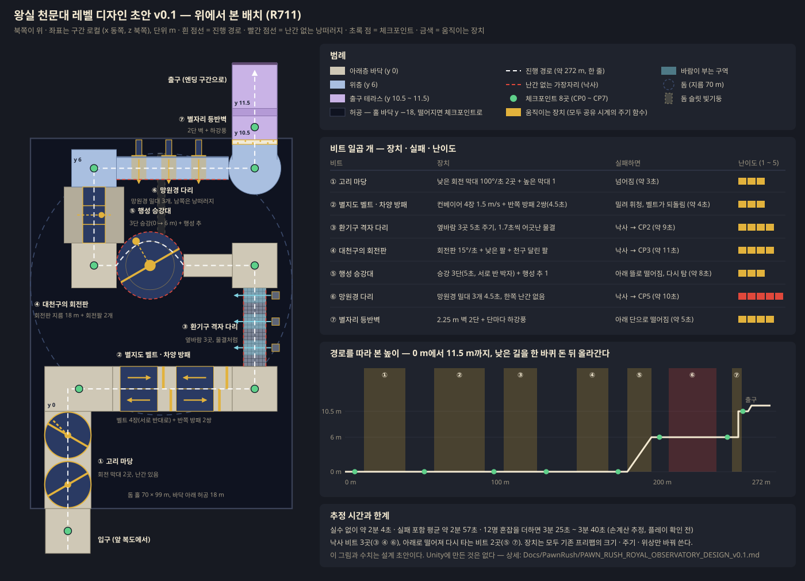

# 폰 러시 후반 장애물 · 왕실 천문대 레벨 디자인 v0.1 (초안)

2026-11-18 · R711 · 사용자 컨셉 아트 1장과 지시("그래픽으로 압도하는 분위기", "마지막 코스니까 난이도 좀 어렵게")로 Claude가 쓴 초안

> **Unity에 만든 것은 없다.** 이 문서와 배치도만 있다. 장치 수치는 기존 프리팹의 값과 손계산으로 잡은 설계 제안이고, 첫 시도 성공률과 시간은 추정값이라 회색 상자 플레이로 바꿔야 한다. 사용자 검수 전.

## 개요

거대한 돔 아래, 허공 한가운데에 지름 30 m 천구의(혼천의)가 돌고 있는 천문대다. 길은 그 천구의를 감아 오른다. 아래층을 한 바퀴 돌아 천구의 한가운데를 가로지른 다음, 승강대로 올라 돔 슬릿의 빛기둥이 떨어지는 망원경 다리를 건너고, 별자리 벽을 올라 출구 테라스에 선다. 입구에 서면 출구가 오른쪽 위 11.5 m 높이에 처음부터 보인다.

컨셉 아트는 위쪽 길과 아래쪽 길이 나란히 있는 것처럼 읽힌다. 이 초안은 그림의 장치를 하나도 빼지 않고 **한 줄**로 이었다(아래 '컨셉 아트를 길로 읽기').

| 항목 | 값 |
| --- | --- |
| 크기 | 돔 홀 가로 70 m × 세로 99 m, 입구 터널 12 m와 출구 회랑 20 m 별도. 홀 바닥은 길 아래 18 m, 돔 꼭대기는 길 위 약 59 m |
| 경로 길이 | 약 272 m, 한 줄(갈래 없음) |
| 높이 | 아래층 0 → 승강대 2 · 4 → 위층 6 → 출구 테라스 10.5 → 출구 11.5 m |
| 비트 | 일곱: 고리 마당 / 별지도 벨트와 차양 방패 / 환기구 격자 다리 / 대천구의 회전판 / 행성 승강대 / 망원경 다리 / 별자리 등반벽 |
| 장애물 | 기존 장치 8종 27개(회전 막대 3 · 08 컨베이어 4 · 06 미닫이 벽 4 · 15 바람 5 · 01 원판 1 + 회전팔 2 · 05 승강 3 · 11 진자 1 · 03 밀대 3). 새 종류 없음, 설정과 겉모습만 바꿈 |
| 낙사 | 세 비트(환기구 격자 다리, 대천구의 회전판, 망원경 다리). 두 비트는 아래로 떨어져 다시 탐(승강대, 등반벽) |
| 설계 추정 시간 | 실수 없이 약 2분 4초, 실패 포함 평균 약 2분 57초, 12명 혼잡을 더하면 3분 25초 ~ 3분 40초('시간 추정') |
| 온라인 | 모든 장치가 공유 시계의 주기 함수라 구간 상태로 보낼 것이 없다(0바이트) |

### 먼저 정할 것

1. **시간과 난이도 목표.** 대계단 현관홀 설계(v0.3)는 혼잡 포함 약 2분 55초에 낭떠러지 실패가 두 곳이었다. 이 초안은 낙사 세 곳에 혼잡 포함 3분 25초 ~ 3분 40초다. 더 어렵게 · 쉽게 바꾸는 손잡이는 '튜닝 손잡이'에 모았다.
2. **낙사의 수위.** 격자 다리 · 회전판 · 망원경 다리에는 난간이 없다. 실패 한 번에 9 ~ 11초를 잃는다. 마지막 코스라 이 정도로 잡았는데, 과하면 망원경 다리 남쪽에 난간을 두고 넘어짐만 남길 수 있다.
3. **별자리 등반벽(비트 7).** 컨셉 아트의 등반벽을 마지막 비트로 썼다. 폰 러쉬 이동에서 벽 오르기 속도와 바람에 밀릴 때의 동작은 재 본 적이 없다(공용 값은 초당 1.2 m). 재 보고 안 맞으면 승강대 한 단으로 바꾼다. 나이트 도약(높이 약 2.1 m)은 2.25 m 단 하나를 건너뛸 수 있을 듯하다 — 특기로 둘지, 단을 2.6 m로 올려 막을지.
4. **컨셉 아트의 대각 다리(18 캐슬링 교차 다리).** 지금 판의 어느 구간도 이 장치를 쓰지 않아 v0.1에서는 뺐다. 넣는다면 망원경 다리 뒤(약 +20초)가 자리다.
5. **슬롯.** 후반 장애물(슬롯 5) 목록에 국왕 작전실 · 왕의 서재와 함께 넣어 판마다 셋 중 하나가 나오는 것으로 가정했다.
6. **홀의 크기.** 70 × 99 m에 허공 18 m, 돔 꼭대기까지 약 77 m다. '압도'를 위해 크게 잡았고, 그만큼 벽 아케이드와 돔 모델링이 늘어난다('그래픽으로 압도하기'의 예산).

## 컨셉 아트를 길로 읽기

2026-10월 기획 [장소별 4분 코스 3-5 왕실 천문대](PAWN_RUSH_PLACES_4MIN.md)도 같은 그림 계열을 여섯 비트로 읽었고, "아래쪽과 위쪽 길이 병렬처럼 읽힘"을 한계로 적었다. 이번에는 **아래층을 먼저 돌고 위층으로 올라가는 순서**로 풀었다. 그림의 왼쪽 아래 문이 입구, 오른쪽 위 커튼 아치가 출구다.

| 그림에서 | 이 초안에서 | 비트 |
| --- | --- | --- |
| 왼쪽 아래, 왕관 깃발 문과 금 고리 장치 둘 | 입구 터널과 고리 마당의 회전 막대 두 곳 | 1 |
| 아래쪽, 별 무늬 판이 깔린 긴 다리 | 별지도 벨트(컨베이어) | 2 |
| 오른쪽 아래, 금빛 반원 방패 한 쌍 | 차양 방패(반쪽씩 막는 미닫이 벽) | 2 |
| 오른쪽, 금 부채와 바람 줄기, 바닥 격자 | 환기구 격자 다리의 옆바람 | 3 |
| 가운데 둥근 단과 팔 끝의 천구 둘 | 대천구의 회전판과 회전팔 둘 | 4 |
| 왼쪽 가운데, 황동 기둥 위의 남색 네모 발판 둘 | 행성 승강대 | 5 |
| 위쪽, 레일 위의 큰 망원경과 긴 다리 | 망원경 다리의 밀대 | 6 |
| 오른쪽 위, 징 박힌 흰 벽과 둥근 단 | 관측 원대와 별자리 등반벽 | 7 |
| 오른쪽 위 끝, 계단과 보라 커튼 아치 | 출구 테라스 · 계단 · 아치 | 출구 |
| 허공에 뜬 행성 구, 벽감의 체스 조각상, 별자리 돔 | 장식(충돌 없음) | — |

4분 코스 기획과 달라진 점: 순서를 아래층 → 위층으로 바꿨고, 가운데 단을 회전판으로 키워 길이 천구의 한가운데를 지나가게 했으며, 교차 다리 대신 등반벽으로 끝낸다.

## 공간 구성

홀은 네모난 방 위에 둥근 돔을 얹은 모양이다. 길은 벽에 붙지 않고 모두 허공 위에 떠 있고, 길과 길 사이는 14 m 이상 떨어져 있어 다음 구간으로 건너뛸 수 없다(나이트 도약은 조준 9 m까지).

### 공간의 순서

1. **입구 터널 (y 0):** 낮고 어두운 12 m 터널. 끝에서 돔 전체가 한 번에 열린다.
2. **고리 마당 (y 0):** 터널에서 곧장 북쪽으로. 금 고리 장치 두 개가 바닥을 쓴다.
3. **별지도 벨트 다리 (y 0):** 남서 승강장에서 동쪽으로 꺾어 32 m. 왼쪽으로 대천구의가 옆모습으로 보인다.
4. **환기구 격자 다리 (y 0):** 남동 승강장에서 북쪽으로 21 m. 발밑 격자로 18 m 아래가 보이고, 동쪽 벽 환기 팬이 서쪽으로 분다.
5. **대천구의 회전판 (y 0):** 북동 승강장에서 서쪽으로 진입교를 건너 홀 한가운데로. 머리 위로 천구의 고리가 돌고 빛기둥이 떨어진다.
6. **행성 승강대 (y 0 → 6):** 서쪽 승강장에서 북쪽으로, 세 단을 갈아타며 오른다.
7. **망원경 다리 (y 6):** 북서 관측 승강장에서 동쪽으로 30 m. 돔 슬릿 바로 아래, 홀에서 가장 높이 뜬 길이다.
8. **관측 원대와 등반벽 (y 6 → 10.5):** 다리 끝 둥근 단에서 북쪽 벽을 두 단으로 오른다.
9. **출구 테라스 (y 10.5 → 11.5):** 망원경 소품이 놓인 테라스, 계단 네 단, 보라 깔개의 정리 동선, 커튼 아치.

**좌표 규칙:** 구간 로컬 좌표 (x, y, z), 단위 m. 원점은 입구 문턱 가운데, +z = 북쪽(처음 진행 방향), +x = 동쪽, y = 바닥 윗면.

| 영역 | 범위 | 높이 y | 비트 |
| --- | --- | --- | --- |
| 입구 터널 | x −6\~6, z 0\~12 | 0 | 0 |
| 고리 마당 | x −6.2\~6.2, z 12\~38 | 0 | 1 |
| 남서 승강장 | x −6.2\~12, z 38\~50 | 0 | 쉼 |
| 별지도 벨트 다리 | x 12\~44, z 38\~50 | 0 | 2 |
| 남동 승강장 | x 44\~56, z 38\~50 | 0 | 쉼 |
| 환기구 격자 다리 | x 47\~53, z 50\~71 | 0 | 3 |
| 북동 승강장 | x 44\~56, z 71\~83 | 0 | 쉼 |
| 천구의 진입교 | x 31\~44, z 74\~80 | 0 | 4 |
| 대천구의 회전판 | 중심 (22, 77), 반지름 9 | 0 | 4 |
| 서쪽 승강장 | x 1\~13, z 71\~83 | 0 | 쉼 |
| 승강대 뜰 | x −1\~15, z 83\~98 | 0 | 5 |
| 행성 승강대 A / B / C | x 4\~10, z 83\~88 / 88\~93 / 93\~98 | 0↔2 / 2↔4 / 4↔6 | 5 |
| 북서 관측 승강장 | x 1\~13, z 98\~108 | 6 | 쉼 |
| 망원경 다리 | x 13\~43, z 100\~106 | 6 | 6 |
| 관측 원대 | 중심 (50, 103) 반지름 7 + 벽 앞 바닥 x 44\~56, z 103\~109.4 | 6 | 7 |
| 등반벽 1단 / 쉬는 턱 / 2단 | 벽면 z 109.4 / 턱 z 109.4\~110.6 / 벽면 z 110.6, x 44\~56 | 6→8.25 / 8.25 / 8.25→10.5 | 7 |
| 출구 테라스 | x 44\~56, z 110.6\~117 | 10.5 | 출구 |
| 계단 4단 / 정리 동선 / 아치 | z 117\~119 / 119\~131 / 131, x 44\~56 | 10.5→11.5 / 11.5 / 11.5 | 경계 |
| 홀 바닥 | x −10\~60, z 12\~111 | −18 | 떨어지면 리스폰(y −10 아래) |

입구는 (0, 0, 0), 출구는 (50, 11.5, 131)에서 북쪽을 본다. 출구 아치는 폭 12 m · 높이 6 m로 뒤의 구간 사이 복도와 맞는다.

## 그래픽으로 압도하기

압도는 장식의 양이 아니라 **크기 · 깊이 · 움직임을 한눈에 보여 주는 순서**에서 나온다. 장애물의 가독성과 부딪히지 않게 아래 일곱 가지로 잡는다.

**1. 위아래로 77 m.** 길은 홀의 3분의 1 높이에 떠 있다. 아래로 18 m 허공(별지도 바닥과 천구의 받침 기계), 위로 약 59 m 돔. 어느 비트에서든 위와 아래가 함께 보인다.

**2. 한가운데의 대천구의.** 지름 26 ~ 30 m 황동 고리 여럿이 서로 다른 축으로 천천히 돈다(초당 10° 이하). 팔 끝의 행성 구 여덟 개가 반지름 12 ~ 30 m로 돌며 다른 비트의 머리 위 8 m 이상을 지나가 바닥에 그림자를 떨군다. 홀의 어느 자리에서도 보이는 기준점이고, 비트 4에서는 그 안을 직접 지나간다. 장식 고리와 행성은 충돌이 없고 공유 시계로 돌아 모든 PC에서 같은 모습이다.

**3. 보여 주는 순서.**

| 순간 | 보이는 것 | 의도 |
| --- | --- | --- |
| 터널 끝(z 12) | 어둡고 낮은 터널에서 나오며 돔 전체. 정면 65 m 앞에 대천구의, 오른쪽 위에 빛을 받는 출구 테라스와 보라 커튼, 그 사이를 가로지르는 망원경 다리 | 좁았다가 넓어지는 대비. 목표와 길 전체가 5초 안에 읽힌다 |
| 벨트 다리(비트 2) | 왼쪽으로 천구의의 옆모습, 발아래 허공의 행성 구 | 달리는 동안 옆으로 흐르는 큰 풍경 |
| 격자 다리(비트 3) | 격자 바닥 아래 18 m가 그대로 보이고, 바람이 불 때마다 벽 휘장과 별지도 종이가 날린다 | 높이의 아찔함, 바람이 보인다 |
| 회전판(비트 4) | 머리 위로 도는 거대한 고리, 빛기둥 한가운데 | 기계의 심장 속에 들어온 느낌 |
| 승강대(비트 5) | 올라갈수록 돔의 별자리 그림이 다가오고, 지나온 아래층이 내려다보인다 | 올라간다는 실감 |
| 망원경 다리(비트 6) | 슬릿으로 하늘이 보이고, 길이 12 m 망원경 석 대가 번갈아 내지른다. 남쪽으로 홀 전체 | 이 구간의 절정 — 가장 화려한 곳이 가장 어려운 곳 |
| 출구 테라스 | 돌아보면 지나온 길 전부와 뒤따르는 상대 | 올라온 높이를 확인 |

**4. 빛은 하나.** 주인공은 돔 슬릿으로 떨어지는 빛기둥이다(그림자 있는 해 하나 + 빛줄기 메시). 나머지는 난간 등불의 자체발광과 그림자 없는 보조광 둘, 돔 안쪽의 별자리 발광 그림이다. [3단계 윗궁 기준](PAWN_RUSH_ART_PHASES.md) "천창 빛기둥, 짙은 남색 그림자, 샹들리에 없음"과 같다. 해 · 안개 · 색 보정은 왕의 서재(R706)처럼 카메라가 천문대 안에 있을 때만 건다.

**5. 움직임은 세 겹.** 먼 곳(돔의 별자리, 슬릿의 빛) · 가운데(천구의 고리, 행성 구) · 가까운 곳(장애물). 먼 것일수록 느리고 흐리게 해서 장애물이 묻히지 않게 한다.

**6. 화려해도 읽혀야 한다.** 컨셉 아트는 금이 많다. 윗궁 기준대로 밝은 금 `#E2B23C`(자체발광 0.6)는 **움직이는 장치와 잡는 곳에만** 쓰고, 장식 금은 무광 황동 `#9C8354`로 낮춘다. 걷는 바닥은 크림 대리석과 남색 별 판, 예고는 빨강 `#E0483B`, 허공은 안개 낀 짙은 남색으로 두어 가장자리가 또렷하게 한다. 난간이 없는 가장자리에는 등불 기둥을 세우지 않는다(등불이 보이면 안전한 곳).

**7. 예산(제안).** 한 화면 삼각형 250만 이하(정원 248만 · 대계단 290만 · 서재 114만), 그리기 호출 1,200 이하(서재 약 1,115). 벽 아케이드는 8 m 칸 하나를 반복하고 조각상 · 깃발 · 혼천의 소품은 서너 종을 돌려 쓴다. 조명은 서재와 같이 그림자 있는 해 하나, 보조광 둘, 반사 프로브 둘.

## 플레이어 경험과 난이도 곡선

익숙한 장치로 빠르게 시작해, 낙사가 있는 건넘 두 번으로 긴장을 올리고, 승강대에서 한 번 숨을 돌린 뒤, 가장 높고 화려한 다리에서 절정을 맞고, 벽 위에서 마지막 몸싸움을 한다.

| 비트 | 시간 창 | 장면 | 하는 것 | 느끼는 것 | 실패하면 | 난이도 1\~5 |
| --- | --- | --- | --- | --- | --- | --- |
| 1 고리 마당 | 0:05–0:20 | 금 고리 장치 둘이 마당 폭 전체를 쓴다 | 낮은 막대는 점프, 높은 막대 밑에서는 뛰지 않기 | 돔에 감탄할 틈 없이 바로 뛴다. 12명이 한 마당에 | 넘어져 밀림(약 3초) | 3 |
| 2 별지도 벨트와 차양 방패 | 0:25–0:40 | 서로 반대로 흐르는 벨트 뒤에 반쪽씩 닫히는 금빛 방패 | 빠른 줄을 탈지 느린 줄에서 볼지 고르고, 열린 반쪽으로 | 빠른 길이 닫히는 방패로 데려간다 | 방패에 밀려 휘청, 벨트가 되돌림(약 4초) | 3 |
| 3 환기구 격자 다리 | 0:45–0:55 | 난간 없는 격자 다리에 옆바람이 물결처럼 지나간다 | 쉼터에서 바람을 보고 다음 쉼터까지 달린다 | 첫 낙사. 발밑이 다 보인다 | 날려 떨어지면 남동 승강장부터(약 9초) | 4 |
| 4 대천구의 회전판 | 1:05–1:15 | 도는 판 위를 낮은 팔과 천구 달린 팔이 쓴다 | 낮은 팔을 뛰어넘고, 천구가 지나간 뒤 가장자리로 나간다 | 기계 한가운데. 판이 나를 싣고 돈다 | 밖으로 쓸리면 북동 승강장부터(약 11초) | 4 |
| 5 행성 승강대 | 1:20–1:30 | 엇박자로 오르내리는 세 단, 가운데 단을 가르는 행성 추 | 높이가 맞는 순간 다음 단으로, 추가 지나간 뒤 건넌다 | 숨 돌리기. 떨어져도 다시 타면 된다 | 아래 뜰로 떨어져 다시 탐(약 8초) | 3 |
| 6 망원경 다리 | 1:35–1:50 | 빛기둥 아래 망원경 석 대가 다리를 가로질러 내지른다 | 렌즈가 빛나면 멈추고, 물러나면 다음 쉼터까지 | 절정. 뒤에서 미는 한 수가 가장 무섭다 | 밀려 떨어지면 북서 승강장부터(약 10초) | 5 |
| 7 별자리 등반벽 | 1:55–2:00 | 두 단 벽에 번갈아 내리부는 바람 | 바람이 멎은 단을 오르고 턱에서 기다린다 | 마지막 몸싸움. 턱에서 밀고 밀린다 | 아래 단으로 떨어짐(약 5초) | 4 |

### 난이도 곡선의 원칙

- **세기 순서:** 넘어짐(고리) → 밀림(방패) → 낙사(바람) → 낙사(회전팔) → 아래로 떨어짐(추) → 낙사(망원경) → 아래로 떨어짐(하강풍). 낙사 비트 사이에는 항상 넓은 승강장과 체크포인트가 있다.
- **새 규칙은 한 번에 하나, 섞기는 뒤에서:** 비트 1 · 3 · 6은 장치 한 종류다. 비트 2(벨트 + 방패) · 4(판 + 팔) · 5(승강 + 추)는 둘을 섞는다. 비트 7의 바람은 비트 3에서 이미 본 것이다.
- **센 장애물 바로 앞에 체크포인트:** 낙사 비트 셋 모두 시작 승강장이 체크포인트라 실패해도 그 비트만 다시 한다.
- **5초 안에 읽힌다:** 고리와 회전팔은 늘 보이는 움직임, 방패는 미끄러지기 0.5초 전 움직임, 바람은 예고 0.8초(격자 아래 팬이 돌고 줄기가 비침), 망원경은 예고 1.0초(렌즈가 빨갛게 빛나고 경통이 뒤로 살짝 당겨짐), 승강대는 기둥 눈금으로 높이를 보여 준다.
- **가장 화려한 곳이 가장 어려운 곳:** 절정(비트 6)을 빛기둥과 슬릿 아래에 두었다.

### 실패의 세 종류

| 종류 | 어디서 | 비용 |
| --- | --- | --- |
| 넘어짐 · 밀림 | 비트 1, 2 | 3\~4초. 난간이 있어 떨어지지 않는다 |
| 아래로 떨어짐(8 m 미만, 리스폰 아님) | 비트 5 승강대(최대 6 m), 비트 7 등반벽(최대 4.5 m) | 5\~8초. 같은 비트를 처음부터 다시 탄다 |
| 리스폰(허공으로 추락) | 비트 3, 4, 6 | 9\~11초. 그 비트의 시작 승강장에서 |

## 비트별 상세

각 비트를 '배치 → 플레이 흐름 → 상대를 방해하는 자리 → 실패와 비용 → 튜닝 손잡이' 순서로 적었다. 위상은 공유 시계(`ObstacleClock`)에 더하는 초다. 폰 속도는 달리기 2.5 · 질주 3.6 m/s, 점프 체공 약 0.7초로 계산했다.

### 비트 1 · 고리 마당 (난이도 3)

| 요소 | 위치 | 크기 · 설정 | 비고 |
| --- | --- | --- | --- |
| 입구 터널 | x −6\~6, z 0\~12 | y 0, 천장 5 m | CP0 (0, 0, 6) |
| 마당 바닥 | x −6.2\~6.2, z 12\~38 | 폭 12.4 m | 양옆 난간 1.1 m, 못 오름 |
| 고리 1 | 축 (0, 0, 18.4) | 낮은 막대 양팔 12.4 m, 높이 0.2\~0.52 m, +100°/초 | 어느 자리든 1.8초마다 지나감. 끝 속도 10.8 m/s |
| 고리 2 | 축 (0, 0, 31.6) | 낮은 막대 양팔 −100°/초 + 높은 막대 한 팔(높이 1.15\~1.5 m) +55°/초 | 높은 막대는 서 있으면 지나가고 뛰면 맞는다 |
| 쉼 띠 | z 24.6\~25.4 | 0.8 m | 두 고리 사이. 사실상 이어서 넘는다 |

**플레이 흐름.** 터널을 나오자마자 26 m 마당이다. 고리 1은 낮은 막대만 두세 번 넘으면 된다. 고리 2는 낮은 막대가 반대로 돌고 그 위로 높은 막대가 따로 돈다. 낮은 막대는 뛰어야 하고, 높은 막대가 머리 위일 때는 뛰면 안 된다. 정원의 낮은 막대(105 · 95°/초)와 비슷한 빠르기지만 막대가 길어 끝이 더 빠르다. 선두 약 10초.

**상대를 방해하는 자리**

- **점프 직전 밀기:** 막대가 오기 직전에 밀리면 타이밍이 깨진다.
- **가장자리로 몰기:** 막대 끝(난간 쪽)이 가장 빨라 넘어지고, 축 가까이는 느려 안전하다. 안쪽 자리를 두고 다툰다.

**실패와 비용:** 막대에 걸려 넘어지고 1\~2 m 밀림, 약 3초. 난간이 있어 떨어지지 않는다.

**튜닝 손잡이:** 회전 속도(100°/초), 높은 막대 속도(55°/초)와 개수, 쉼 띠 폭(0.8 m).

### 비트 2 · 별지도 벨트와 차양 방패 (난이도 3)

| 요소 | 위치 | 크기 · 설정 | 비고 |
| --- | --- | --- | --- |
| 남서 승강장 | x −6.2\~12, z 38\~50 | y 0 | CP1 (3, 0, 44). 여기서 동쪽으로 꺾는다 |
| 다리 바닥 | x 12\~44, z 38\~50 | 폭 12 m | 양옆 난간 1.1 m |
| 벨트 1조 | x 14\~24. 북쪽 줄(z 44\~50) 앞으로, 남쪽 줄(z 38\~44) 뒤로 | 08 컨베이어 6 × 10 m, 1.5 m/s | 앞으로 가는 줄 위에서는 달리기 4.0 m/s, 거스르는 줄은 1.0 m/s |
| 차양 방패 1조 | x 25.5(북쪽 반), x 27.5(남쪽 반) | 06 미닫이 벽(벽 6 × 3 m, 6 m 미끄럼), 주기 4.5초, 위상 0 | 금빛 반원 차양 모양. 쉴 때는 난간 밖 |
| 벨트 2조 | x 29\~39. 북쪽 줄 뒤로, 남쪽 줄 앞으로 | 같음 | 1조와 방향이 반대 |
| 차양 방패 2조 | x 40.5(남쪽 반), x 42.5(북쪽 반) | 주기 4.5초, 위상 2.25초 | |

**플레이 흐름.** 앞으로 흐르는 줄을 타면 4 m/s로 실려 가지만, 그 줄이 닿는 반쪽이 먼저 닫히는 방패다. 거스르는 줄은 느린 대신 방패를 보며 맞출 시간이 있다. 2조는 줄의 방향이 뒤바뀌어 같은 줄만 타고 갈 수 없다. 방패 한 쌍을 지나는 창은 4.5초 중 2초 안팎이다(작전실 설계에서 같은 장치는 1.95초였다 — 방패 간격이 달라 회색 상자에서 다시 계산).

**상대를 방해하는 자리**

- **빠른 줄로 밀어 넣기:** 방패가 닫히는 중에 상대를 앞으로 흐르는 줄에 올리면 방패로 실려 간다.
- **열린 반쪽 막기:** 방패 사이 2 m 틈은 좁다. 먼저 들어가 서 있으면 뒤가 막힌다.

**실패와 비용:** 방패에 밀려 휘청하고 벨트가 뒤로 싣고 감, 약 4초. 난간이 있어 떨어지지 않는다.

**튜닝 손잡이:** 벨트 속도(1.5 m/s), 방패 주기(4.5초), 두 조의 위상 차(2.25초).

### 비트 3 · 환기구 격자 다리 (난이도 4, 낙사)

| 요소 | 위치 | 크기 · 설정 | 비고 |
| --- | --- | --- | --- |
| 남동 승강장 | x 44\~56, z 38\~50 | y 0 | CP2 (50, 0, 44). 북쪽으로 꺾는다 |
| 격자 다리 | x 47\~53, z 50\~71 | 폭 6 m, **난간 없음** | 격자 그림(아래가 보임), 충돌은 막힌 바닥 |
| 바람 구역 1 · 2 · 3 | z 53\~57 / 60\~64 / 67\~71 | 15 바람 분사구. 동쪽 기둥(x 55.6)에서 서쪽으로. 쉼 2.0 · 예고 0.8 · 분사 2.2초(주기 5.0초), 위상 0 / 1.7 / 3.4초 | 세기는 대계단 홀 회랑 바람에서 시작 |
| 쉼터 | z 50\~53 / 57\~60 / 64\~67 | 3 × 6 m | 바람이 닿지 않는다 |

**플레이 흐름.** 바람 구역 하나는 4 m라 달려서 1.6초, 질주로 1.1초다. 구역이 안전한 시간은 주기마다 2.8초이므로 들어갈 수 있는 창은 달리기 1.2초, 질주 1.7초다. 세 구역은 1.7초씩 늦게 부는 물결이라, 질주로 물결을 따라가면 세 구역을 한 번에 지난다. 달리기로는 쉼터마다 한 번씩 기다려야 한다. 바람에 걸리면 6 m 다리 밖 서쪽 허공으로 날린다.

**상대를 방해하는 자리**

- **쉼터에서 밀어내기:** 3 m 쉼터에 여럿이 서면 가장자리 사람은 바람 구역에 걸친다. 바람이 부는 순간 한 번 밀면 끝이다.
- **쉼터 선점:** 앞 쉼터가 꽉 차 있으면 뒤 사람은 구역을 건널 수 없다.

**실패와 비용:** 낙사 → CP2. 리스폰 2초 + 최대 21 m, 약 9초.

**튜닝 손잡이:** 쉼(2.0초), 물결 간격(1.7초), 구역 길이(4 m), 다리 폭(6 m).

### 비트 4 · 대천구의 회전판 (난이도 4, 낙사)

| 요소 | 위치 | 크기 · 설정 | 비고 |
| --- | --- | --- | --- |
| 북동 승강장 | x 44\~56, z 71\~83 | y 0 | CP3 (50, 0, 77). 서쪽으로 꺾는다 |
| 진입교 | x 31\~44, z 74\~80 | 폭 6 m, 난간 | |
| 회전판 | 중심 (22, 0, 77), 지름 18 m | 01 회전 원판을 키움, +15°/초(가장자리 2.4 m/s) | **난간 없음.** 남색 별지도 바닥 |
| 중심축 | 반지름 1.5 m 기둥 | 못 오름 | 가운데로는 못 간다. 왼쪽이나 오른쪽으로 돌아감 |
| 낮은 팔 | 축에서 양쪽 9.2 m, 높이 0.2\~0.52 m | −60°/초 | 판 위 사람에게는 2.4초마다. 점프로 넘는다 |
| 천구 팔 | 한 팔. 반지름 6.5\~8.5 m에 지름 2 m 천구, 안쪽 팔은 머리 위 1.8 m | +70°/초(5.1초에 한 바퀴) | 천구는 못 넘는다. 가장자리 띠를 쓸어 밖으로 민다 |

**플레이 흐름.** 판을 가로지르는 길은 축을 돌아 약 20 m, 8초쯤이다. 그동안 낮은 팔을 서너 번 넘는다. 안쪽(반지름 6.5 m 안)에는 낮은 팔만 있어 비교적 안전하지만, 들어오고 나가는 곳은 가장자리라 천구가 그쪽을 지나간 뒤에 움직여야 한다. 판이 도는 방향과 낮은 팔이 도는 방향이 반대라 팔이 생각보다 빨리 온다(가장자리에서 상대 속도 11.8 m/s). 작전실 설계의 회전 탁자(판 16 m + 막대 하나, 첫 시도 성공 추정 65%)에 천구 팔을 더한 것이다.

**상대를 방해하는 자리**

- **나가는 곳 막기:** 서쪽 가장자리에서 천구를 기다리는 사람을 바깥으로 민다.
- **점프 직전 잡기:** 낮은 팔이 오기 직전에 잡으면 둘 다 걸린다. 지고 있는 팀이 쓸 만한 수다.

**실패와 비용:** 팔에 걸려 밖으로 쓸리거나 천구에 밀려 낙사 → CP3. 약 11초.

**튜닝 손잡이:** 판 속도(15°/초), 낮은 팔 속도(60°/초), 천구 팔 속도(70°/초)와 천구 크기, 판 지름(18 m).

### 비트 5 · 행성 승강대 (난이도 3)

| 요소 | 위치 | 크기 · 설정 | 비고 |
| --- | --- | --- | --- |
| 서쪽 승강장 | x 1\~13, z 71\~83 | y 0 | CP4 (7, 0, 77). 북쪽으로 꺾는다 |
| 승강대 뜰 | x −1\~15, z 83\~98 | y 0 | 승강대 둘레 바닥. 떨어지면 여기 |
| 승강대 A | x 4\~10, z 83\~88 | 05 승강 타일, 0 ↔ 2 m, 주기 5초 | 기둥에 높이 눈금 |
| 승강대 B | x 4\~10, z 88\~93 | 2 ↔ 4 m, A와 반 주기 어긋남 | A가 꼭대기일 때 B가 바닥 |
| 승강대 C | x 4\~10, z 93\~98 | 4 ↔ 6 m, A와 같은 박자 | 꼭대기에서 위층으로 |
| 행성 추 | B의 가운데 z 90.5를 동서로 | 11 진자. 진폭 55°, 스윙 1.15초 + 끝 멈춤 0.2초, 밀어내기 14 + 위 3 m/s | 가운데를 1.35초마다 지난다. 승강대 폭 6 m라 피하는 줄 없음 |
| 승강대 옆면 · 위층 앞면 | — | 매끈한 대리석, 못 오름 | 승강대로만 오른다 |

**플레이 흐름.** 이웃한 두 단의 높이 차가 0.6 m 이하인 약 1.25초 동안 다음 단으로 뛰어오른다(저절로 올라서는 0.25 m 이하는 약 0.8초). 박자를 타면 A 출발 2.5초 뒤 B, 5초 뒤 C, 7.5초 뒤 위층이다. 한 번 놓치면 5초를 기다린다. B 위에서는 행성 추가 지나가는 선을 건너야 C 쪽에 선다.

**상대를 방해하는 자리**

- **갈아타는 순간 밀기:** 6 × 5 m 단 위에서 뛰려는 사람을 밀면 5초를 잃게 한다.
- **추 앞에 세우기:** B의 가운데 선으로 밀어 추에 맞게 한다.

**실패와 비용:** 추에 맞거나 밀려 뜰로 떨어짐(최대 6 m, 리스폰 아님). A부터 다시, 약 8초.

**튜닝 손잡이:** 승강 주기(5초), 추 스윙(1.15초), 단 수(3).

### 비트 6 · 망원경 다리 (난이도 5, 낙사)

| 요소 | 위치 | 크기 · 설정 | 비고 |
| --- | --- | --- | --- |
| 북서 관측 승강장 | x 1\~13, z 98\~108 | y 6 | CP5 (7, 6, 103). 동쪽으로 꺾는다 |
| 다리 | x 13\~43, z 100\~106 | 폭 6 m, y 6 | 북쪽에만 난간. **남쪽은 낭떠러지** |
| 망원경 밀대 1 · 2 · 3 | x 17\~21 / 25\~29 / 33\~37 | 03 왕복 밀대. 머리 폭 4 m · 높이 1.6 m, 북쪽 포가에서 남쪽으로 6 m. 쉼 1.6 · 예고 1.0 · 내지름 0.5 · 버팀 0.5 · 물러남 0.9초(주기 4.5초), 위상 0 / 2.2 / 4.4초 | 못 넘는다. 내지르는 속도 12 m/s |
| 쉼터 | x 13\~17 / 21\~25 / 29\~33 / 37\~43 | 4 × 6 m | 밀대가 닿지 않는다 |

**플레이 흐름.** 밀대 자리 하나는 4 m, 달려서 1.6초다. 지날 수 있는 시간은 쉼과 예고를 합친 2.6초이므로 들어갈 창은 달리기 1.0초, 질주 1.5초다. 세 대는 2.2초씩 늦게 내지르고, 질주로 8 m를 가는 시간이 2.2초라 박자를 탄 사람만 멈추지 않고 건넌다. 나머지는 4 m 쉼터에서 다음 창을 기다린다. 쉼터는 좁고 남쪽이 뚫려 있다.

**상대를 방해하는 자리**

- **예고 중에 밀어 넣기:** 렌즈가 빛날 때 쉼터 끝의 상대를 밀대 자리로 한 걸음 민다.
- **쉼터 채우기:** 팀원 둘이 다음 쉼터를 채우고 있으면 뒤따르는 상대는 설 곳이 없다.
- **스킬:** 퀸 충격파(반경 3 m)는 4 m 쉼터 전체에 닿는다. 이 다리에서 가장 값지다.

**실패와 비용:** 밀려 낙사 → CP5. 리스폰 2초 + 최대 30 m, 약 10초. 이 구간에서 가장 비싼 실수다.

**튜닝 손잡이:** 쉼(1.6초), 머리 폭(4 m), 대수(3), 위상 간격(2.2초), 남쪽 난간 유무.

03 밀대의 지금 움직임이 멈춤 없는 사인 왕복이라면 6 m 중 1 m 이하로 물러나 있는 시간이 주기의 27%(4.5초 중 약 1.2초)뿐이고 예고도 없다. 위 표처럼 멈춤과 예고가 있는 주기가 필요하다 — 구현 때 확인할 것.

### 비트 7 · 별자리 등반벽 (난이도 4)

| 요소 | 위치 | 크기 · 설정 | 비고 |
| --- | --- | --- | --- |
| 관측 원대 | 중심 (50, 6, 103) 반지름 7 + 벽 앞 바닥 x 44\~56, z 103\~109.4 | y 6, 난간 | CP6 (50, 6, 103) |
| 1단 벽 | 벽면 z 109.4, x 44\~56 | y 6 → 8.25(2.25 m) | 줄눈 벽, 별자리 모양 금 손잡이 |
| 쉬는 턱 | z 109.4\~110.6 | y 8.25, 깊이 1.2 m | 바람이 닿지 않는다 |
| 2단 벽 | 벽면 z 110.6 | y 8.25 → 10.5(2.25 m) | |
| 하강풍 1 · 2 | 각 단 벽면 앞 0.8 m | 15 바람 분사구를 아래로. 쉼 2.2 · 예고 0.8 · 분사 2.2초(주기 5.2초), 두 단이 2.6초 어긋남 | 한 단이 불 때 다른 단은 멎는다 |

**플레이 흐름.** 한 단을 오르는 데 약 1.9초(초당 1.2 m), 바람이 멎어 있는 시간은 3.0초라 오르기 시작할 창은 약 1.1초다. 1단을 올라 턱에서 2단의 바람이 멎기를 기다렸다가 오른다. 박자가 맞으면 멈추지 않고 두 단을 잇는다.

**상대를 방해하는 자리**

- **턱에서 밀기:** 깊이 1.2 m 턱은 이 구간의 마지막 몸싸움 자리다. 밀리면 아래 단으로 떨어진다.
- **벽 자리 막기:** 폭 12 m라 여섯쯤 나란히 오른다. 먼저 붙은 사람 위로는 못 오른다.

**실패와 비용:** 바람이나 상대에 밀려 아래로 떨어짐(최대 4.5 m, 리스폰 아님), 약 5초.

**튜닝 손잡이:** 단 높이(2.25 m), 쉼(2.2초), 턱 깊이(1.2 m).

### 출구

| 요소 | 위치 | 크기 · 설정 | 비고 |
| --- | --- | --- | --- |
| 출구 테라스 | x 44\~56, z 110.6\~117 | y 10.5 | CP7 (50, 10.5, 114). 삼각대 망원경은 걷는 폭 밖 |
| 계단 | z 117\~119 | 0.25 m × 4단 → y 11.5 | 저절로 오르는 높이 |
| 정리 동선 | z 119\~131 | 12 m, 보라 깔개 | 장애물 없음 |
| 출구 아치 | z 131 | 폭 12 · 높이 6 m, 묶은 보라 벨벳 | 뒤는 구간 사이 복도 → 엔딩 구간 |

마지막 힘(2단 하강풍) 뒤로 테라스 6 m + 계단 2 m + 정리 동선 12 m가 있다.

## 체크포인트

판의 번호는 슬롯 × 100 + 구간 안 번호라 400번대다(왕의 서재가 400 ~ 405).

| 번호 | 자리 | 지키는 것 |
| --- | --- | --- |
| CP0 (400) | 입구 터널 (0, 0, 6) | 구간 시작 |
| CP1 (401) | 남서 승강장 (3, 0, 44) | 고리 마당 통과 |
| CP2 (402) | 남동 승강장 (50, 0, 44) | 격자 다리 앞 |
| CP3 (403) | 북동 승강장 (50, 0, 77) | 회전판 앞 |
| CP4 (404) | 서쪽 승강장 (7, 0, 77) | 회전판 통과, 승강대 앞 |
| CP5 (405) | 북서 관측 승강장 (7, 6, 103) | 망원경 다리 앞 |
| CP6 (406) | 관측 원대 (50, 6, 103) | 망원경 다리 통과 |
| CP7 (407) | 출구 테라스 (50, 10.5, 114) | 구간 끝 |

## 시간 추정

손계산이다. 길이 ÷ 2.5 m/s에 창을 기다리는 평균을 더했고, 실패 포함 평균은 비트마다 (1 − 성공률) ÷ 성공률 × (실패 비용 + 기다림)을 더했다([작전실 설계](ENDGAME_LD_HARD_v1.md)와 같은 셈법). **성공률은 설계 추정이다.**

| 구간 | 길이 (m) | 이상 (초) | 창 기다림 (초) | 실수 없는 평균 (초) | 첫 시도 성공(추정) | 실패 비용 (초) | 실패 포함 평균 (초) |
| --- | --- | --- | --- | --- | --- | --- | --- |
| 입구 터널 | 12 | 4.8 | 0 | 4.8 | 100% | 0 | 4.8 |
| 1 고리 마당 | 26 | 10.4 | 0 | 10.4 | 70% | 3 | 11.7 |
| 남서 승강장 | 18 | 7.2 | 0 | 7.2 | 100% | 0 | 7.2 |
| 2 벨트와 방패 | 32 | 9.8 | 2.4 | 12.2 | 65% | 4 | 15.0 |
| 남동 승강장 | 12 | 4.8 | 0 | 4.8 | 100% | 0 | 4.8 |
| 3 격자 다리 | 21 | 8.4 | 2.2 | 10.6 | 55% | 9 (낙사) | 19.8 |
| 북동 승강장 · 진입교 | 25 | 10.0 | 0 | 10.0 | 100% | 0 | 10.0 |
| 4 회전판 | 20 | 8.0 | 1.0 | 9.0 | 50% | 11 (낙사) | 21.0 |
| 서쪽 승강장 | 12 | 4.8 | 0 | 4.8 | 100% | 0 | 4.8 |
| 5 행성 승강대 | 15 | 7.5 | 2.5 | 10.0 | 60% | 8 | 17.0 |
| 북서 관측 승강장 | 11 | 4.4 | 0 | 4.4 | 100% | 0 | 4.4 |
| 6 망원경 다리 | 30 | 12.0 | 3.0 | 15.0 | 45% | 10 (낙사) | 30.9 |
| 관측 원대 | 14 | 5.6 | 0 | 5.6 | 100% | 0 | 5.6 |
| 7 등반벽 | 4.5 (오름) | 4.5 | 2.5 | 7.0 | 60% | 5 | 12.0 |
| 출구 | 20 | 8.0 | 0 | 8.0 | 100% | 0 | 8.0 |
| **합계** | 272.5 | **110.2** | | **123.8** | | | **177.0** |

- 실수 없는 평균 2분 4초, 실패 포함 평균 2분 57초. 12명 혼잡과 몸싸움(+15 ~ 25%)을 더하면 3분 25초 ~ 3분 40초.
- 견줄 것: 대계단 현관홀 v0.3 설계는 210 m · 약 2분 35초, 혼잡 포함 2분 55초, 낭떠러지 실패 두 곳. 작전실 고난이도 설계 v1은 264 m · 실수 없이 2분 1초, 실패 포함 3분 7초, 가장 어려운 비트의 성공 추정 55%. 지금 판에 나오는 국왕 작전실(포탑 여섯 대와 밀어 여는 문)은 이 설계와 다른 구성이라 직접 견주지 않았다.

## 공정성 점검

[작전실 설계 0절](ENDGAME_LD_HARD_v1.md)의 제약에 맞춰 본 것이다. 계산이 아니라 설계 의도 기준이며 회색 상자에서 다시 본다.

| 규칙 | 이 초안 |
| --- | --- |
| 장애물은 길 폭 전체를 쓴다 | 고리 막대 길이 = 마당 폭. 바람 · 밀대 · 하강풍 = 길 폭 전체. 추는 폭 6 m 승강대 전체. 방패는 반쪽씩 번갈아 막는 장치라 열린 반쪽이 있는 것이 정상. 천구 팔은 가장자리 띠만 쓴다(의도) |
| 공유 시계의 주기 함수만 | 전부. 상태형(07 · 14 · 16)과 13 피스톤 없음 |
| 힘 14 m/s 이하 | 추 14 + 위 3(기존 값), 밀대 12, 회전팔 끝 상대 속도 11.8, 고리 막대 끝 10.8 |
| 필수 틈 1.5 m 이하 | 고정 바닥은 모두 이어져 있다. 승강대는 높이 차 0.6 m 이하일 때 갈아탄다 |
| 통과 창 1.0초 이상 | 바람 1.2 · 승강 1.25 · 밀대 1.0 · 등반 1.1초(모두 달리기 기준) |
| 경고 | 바람 0.8초(대계단 홀과 같음), 밀대 1.0초, 나머지는 늘 보이는 움직임 |
| 센 타격 뒤 정리 구간 | 마지막 하강풍 뒤 20 m |
| 6 m 넘는 벽에는 쉬는 턱 | 벽은 4.5 m이고 가운데에 턱 |
| 좁은 곳 | 6 m(격자 다리, 망원경 다리, 승강대). 그보다 좁은 곳 없음 |
| 지름길 | 길과 길 사이 14 m 이상 또는 6 m 높이 차. 나이트 도약(조준 9 m)으로 못 건넌다. 비트 안에서 바람 구역 · 밀대 자리 하나를 도약으로 넘는 것은 특기로 본다 |

고리 1과 2 사이 쉼 띠가 0.8 m뿐이라 "연속 장애물 사이 1초"에는 못 미친다. 첫 비트를 빠르게 하려는 의도인데, 과하면 띠를 2.5 m로 늘린다.

## 온라인 · 구현 메모

구현은 이 초안이 검수된 뒤의 일이다. 미리 알아 둘 것만 적는다.

- **구간 프리팹(제안):** `Assets/Prefabs/PawnRushSections/Late_3-2_RoyalObservatory.prefab`, 이름 "왕실 천문대". `Assets/Settings/PawnRushSections.asset`의 후반 장애물 목록과 입장 화면 구간 표 `Resources/Loading/PawnRushCourse.txt`에 넣는다. 같은 씨앗에서 뽑히는 구간이 달라지므로 넣는 날 프로토콜을 올린다(R706 서재 때와 같다).
- **구간 상태 0바이트:** 장치가 모두 공유 시계로 움직여 보낼 것이 없다. 판 전체 96바이트 한도에 영향이 없다(작전실 판 25, 서재 판 54).
- **맞음 판정은 방장만**, 지금 장치들과 같다.
- **새로 손댈 코드:** 구간 빌더(회색 상자), 망원경 밀대의 멈춤 있는 주기, 지름 18 m 원판과 그 위의 회전팔 둘, 아래로 부는 바람 설정, 천문대 안에서만 켜지는 조명, 장식 고리 · 행성의 회전(충돌 없음).
- **왕좌 차지전(R707):** 천문대에도 큰 문이 없으므로 서재처럼 누군가 출구를 지나 엔딩 구간에 들어서는 순간 시작하면 된다.
- **코스 프리팹 시험(R708):** 슬롯 목록 순서대로 나오므로 넣으면 코스 3의 6번 키가 된다.

## 튜닝 손잡이

| 방향 | 손잡이 | 효과 |
| --- | --- | --- |
| 더 어렵게 | 망원경 다리의 쉼 1.6 → 1.2초 | 달리기 창 1.0 → 0.6초. 질주만 지나간다(0.8초 미만 금지 규칙을 깨므로 승인 필요) |
| 더 어렵게 | CP6(관측 원대)을 뺀다 | 등반벽에서 떨어져도 그대로지만 원대에서 밀려 떨어지면 망원경 다리부터 |
| 더 어렵게 | 승강대 뜰을 없애 허공으로 | 비트 5가 낙사 비트가 된다(네 곳) |
| 더 어렵게 | 18 캐슬링 교차 다리를 망원경 다리 뒤에 추가 | 결정적 건넘 하나 더, 약 +20초 |
| 더 어렵게 | 격자 다리 물결 1.7 → 1.2초 | 질주로도 한 번에 못 지난다 |
| 더 쉽게 | 망원경 다리 남쪽에 난간 | 낙사 → 넘어짐. 실패 비용 10 → 3초 |
| 더 쉽게 | 회전판의 천구 팔을 뺀다 | 작전실 설계의 회전 탁자 수준(성공 추정 65%) |
| 더 쉽게 | 격자 다리 폭 6 → 8 m | 바람에 버틸 여유가 생긴다 |
| 더 쉽게 | 등반벽을 승강대 한 단으로 | 벽 오르기 없이 끝난다 |

## 다음 단계

1. 사용자 검수: '먼저 정할 것' 여섯 가지와 비트 순서.
2. 회색 상자: 구간 빌더로 프리팹을 지어 코스 프리팹 시험 장면에서 달려 본다. 여기서 창과 시간을 실제 값으로 바꾼다.
3. 폰 러쉬 이동으로 벽 오르기와 바람 속 등반을 재 본다(비트 7을 정한다).
4. 아트: 컨셉 시트(전경 · 건축 모듈 · 소품과 재질) → 3단계 윗궁 재질 세트 확인 → 모델. 대천구의와 돔이 먼저다.
