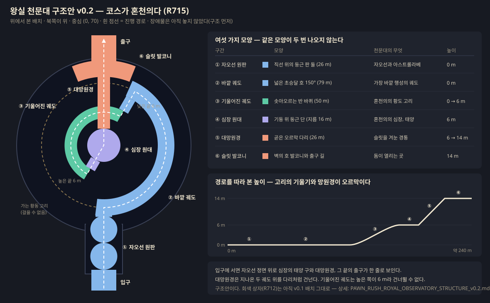

# 왕실 천문대 구조안 v0.2 — 코스가 혼천의다

2026-11-19 · R715 · 사용자 피드백으로 Claude가 다시 잡은 구조. [레벨 디자인 v0.1](PAWN_RUSH_ROYAL_OBSERVATORY_DESIGN_v0.1.md)의 배치를 대신할 안이다.

> **R716(11-19): 버린 안이다.** 사용자 "이 구조는 너무 대계단하고 비슷해. 천문대만의 구조가 필요해." 가운데를 돌며 오르는 뼈대가 대계단의 나선과 같았다 → [구조안 v0.3 — 별자리 둘, 천구 하나, 망원경 하나](PAWN_RUSH_ROYAL_OBSERVATORY_STRUCTURE_v0.3.md).

> **구조안만 있다.** 장애물은 아직 놓지 않았다(사용자: "장애물보다 구조적인게 먼저야"). 회색 상자(R712, `RoyalObservatoryBuilder`)는 v0.1 배치 그대로이고, 이 구조가 정해지면 다시 짓는다. 사용자 검수 전.

## 무엇이 바뀌나

| 피드백 | v0.1 | v0.2 |
| --- | --- | --- |
| "지금 너무 코스가 단조로워" | 직사각형 바닥과 곧은 다리를 직각으로 이은 길. 비트마다 장치는 달라도 모양은 같다 | 여섯 구간의 모양이 모두 다르다: 둥근 판 둘, 넓은 호, 솟아오르는 반 바퀴, 기둥 위 원대, 곧은 오르막, 벽의 호 발코니 |
| "단순히 ㄷ자만 반복되는 코스 말고" | 북 → 동 → 북 → 서 → 북 → 동 → 북으로 꺾는 ㄷ자의 반복 | 직각으로 꺾는 곳이 없다. 직선은 자오선과 대망원경 둘뿐이고 나머지는 궤도를 따라 돈다 |
| "대계단처럼 컨셉에 맞춘 모형으로" | 천문대의 물건(망원경, 천구의)을 장치의 겉모습으로만 썼다 | **코스의 생김새가 혼천의다.** 바깥 궤도에서 안쪽 궤도로 들어가 심장에 닿고, 대망원경을 타고 돔의 슬릿으로 나간다 |
| "장애물보다 구조적인게 먼저야" | 장치 스물여섯 개를 먼저 놓고 바닥으로 이었다 | 구조만 정한다. 장치는 구조가 정해진 뒤에 얹는다(아래 '장치는 나중에') |

대계단 현관홀이 왕궁 계단 홀의 실제 순서(현관 → 포이어 → 대계단 → 계단참 → 발코니)를 따른 것처럼, 천문대는 혼천의와 천문대 건물의 실제 부분을 따른다.

## 여섯 구간

중심은 (0, 70), 각도는 동쪽이 0°이고 북쪽으로 돌며 잰다(남쪽 −90°, 북쪽 90°). 좌표는 구간 로컬(x 동쪽, y 높이, z 북쪽, 원점 = 입구 문턱).

| 구간 | 모양 | 천문대의 무엇 | 자리 · 크기 | 높이 | 길이 |
| --- | --- | --- | --- | --- | --- |
| 입구 터널 | 곧은 통로 | 남쪽 문 | x −6\~6, z 0\~10 | 0 | 10 m |
| ① 자오선 원판 | 직선 위에 나란한 둥근 판 둘 | 바닥의 자오선과 아스트롤라베 판 | 중심 (0, 16.5) · (0, 29.5), 반지름 6.5 | 0 | 26 m |
| ② 바깥 궤도 | 넓은 초승달 호 | 가장 바깥 행성의 궤도 | 반지름 26\~34(폭 8), −90° → 60°(남 → 동 → 북동) | 0 | 79 m |
| 살 | 짧은 곧은 다리 | 궤도를 잇는 살 | 60° 방향, 반지름 19\~26 | 0 | 7 m |
| ③ 기울어진 궤도 | 솟아오르는 반 바퀴 | 혼천의의 기울어진 황도 고리 | 반지름 13\~19(폭 6), 60° → 240°(북동 → 북 → 서 → 남서) | 0 → 6 | 50 m |
| 살 | 짧은 곧은 다리 | | 240° 방향, 반지름 8\~13 | 6 | 5 m |
| ④ 심장 원대 | 기둥 위 둥근 단 | 혼천의의 심장, 머리 위의 태양 구 | 중심 (0, 70), 반지름 8 | 6 | 약 14 m |
| ⑤ 대망원경 | 곧은 오르막 다리 | 슬릿을 겨눈 망원경의 경통 | x −3\~3, z 78\~103 | 6 → 14 | 26 m |
| ⑥ 슬릿 발코니 | 벽의 호 발코니와 출구 길 | 돔이 열리는 슬릿 아래 | 반지름 33\~41, 68°\~112° + 출구 길 z 110.5\~123 | 14 | 약 20 m |

- 경로 약 240 m, 높이 0 → 14 m. 입구 (0, 0, 0), 출구 (0, 14, 123), 둘 다 북쪽을 본다.
- 홀은 지름 84 m 원형(돔)이고 남쪽에 원판 둘이 놓이는 전실이 붙는다. 길 아래 18 m가 허공이다.
- 바깥 궤도의 나머지 둘레는 걸을 수 없는 가는 황동 고리로 이어 원을 완성한다.
- 기울어진 궤도의 높이는 3 × (1 − cos(각도 − 60°)) m다. 가장 가파른 곳이 약 11°로 그냥 걸어 오른다.
- 대망원경의 기울기는 약 18°(25 m에 8 m)다. 코스의 경사 한도 19.5° 안이다.

## 구조가 하는 일

- **입구에서 출구가 정면 위로 보인다.** 자오선 위에 서면 원판 둘, 심장의 태양 구, 대망원경, 그 끝의 슬릿과 출구가 한 줄이다. 정면으로는 갈 수 없고 궤도를 돌아야 한다.
- **길이 길 위를 건넌다.** 대망원경은 지나온 기울어진 궤도와 바깥 궤도의 북쪽 위를 다리처럼 지나간다(궤도 위 6 ~ 14 m). 오르는 사람이 아래의 뒤처진 사람을 내려다본다.
- **기울기가 지름길을 막는다.** 기울어진 궤도는 남쪽이 5 ~ 6 m 높아서 바깥 궤도의 출발 쪽에서 건너뛸 수 없다. 낮은 끝(북동쪽)에서만 들어간다. 벽이나 울타리 없이 구조가 순서를 지킨다.
- **계단도 승강기도 없이 오른다.** 높이 14 m를 고리의 기울기(6 m)와 망원경(8 m)으로 오른다.
- **모양마다 움직임이 다르다.** 좁은 곧은 길, 넓게 휘는 길, 안쪽으로 기울며 솟는 길, 사방이 트인 원대, 내려다보이는 오르막.

대계단 현관홀과 겹치는 점은 "가운데를 돌며 오른다"는 것이다. 다른 점은, 대계단은 한 줄기 나선 계단이고 천문대는 높이가 다른 동심 고리 셋을 살로 이은 뒤 곧은 망원경으로 빠져나간다는 것이다.

## 컨셉 아트의 것들이 갈 자리

컨셉 아트의 요소는 버리지 않고 구조 위에 얹는다. 어느 장치를 어떻게 쓸지는 다음 단계다.

| 컨셉 아트에서 | 놓일 자리(후보) |
| --- | --- |
| 금 고리 장치 둘 | ① 원판 둘 위 — 판마다 도는 자(막대) |
| 별 무늬 벨트, 금빛 반원 방패 | ② 바깥 궤도 — 궤도가 폰을 싣고 흐르는 구간, 궤도를 가로막는 방패 |
| 금 부채와 바람 | ② 바깥 궤도의 동쪽, 또는 살 다리 |
| 황동 기둥 위의 남색 발판(행성 승강대) | 살 자리 — 다리 대신 궤도 사이를 도는 행성 발판을 타고 건너기 |
| 팔 끝의 천구 | ③ 기울어진 궤도를 쓸고 지나가는 회전팔, ④ 심장 원대 |
| 큰 망원경 | ⑤ 대망원경 자체. 그 등 위의 밀대나 보조 망원경 |
| 징 박힌 등반벽 | ⑥ 발코니로 오르는 마지막 단, 또는 뺀다 |
| 계단과 보라 커튼 아치 | ⑥ 출구 |

## 정할 것

1. **이 구조로 갈지.** 맞으면 회색 상자를 이 구조로 다시 짓는다(휘는 바닥과 기울어진 고리라 빌더를 새로 쓴다).
2. **바깥 궤도를 도는 방향.** 지금은 동쪽으로 돈다(남 → 동 → 북동). 서쪽으로 뒤집어도 같다.
3. **크기.** 홀 지름 84 m, 높이 14 m, 경로 240 m. v0.1(272 m)보다 짧다. 더 길게 하려면 바깥 궤도의 호를 늘리거나(150° → 210°) 궤도를 하나 더 둔다.
4. **등반벽.** 구조에서는 뺐다. 넣는다면 발코니 앞의 마지막 단이다.

## v0.1에서 그대로 가져가는 것

체크포인트는 구간이 바뀌는 어귀마다 둔다는 원칙, 낙사와 실패 비용의 수위, [비트별 의도와 예상 행동](PAWN_RUSH_ROYAL_OBSERVATORY_BEHAVIOR_v0.1.md)에서 나온 걱정(먼저 온 사람의 문지기, 기다리는 쪽이 손해인 장치)은 장치를 얹을 때 다시 쓴다. 새 장치 `TelescopeRam`과 구간 목록의 초안 칸도 그대로 쓴다.
