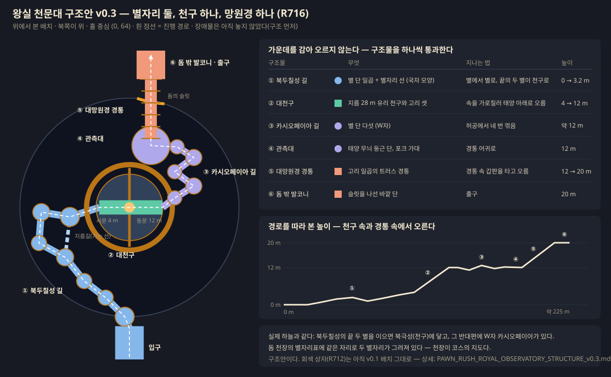

# 왕실 천문대 구조안 v0.3 — 별자리 둘, 천구 하나, 망원경 하나

2026-11-19 · R716 · 사용자 피드백과 참고 사진 세 장으로 Claude가 다시 잡은 구조. [구조안 v0.2](PAWN_RUSH_ROYAL_OBSERVATORY_STRUCTURE_v0.2.md)를 대신한다.

> **구조안만 있다.** 장애물은 아직 놓지 않았다. 회색 상자(R712, `RoyalObservatoryBuilder`)는 v0.1 배치 그대로이고, 이 구조가 정해지면 다시 짓는다. 사용자 검수 전.

> **R717(11-19): 이 구조에 얹을 장애물을 따로 기획했다** → [새 장애물 기획 v0.1](PAWN_RUSH_ROYAL_OBSERVATORY_OBSTACLES_v0.1.md)(변광성 · 유성우 · 혜성 · 월식 문 · 행성 궤도 · 쌍성 · 조리개 문 · 초점 광선). 아래 '컨셉 아트의 것들이 갈 자리'의 후보는 그 문서가 대신한다.

## 무엇이 바뀌나

| 피드백 | v0.2 | v0.3 |
| --- | --- | --- |
| "이 구조는 너무 대계단하고 비슷해" | 동심 궤도를 따라 가운데를 돌며 오른다 — 대계단 홀의 나선과 같은 뼈대 | 가운데를 감지 않는다. 서쪽으로 휘는 별자리, 한가운데의 천구 속, 동쪽의 지그재그 별자리, 북쪽의 망원경 속을 **차례로 통과**한다 |
| "천문대만의 구조가 필요해" | 고리와 다리 — 다른 방에도 있을 수 있는 모양 | 별자리, 천구, 망원경, 별자리표 돔. 천문대에만 있는 것으로 길을 지었다 |
| "별, 망원경, 구형 구조물 등 조금 더 자세히" | 망원경은 경사로 하나, 구는 장식 | 별 단 열두 개, 속을 지나가는 지름 28 m 유리 천구, 속을 오르는 트러스 경통을 부품과 치수까지 정했다 |

### 참고 사진에서 가져온 것

사진은 저장소에 넣지 않았다(남의 그림이다). 무엇을 가져왔는지만 적는다.

| 사진 | 가져온 것 |
| --- | --- |
| 별자리 돔 아래 나무 받침의 행성의(천장에 별자리 격자, 가운데 빛나는 태양 등과 팔 끝의 행성) | 천장의 별자리표, 천구 속의 태양 등과 궤도를 도는 행성 |
| 금 고리에 싸인 거대한 유리 천구(세로 · 가로 고리, 계단형 받침, 둥근 창의 홀) | 대천구의 생김새: 유리 구, 자오선 고리와 지평 고리, 3단 받침, 둥근 홀 |
| 만화풍 천문대 방(별자리 돔과 열린 슬릿, 둥근 단 위 포크 가대의 금빛 망원경, 태양 무늬 바닥) | 관측대의 태양 무늬 둥근 단과 난간, 포크 가대, 슬릿을 겨눈 망원경, 슬릿으로 보이는 하늘 |

## 뼈대 — 하늘을 그대로 옮겼다

실제 밤하늘에서 **북두칠성**의 끝 두 별을 이어 늘이면 **북극성**에 닿고, 북극성 건너편에 W자 **카시오페이아**가 있다. 코스가 그 배치다.

1. 입구에서 **북두칠성**의 일곱 별을 차례로 밟는다(홀의 서쪽).
2. 마지막 두 별을 잇는 선이 그대로 뻗어 홀 한가운데의 **대천구**(북극성)에 닿는다. 천구 속을 가로질러 오른다.
3. 천구의 반대편으로 나와 **카시오페이아**의 다섯 별을 W자로 건넌다(홀의 동쪽, 높이 12 m).
4. **대망원경**의 관측대에 닿아 경통 속을 타고 올라, 돔의 슬릿을 뚫고 **돔 밖**으로 나간다.

돔 천장의 별자리표에는 같은 자리에 북두칠성과 카시오페이아, 한가운데 북극성이 그려져 있다. 천장이 코스의 지도다.

## 구조물

좌표는 구간 로컬(x 동쪽, y 높이, z 북쪽, 원점 = 입구 문턱). 홀은 중심 (0, 64) 반지름 46 m 원형이고 길 아래 18 m가 허공이다.

### ① 북두칠성 길 (높이 0 → 3.2 m, 약 90 m)

별 단 일곱 개를 **별자리 선**(다리)으로 이었다. 별은 밝기에 따라 크기가 다르고 높이도 제각각이다.

| 별 | 자리 (x, z) | 지름 | 높이 |
| --- | --- | --- | --- |
| 1 (손잡이 끝) | (−2, 18) | 8 m | 0 |
| 2 | (−10, 26) | 6.4 m | 0.8 |
| 3 | (−19, 33) | 6.4 m | 1.8 |
| 4 (국자 시작) | (−27, 43) | 7.2 m | 2.4 |
| 5 | (−38, 49) | 6.4 m | 1.2 |
| 6 | (−37, 62) | 7.2 m | 2.2 |
| 7 (국자 끝) | (−25, 60) | 8 m | 3.2 |

- **별 단:** 둥근 단 위에 금빛 다섯 꼭지 별 무늬, 가장자리에 황동 테. 가는 황동 기둥 하나가 홀 바닥까지 내려가고 단 아래에 작은 고리가 달렸다(받침대 위의 천구의처럼). 기둥 하나로 허공에 선 것이 이 길의 인상이다.
- **별자리 선:** 폭 3 m 다리. 별의 높이가 달라 완만하게 오르내린다.
- **국자를 닫는 선:** 4번과 7번을 바로 잇는 폭 1.5 m의 가는 선. 5 · 6번을 건너뛰는 지름길이다(약 17 m 대 37 m). 좁은 만큼 위험하게 만들 자리다.
- **가리키는 선:** 6번에서 7번으로 가는 방향이 그대로 천구의 서쪽 문으로 이어진다(7번 → 서문, 폭 3 m, 높이 3.2 → 4 m).

### ② 대천구 (높이 4 → 12 m, 속 오르막 28 m)

홀 한가운데 (0, 64)의 **지름 28 m 유리 천구**. 중심 높이 10 m(바닥 −4 m, 꼭대기 24 m).

- **겉:** 별과 경위선이 새겨진 유리. 세로 **자오선 고리**(지름 33 m, 남북 방향), 가로 **지평 고리**(반지름 17 ~ 19 m, 높이 10 m), 기울어진 **황도 고리**가 감싼다. 고리는 걷는 길이 아니다.
- **받침:** 홀 바닥에서 올라오는 3단 기단과 북(반지름 13 → 10.5 → 7 → 4.5 m), 단마다 황동 띠.
- **문:** 서문(높이 4 m, 북두칠성에서)과 동문(높이 12 m, 카시오페이아로). 둥근 황동 문틀.
- **속:** 서문에서 동문까지 천구 속을 **곧게 가로지르는 오르막**(폭 6 m, 길이 약 28 m, 기울기 약 17°). 한가운데 위에 **태양 등**(지름 4.4 m)이 걸려 있고 오르막은 그 아래를 지난다. 태양 둘레를 **행성 넷**이 저마다 기울어진 궤도로 돌며 오르막 위를 가로지른다.
- 유리라서 밖에서 속이, 속에서 밖이 보인다. 따라가는 카메라도 가리지 않는다.

### ③ 카시오페이아 길 (높이 약 12 m, 약 45 m)

별 단 다섯 개가 **W자**로 놓였다. 높이 12 m의 허공이라 기둥이 길다.

| 별 | 자리 (x, z) | 지름 | 높이 |
| --- | --- | --- | --- |
| 1 | (19, 68) | 6 m | 12 |
| 2 | (27, 73) | 6.8 m | 11.2 |
| 3 | (19, 79) | 6 m | 12.6 |
| 4 | (27, 85) | 6.8 m | 11.6 |
| 5 | (20, 89.5) | 6 m | 12.2 |

천구의 동문에서 첫 별로, 다섯째 별에서 관측대로 폭 3 m 선이 이어진다. 네 번 꺾는 동안 발아래로 북두칠성 길과 뒤따르는 사람이 보인다.

### ④ 관측대와 ⑤ 대망원경 (높이 12 → 20 m)

- **관측대:** 중심 (9, 90), 지름 16 m 둥근 단(높이 12 m). 바닥에 열두 빛살 태양 무늬, 둘레에 황동 난간(경통 어귀만 트임). 굵은 기둥 하나가 홀 바닥까지 내려간다.
- **포크 가대:** 경통 양옆의 두 팔(높이 약 9 m)과 축. 경통이 여기에 걸려 있다.
- **경통:** 고리 일곱 개(렌즈 틀)를 살로 이은 **트러스 경통**. 길이 약 26 m, 지름 7.4 m, 기울기 약 18°. 뼈대뿐이라 속이 다 보이고 카메라가 가리지 않는다. 속에 폭 5 m **갑판**이 깔려 있어 관측대(z 93, 높이 12)에서 위 끝(z 118, 높이 20)까지 걸어 오른다. 고리를 하나씩 지난다.
- **부품:** 아래 끝의 접안부, 옆구리의 보조 망원경(길이 9 m), 위 끝의 큰 대물 고리.
- 경통의 위 끝은 **돔의 슬릿**(홀 벽 z ≈ 109)을 뚫고 밖으로 나가 있다.

### ⑥ 돔 밖 발코니와 돔

- **발코니:** 경통 끝에서 이어지는 12 × 12 m 단(높이 20 m), 난간. 출구 (9, 20, 130), 북쪽을 본다.
- **돔:** 반지름 46 m 반구(벽 위 14 m에서 시작, 꼭대기 60 m). 안쪽은 경위선 격자와 별이 그려진 **별자리표**. 북북동에 폭 약 11 m **슬릿**이 벽 위까지 열려 하늘이 보이고 빛이 들어온다.

## 치수 요약

| 항목 | 값 |
| --- | --- |
| 홀 | 지름 92 m 원형, 허공 18 m, 돔 꼭대기 60 m |
| 경로 | 약 225 m, 한 줄(국자의 지름길 하나) |
| 높이 | 0 → 3.2(북두칠성) → 4 → 12(천구 속) → 약 12(카시오페이아 · 관측대) → 20(경통) m |
| 입구 / 출구 | (0, 0, 0) / (9, 20, 130), 둘 다 북쪽 |

## 구조가 하는 일

- **감아 오르지 않는다.** 높이는 두 번, 구조물의 **속**에서 오른다(천구 속 8 m, 경통 속 8 m). 그 사이는 허공의 별을 건넌다.
- **구간마다 발밑이 다르다.** 기둥 하나에 선 둥근 별 단, 좁은 선, 유리 구 속의 넓은 오르막, 뼈대만 있는 경통.
- **목표가 계속 바뀌어 보인다.** 북두칠성에서는 천구가, 천구 속에서는 태양이, 카시오페이아에서는 망원경이, 경통 속에서는 슬릿의 하늘이 정면에 있다.
- **지나온 길이 내려다보인다.** 카시오페이아와 경통은 북두칠성보다 9 ~ 17 m 높다.
- **건너뛸 수 없다.** 두 별자리는 높이가 9 m 넘게 다르고, 천구는 문이 둘뿐이다.

## 컨셉 아트의 것들이 갈 자리(후보)

장치는 구조가 정해진 뒤에 얹는다.

| 컨셉 아트에서 | 놓일 자리 |
| --- | --- |
| 금 고리 장치(회전 막대) | 큰 별 단(1 · 7번) 위 |
| 별 무늬 벨트 | 별자리 선 — 흐르는 선 |
| 금빛 반원 방패 | 천구의 문, 경통의 고리(렌즈 덮개처럼 여닫힘) |
| 금 부채와 바람 | 카시오페이아 길의 옆바람 |
| 남색 승강 발판 | 별 단 자체가 오르내리는 별(높이가 맞을 때 건넘) |
| 팔 끝의 천구 | 천구 속의 행성 — 오르막을 가로지른다 |
| 큰 망원경 | 대망원경. 보조 망원경이 밀대가 될 수 있다 |
| 징 박힌 등반벽 | 뺐다 |

## 정할 것

1. **이 구조로 갈지.** 맞으면 회색 상자를 이 구조로 다시 짓는다.
2. **높이 20 m.** v0.1(11.5 m)의 두 배 가깝다. 떨어지면 전부 낙사이므로 체크포인트를 별자리마다 둘 이상 두어야 한다.
3. **별 단의 난간.** 지금은 없다고 보고 그렸다. 난간 없이 좁은 선으로 이은 허공의 별은 그 자체로 어렵다 — 장치를 덜 얹어도 된다.
4. **국자의 지름길.** 둘지 뺄지.
5. **경통을 닫힌 관으로 할지.** 지금은 속이 보이는 트러스다. 닫힌 관이 더 망원경답지만 따라가는 카메라가 가린다.
