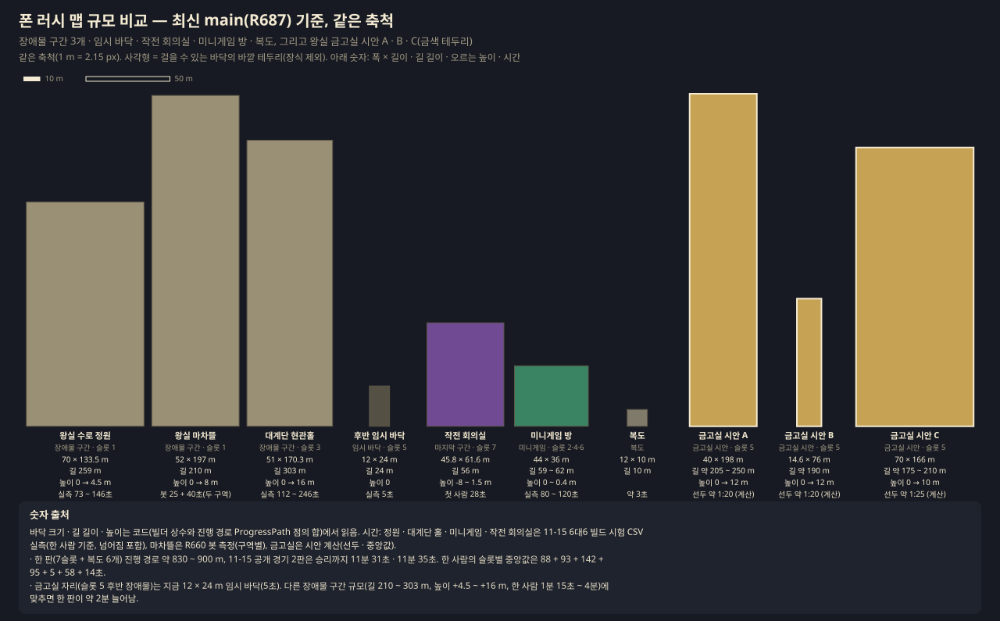
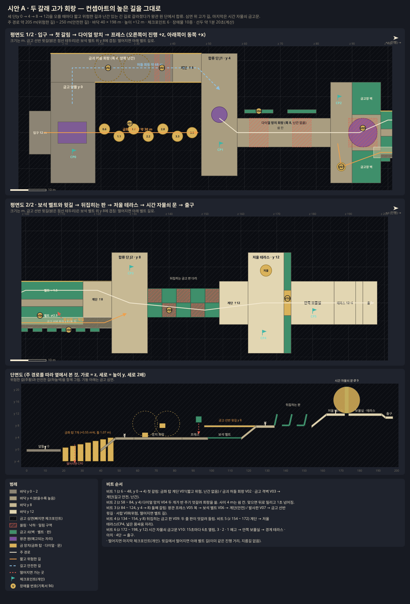
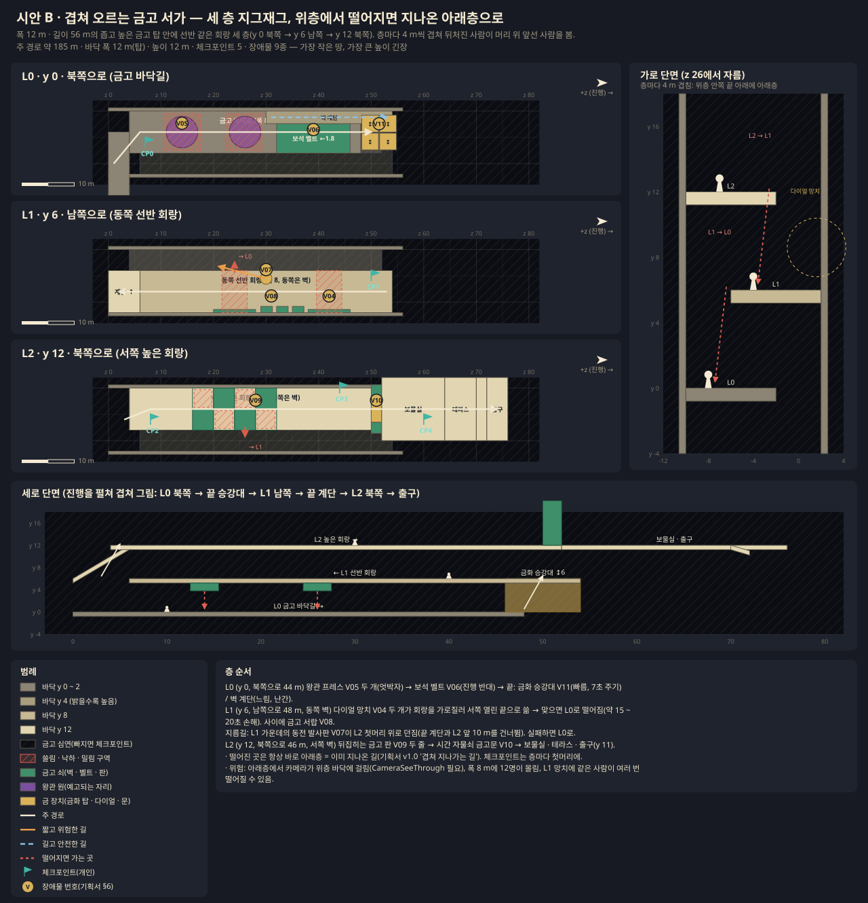
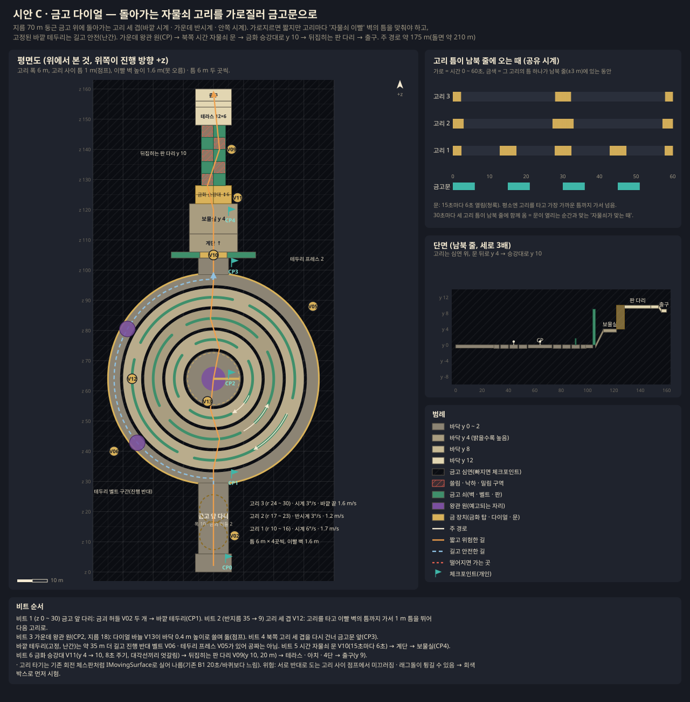

# 왕실 금고실 레벨 디자인 v0.1 — 후반 장애물 구간 시안 3개

> 2026-11-16 · 제안 문서(커밋하지 않음) · 최신 main `38f3f998`(R687) 기준 · 코드·프리팹은 바꾸지 않았다.
> 숫자는 코드에서 읽은 값, 11-15 빌드 시험 실측, 그리고 계산값이다. Unity에서 재 보지 않았다.
> 그림: [규모 비교](Mockups/R688_RoyalVault_Scale.svg) · [시안 A](Mockups/R688_RoyalVault_A.svg) · [시안 B](Mockups/R688_RoyalVault_B.svg) · [시안 C](Mockups/R688_RoyalVault_C.svg)

## 0. 한눈에

- **자리:** 금고실은 **슬롯 5 (후반 장애물)** 에 들어간다. 지금 이 자리는 12 × 24 m 임시 바닥이고, 실측 5초면 지나간다. 한 판에서 장애물 구간이 하나 비어 있는 셈이다.
- **규모 목표:** 다른 장애물 구간에 맞춘다.
  - 진행 경로 **200 ~ 260 m**, 높이 **+10 ~ +12 m**, 바닥 폭 **40 ~ 70 m**.
  - 체크포인트 **5 ~ 6**, 비트 **6**.
  - 시간: 선두 약 **1분 20초**, 한 사람 중앙값 약 **2분**. 지금 구간들의 실측 88 ~ 142초 사이이고, 후반이라 조금 더 어렵게 잡았다.
- **추천:** **시안 A (두 갈래 고가 회랑)** 를 바탕으로 간다. 이유는 셋이다.
  - 컨셉아트와 가장 닮았다.
  - 기존 장치로 가장 많이 지을 수 있다.
  - 사용자가 정한 "가깝고 어려운 길 / 돌아가도 쉬운 길"(P43)을 두 번 쓴다.
  - 여기에 시안 B의 "위층에서 떨어지면 지나온 아래층으로"를 윗길 한 곳에 얹었다(이미 넣음). 시안 C의 "열쇠가 맞는 때 열리는 금고문"도 마지막 문에 얹는다.
- **꼭 넣을 장애물 5:** 다이얼 망치(V04), 왕관 프레스(V05), 금화 탑 계단(V01), 뒤집히는 금고 판(V09), 시간 자물쇠 금고문(V10). 전체 목록은 §5.

## 1. 지금 폰 러시 맵의 규모 (최신 main R687)

### 1-1. 한 판의 구성

`PawnRushRound`가 7슬롯에서 한 구간씩 뽑아 잇는다. 구간과 구간 사이에는 복도 6개가 들어간다(길이 10 m, 걷는 폭 12 m, R517). 각 구간의 출구는 +z를 향한다.

| 슬롯 | 종류 | 후보 (`Assets/Settings/PawnRushSections.asset`) |
|---|---|---|
| 1 | 초반 장애물 | 왕실 수로 정원 · 왕실 마차뜰(둘 중 하나) |
| 2 | 초반 미니게임 | A 의장 광장 · C 해자 도개교 · D 쇠살문 누각 |
| 3 | 중반 장애물 | 대계단 현관홀 |
| 4 | 중반 미니게임 | B 동관 · E 서고 · F 무도회장 · J 나이트의 길(세탁장) |
| 5 | **후반 장애물** | **임시 바닥(12 × 24 m) — 금고실 자리** |
| 6 | 후반 미니게임 | G 행차 회랑 · H 체스 홀 · I 침실 |
| 7 | 마지막 구간 | 작전 회의실 |

### 1-2. 구간별 규모

진행 경로는 코드의 진행 경로 점(`ProgressPath`)을 따라 잰 3D 길이다. 시간은 11-15 6대6 빌드 시험의 구간 CSV에서 한 사람 기준으로 뽑았고, 넘어진 시간도 들어 있다.

| 구간 | 슬롯 | 걷는 바닥 (폭 × 길이) | 진행 경로 | 높이 | 길 폭 (가장 좁은 곳 / 보통) | 비트 · CP · 움직이는 장치 | 시간 |
|---|---|---|---|---|---|---|---|
| 왕실 수로 정원 | 1 | 70 × 133.5 m | **259 m** | 0 → 4.45 m (출구 2.8) | 2.4 / 8 m (광장 34) | 7 · 9 · 34 | 실측 73 · 75 · 101 · 146초 (넘어짐 0 ~ 2번) |
| 왕실 마차뜰 (R662) | 1 | 52 × 197 m | **210 m** | 0 → 8 m (출구 7) | 2.37 / 30 m | 19 · 6 · 17 | 봇 측정(R660): 구역 1 25초 · 구역 2 39.5초. 6대6 실측 없음 |
| 대계단 현관홀 | 3 | 51 × 170 m | **303 m** | 0 → 16 m (출구 15) | 1.8 / 3.5 m (넓은 곳 40) | 11 · 9 · 15 | 실측 112 · 121 · 164 · 246초 (넘어짐 3 ~ 6번) |
| 후반 임시 바닥 | 5 | 12 × 24 m | 24 m | 0 | 12 m | 1 · 1 · 0 | 실측 5초 |
| 작전 회의실 | 7 | 45.8 × 61.6 m | 56 m | −8 ~ 1.5 m | 3.4 / 30 m | 5 · 2 · 9 | 첫 사람 28초. 팀 과반이 들어갈 때까지 2 ~ 3분 더 |
| 미니게임 방 (10종이 같은 틀) | 2 · 4 · 6 | 44 × 36 m | 59 ~ 62 m | 0 ~ 0.4 m | 방마다 다름 | — | 실측 80 ~ 120초 |
| 복도 | 사이 6곳 | 12 × 10 m | 10 m | 0 | 12 m | — | 약 3초 |
| **한 판** | — | — | **약 830 ~ 900 m** | — | — | — | 11-15 공개 6대6 두 판: 승리까지 **11분 31초 · 11분 35초** |

한 사람의 슬롯별 실측 중앙값은 정원 88초, 미니게임 93초, 대계단 142초, 미니게임 95초, 임시 바닥 5초, 미니게임 58초, 작전 회의실 14초다. 합하면 약 640초다.

### 1-3. 읽은 것

1. **장애물 구간의 규모는 비슷하다.**
   - 진행 경로 210 ~ 303 m, 바닥 폭 50 ~ 70 m, 길이 130 ~ 200 m, 높이 +4.5 ~ +16 m다.
   - 높이는 중반인 대계단이 가장 높다(+16 m).
2. **시간은 넘어짐이 좌우한다.**
   - 같은 구간도 한 사람이 1분 15초에서 4분까지 벌어진다(대계단 112 ~ 246초).
   - 가장 오래 걸리고 가장 많이 떨어진 곳은 대계단의 유리 추측 다리다(한 판에 3 ~ 4번). 그곳에서는 온라인 화면 어긋남도 의심되었다.
3. **슬롯 5가 비어 있다.**
   - 지금 판은 장애물 2개 · 미니게임 3개 · 마지막 구간으로 11분 30초가 걸린다.
   - 금고실이 들어오면 약 2분이 늘어 **13분 남짓**이 된다. 기획서 v1.0의 "한 경기 8 ~ 10분"보다 길다. 이 부분은 결정해야 한다(§10).
4. **길 폭:** 주 통로는 6 ~ 12 m다. 대계단의 1.8 m 길은 v1.0의 "좁은 길도 2.4 m 이상" 규칙보다 좁다. 금고실은 **필수 길 2.4 m 이상, 주 통로 8 m**로 잡는다.
5. **이미 정해진 규칙** (기록과 사용자 피드백):
   - 옆으로 걸어서 피할 수 있는 장애물은 의미가 없다(R301 바람).
   - 시간 장치는 노출 시간이 충분해야 한다(R301 도개교).
   - 짝 장애물은 반 주기 엇갈려 둔다. 하나를 맞추면 다음이 공짜인 "초록불 물결"을 피한다(R301 · R680).
   - "피하기 너무 쉽고 너무 드물다"는 피드백으로 주기를 20 ~ 30% 줄였다(R679 11번 → R680). 예고 시간과 맞는 속도는 그대로 두었다.
   - 길이를 늘리면 사람이 흩어진다. 다시 모으는 장치(문 · 승강대)를 같이 둔다(R288 · R301 모형).
   - 타고 가야 하는 바닥이 뒤로 세게 밀면 안 된다(R518, 작전 회의실 벨트 역방향 제거).
   - 필수 장애물은 옆길로 건너뛰지 못하게 막는다(R653). 다만 **의도한 두 갈래**(P43: 가깝고 어려운 길 / 돌아가도 쉬운 길)는 남긴다.
   - 한 줄 길은 협동을 죽인다. 실패는 싸게 하고 착지는 너그럽게 한다(J 나이트의 길, R685 ~ R687).
   - 규칙은 체스처럼 읽혀야 한다(R687 "올라서면 잡힘").

### 1-4. 금고실이 맞출 규모

| 항목 | 목표 | 근거 |
|---|---|---|
| 진행 경로 | 200 ~ 260 m (안전한 길은 +20 ~ 25%) | 정원 259 · 마차뜰 210 · 대계단 303 m |
| 바닥 | 폭 40 ~ 70 m, 길이 130 ~ 200 m | 장애물 구간 3개 |
| 높이 | 0 → +10 ~ 12 m, 출구는 그보다 1 m 아래 | 마차뜰 +8, 대계단 +16. 후반은 "높은 곳 위 결정적 건넘" |
| 비트 · CP | 6비트, CP 5 ~ 6 (비트마다 하나) | 4분 코스 6비트 틀, 정원 CP 9 · 대계단 9 |
| 시간 | 선두 약 1:20, 한 사람 중앙값 약 2:00 | 실측 중앙값 88 ~ 142초, 후반이라 그 사이에서 위쪽 |
| 길 폭 | 필수 길 ≥ 2.4 m, 주 통로 8 m, 몸싸움 단 ≥ 28 m | v1.0, 6대6 |
| 틈 | 필수 길의 맨 점프 틈 ≤ 1.5 m (일부러 둔 틈은 표시) | 구간 검사 규칙 |
| 낙하 | 심연 → 마지막 체크포인트(지금 1.5초 뒤) | `KillVolume` 기본값. v1.0은 5초 |
| 입구 · 출구 | 입구 폭 12 m(복도), 출구는 +z · 12 × 6 m 테라스 · 12 m 아치 · 0.25 m 4단 · 입구 띠 | 구간 끝 규격(경계 도식) |

## 2. 컨셉아트에서 가져올 것

첨부 그림은 남서쪽 위에서 내려다본 3/4 시점이다. 길은 왼쪽 아래 출발에서 오른쪽 위 출구 아치로 오른다.

- **공간:** 여러 층의 거대한 금고 홀이다.
  - 길은 청록 기둥 위에 놓인 상아색 대리석 고가 길이고, 테두리는 금이다.
  - 아래는 금화 · 보물 상자 · 왕관이 쌓인 깊은 금고 바닥이다. 떨어지면 금고 아래로 간다.
- **벽:** 층층의 보물 선반, 벽에 박힌 둥근 초록 금고 문(가운데 금 왕관), 흰 룩 · 킹 문장의 보라 깃발, 금 나이트 머리 석상, 아치 창의 빛줄기, 샹들리에, 촛불.
- **색:** 상아 대리석 · 금 · 짙은 청록(금고 쇠) · 왕실 보라 · 호박색 빛.
- **폰:** 흰 몸에 빨강 · 파랑 목도리(두 팀).

| 순서 | 그림의 장면 | 레벨 디자인으로 읽으면 | 기존 장치 |
|---|---|---|---|
| 1 | 출발 단: 왕관 보라 카펫, 금 난간, 금 등불 | 넓은 출발 단 · CP | — |
| 2a | 낮은 길: 무릎 높이 금 막대 → 세워 둔 초록 금고 판 두 쌍 | 길고 안전한 길: 넘는 막대, 판 사이 통과 | 코스 회전 점프 막대, #06 미닫이 벽 / #09 시계 문 |
| 2b | 높이가 차례로 오르는 금화 탑 5개 (심연 위) | 짧고 위험한 길: 탑에서 탑으로 뛰어 오름 | 고정 발판 또는 #05 승강 타일 |
| 3 | 가운데 단: 바닥의 보라 왕관 원 | 합류 · CP | — |
| 4 | 세로로 선 둥근 금고 문 두 개, 금 망치 팔이 돌며 길을 쓺 | 엇박자 타이밍 장애물 두 개 | #04 회전 망치 |
| 5 | 초록 금고 블록, 옆 계단, 지붕 위 왕관 상자 | 윗길(높은 우회) | — |
| 6 | 금 틀에 사슬로 매단 왕관 상자, 아래 보라 왕관 원 | 예고 뒤 떨어지는 프레스 | #10 떨어지는 기물 · 마차뜰 크레인 |
| 7 | 에메랄드를 나르는 초록 벨트 두 줄 | 움직이는 바닥 | #08 컨베이어 |
| 8 | 길 끝에서 경첩으로 들리는 큰 초록 판 | 들렸다 내려오는 판 다리 | #12 들리는 다리 |
| 9 | 계단 → 금 저울 · 보물 상자 테라스 → 보라 커튼 아치 → 안쪽 보물실 | 마지막 오름과 출구 (경계 테라스 · 아치) | 구간 끝 규격 |

가져올 핵심은 다섯 가지다.
- **심연 위 높은 길**
- **아래에서 위로 오르는 진행**
- **두 갈래:** 금화 탑 대 일반 길, 금고 블록 지붕 대 바닥
- **금고 기계가 곧 장애물**
- **체스 상징:** 룩 · 킹 깃발, 나이트 석상, 흑백 기물 석상

## 3. 앞선 계획과의 관계

- **장소별 4분 코스 "3-2 왕실 금고실"**(PAWN_RUSH_PLACES_4MIN, 사용자 첨부 원문)은 6비트 35/40/45/40/45/35초 = 4분이다.
  1. 금화 더미 승강대 + 낮은 금 막대
  2. 금고 쌍문 + 반폭 격벽
  3. 다이얼 팔
  4. 점핑 발판 두 개 + 보물 선반 착지
  5. 왕관 보물함 낙하 + 보석 벨트 두 줄
  6. 들리는 다리
- 이 문서는 그 순서와 장치 번호를 거의 그대로 따른다. 바뀐 점은 셋이다.
  - **컨셉아트의 고가 길과 두 갈래**를 뼈대로 삼았다.
  - **지금 맵 규모와 실측 시간**에 길이를 맞췄다. 4분이 아니라 한 사람 중앙값 약 2분이다.
  - **그동안의 피드백**(옆으로 못 피함, 짝은 반 주기, 다시 모으는 문)을 넣었다.
- **R160 후반 A "02 금고"**: 황동 격자문(#09)이 엇갈려 열리고, 동전 문양 발사판(#02)이 다음 높은 단으로 던진다. #13 피스톤은 뺀다. 이 문서의 V07 · V10이 이것을 잇는다.
- **엔드게임 연구**(PAWN_RUSH_ENDGAME_RESEARCH): "도입부 두 갈래는 같은 위험의 장치로 재합류." 시안 A의 첫 갈림이 이 원칙을 따른다.

## 4. 추천하는 구조와 지형

1. **고가 길 + 심연.**
   - 바닥은 기둥 위 대리석 단이다. 아래 8 m 이상은 금화가 쌓인 금고 바닥(그림)이고, y −4에 낙하 판정을 둔다.
   - 떨어지면 마지막 체크포인트로 간다. 같은 진행 거리의 아래층 길이 있는 곳(윗길)에서는 그 길로 떨어진다(v1.0 "겹쳐 지나가는 길").
2. **세 단 오름.** y 0 → 4 → 8 → 12, 단마다 4 m다.
   - 계단은 0.25 m × 16단(경사면 8 m)이다.
   - 오름마다 짧고 위험한 길 하나, 길고 안전한 길 하나를 둔다. 두 길 모두 장애물이 있어 공짜 우회가 아니다(R653 · P43).
3. **합류 단 = 몸싸움 단 = CP.** 폭 28 ~ 36 m, 깊이 10 m다. 바닥 가운데에 보라 왕관 원을 둔다. 여기서 6대6이 다시 섞이고 밀치기가 일어나며, 피할 공간도 넉넉하다.
4. **길 폭.**
   - 주 통로 8 m, 윗길 3 m, 필수 다리 8 m(4 m 판 두 줄)다.
   - 난간: 안전한 길은 양쪽 1.1 m 금 난간, 위험한 길은 없음.
   - 넘어가면 안 되는 벽(금고장 · 문 벽 · 이빨 벽)은 **오를 수 없는 면**(`NoClimbSurface`)으로 한다. 폰은 벽을 탄다(B 동관 교훈).
5. **시야.**
   - 진행 방향 끝의 금고문과 저울 테라스가 출발 단에서 보이게 높이를 쌓는다.
   - 윗길과 위층은 아래에서 올려다보이게 반쯤 겹친다. 뒤처진 사람이 앞을 본다.
6. **다시 모으기.** 마지막 문은 15초마다 6초 열린다. 앞선 사람이 기다리는 사이 따라잡는다. 판 길이가 늘어난 만큼 흩어진 사람을 한 번 모은다.
7. **재질 · 소품.**
   - 상아 대리석 바닥, 금 테두리, 청록 기둥, 초록 금고 쇠, 보라 카펫, 금화 더미, 보물 상자, 왕관, 룩 · 킹 깃발, 나이트 석상.
   - 보물은 장식이거나 물리가 없는 효과다. 흩어지는 물리 동전은 쓰지 않는다(네트워크 · 성능).
8. **온라인.**
   - 모든 장치는 공유 장애물 시계(`ObstacleClock`)의 순수 함수로 움직이고, 방장이 보내는 상태가 없다.
   - 넉백은 판정하는 PC(오프라인 · 방장)에서 처리한다. 마차뜰 `YardImpact` · `IHitTurns` 방식으로 한 번 쳐서 한 번만 넘어뜨린다.
   - 저울처럼 몸무게로 바뀌는 상태 장치는 v0.1에 넣지 않는다. 유리 다리의 어긋남 의심을 되풀이하지 않기 위해서다.

## 5. 장애물 컨셉과 추천 목록

번호 V01 ~ V16은 이 문서 안의 이름이다. "기존"은 프로젝트에 이미 있는 장치나 패턴이다. 수치는 폰 실제 이동값으로 계산했다(달리기 2.5 · 질주 3.6 m/s, 점프 위 4.9 m/s, 공중 약 0.69초, 모서리 도움 0.2 m, 질주 점프 약 3.1 m, 다이빙 +3 m/s, 넘어짐 1초).

| 번호 | 이름 | 컨셉아트 | 동작 · 수치 | 예고 | 이기는 법 · 팀 | 기존 | 우선 |
|---|---|---|---|---|---|---|---|
| V01 | **금화 탑 계단** | 2b | 지름 3 m 금화 탑 7개가 한 칸씩 +0.55 m 오른다. 틈 1.07 m. 달리기 점프로 겨우, 질주 점프로 넉넉하다(0.55 m 오르는 점프는 약 0.56초 날고 1.4 m / 2.0 m 감). 난간이 없다. 어렵게 하려면 2 · 4 · 6번 탑을 ±0.3 m, 4초로 출렁이게 한다 | 탑 높이가 보임 | 리듬 점프. 탑 위는 한 명 자리라 서로 밀면 떨어진다 | 고정 충돌체 / #05 | **꼭** |
| V02 | 금괴 허들 | 2a | 반지름 3.8 m 낮은 금 막대(0.25 ~ 0.5 m)가 90°/초(4초에 한 바퀴)로 돈다. 두 개를 반대로 돌린다 | 막대가 보임 | 점프로 넘는다. 넘어지면 1초 | 정원 회전 점프 막대 | 있으면 좋음 |
| V03 | 금고 격벽 | 2a | 폭 4 m 반쪽 미닫이 판 두 장이 3초마다 열린 쪽을 바꾼다. 오를 수 없는 면 | 1초 전 판 위 등 | 열린 쪽으로 간다 | #06 미닫이 벽 | 있으면 좋음 |
| V04 | **다이얼 망치** | 4 | 지름 8 m 금고 다이얼 옆에서, 길 위 축(바닥 위 4.6 m)에 매단 4.2 m 팔 끝의 금 망치 머리(길이 방향 2.2 · 높이 1.4 · 폭 7.6 m)가 36°/초(10초에 한 바퀴)로 돈다. 바닥에서 몸 높이를 지나는 때는 한 바퀴에 약 2.8초. 아래에서는 뒤(−z)로 쓸어 앞으로 밀어 주지 않는다. 두 개는 반 주기(5초) 엇갈린다 | 다이얼 째깍 소리와 1초 전 종. 높이 든 망치가 보임 | 지나간 직후 따라 들어간다. 사이 4 m 쉼 칸. 맞으면 1초 넘어지고 약 3 m 밀림 | #04 회전 망치 | **꼭** |
| V05 | **왕관 프레스** | 6 | 왕관을 얹은 3 × 3 × 2 m 금고 상자가 폭 8 m 목에서 지름 8 m 왕관 원 위로 6초마다 4.4 m 떨어진다. 순서: 예고 1.2초 → 낙하 0.25초 → 멈춤 0.6초 → 올라감 1.5초. 지나갈 틈은 약 2.5 ~ 3초. 원 안에 있으면 넘어지고 원 밖으로 밀린다. 반지름 5.5 m까지 휘청 | 사슬 덜컹 + 원이 빛남(1.2초) | 올라간 직후 통과한다. 양옆 금고장 벽은 오를 수 없다 | #10 떨어지는 기물 · 마차뜰 크레인 상자(예고 1초 · 멈춤 0.7초) | **꼭** |
| V06 | 보석 벨트 | 7 | 폭 5 m 벨트 두 줄. 서쪽은 늘 −z로 1.5 m/s(질주하면 앞으로 2.1 m/s), 동쪽은 5초마다 ±2.5 m/s로 방향이 바뀐다 | 1초 전 굴대 등 깜빡임 | 동쪽이 유리할 때 갈아탄다. 뒤로 세게 밀지 않게 서쪽은 1.5 m/s로 한정(R518) | #08 컨베이어 | 있으면 좋음 |
| V07 | 동전 발사판 | R160 | 바닥의 동전 문양 판이 위 12 · 앞 4.5 m/s로 던진다. 약 1.3초 뒤 +4 m · 5.8 m 앞에 착지(계산). 4분 코스의 위 9 m/s로는 +2.9 m만 올라 모자람 | 판 테두리 빛 | 윗길 입구다. 착지 뒤 서랍을 피한다 | #02 점핑 발판 | 있으면 좋음 |
| V08 | 금고 서랍 | 새 | 윗길 동쪽 벽의 2.6 m 서랍이 0.5초에 2 m 나오고, 1초 머물렀다가 0.5초에 들어간다. 벽을 따라 1.5초 간격 물결 | 1초 전 서랍 손잡이 빛 | 서랍 사이 빈 칸에서 기다린다. 밀리면 아래 벨트 길로 4 m 떨어진다(지나온 길과 같은 진행 거리) | #03 왕복 밀대 / `Oscillator` | 있으면 좋음 |
| V09 | **뒤집히는 금고 판** | 8 | 4 × 4 m 판 다섯 장이 두 줄. 판마다 안쪽 끝이 6초마다 70°로 2초 들린다. 두 줄은 서로 반대 박자라 평평한 판이 늘 지그재그로 하나씩 이어진다 | 1초 전 판 테두리 등 | 내려온 판을 골라 지그재그로 간다. 들리는 판 위에 있으면 미끄러져 떨어진다 | #12 들리는 다리 | **꼭** |
| V10 | **시간 자물쇠 금고문** | 9 | 지름 9 m 둥근 문이 옆으로 굴러 15초마다 6초 열린다(평균 기다림 약 2.7초, 길면 9초) | 문 위 다이얼 3 · 2 · 1 + 종 | 앞 테라스(폭 28 m)에서 다시 모인다. 문 앞 밀치기 | 마차뜰 바깥 성문 `TimedGate` / #09 | **꼭** |
| V11 | 금화 승강대 | 4분 코스 1 | 3 × 3 m 판 2 × 2개가 2.5초에 6 m 올라가 1.5초 머물고, 2.5초에 내려와 1.5초 머문다(8초 주기). 대각선끼리 4초 엇갈림 | 판 높이가 보임 | 낮을 때 올라탄다. 놓치면 다음 판 | #05 승강 타일 | 있으면 좋음 |
| V12 | 자물쇠 고리 | 새(시안 C) | 폭 6 m 고리 세 겹이 시계 3 · 반시계 3 · 시계 6 °/초로 돈다(바깥 끝 1.2 ~ 1.7 m/s). 고리마다 1.6 m 이빨 벽에 6 m 틈 4곳. 30초마다 세 틈이 남북 줄에 함께 온다 | 다이얼 눈금 | 고리를 타고 가장 가까운 틈까지 가서 1 m 틈을 뛴다 | 코스 회전 체스판 · `IMovingSurface` | 시안 C만 |
| V13 | 다이얼 바늘 | 새 | 가운데 단에서 반지름 8.6 m 바늘이 0.4 m 높이로 30°/초 돈다 | 바늘이 보임 | 점프로 넘는다 | 회전 점프 막대 | 시안 C만 |
| V14 | 보물 수레 | 새 | 레일 위 3 m 수레가 길을 가로질러 6 m/s로 달린다. 레일마다 약 5초에 한 번 | 1초 전 종과 빨간 띠 | 수레가 지나간 뒤 건넌다 | 마차뜰 `StableCharger` | 나중 |
| V15 | 저울 다리 | 9 | 4 × 4 m 접시 두 개. 사람이 많은 쪽이 1.5 m 내려간다 | — | 팀원끼리 무게를 맞춘다 | 새 상태 장치(방장 상태) | 나중 (장식만) |
| V16 | 나이트 석상 도약 | 체스 | 석상이 L자로 뛰어 4 × 4 m 칸에 내려앉는다. 1초 전 금색 표시 | 내려앉을 칸이 빛남 | 표시 칸을 피한다 | #17 나이트 돌격 | 나중 |

**추천 목록 (먼저 만들 순서)**

1. **꼭:** V04 다이얼 망치 · V05 왕관 프레스 · V01 금화 탑 계단 · V09 뒤집히는 금고 판 · V10 시간 자물쇠 금고문. 컨셉아트의 얼굴이고, 다섯 모두 기존 장치를 고쳐 쓸 수 있다.
2. **있으면 좋음:** V06 보석 벨트 · V07 동전 발사판 + V08 금고 서랍(윗길 세트) · V02 금괴 허들 · V03 금고 격벽 · V11 금화 승강대.
3. **나중:** V12 자물쇠 고리(시안 C 전용, 물리 시험 먼저) · V13 다이얼 바늘 · V14 보물 수레 · V15 저울 다리 · V16 나이트 석상.

## 6. 시안 A — 두 갈래 고가 회랑 (추천)

**구조:** 컨셉아트의 고가 길을 그대로 옮겼다.
- 세 단(y 0 → 4 → 8 → 12)을 오를 때마다 짧고 위험한 길과 난간 있는 긴 길로 갈라지고, 왕관 원 합류 단에서 다시 만난다.
- 둘째 갈림의 윗길은 보석 벨트 위에 겹친다. 떨어지면 아래 길로 간다.
- 마지막은 시간 자물쇠 금고문이다.

| 비트 | z | 높이 | 무엇 | 장애물 | CP |
|---|---|---|---|---|---|
| 0 | 0 ~ 18.4 | 0 | 입구(12 m) → 금고 앞뜰 28 × 12 m, 보라 왕관 카펫 | — | CP0 |
| 1 첫 갈림 | 6 ~ 48 | 0 → 4 | 위험(약 30 m): 금화 탑 7개. 안전(약 68 m): 서쪽 금괴 허들 회랑(폭 8, 양쪽 난간) → 금고 격벽 → 계단 | V01 / V02 ×2 · V03 ×2 | — |
| 합류 J1 | 48 ~ 58 | 4 | 34 × 10 m 합류 단, 왕관 원 | — | CP1 |
| 2 | 58 ~ 84 | 4 | 다이얼 망치 회랑(폭 8, 난간 없음). 망치 두 개가 반 주기 엇갈리고, 사이 4 m 쉼 칸 | V04 ×2 | — |
| 3 둘째 갈림 | 84 ~ 124 | 4 → 8 | 안전: 왕관 프레스 목(폭 8, 양옆 금고장) → 보석 벨트 두 줄 → 계단. 위험: 동쪽 동전 발사판 → 금고 선반 윗길(y 8, 폭 3, 동쪽 벽 서랍). 윗길은 동쪽 벨트 위에 겹쳐 떨어지면 벨트 길로 감 | V05 · V06 ×2 / V07 · V08 | CP2 (z 86) |
| 합류 J2 | 124 ~ 134 | 8 | 28 × 10 m | — | CP3 |
| 4 | 134 ~ 154 | 8 | 뒤집히는 금고 판 다리(4 m 판 2줄 × 5장, 심연 위) | V09 | — |
| 5 | 154 ~ 172 | 8 → 12 | 계단 → 저울 테라스 28 × 10 m(금 저울 · 보물 상자 장식) | — | CP4 |
| 6 | 172 ~ 198 | 12 → 11 | 시간 자물쇠 금고문 → 안쪽 보물실 → 경계 테라스 12 × 6 · 아치 · 4단 → 입구 띠 | V10 | CP5 |

- **숫자:**
  - 바닥 40 × 198 m(x −24 ~ 16), 높이 +12 m, 출구 (0, 11, 198).
  - 진행 경로는 위험한 길만 고르면 약 205 m, 안전한 길만 고르면 약 250 m다.
- **시간(계산):**
  - 선두 약 1분 20초. 걷기 약 205 m를 평균 2.8 m/s로 약 73초, 기다림 약 9초(망치 · 프레스 · 문)를 더했다.
  - 한 사람 중앙값 약 2분. 넘어짐 2 ~ 3번, 한 번에 8 ~ 12초로 잡았다.
  - 안전한 길만 고르면 선두보다 약 25 ~ 30초 늦다.
- **재미 포인트:**
  - 갈림이 두 번이라 실력과 판단이 드러난다.
  - 합류 단마다 두 팀이 다시 섞여 밀치기가 일어난다(v1.0 "상대 3 · 4번째 주자를 막는 것이 핵심").
  - 윗길에서 아래 벨트로 떨어지는 장면이 뒤에서 보인다.
  - 마지막 문이 흩어진 사람을 한 번 모은다.
- **위험:**
  - 금화 탑 7개 연속 점프는 처음 해 보는 사람에게 어렵다(떨어지면 CP0, 약 6초). 실패율이 높으면 탑 높이 차를 0.45 m로 낮춘다.
  - 망치 머리가 폭 전체를 쓸어 기다리는 줄이 생긴다. 줄이 길면 회랑을 10 m로 넓힌다.
  - 발사판 착지 수치는 Unity에서 맞춰야 한다.
- **만들 것:**
  - 기존 장치 고쳐 쓰기: #04 · #10 · #12 · #08 · #02 · #06, 회전 점프 막대, `TimedGate`.
  - 새로 만들 것: 금고 다이얼 망치 외형, 서랍 벽, 굴러 열리는 둥근 문 외형, 금화 탑.
  - 기존 맵 빌더처럼 코드로 지을 수 있다.

## 7. 시안 B — 겹쳐 오르는 금고 서가

**구조:**
- 폭 12 m · 길이 56 m의 좁고 높은 금고 탑 안에 선반 같은 회랑 세 층이 지그재그로 쌓여 있다.
  - L0: y 0, 북쪽으로
  - L1: y 6, 남쪽으로
  - L2: y 12, 북쪽으로
- 층마다 4 m씩 겹친다. 위층 안쪽 끝에서 떨어지면 항상 바로 아래층, 즉 이미 지나온 길에 떨어진다(v1.0 "겹쳐 지나가는 길"을 구조 전체로 쓴 안).
- 대계단 홀의 둥근 나선과 달리 곧은 지그재그다.

| 층 | 진행 | 무엇 | 장애물 | CP |
|---|---|---|---|---|
| L0 금고 바닥길 | z 4 → 48, y 0 | 왕관 프레스 두 개(엇박자) → 보석 벨트(진행 반대 1.8 m/s) → 북쪽 끝 금화 승강대(빠름) 또는 서쪽 벽 계단(느림, 난간) | V05 ×2 · V06 · V11 | CP0 |
| L1 동쪽 선반 회랑 | z 54 → 6, y 6 | 동쪽 벽 다이얼에서 망치 두 개가 회랑을 가로질러 서쪽 열린 끝으로 쓴다. 맞으면 L0로 떨어진다(약 15 ~ 20초 손해). 사이에 서랍. 가운데 동전 발사판 = L2 첫머리로 가는 지름길 | V04 ×2 · V08 · V07 | CP1 |
| L2 서쪽 높은 회랑 | z 6 → 52, y 12 | 뒤집히는 금고 판 두 줄 → 시간 자물쇠 금고문 → 보물실 · 테라스 · 출구(y 11) | V09 · V10 | CP2 · CP3 · CP4 |

- **숫자:**
  - 탑 바닥 약 14.6 × 76 m(출구 포함), 높이 +12 m.
  - 진행 경로 약 190 m. 층 길이 44 · 48 · 46 m에 끝 오름과 출구를 더했다.
- **시간(계산):** 선두 약 1분 20초. 한 사람 중앙값 약 2분 10초로, 아래층으로 떨어지는 손해가 커서 A보다 길다.
- **재미 포인트:**
  - 땅이 가장 작고(성능 · 제작이 가볍다) 높이 긴장이 가장 크다.
  - 뒤처진 사람이 머리 위에서 앞선 사람을 계속 본다.
  - 위층에서 떨어지는 장면이 아래층 사람의 화면에 들어온다.
- **위험:**
  - 아래층에서 카메라가 위층 바닥에 걸린다. 층 사이 6 m에 `CameraSeeThrough`가 필요하다.
  - 폭 8 m 회랑에 12명이 몰린다.
  - 같은 사람이 L1 망치에 맞아 여러 번 아래층으로 떨어지면 좌절한다. 망치 앞에 난간 일부를 두는 쪽을 검토한다.
  - 갈림길이 약하다(승강대 / 벽 계단, 발사판 지름길 정도).
- **만들 것:** 층 구조는 단순하다(직사각 회랑 3개 + 끝 오름). 장치는 A와 같은 것을 쓴다.

## 8. 시안 C — 금고 다이얼

**구조:**
- 지름 70 m 둥근 금고 위에 돌아가는 고리 세 겹(V12)이 있다. 바깥은 시계, 가운데는 반시계, 안쪽은 시계 방향이다.
- 가로지르면 짧다. 다만 고리마다 1.6 m "자물쇠 이빨" 벽의 6 m 틈까지 고리를 타고 가서 1 m 틈을 뛰어야 한다.
- 고정된 바깥 테두리(난간)는 약 35 m 더 길다. 진행 반대 벨트와 프레스가 있어 공짜가 아니다.
- 가운데 왕관 원(CP, 다이얼 바늘 V13)을 지나 북쪽 고리를 다시 건넌다.
- 그 뒤 시간 자물쇠 문 → 보물실 → 금화 승강대(y 4 → 10) → 뒤집히는 판 다리 → 출구 순서다.

| 비트 | 무엇 | 장애물 | CP |
|---|---|---|---|
| 1 | 금고 앞 다리(폭 10, 금괴 허들 두 개) → 바깥 테두리 | V02 ×2 | CP0 · CP1 |
| 2 | 남쪽 고리 세 겹 건너기(또는 테두리로 돌기) | V12 / V06 · V05 | — |
| 3 | 가운데 왕관 원 지름 18 m, 다이얼 바늘 | V13 | CP2 |
| 4 | 북쪽 고리 세 겹 건너기 → 금고문 앞 | V12 | CP3 |
| 5 | 시간 자물쇠 문(15초마다 6초). 30초마다 세 고리 틈이 남북 줄에 함께 오는 때와 맞음 → 계단 → 보물실 y 4 | V10 | CP4 |
| 6 | 금화 승강대(y 4 → 10) → 뒤집히는 판 다리(y 10, 20 m) → 테라스 · 아치 · 4단 → 출구(y 9) | V11 · V09 | — |

- **숫자:** 바닥 70 × 166 m, 높이 +10 m. 진행 경로는 가로지르면 약 175 m(고리를 타고 틈까지 가는 거리 별도), 테두리로 돌면 약 210 m.
- **시간(계산):** 선두 약 1분 25초. 한 사람 중앙값 약 2분.
- **재미 포인트:**
  - "금고 자물쇠를 연다"는 컨셉이 장치 자체가 된다.
  - 장소가 다른 구간과 완전히 다르게 생겼다.
  - 30초마다 오는 "자물쇠가 맞는 때"가 판 전체의 박자를 만든다.
- **위험:**
  - 서로 반대로 도는 고리 사이 점프(상대 속도 약 2.4 ~ 2.6 m/s)에서 래그돌이 미끄러지거나 튈 수 있다. 회색 박스로 먼저 시험해야 한다.
  - 고리 위 폰을 실어 나르는 `IMovingSurface`가 6대6 온라인에서 매끄러운지 봐야 한다.
  - 이빨 벽을 오르지 못하게 해야 한다.
  - 새로 만들 것이 가장 많다.

## 9. 시안 비교

| | A 두 갈래 고가 회랑 | B 겹쳐 오르는 금고 서가 | C 금고 다이얼 |
|---|---|---|---|
| 구조 | 고가 길이 세 단으로 오르며 갈라졌다 합류 | 좁은 탑 안 세 층 지그재그 | 둥근 회전 고리 + 가운데 단 |
| 바닥 · 높이 | 40 × 198 m · +12 m | 14.6 × 76 m · +12 m | 70 × 166 m · +10 m |
| 진행 경로 | 205 ~ 250 m | 약 190 m | 175 ~ 210 m |
| 선두 / 중앙값(계산) | 1:20 / 2:00 | 1:20 / 2:10 | 1:25 / 2:00 |
| 두 갈래(P43) | 강함 (두 번) | 약함 | 중간 (가로지르기 / 테두리) |
| 겹쳐 지나가는 길 | 한 곳(윗길 → 벨트) | 구조 전체 | 없음 |
| 다시 모으기 | 금고문 | 금고문 | 금고문 + 고리 박자 |
| 컨셉아트 닮음 | 가장 높음 | 중간(선반 · 층) | 낮음(새 해석) |
| 새로 만들 것 | 적음 | 적음 | 많음 (회전 고리) |
| 가장 큰 위험 | 금화 탑 실패율, 망치 앞 줄 | 카메라 · 반복 낙하 좌절 | 회전 고리 물리 · 온라인 |
| 추천 | **1순위** | 2순위 (A의 윗길 겹침으로 일부 반영) | 3순위 (문 박자만 A에 반영) |

## 10. 결정할 것과 다음 단계

**결정할 것**

1. 어느 시안으로 갈지. 추천은 A이고, B의 겹친 윗길과 C의 문 박자를 함께 쓴다.
2. 구간 길이. 기획서 v1.0은 공용 구간 60 ~ 90초, 4분 코스 문서는 4분, 실측은 1분 15초 ~ 4분이다. 금고실 목표를 **한 사람 중앙값 약 2분**으로 잡을지 정한다. 한 판이 13분 남짓이 되는 것도 함께 정한다.
3. 낙하 뒤 부활 대기. 지금은 1.5초, v1.0은 5초다.
4. 저울(V15) · 자물쇠 고리(V12)처럼 새 상태 · 회전 장치를 넣을지. 온라인 위험이 있다.

**다음 단계 (고른 시안 하나)**

1. 맵 시험 장면(`Open Map Test`)에서 회색 박스로 짓는다. 기존 맵처럼 코드로 짓고, 장치는 `ObstacleClock` 순수 함수로 만든다.
2. 프로젝트 사본의 실제 물리 봇 12명(R660 방식)으로 잰다.
   - 구간 시간 분포, 비트별 낙하 횟수, 장애물마다 맞은 비율
   - 10 m 안에 혼자 있는 시간, 금고문 앞에서 다시 모이는 정도
3. 사람 6대6으로 해 본다.
   - 기획서 v1.0 지표: 첫 전직 팀 승률 60% 이하
   - 팀 첫 사람과 과반째 사람의 시간 차

## 11. 근거

- 규모: `Assets/Scripts/PawnRush/PawnRushRound.cs`(슬롯 · 시작 자리), `SectionCorridor.cs`, `RoyalWaterGardenBuilder*.cs`(진행 경로 41점), `RoyalCarriageYard*.cs`(R662, 진행 경로 19점), `GrandStairHall*` · `Mid_2-1_GrandStairHall.prefab`(진행 경로 59점), `Course01v4Builder.WarRoom*`, `MiniGameSectionBuilder`(방 틀 44 × 36 m).
- 실측: [빌드 시험 11-15](../Network/BUILD_TEST_2026-11-15.md)(구간 CSV), [왕실 마차뜰](ROYAL_CARRIAGE_YARD.md)(R660 봇).
- 기획: 폰 러시 기획서 v1.0(사용자 첨부 PDF), [장소별 4분 코스 3-2](PAWN_RUSH_PLACES_4MIN.md), [장애물 컨셉 R160 후반 A](PAWN_RUSH_OBSTACLE_CONCEPTS.md), [엔드게임 연구](PAWN_RUSH_ENDGAME_RESEARCH.md), [3페이즈 연구 묶음 ⑥](PAWN_RUSH_3PHASE_RESEARCH.md), [DECISIONS P43 · R653](../Project/DECISIONS.md).
- 그림 코드: `Tools/Blueprints/royal_vault.py`(시안 3장), `scale_figure.py` + `scale_data.json`(규모 비교), `blueprint_kit.py`, `md_to_html.py`(이 문서를 그림이 들어간 한 페이지로).
